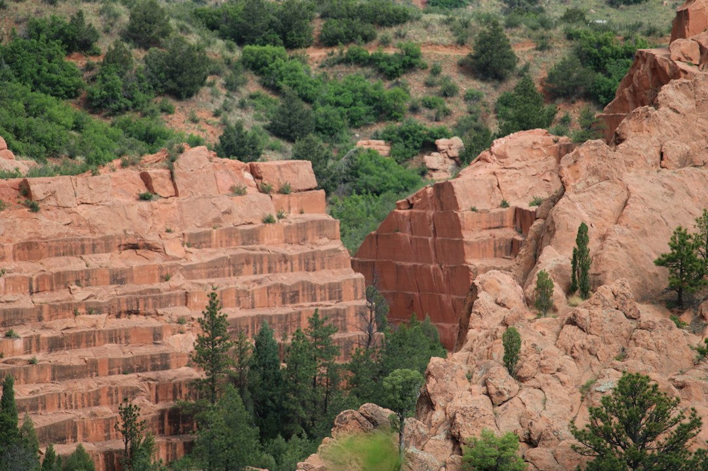
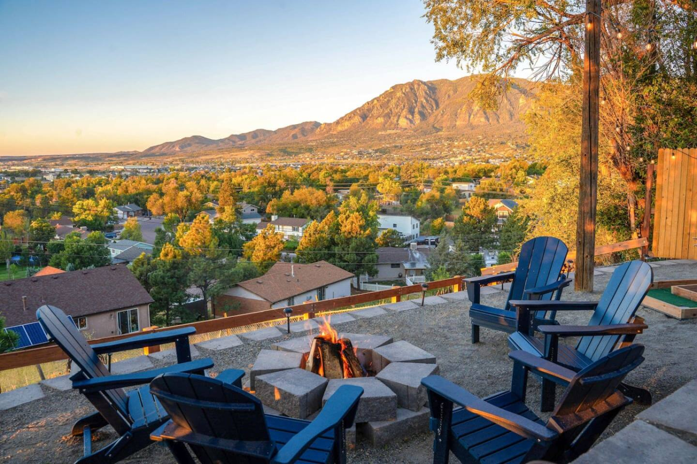
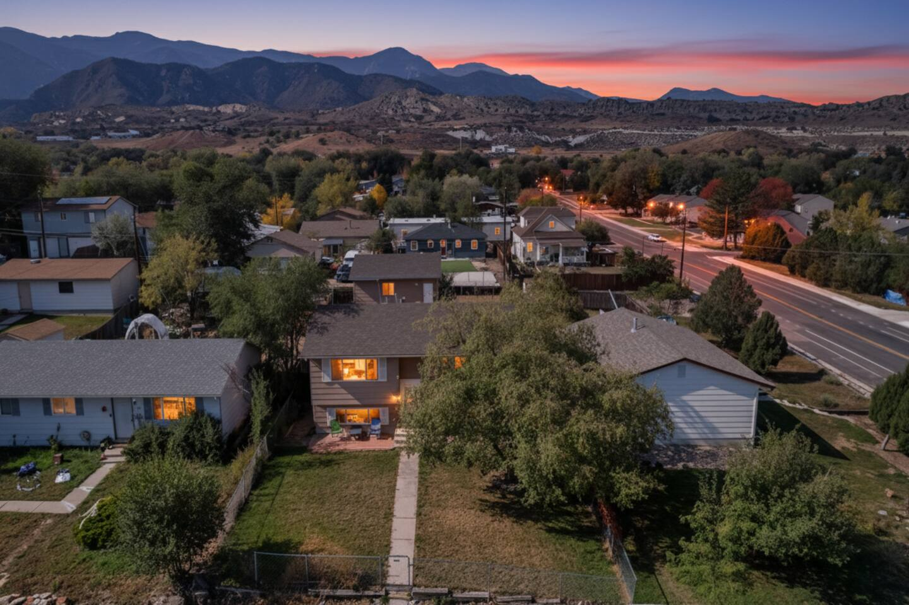
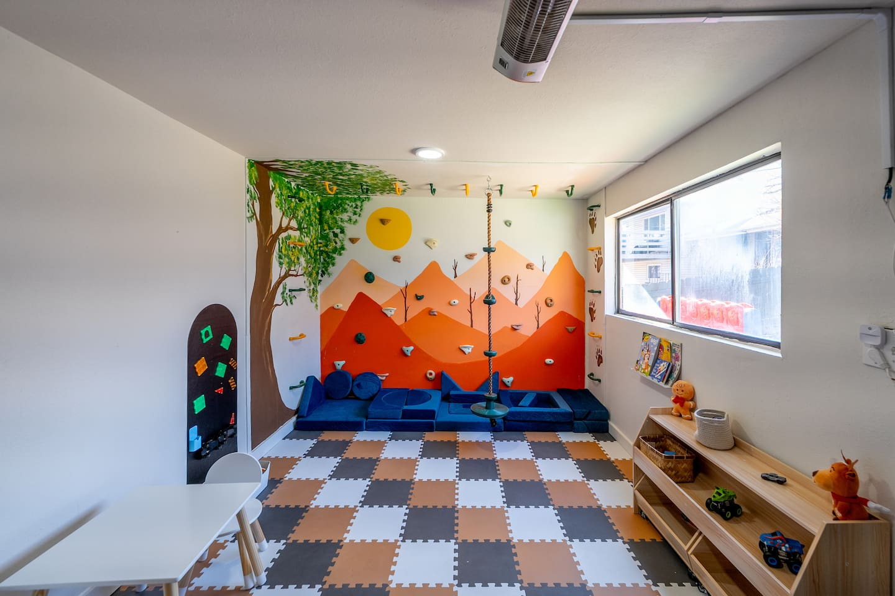
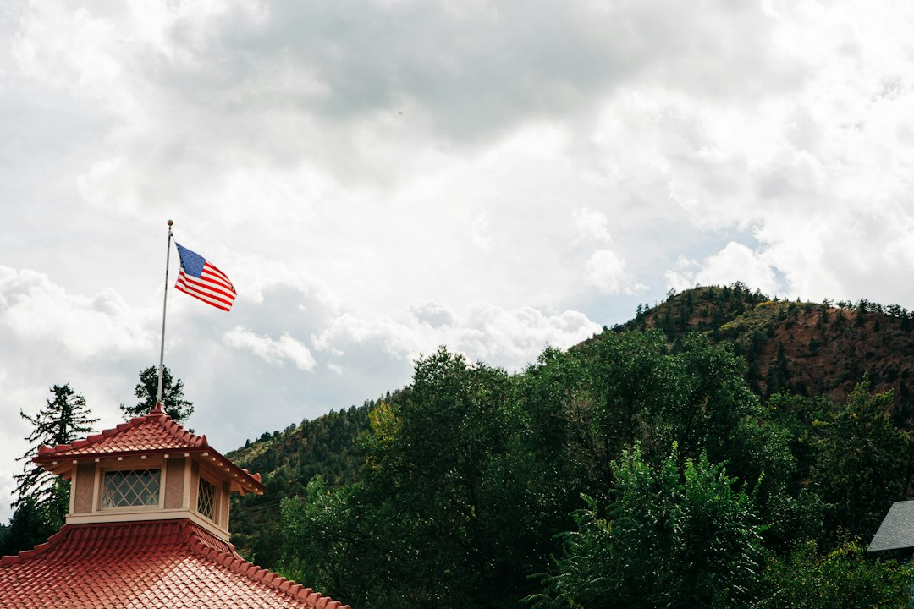
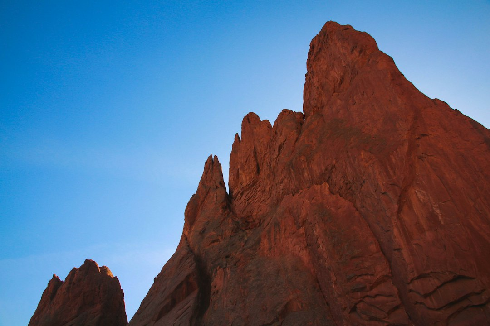
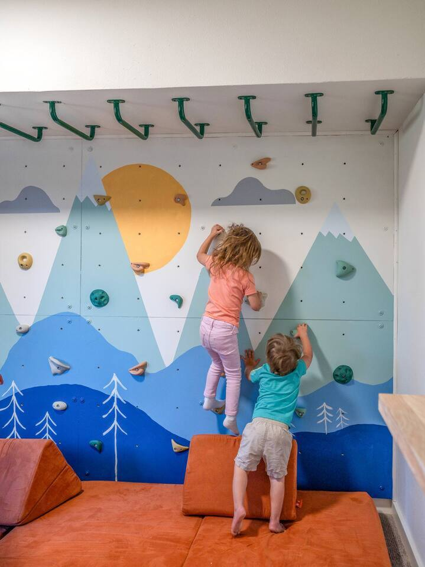
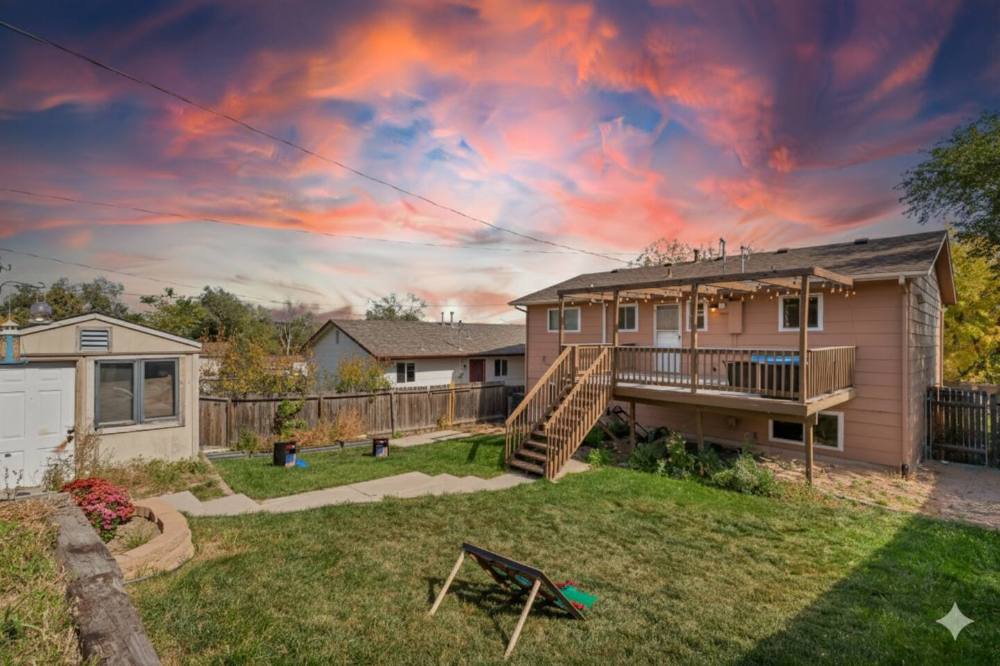

You’ve seen the photos of the Kissing Camels in Garden of the Gods and the summit sign on Pikes Peak. They’re incredible, no doubt. But the real soul of Colorado Springs, the stuff that makes us locals never want to leave, often lies just around the corner from the main attractions—minus the crowds and the parking nightmares.

If you want to experience the city beyond the postcards, this is your guide. We're talking about the places where you can get the same jaw-dropping views, thrilling adventures, and amazing food, but with a little more breathing room. Forget the top-ten lists for a second; let's dig into the underrated gems that will make your trip unforgettable.

### Table of Contents
- [Red Rock Canyon: Garden of the Gods' Wilder Cousin](#red-rock-canyon-garden-of-the-gods-wilder-cousin)
- [North Cheyenne Cañon Park: The Adventure Beyond Seven Falls](#north-cheyenne-cañon-park-the-adventure-beyond-seven-falls)
- [Palmer Park: A Mountain Escape in the Middle of the City](#palmer-park-a-mountain-escape-in-the-middle-of-the-city)
- [Manitou Incline Alternatives: Same Burn, Less Hassle](#manitou-incline-alternatives-same-burn-less-hassle)
- [Unique Museums That Aren't on Your Radar](#unique-museums-that-arent-on-your-radar)
- [Local Eats Off the Beaten Path](#local-eats-off-the-beaten-path)
- [Planning Your Colorado Springs Home Base](#planning-your-colorado-springs-home-base)
- [Frequently Asked Questions](#frequently-asked-questions)

---

## Red Rock Canyon: Garden of the Gods' Wilder Cousin

Everyone flocks to Garden of the Gods, and for good reason. It's a National Natural Landmark. But literally right across Highway 24 is Red Rock Canyon Open Space, a 1,474-acre park that offers a strikingly similar landscape of towering red rock fins and sandstone formations, but with a fraction of the people.

The secret here is the freedom. While Garden of the Gods has its paved paths and designated walkways, Red Rock Canyon feels more rugged and exploratory. It's a maze of interconnected trails perfect for hiking, trail running, and mountain biking. It's also incredibly dog-friendly (off-leash in a designated area!), which is a huge bonus.

### Local Tips for Red Rock Canyon
*   **Best Trail for Views:** The Contemplative Trail to the top of the main ridge. It's a short, steep climb, but the payoff is a panoramic view of Garden of the Gods with Pikes Peak looming behind it. It's one of the best photo ops in the city, and you'll likely have it all to yourself.
*   **For a Longer Hike:** Combine the Red Rock Rim Trail and the Hogback Valley Trail for a fantastic loop that showcases the park's diverse geology.
*   **Parking:** There are three main parking lots along Ridge Road just off of Highway 24. Even on a busy weekend, you can usually find a spot in the third (southernmost) lot. The main address to plug into your GPS is [3550 W High St, Colorado Springs, CO 80904](https://www.google.com/maps/search/?api=1&query=3550+W+High+St,+Colorado+Springs,+CO+80904).

This area on the west side of town, nestled between Old Colorado City and Manitou Springs, is the perfect launchpad for adventure. It gives you immediate access to this trifecta of parks without having to deal with I-25 traffic.

---

## North Cheyenne Cañon Park: The Adventure Beyond Seven Falls

Seven Falls is spectacular, but it's a ticketed attraction owned by The Broadmoor, and it can get packed. What many visitors don't realize is that Seven Falls is just one small part of the much larger, city-owned, and completely **free** North Cheyenne Cañon Park.

This 1,600-acre park is a local treasure. As you drive up North Cheyenne Canyon Road, the granite walls tower hundreds of feet above you, following the path of the creek below. There are dozens of trailheads, pull-offs for picnics, and scenic overlooks.

### Must-Dos in North Cheyenne Cañon
*   **Helen Hunt Falls:** Easily accessible right off the road, this beautiful waterfall is a must-see. You can take the short, steep trail up to the top of the falls for a different perspective. It's especially gorgeous in the winter when the falls freeze over.
*   **Starsmore Discovery Center:** Located at the park's entrance ([2120 S Cheyenne Cañon Rd](https://www.google.com/maps/search/?api=1&query=2120+S+Cheyenne+Cañon+Rd)), this is a great first stop to grab a trail map and learn about the area's geology and wildlife.
*   **Columbine Trail:** This is the main trail that follows the creek up the canyon floor. It's relatively flat and shaded, making it perfect for a leisurely family walk or a trail run.
*   **For the Ambitious Hiker:** Drive to the top of the canyon and hike to St. Mary's Falls. It's a moderate 6-mile out-and-back that rewards you with a stunning, multi-tiered waterfall far away from any crowds.

The drive itself is an activity. Winding up Gold Camp Road (the upper, unpaved section) provides some of the most stunning, unobstructed views of the city you can find anywhere.

For families or larger groups wanting to explore this southern part of the city, from the zoo to the canyon, having a comfortable place to return to is key. After a long day of hiking, a property like the **[Stunning Mountain Views, Hot Tub, Game Room](https://book.springlinestays.com/property/family-friendly-firepit-hottub-views-games)** home is an absolute dream. It sleeps up to 11 and lets you soak in a private hot tub while gazing at the very mountains you just explored.

---

## Palmer Park: A Mountain Escape in the Middle of the City

Tucked away in the center of Colorado Springs is Palmer Park, a geological anomaly that feels like a piece of the foothills was dropped right into the city. It's a local's favorite for quick after-work hikes, dog walks, and sunset viewing sessions.

Unlike the manicured city parks you might be used to, Palmer Park is a rugged landscape of arroyos, sandstone bluffs, and unique rock formations. The main road, Grandview Drive, winds its way up to an overlook that offers a 360-degree vista of the entire Pikes Peak region. It's arguably a better, more comprehensive city view than you get from many of the more famous spots.

### Exploring Palmer Park
*   **The Overlook:** Drive or hike to the top. The main overlook faces west, making it the absolute best place in town to watch the sunset paint the sky behind Pikes Peak.
*   **Templeton Trail:** A popular loop for mountain bikers and hikers that circles the base of the park's main rock formations.
*   **Find Your Own Adventure:** The best part of Palmer Park is the web of unmarked social trails. It’s a safe and fun place to let yourself get a little "lost" and scramble over rocks, discovering hidden canyons and balanced rocks along the way.
*   **Address for the top:** [3650 Maizeland Rd, Colorado Springs, CO 80909](https://www.google.com/maps/search/?api=1&query=3650+Maizeland+Rd,+Colorado+Springs,+CO+80909).

---

## Manitou Incline Alternatives: Same Burn, Less Hassle

The Manitou Incline is legendary: 2,744 steps gaining 2,000 feet of elevation in under a mile. It’s a bucket-list challenge, but it also requires a paid reservation, has strict rules, and can be relentlessly crowded. If you're looking for a serious workout with epic views but without the logistical headache, you have options.

### Local-Favorite Vertical Challenges
1.  **Section 16 / Palmer Loop Trail:** This trailhead is located in Bear Creek Cañon Park, just south of Old Colorado City. The first mile is a steep, quad-burning climb that rivals the Incline's intensity. Once you reach the ridge, you're rewarded with incredible views of Red Rock Canyon and the city. You can then continue on the much gentler Palmer Loop for a fantastic 6-mile circuit.
2.  **Mount Muscoco Trail:** Located in North Cheyenne Cañon Park (see, it all connects!), this 4-mile out-and-back trail is a steady, steep climb to a rocky summit. The final scramble to the top is a blast, and the 360-degree views are phenomenal, stretching from the city plains to the high peaks. It’s a true mountain summit experience without the 14er commitment.
3.  **Barr Trail (The First Few Miles):** The same trail used to summit Pikes Peak starts right next to the Incline's base. You can hike the first 2-3 miles of Barr Trail for a fantastic, challenging workout. The switchbacks are relentless, but the views of Manitou Springs and the canyon below are worth every step. Just turn around whenever you've had enough!

Choosing a home base close to the west side makes jumping on these trails a breeze. The **[Views | 2 mins to OCC | Fire Pit | Games | Pets](https://book.springlinestays.com/property/views-2-mins-to-occ-fire-pit-games-pets)** property is practically made for this. It's pet-friendly, sleeps 8, and is located just minutes from the Section 16 trailhead. After conquering a tough trail, you can come back and relax around the fire pit with an unbeatable view of Pikes Peak.

---

## Unique Museums That Aren't on Your Radar

Colorado Springs has a rich and quirky history that goes far beyond its pioneer roots. While the Pioneers Museum is great, there are a few other collections worth your time that offer a completely different slice of local and national culture.

*   **ProRodeo Hall of Fame & Museum of the American Cowboy:** ([101 Pro Rodeo Dr](https://www.google.com/maps/search/?api=1&query=101+Pro+Rodeo+Dr)) Even if you're not a rodeo fan, this place is fascinating. It's a beautifully curated museum dedicated to the history and heroes of the sport that is so deeply intertwined with Western culture. The sculpture garden and Hall of Champions are highlights.
*   **The ANA Money Museum:** ([818 N Cascade Ave](https://www.google.com/maps/search/?api=1&query=818+N+Cascade+Ave)) One of the coolest, most unexpected museums you'll ever visit. Run by the American Numismatic Association, this museum showcases the history of money, from ancient coins to modern currency. You can see priceless rarities, learn about minting, and marvel at incredible miniature engravings. It's a perfect rainy-day activity.
*   **Western Museum of Mining & Industry:** ([225 North Gate Blvd](https://www.google.com/maps/search/?api=1&query=225+North+Gate+Blvd)) Located on the north end of town, this museum provides a hands-on look at Colorado's mining history, which is the very foundation of the state. You can see massive, restored steam engines in action, try your hand at gold panning, and explore the 27-acre campus.

---

## Local Eats Off the Beaten Path

The dining scenes in Old Colorado City and Downtown are fantastic, but they can also be crowded. Some of the city's most beloved spots are a little more off-the-grid.

*   **Shuga's:** ([702 S Cascade Ave](https://www.google.com/maps/search/?api=1&query=702+S+Cascade+Ave)) Known for its quirky, global-inspired menu and cozy, eclectic vibe. The "Cafe Tray" featuring their famous spicy shrimp soup is a rite of passage. Their cocktail menu is inventive, and the atmosphere feels like you're hanging out in a well-traveled friend's living room.
*   **The Skirted Heifer:** ([204 N Tejon St](https://www.google.com/maps/search/?api=1&query=204+N+Tejon+St)) While this one is downtown, it's a small, order-at-the-counter joint that many visitors might walk right past. Don't. They serve burgers with a "skirt" of crispy, grilled cheddar cheese. It's a simple concept, executed perfectly. Grab a burger and a craft soda for a quintessential Colorado Springs lunch.
*   **Goat Patch Brewing Company:** ([2727 N Cascade Ave #123](https://www.google.com/maps/search/?api=1&query=2727+N+Cascade+Ave+%23123)) Located in the Lincoln Center, a former elementary school turned community marketplace, Goat Patch is a local's brewery. They have award-winning beer (try the Hazy IPA) and a relaxed, communal feel. Plus, there are usually multiple food trucks right outside, including ROC N' Ro Sushi and Witty Pork's Wood-Fired Pizza.

---

## Planning Your Colorado Springs Home Base

Exploring these hidden gems often means having a full day of varied activities—a morning hike, an afternoon museum visit, and an evening at a local brewery. Instead of just a place to sleep, your accommodation can become a central part of the experience, a place to recharge and make memories.

Sometimes, the best-kept secret is a day spent *not* going anywhere. For a large family or group looking for a vacation rental that’s an attraction in itself, the **[Epic Family Home: Mini-Golf, Sauna, Hot Tub, Games](https://book.springlinestays.com/property/epic-family-home-mini-golf-sauna-hot-tub-games)** is in a class of its own. After days of exploring the city's underrated spots, imagine a "rest day" that includes a round of private mini-golf, a session in the sauna, and an evening soak in the hot tub. It's the ultimate way to balance adventure with relaxation.

No matter where your adventures take you, having a comfortable, well-equipped home to come back to makes all the difference.

---

## Frequently Asked Questions

### What is the least crowded time to visit Colorado Springs?
The shoulder seasons are your best bet. September and October offer beautiful fall colors, crisp hiking weather, and far fewer crowds than summer. Similarly, April and May are wonderful, with pleasant temperatures and the landscape turning green again before the summer rush.

### Are there free things to do in Colorado Springs?
Absolutely! This is one of the best things about the city. Exploring Red Rock Canyon Open Space, North Cheyenne Cañon Park (excluding Seven Falls), Palmer Park, and Old Colorado City are all completely free. Many of the "hidden gems" in this guide won't cost you a dime.

### What is something unique to do in Colorado Springs?
Beyond the major parks, visiting the ProRodeo Hall of Fame offers a unique glimpse into Western culture you won't find in many other cities. For an adventurous and unique experience, try finding the "dragon's eye" rock formation in the Austin Bluffs Open Space—a true local's quest.

### Is it better to stay in Manitou Springs or Colorado Springs?
It depends on your vibe. Manitou Springs is a small, quirky, and very walkable town at the base of Pikes Peak, but it can feel a bit tourist-heavy. Staying in Colorado Springs (especially the west side near Old Colorado City) gives you more space and easier access to a wider variety of restaurants, breweries, and attractions across the entire Pikes Peak region.

---

Ready to discover the side of Colorado Springs that most visitors miss? The adventure begins when you look beyond the obvious. When you’re ready to plan your trip, consider making one of our properties your home base. **[Book direct with Springline Stays](https://www.springlinestays.com)** and get the best rates for your unforgettable Colorado adventure.

*Manitou Springs — a must-visit near our Colorado Springs properties.*

*Red Rock Canyon — a must-visit near our Colorado Springs properties.*

*[Stunning Mountain Views, Hot Tub, Game Room — Book your stay →](https://book.springlinestays.com/property/family-friendly-firepit-hottub-views-games)*

*[Views | 2 mins to OCC | Fire Pit | Games | Pets — Book your stay →](https://book.springlinestays.com/property/views-2-mins-to-occ-fire-pit-games-pets)*
