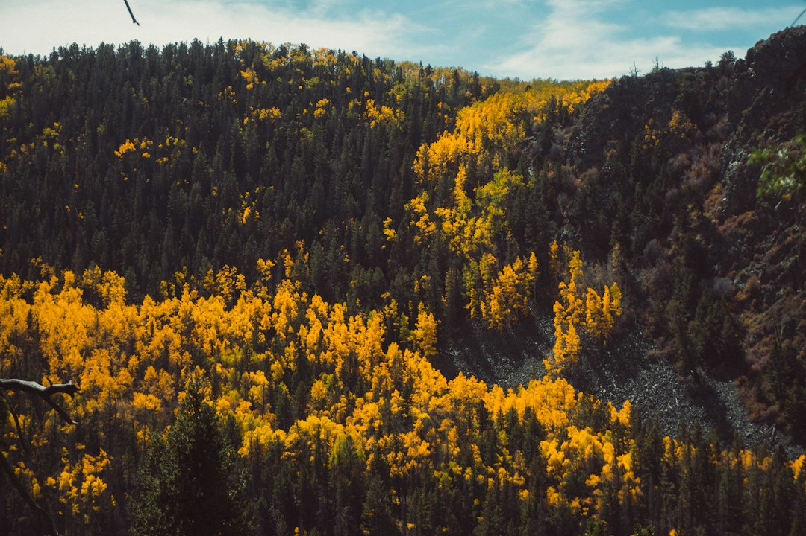
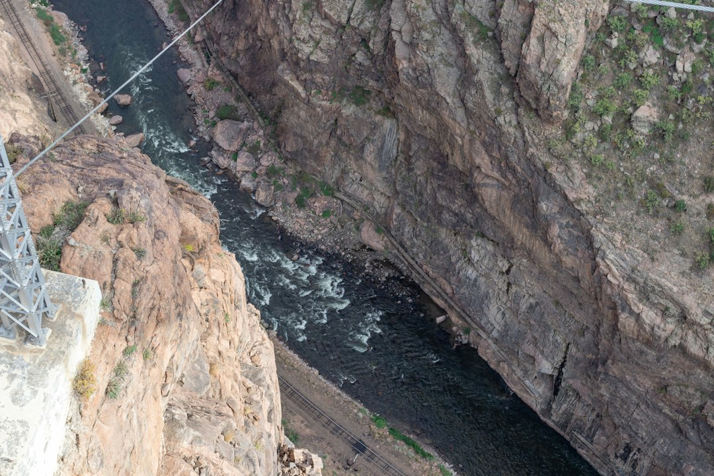
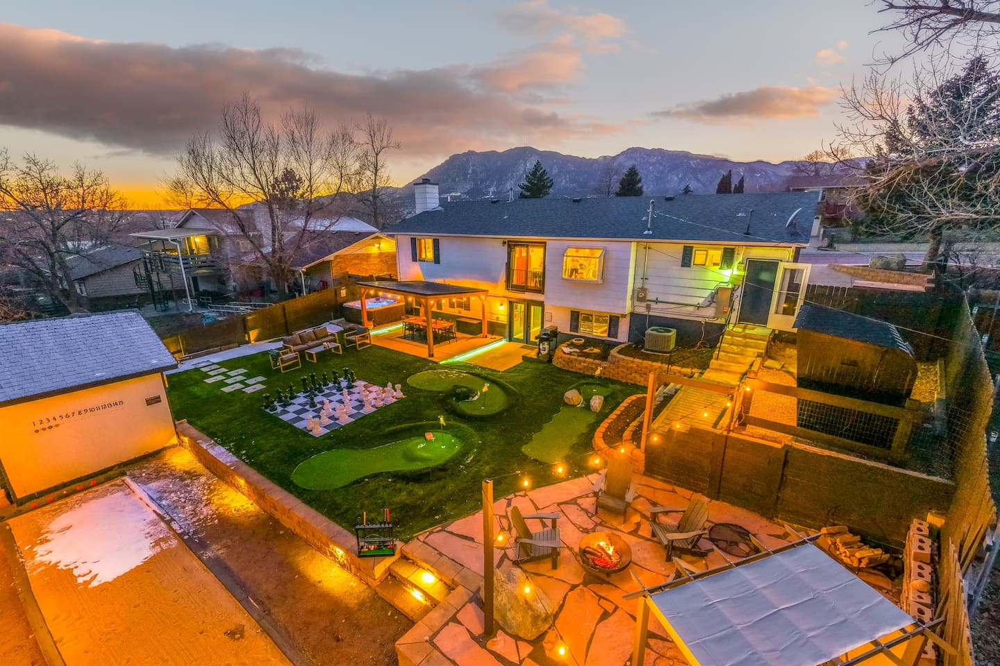
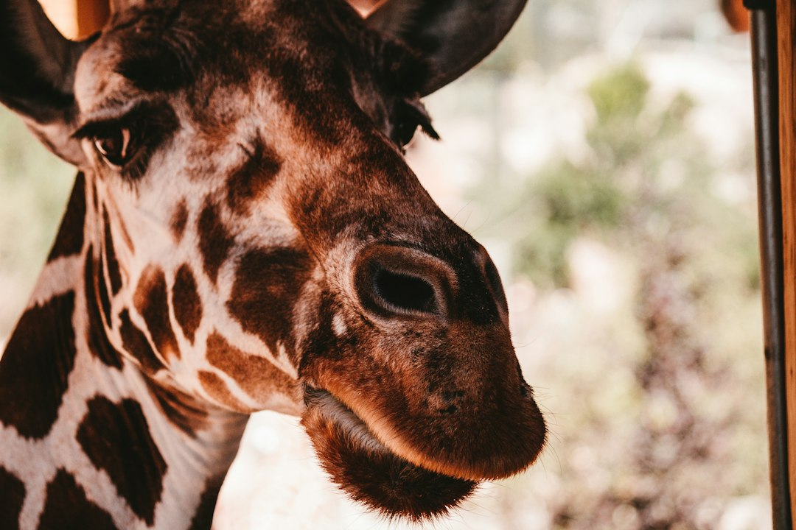
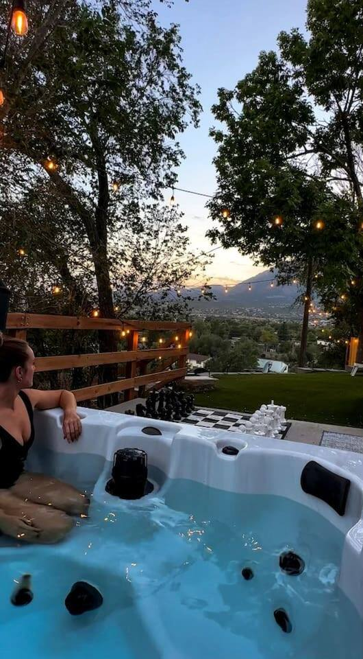
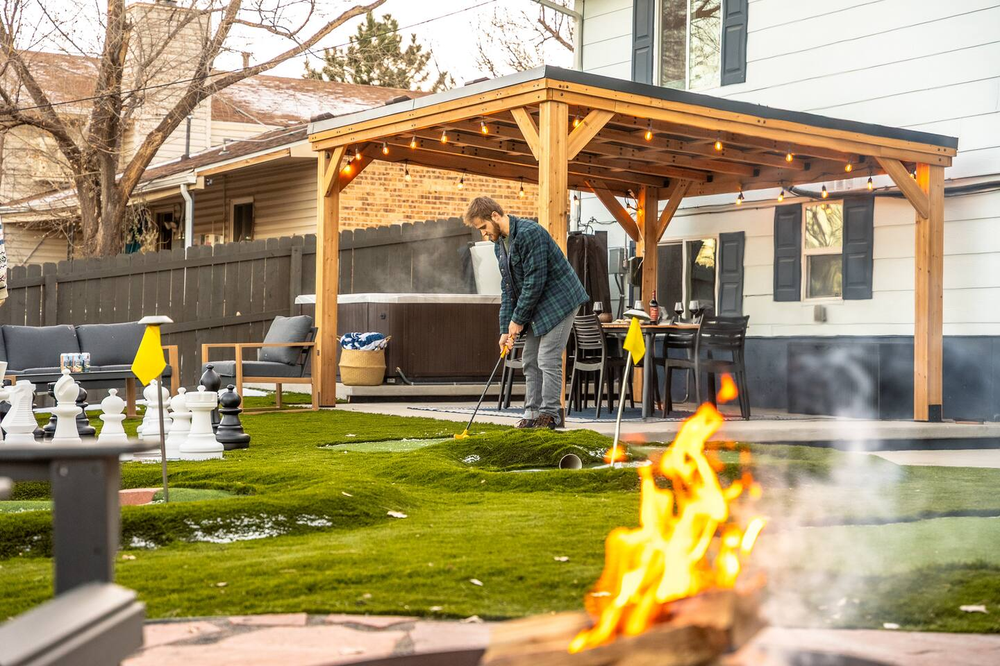

Sure, Colorado Springs has postcard-perfect views, but let's be honest—you're not here just to look at the mountains. You're here to conquer them. You're here for the stomach-dropping, heart-pounding, "did-I-really-just-do-that?" moments. This isn't your average travel guide. This is your blueprint for an adrenaline-fueled escape at the foot of Pikes Peak.

Forget the scenic overlooks for a minute. We're talking about dangling over canyons, climbing iconic red rocks, and racing down America's most famous mountain on two wheels. If your idea of a vacation involves more harnesses than hammocks, you've come to the right place.

### Table of Contents
- [Conquering Heights: Ziplining and Rock Climbing](#conquering-heights-ziplining-and-rock-climbing)
- [Gorges and Whitewater: Next-Level Thrills](#gorges-and-whitewater-next-level-thrills)
- [High-Speed Descents: Wheeling It Downhill](#high-speed-descents-wheeling-it-downhill)
- [Basecamp for Adventure: Where to Recover and Recharge](#basecamp-for-adventure-where-to-recover-and-recharge)
- [Frequently Asked Questions](#frequently-asked-questions)

---

## Conquering Heights: Ziplining and Rock Climbing

The best way to see the Pikes Peak region is from above—or while clinging to the side of a cliff. These vertical adventures offer a perspective you just can't get from the car.

### Soar Above Canyons on a Zipline

There's nothing quite like the rush of wind and the blur of scenery as you fly hundreds of feet above the canyon floor. Colorado Springs is home to some of the most spectacular zipline courses in the country.

#### The Broadmoor Soaring Adventure

This is the gold standard. Located in the stunning South Cheyenne Cañon, this experience is less of a single zipline and more of an aerial journey. You'll traverse a series of ziplines, walk across swaying suspension bridges, and even tackle a controlled 180-foot rappel.

They offer two distinct courses:

*   **The Woods Course:** A fantastic introduction that zips you through the dense forest and over Cheyenne Creek. It's exhilarating, with five ziplines ranging from 300 to 1,500 feet long.
*   **The Fins Course:** This is the one for true adrenaline junkies. It takes you much higher up the canyon walls, offering jaw-dropping views of Seven Falls and the valley below. The exposure is real, the lines are faster, and the experience is unforgettable.

**Local Tip:** If you can only do one, book the Fins Course. The views are unparalleled. Go for a morning slot to get the best light and calmer winds. You'll find it at [6 Lake Ave, Colorado Springs, CO 80906](https://www.google.com/maps/search/?api=1&query=6+Lake+Ave,+Colorado+Springs,+CO+80906).

#### Adventures Out West: Pikes Peak Ziplines

Located just outside Manitou Springs in a gorgeous alpine canyon, this course feels a bit more rustic and wild. You'll ride 5 different ziplines that zig-zag across the canyon, reaching speeds up to 40 mph. The guides here are fantastic and make the experience as fun as it is thrilling. It's a great option if you're looking for a slightly more rugged and less polished (in a good way) zipline adventure.

### Reach for the Sky with Rock Climbing

The geology around Colorado Springs isn't just for looking at—it's a world-class climbing playground. The iconic red sandstone fins and granite faces are a magnet for climbers of all skill levels.

#### Garden of the Gods

Climbing in Garden of the Gods is a bucket-list experience. The surreal landscape of towering red rock formations feels like something from another planet. You can't just throw a rope up anywhere, though—you need a [free permit](https://coloradosprings.gov/parks/page/garden-gods-technical-climbing-and-bouldering-regulations-and-permit) from the visitor center, and you must know what you're doing.

For anyone who isn't an expert, booking a guided trip is the only way to go. Companies like **Front Range Climbing Company** provide all the gear and expertise you need to safely scale these famous rocks. They know the park inside and out and can find the perfect route for your skill level, whether you're a complete beginner or an experienced gym climber looking to try real rock for the first time.

**Local Tip:** Go on a weekday morning. The park gets incredibly crowded, and the rock can get hot in the afternoon sun. Climbing when the park is quiet is a magical experience.

#### Red Rock Canyon Open Space

Just a stone's throw from Garden of the Gods, [Red Rock Canyon Open Space](https://www.google.com/maps/search/?api=1&query=Red+Rock+Canyon+Open+Space+colorado+springs) is a local favorite. It offers a huge variety of climbing on the same beautiful sandstone, but with a fraction of the crowds. The park has designated climbing areas with hundreds of bolted routes, making it a fantastic spot for sport climbing. It’s also a great place to practice multi-pitch climbing and rappelling with a guide.

---

## Gorges and Whitewater: Next-Level Thrills

If you prefer your adventures closer to the ground (or water), the region's powerful rivers and deep gorges deliver some of the most intense experiences in the state.

### Brave the Royal Gorge Bridge & Park

About an hour's drive from Colorado Springs, the Royal Gorge is a non-negotiable stop for any thrill-seeker. The Arkansas River has carved a canyon over 1,200 feet deep, and humanity has decided the best thing to do is build a theme park of terror on its rim.

#### The Bridge Itself

Simply walking across America's highest suspension bridge is a thrill. Peering over the railing at the tiny ribbon of river so far below is enough to make your knees weak. But that's just the warm-up.

#### The Royal Rush Skycoaster

This is pure, unadulterated fear. You and up to two friends are strapped into harnesses, hoisted 1,200 feet above the Arkansas River, and then released into a giant pendulum swing, hitting speeds of 50 mph as you fly out over the canyon. There’s a moment of weightlessness at the apex of the swing that will redefine your understanding of "thrilling."

#### The Cloudscraper Zipline

This isn't your average zipline. It's the highest in America, sending you soaring 1,200 feet above the river. You fly hands-free in a seated position, giving you a terrifyingly good view of the chasm below.

**Local Tip:** Buy your tickets online in advance. It often saves you a few dollars and lets you skip the ticket line when you arrive at the park, located at [4218 Co Rd 3A, Cañon City, CO 81212](https://www.google.com/maps/search/?api=1&query=4218+Co+Rd+3A,+Ca%C3%B1on+City,+CO+81212).

### Conquer the Arkansas River on a Raft

The Arkansas River offers some of the best whitewater rafting in the United States, with sections perfect for every level of adventurer. The main rafting hub is in Cañon City, an easy day trip from the Springs.

#### Bighorn Sheep Canyon (Class II-III)

This is the perfect trip for first-timers or families with adventurous kids. It’s a beautiful stretch of river with fun, splashy rapids that are exciting but not overly intimidating. You'll get plenty of action without the terror of the more advanced sections.

#### The Royal Gorge (Class IV-V)

This is the main event. Rafting *through* the Royal Gorge, directly under the suspension bridge you may have just walked across, is an epic adventure. This section is serious, technical whitewater. You'll paddle through legendary rapids like "Sunshine Falls" and "Sledgehammer." This is not for the faint of heart and requires good physical condition. Outfitters like **Echo Canyon River Expeditions** are pros and will guide you safely through the chaos.

---

## High-Speed Descents: Wheeling It Downhill

Why drive up a mountain when you can fly down it? Colorado Springs offers some unique ways to experience its massive elevation changes on two or four wheels.

### Pikes Peak by Bike: 19 Miles of Downhill

You've heard of the Pikes Peak International Hill Climb for cars. This is the pedal-powered version, only in reverse. Several local outfitters offer tours where they drive you and a specialized mountain bike to the 14,115-foot summit of Pikes Peak. After you’ve taken your obligatory photos and eaten a world-famous summit donut, you get to ride all the way back down.

You’ll descend over 7,000 vertical feet on the paved, winding Pikes Peak Highway. The top section is a series of tight, breathtaking switchbacks above the treeline. As you descend, you'll cruise through beautiful aspen groves and pine forests. You don't have to be an expert cyclist, but you do need to be comfortable on a bike and confident with hand brakes. Companies like **Challenge Unlimited - Pikes Peak Bike Tours** have been doing this for decades and have it down to a science.

**Local Tip:** Dress in layers! It can be 30-40 degrees colder at the summit than in Colorado Springs. Gloves and a windbreaker are an absolute must, even in July.

### Off-Roading on Mountain Trails

If you want to explore the backcountry with a bit more horsepower, a 4x4 adventure is the way to go. The Rampart Range area west of the city is crisscrossed with rugged Forest Service roads perfect for Jeeps, ATVs, and dirt bikes.

You can rent your own vehicle or, for a more relaxed and informative experience, take a guided Jeep tour. Companies like **Adventures Out West** offer guided tours that take you up scenic and bumpy trails like Old Stage Road, where you'll get incredible views of the city and plains while learning about the area's Gold Rush history. It’s a great way to access remote viewpoints without the grueling hike.

---

## Basecamp for Adventure: Where to Recover and Recharge

After a day of dangling from cliffs and battling rapids, you need more than just a place to sleep. You need a basecamp—a comfortable, relaxing space where you can recharge for the next day's adventure. The right Colorado Springs vacation rental can make all the difference, providing the amenities you need to soothe sore muscles and relive the day's highlights with your crew.

For larger groups looking for the ultimate recovery zone, look no further than the **Epic Family Home**. After pushing your limits, imagine coming back to your own private sauna to sweat out the day's fatigue, followed by a long soak in the hot tub under the stars. The game room and private mini-golf course are perfect for some low-key competitive fun after a high-stakes day on the mountain. This property is more than a rental; it's a private resort for your adventure team.

If soaking with an epic view is your preferred style of recovery, the hot tub at the **Stunning Mountain Views, Hot Tub, Game Room** home is absolutely unbeatable. Centrally located, this spot makes it easy to get to Garden of the Gods or Red Rock Canyon. After your climb, you can sit back and watch the alpenglow on the Front Range while the jets work their magic. It's the perfect spot to plan tomorrow's thrill while enjoying one of the best views in the city.

Choosing a home base on the west side of town, like the **Views | 2 mins to OCC** property, puts you in the perfect launch position. You're just minutes from the turnoff for Highway 24, the main artery to Pikes Peak, Manitou Springs, and the mountains beyond. After a long day, you can gather around the fire pit, share stories, and rest up, knowing you're just a short drive from your next adventure.

---

## Frequently Asked Questions

**What is the single most thrilling activity in Colorado Springs?**
While it's subjective, most adrenaline junkies would point to the Royal Rush Skycoaster at the Royal Gorge. Being swung out 1,200 feet over a canyon at 50 mph is an experience that's hard to top. Biking down Pikes Peak is a close second for its sustained, high-altitude thrill.

**Do I need experience to rock climb in Garden of the Gods?**
No, you don't need prior experience, but you absolutely **must** go with a certified guide or an experienced climber who knows the area. Reputable guide services provide all the necessary safety equipment and instruction to ensure a safe and enjoyable first climb on these iconic formations.

**What's the best time of year for adventure travel in Colorado Springs?**
Late spring through early fall (May to October) is the prime season for most of the adventures listed, especially whitewater rafting and biking down Pikes Peak. Rock climbing and ziplining can often be done year-round, weather permitting. Always check with the tour operators for seasonal availability.

**Where is the best area to stay for easy access to these adventures?**
Staying on the west side of Colorado Springs is ideal. Neighborhoods near Old Colorado City, Manitou Springs, or off the I-25 corridor south of Garden of the Gods provide the quickest access to Highway 24 (the gateway to the mountains), Garden of the Gods, and Red Rock Canyon. This minimizes drive time and maximizes adventure time.

Colorado Springs is an adventurer's paradise, a place where the stunning scenery is matched only by the incredible opportunities to challenge yourself within it. So pack your nerve, book your flight, and get ready to play hard.

When you’re ready to find the perfect home base for your thrill-seeking crew, browse our collection of properties and **[book your Colorado Springs adventure directly with Springline Stays](https://www.springlinestays.com)**.

*Cheyenne Mountain Zoo — a must-visit near our Colorado Springs properties.*

*[Stunning Mountain Views, Hot Tub, Game Room — Book your stay →](https://book.springlinestays.com/property/family-friendly-firepit-hottub-views-games)*

*[Epic Family Home: Mini-Golf, Sauna, Hot Tub, Games — Book your stay →](https://book.springlinestays.com/property/epic-family-home-mini-golf-sauna-hot-tub-games)*
