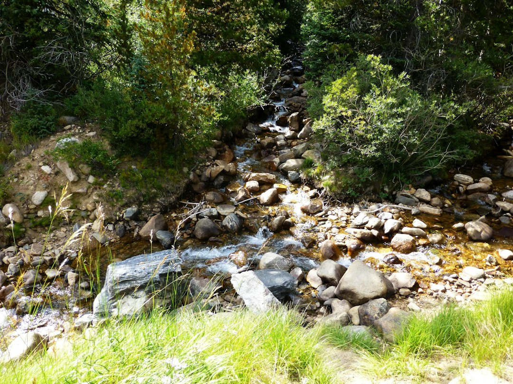
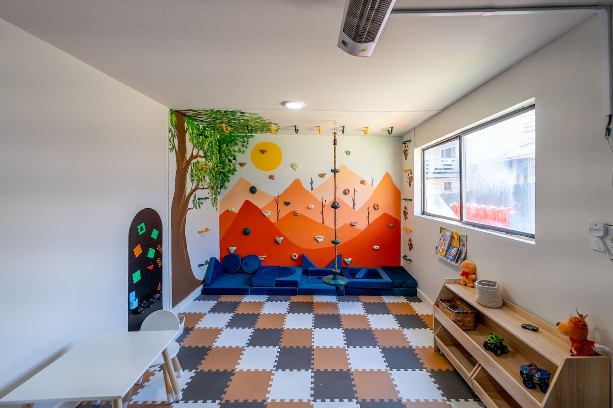
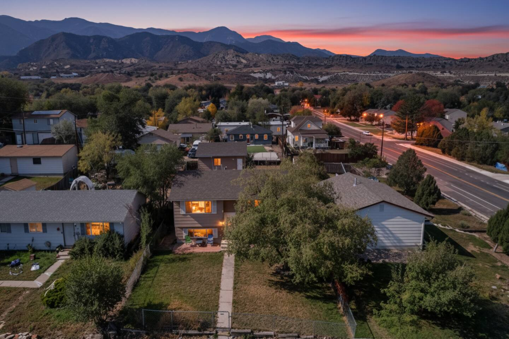
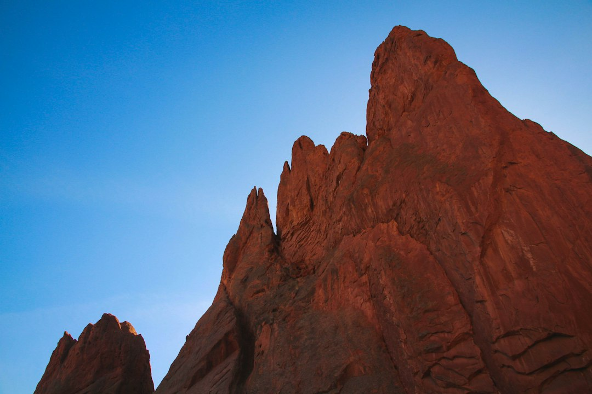
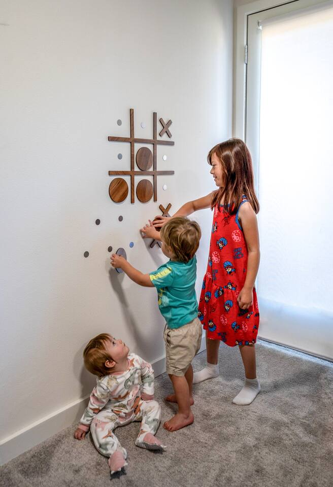

Forget the generic top-ten lists that have you crisscrossing the city and wasting half your day in the car. Colorado Springs isn't a checklist; it's an experience. The key to a truly memorable trip is to group your activities wisely and match them to your travel style.

Are you here to conquer mountains? Or would you rather conquer the local art and dining scene? Maybe you're juggling kids and just need a day that’s more fun than frantic.

Think of this as your playbook for building the perfect day (or three) in the shadow of Pikes Peak. We'll skip the fluff and get straight to the logistics, local secrets, and a few ideas on where to crash after a long day of exploring.

### Table of Contents
*   [Day Plan 1: The Adrenaline Junkie's Gauntlet](#plan-1)
*   [Day Plan 2: The Ultimate Family Fun Day](#plan-2)
*   [Day Plan 3: The Laid-Back Culture Seeker](#plan-3)
*   [Day Plan 4: The Off-the-Beaten-Path Explorer](#plan-4)
*   [Frequently Asked Questions](#faq)

---

## Day Plan 1: The Adrenaline Junkie's Gauntlet

This day is for those who see a mountain and immediately want to get to the top of it. It’s a physically demanding but incredibly rewarding itinerary focused on the rugged beauty of the Pikes Peak region. Pack water, snacks, and your sense of adventure.

### Morning (7:00 AM - 1:00 PM): Conquer the Manitou Incline

Yes, we’re starting with the big one. The Manitou Incline is a legendary challenge, gaining nearly 2,000 feet of elevation in just under a mile. It’s essentially a staircase made of old railway ties going straight up the side of a mountain. It’s brutal, it’s breathtaking, and the view from the top is an unparalleled reward.

*   **Local's Tip:** You **must** make a free reservation online in advance. They fill up, especially on weekends. The best time to go is first thing in the morning to avoid the intense midday sun. The trail down is the 4-mile Barr Trail, which is a lovely, winding descent. Do not attempt to go down the Incline itself.
*   **Address:** [Incline Trail Head, Manitou Springs, CO 80829](https://www.google.com/maps/search/?api=1&query=Incline+Trail+Head,+Manitou+Springs,+CO+80829)
*   **Parking:** Parking is notoriously difficult. Use the free shuttle from the Hiawatha Gardens building in Manitou Springs ([10 Old Man's Trail, Manitou Springs, CO 80829](https://www.google.com/maps/search/?api=1&query=10+Old+Man's+Trail,+Manitou+Springs,+CO+80829)). It’s easy and stress-free.

### Afternoon (1:30 PM - 4:00 PM): Refuel and Explore Manitou Springs

After that climb, you’ve earned a serious lunch. Head down into the quirky, vibrant town of Manitou Springs. It’s a world away from the rest of Colorado Springs, with a bohemian vibe, unique shops, and fantastic food.

Stroll down Manitou Avenue and pop into the dozens of art galleries and boutiques. Don't forget to taste the waters from the various mineral springs dotted around town—each has a unique (and sometimes surprising) taste.

*   **Lunch Spot:** The Loop Mexican Restaurant ([965 Manitou Ave, Manitou Springs, CO 80829](https://www.google.com/maps/search/?api=1&query=965+Manitou+Ave,+Manitou+Springs,+CO+80829)). Their margaritas are legendary and the perfect post-hike reward. I always go for the smothered burrito.
*   **Must-Do:** Play a few rounds of Skee-Ball at the Penny Arcade. It’s a massive, old-school arcade with games dating back decades.

### Evening (4:30 PM Onward): Red Rock Canyon and Sunset Views

Instead of another major hike, spend your evening exploring the more accessible trails of Red Rock Canyon Open Space. It’s just a short drive from Manitou and offers stunning sandstone formations reminiscent of a mini Garden of the Gods, but with far fewer people.

The trails here are perfect for a cool-down walk. The Contemplative Trail is an easy loop that offers fantastic views of the rock fins. As the sun begins to set, the rocks glow a brilliant orange and red, providing a perfect, peaceful end to an adrenaline-filled day.

---

## Day Plan 2: The Ultimate Family Fun Day

Planning a day with kids doesn't have to mean compromising on a great Colorado experience. This itinerary is packed with animal encounters, incredible scenery, and built-in fun that will tire them out in the best way possible.

### Morning (9:00 AM - 1:00 PM): Cheyenne Mountain Zoo

This isn't just any zoo. Consistently ranked one of the best in the country, the Cheyenne Mountain Zoo is built on the side of a mountain, offering incredible views of the city below from nearly every exhibit.

The absolute can't-miss experience is feeding the giraffes. The herd is huge, and they will gently eat lettuce right out of your hand. It’s a core memory waiting to happen for kids and adults alike.

*   **Local's Tip:** Arrive right when they open at 9:00 AM and head straight for the giraffe feeding. You'll beat the long lines that form later in the day. Also, wear comfortable shoes; the mountain terrain is no joke!
*   **Address:** [4250 Cheyenne Mountain Zoo Rd, Colorado Springs, CO 80906](https://www.google.com/maps/search/?api=1&query=4250+Cheyenne+Mountain+Zoo+Rd,+Colorado+Springs,+CO+80906)

### Afternoon (1:30 PM - 4:00 PM): The Broadmoor Seven Falls

Just down the road from the zoo is The Broadmoor Seven Falls. A series of seven cascading waterfalls in a stunning 1,250-foot-wall box canyon. You can take an in-canyon shuttle or walk the scenic 0.8 miles to the base of the falls.

To get the best view, climb the 224 steps alongside the falls. It’s a bit of a workout, but there are platforms to rest along the way. For those not wanting to climb, an elevator inside the mountain takes you up to the "Eagle's Nest" viewing platform.

### Evening (5:00 PM Onward): Dinner, Games, and Relaxation

After a day of walking, climbing, and animal sightings, the last thing you want to do is wrangle tired kids at a crowded restaurant. This is where having the right home base makes all the difference. Head back to your Colorado Springs vacation rental for a relaxed evening.

Order a pizza and let the fun continue. For larger families or groups, finding a place with built-in entertainment is a game-changer. The [Epic Family Home: Mini-Golf, Sauna, Hot Tub, Games](https://book.springlinestays.com/property/epic-family-home-mini-golf-sauna-hot-tub-games) is designed for exactly this. While the kids challenge each other to a round of mini-golf in the backyard or a foosball tournament in the game room, the adults can unwind in the private sauna or hot tub. It turns a standard evening into a highlight of the trip.

This kind of amenity-rich stay, like the home at [19 Clover Cir](https://www.google.com/maps/search/?api=1&query=19+Clover+Cir+Colorado+Springs+CO), transforms your vacation, giving everyone space to relax and play without having to leave.

---

## Day Plan 3: The Laid-Back Culture Seeker

If your ideal vacation involves more art galleries than trailheads and more craft coffee than protein bars, this is the itinerary for you. This plan focuses on the historic charm and creative spirit of Old Colorado City and the iconic Garden of the Gods, taken at a leisurely pace.

### Morning (9:00 AM - 12:00 PM): A Gentle Stroll Through a Divine Garden

Garden of the Gods is a must-see, but you don’t have to be a hiker to enjoy it. The Perkins Central Garden Trail is a 1.5-mile paved loop that winds through the heart of the park's most dramatic red rock formations. It's wheelchair and stroller accessible, making it easy for everyone to get up close to these geological wonders.

*   **Local's Tip:** The main parking lot fills up by 9:30 AM, especially on weekends. Arrive before 9 AM for a prime spot. If it's full, keep driving—there are numerous other lots with trail access throughout the park. The Garden of the Gods Trading Post on the south end has a great cafe for a post-walk coffee.
*   **Address:** [1805 N 30th St, Colorado Springs, CO 80904](https://www.google.com/maps/search/?api=1&query=1805+N+30th+St,+Colorado+Springs,+CO+80904)

### Afternoon (12:30 PM - 5:00 PM): Discover Old Colorado City

Just a five-minute drive from Garden of the Gods is Old Colorado City (OCC), the original capital of the Colorado Territory. Today, its historic brick-lined streets are home to a fantastic collection of independent art galleries, boutiques, and top-tier restaurants.

Spend the afternoon wandering in and out of shops. You’ll find everything from fine art photography at the Michael Garman Museum & Gallery to quirky souvenirs and handmade jewelry. It's an incredibly walkable area perfect for an afternoon of discovery.

*   **Lunch Spot:** Pizzeria Rustica ([2527 W Colorado Ave, Colorado Springs, CO 80904](https://www.google.com/maps/search/?api=1&query=2527+W+Colorado+Ave,+Colorado+Springs,+CO+80904)). Authentic Neapolitan pizza in a charming, historic building with a beautiful patio. The Prosciutto e Fichi pizza is a local favorite.
*   **Coffee Break:** Carnelian Coffee Co. ([2501 W Colorado Ave #102, Colorado Springs, CO 80904](https://www.google.com/maps/search/?api=1&query=2501+W+Colorado+Ave+%23102,+Colorado+Springs,+CO+80904)) for a perfect mid-afternoon latte.

### Evening (5:00 PM Onward): Dinner and a Fire Pit Sunset

As evening settles in, OCC offers a fantastic selection of dinner spots, from casual pubs to fine dining. After dinner, instead of heading to a crowded bar, imagine retreating to a quiet spot with a view.

Staying close to Old Colorado City allows you to fully immerse yourself in the neighborhood's charm. A perfect home base for this itinerary is the [Views | 2 mins to OCC | Fire Pit | Games | Pets](https://book.springlinestays.com/property/views-2-mins-to-occ-fire-pit-games-pets) property. After a day of exploring, you can grab a bottle of wine and enjoy it around the private fire pit, watching the city lights twinkle with Pikes Peak in the distance. It’s the perfect, relaxing end to a day of culture.

Being just a two-minute drive away at a place like the one at [1112 Arch St](https://www.google.com/maps/search/?api=1&query=1112+Arch+St+Colorado+Springs+CO) means you can easily pop back for a break or end your night without a long drive, making your relaxing day truly seamless.

---

## Day Plan 4: The Off-the-Beaten-Path Explorer

You've seen the post-card shots. Now you want to see the Colorado Springs that’s a little more unique, a little more unexpected. This day plan takes you from otherworldly landscapes to modern marvels and ends at one of the city’s most creative community hubs.

### Morning (9:00 AM - 12:30 PM): Explore the Paint Mines

About a 45-minute drive east of Colorado Springs lies a landscape that feels like another planet. The Paint Mines Interpretive Park features colorful clay formations of white, yellow, purple, and grey, sculpted by erosion into bizarre hoodoos and spires. The 4-mile loop trail is relatively easy and winds through the canyons, offering incredible photo opportunities at every turn.

*   **Local's Tip:** Go on a weekday if you can; it's a popular spot for local photographers. The colors are most vibrant in the morning or late afternoon light. And please, stay on the trails—the clay formations are extremely fragile.
*   **Address:** [29950 Paint Mine Rd, Calhan, CO 80808](https://www.google.com/maps/search/?api=1&query=29950+Paint+Mine+Rd,+Calhan,+CO+80808)

### Afternoon (1:30 PM - 4:30 PM): U.S. Olympic & Paralympic Museum

Head back into the city for a dose of inspiration at one of downtown's newest and most impressive attractions. The U.S. Olympic & Paralympic Museum is a state-of-the-art facility celebrating the stories and achievements of Team USA athletes.

The exhibits are incredibly interactive and engaging for all ages. You can race against a virtual Jesse Owens, try your hand at alpine skiing, and see a stunning collection of Olympic torches and medals. The entire museum is designed with universal accessibility in mind, spiraling downwards from the top floor.

*   **Address:** [200 S Sierra Madre St, Colorado Springs, CO 80903](https://www.google.com/maps/search/?api=1&query=200+S+Sierra+Madre+St,+Colorado+Springs,+CO+80903)

### Evening (5:00 PM Onward): Dinner and Drinks at Ivywild School

End your day at one of the most unique spots in the city. The Ivywild School is a formerly abandoned elementary school that has been brilliantly repurposed into a community marketplace.

Inside, you'll find Bristol Brewing Company, a local favorite brewery operating in the old classrooms. You'll also find The Principal's Office, a craft cocktail bar, and several food vendors serving everything from burgers to artisan bread. It's a bustling, lively space that perfectly captures the creative, collaborative spirit of modern Colorado Springs. It’s the perfect place to grab a casual dinner and a pint and reflect on a day of unique discoveries.

*   **Address:** [1604 S Cascade Ave, Colorado Springs, CO 80905](https://www.google.com/maps/search/?api=1&query=1604+S+Cascade+Ave,+Colorado+Springs,+CO+80905)

---

## Frequently Asked Questions

### What is the best month to visit Colorado Springs?
September is arguably the best month. The summer crowds have thinned, the weather is still warm and sunny, and the fall colors begin to appear at higher elevations. However, June through August offer the most reliable weather for high-altitude activities like visiting Pikes Peak.

### Do I need a car in Colorado Springs?
Yes, it is highly recommended. While some areas like Downtown, Old Colorado City, and Manitou Springs are walkable, the main attractions are spread out across the region. A car is essential for getting to trailheads and exploring efficiently.

### How many days do you need to see Colorado Springs?
To comfortably see the main highlights like Garden of the Gods, Pikes Peak, and the Cheyenne Mountain Zoo without feeling rushed, plan for at least 3 to 4 full days. This gives you time to explore different neighborhoods and add in a few hikes.

### Is Colorado Springs better for families or couples?
It’s fantastic for both! The abundance of outdoor activities, family-friendly attractions like the zoo, and interactive museums make it a paradise for kids. At the same time, the stunning scenery, upscale dining, and vibrant brewery and arts scenes make it a perfect destination for a romantic getaway or a trip with friends.

---

No matter how you choose to spend your time, Colorado Springs offers a perfect blend of natural wonder and city culture. By planning your days thoughtfully, you can create a vacation that’s as relaxing or as adventurous as you want it to be.

Ready to plan your perfect trip? Start by finding the perfect home base. To get the best rates and local service for your Colorado Springs vacation rental, **[book direct with Springline Stays](https://www.springlinestays.com)**.

*Red Rock Canyon — a must-visit near our Colorado Springs properties.*

*[Epic Family Home: Mini-Golf, Sauna, Hot Tub, Games — Book your stay →](https://book.springlinestays.com/property/epic-family-home-mini-golf-sauna-hot-tub-games)*

*[Stunning Mountain Views, Hot Tub, Game Room — Book your stay →](https://book.springlinestays.com/property/family-friendly-firepit-hottub-views-games)*
