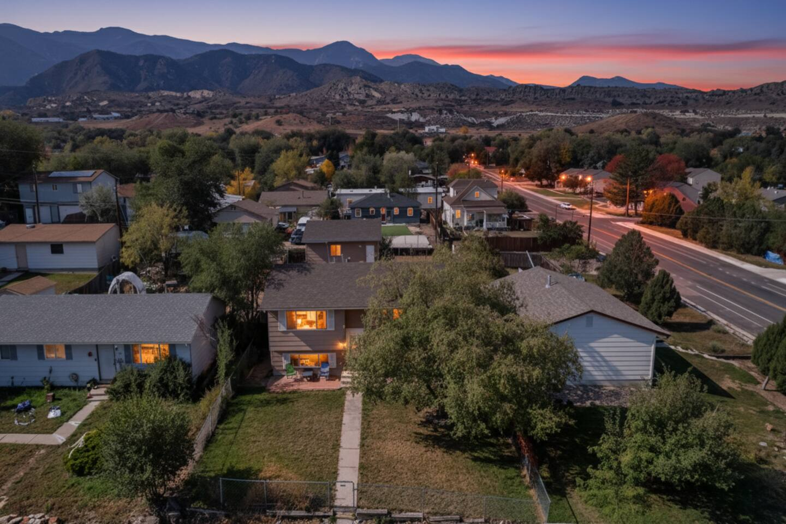
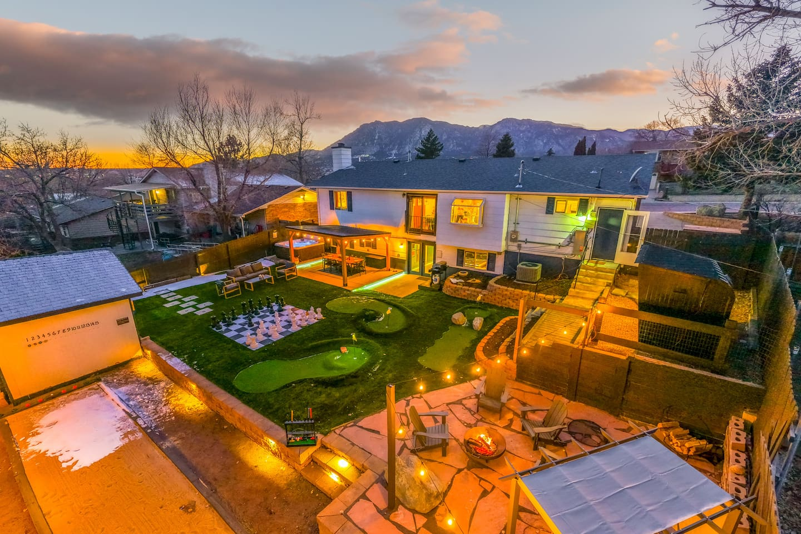
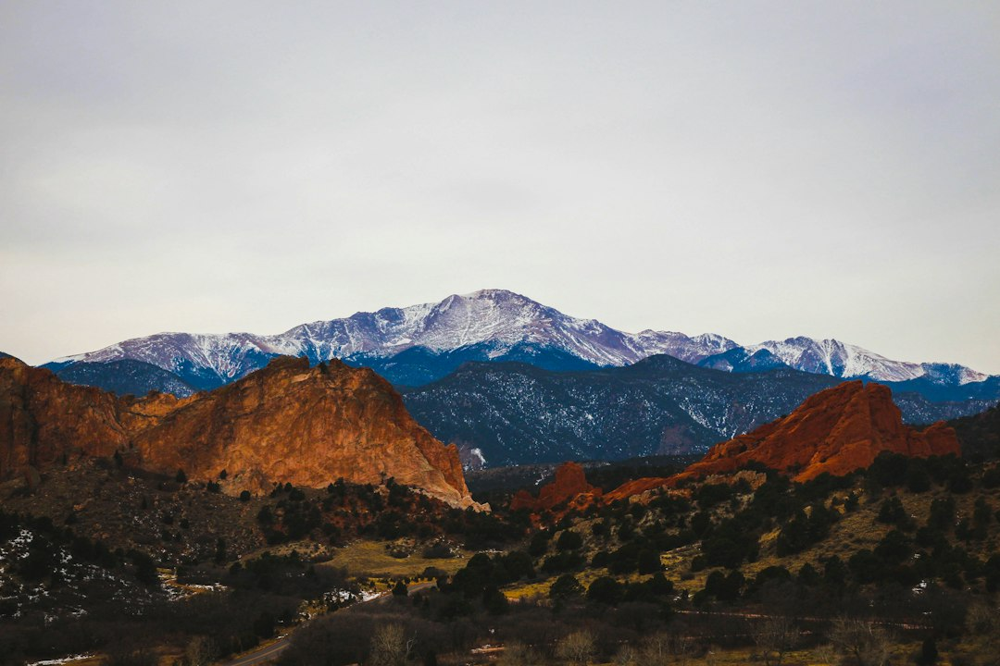
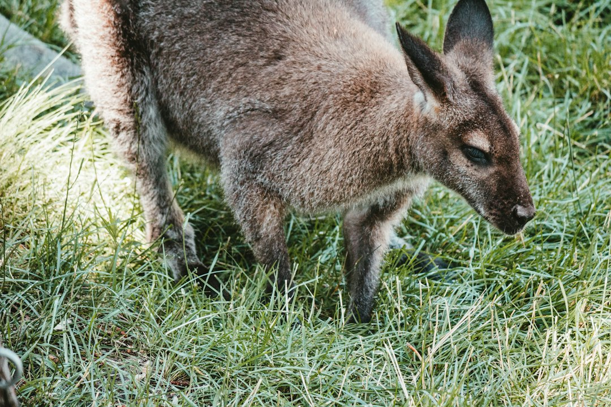
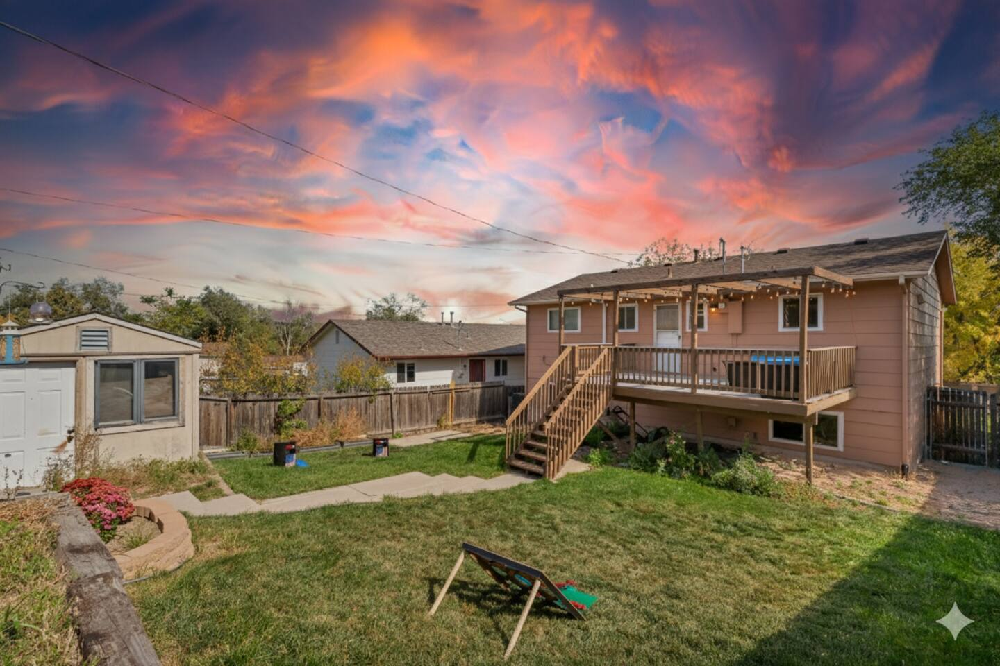
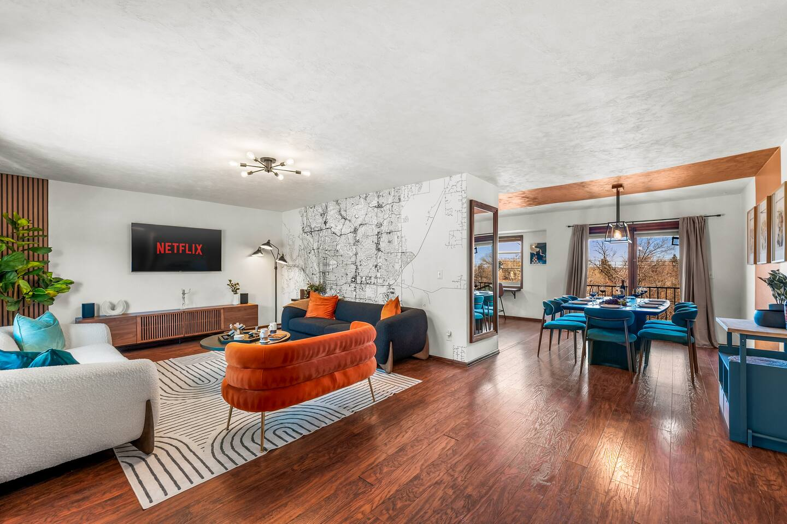

So you're planning a trip to Colorado Springs. You've probably got a list of must-sees: Garden of the Gods, Pikes Peak, maybe the Manitou Incline if you're feeling brave. But the single most important decision you'll make isn't what to do first, it's where you'll drop your bags. Choosing the right neighborhood as your home base completely transforms your vacation.

Do you want historic, walkable streets outside your door? Or would you prefer sprawling mountain views and a bit more seclusion? Are you here for the downtown energy or the quirky, artsy vibe?

Forget generic hotel districts. Let's break down the real character of Colorado Springs' best neighborhoods so you can find the perfect launchpad for your adventure.

### Table of Contents
- [The Westside: Old Colorado City & Manitou Springs](#the-westside-old-colorado-city--manitou-springs)
- [The Broadmoor & Southwest: Upscale Adventures](#the-broadmoor--southwest-upscale-adventures)
- [Downtown: The Urban Heartbeat](#downtown-the-urban-heartbeat)
- [The North End & Rockrimmon: Quiet Views and Easy Access](#the-north-end--rockrimmon-quiet-views-and-easy-access)
- [Colorado Springs Neighborhoods FAQ](#colorado-springs-neighborhoods-faq)

---

## The Westside: Old Colorado City & Manitou Springs
**Vibe:** Historic, artsy, and fiercely independent. This is where Colorado Springs got its start, and it feels like it. Think historic brick buildings, funky art galleries, unique boutiques, and some of the best local restaurants in the city. It’s the perfect spot if you love to park your car and explore on foot.

### What to Do on the Westside

This area is the undisputed gateway to the region's most famous natural wonders. You’re literally minutes from the entrances to both Garden of the Gods and Red Rock Canyon Open Space.

**Garden of the Gods:** You can drive the loop, but the best way to experience it is by walking the Perkins Central Garden Trail. It's a paved, 1.5-mile loop that is accessible and puts you right at the base of the most iconic formations. **Local Tip:** The main parking lot fills up by 9 AM, especially on weekends. Use the overflow lots along the scenic drive and just walk in—it’s worth it to avoid the parking headache.

**Old Colorado City (OCC):** The main drag, Colorado Avenue, is lined with incredible art galleries, souvenir shops that sell more than just t-shirts (check out the glasswork and pottery), and fantastic places to eat. Don't miss a stop at the **Rocky Mountain Chocolate Factory** ([2431 W Colorado Ave](https://www.google.com/maps/search/?api=1&query=2431+W+Colorado+Ave+Colorado+Springs+CO)) for a caramel apple that will ruin all other caramel apples for you. For dinner, **Paravicini's Italian Bistro** ([2802 W Colorado Ave](https://www.google.com/maps/search/?api=1&query=2802+W+Colorado+Ave+Colorado+Springs+CO)) is a local institution—the Pollo al Limone is perfection.

**Manitou Springs:** A few minutes further west lies this wonderfully weird little mountain town. It's packed with arcades (the Penny Arcade is a must-visit), eclectic shops, and eight natural mineral springs you can drink from (they each have a unique taste, to put it mildly). It's also the base for hiking the Manitou Incline and accessing the Pikes Peak Cog Railway.

### Where to Stay on the Westside

Staying here means you prioritize character and proximity to the trails. It's a fantastic choice for active groups and families who want a blend of outdoor adventure and town life. For a group that wants to be right in the middle of the action, a vacation rental in this area is a smart move.

For instance, a place like our **[Views | 2 mins to OCC | Fire Pit | Games | Pets](https://book.springlinestays.com/property/views-2-mins-to-occ-fire-pit-games-pets)** home is perfectly situated. You get stunning views and can be in the heart of Old Colorado City in a two-minute drive, but you also have a quiet backyard with a fire pit to relax after a day of hiking. It’s the best of both worlds.

## The Broadmoor & Southwest: Upscale Adventures
**Vibe:** Grand, scenic, and a little bit luxurious. Dominated by the legendary Broadmoor Hotel, this area of town feels polished and established. The winding roads, large properties, and incredible views of Cheyenne Cañon give it an exclusive, tucked-away feel, yet you're surprisingly close to some major attractions.

### What to Do in the Southwest

This is the neighborhood for epic, unforgettable experiences.

**The Broadmoor Seven Falls:** A series of seven cascading waterfalls in a magnificent box canyon. You’ll climb 224 steps to get to the top (don't worry, there are platforms to rest), where you'll find hiking trails with even more stunning views. **Local Tip:** The falls are lit up at night, which is a completely different and magical experience. Check their schedule for evening hours.

**Cheyenne Mountain Zoo:** Consistently ranked as one of the best zoos in the country, and for good reason. It's built on the side of a mountain, so be prepared for some walking, but the views are as amazing as the animals. The absolute must-do is feeding the giraffes on the elevated boardwalk—you get eye-to-eye with these incredible creatures. It’s an experience you won’t forget.

**North Cheyenne Cañon Park:** This city-owned park is a local treasure and feels like a national park. Drive up the scenic road (or hike it) to Helen Hunt Falls. For a more adventurous hike, continue on to the trailhead for St. Mary's Falls—it's a moderately challenging hike along a beautiful creek.

### Where to Stay in the Southwest

This area is ideal for families or larger groups looking for a Colorado Springs vacation rental that feels like a destination in itself. You trade the walkability of the Westside for more space, incredible amenities, and a more serene environment. It’s perfect for a multi-generational trip or a getaway with friends where the house is just as important as the itinerary.

If you've got a crew, a home with built-in entertainment is a game-changer. Our **[Epic Family Home: Mini-Golf, Sauna, Hot Tub, Games](https://book.springlinestays.com/property/epic-family-home-mini-golf-sauna-hot-tub-games)** is a prime example. After a day at the zoo, you can come home to a private hot tub, a sauna, and your own mini-golf course. It turns downtime into prime vacation time.

## Downtown: The Urban Heartbeat
**Vibe:** Energetic, modern, and central. Downtown Colorado Springs has undergone a massive revitalization and is buzzing with energy. It's a clean, vibrant grid of top-tier restaurants, craft cocktail bars, independent coffee shops, and unique museums. If you want to be in the center of it all with endless dining and entertainment options, this is your spot.

### What to Do Downtown

While it's the most "urban" part of the city, downtown is still incredibly accessible and serves as a great central hub.

**U.S. Olympic & Paralympic Museum:** This state-of-the-art museum is an absolute must-see, whether you're a sports fanatic or not. The interactive exhibits are world-class, and the stories of the athletes are incredibly inspiring. Plan to spend at least 2-3 hours here.

**Acacia Park:** A lovely green space in the heart of downtown, often hosting farmers' markets, concerts, and in the winter, an outdoor ice rink. It's a great place to grab a coffee from a local shop and just relax.

**Dining and Drinks:** Downtown is the culinary center of the city. For a fantastic dinner, try **The Rabbit Hole** ([101 N Tejon St](https://www.google.com/maps/search/?api=1&query=101+N+Tejon+St+Colorado+Springs+CO)), a whimsical underground spot with a creative menu. For cocktails, **Shame & Regret** ([15 E Bijou St, alley entrance](https://www.google.com/maps/search/?api=1&query=15+E+Bijou+St+Colorado+Springs+CO)) is a moody, gothic-inspired bar with an incredible drink list. And for the best breakfast, you can't beat **Urban Egg** ([28 S Tejon St](https://www.google.com/maps/search/?api=1&query=28+S+Tejon+St+Colorado+Springs+CO))—get there early or join the waitlist online.

**America the Beautiful Park:** Located on the southwest edge of downtown, this large park features a stunning fountain, walking paths, and great views of Pikes Peak. It's also home to the new pedestrian bridge connecting downtown to the Weidner Field soccer stadium.

### Where to Stay Downtown

Lodging downtown consists mostly of hotels and apartment-style condos. This is a great choice for couples or business travelers who want to be able to walk to dinner and drinks every night. You'll sacrifice the yard and quiet of other neighborhoods, but you gain unparalleled convenience and access to the city's nightlife and cultural attractions. It's a fantastic base if your itinerary involves things in every direction, as you're right at the intersection of the city's main arteries.

## The North End & Rockrimmon: Quiet Views and Easy Access
**Vibe:** Suburban, scenic, and convenient. This area, particularly the Rockrimmon neighborhood, is defined by its dramatic topography. Homes are built into the bluffs and hills, offering spectacular views of the city and the mountains. It feels more residential and quiet, but its proximity to I-25 makes it an incredibly convenient base for exploring both the city and areas north, like the Air Force Academy and Denver.

### What to Do in the North

This part of town is home to some hidden gems and major landmarks.

**U.S. Air Force Academy:** The Visitor Center is open to the public and offers a fascinating look into the life of a cadet. The main attraction is the stunning Cadet Chapel (currently under renovation, so check its status before you go), but the campus itself is beautiful to drive through. Don't miss the overlook for a panoramic view of the grounds and the Front Range.

**Pulpit Rock Park:** A local favorite for a quick, rewarding hike. It's a short but steep climb to the top of the rock formation, where you're rewarded with 360-degree views of the Pikes Peak region. It's a great spot for a sunrise or sunset hike.

**Pro Rodeo Hall of Fame:** If you're interested in the history of the American West, this museum is a fantastic stop. It's dedicated to the sport of rodeo and the cowboys who define it.

**Garden of the Gods Market and Cafe:** While not technically in the North End, it's an easy drive and a perfect stop. This isn't just a restaurant; it's a gourmet market and bakery. Their breakfast and lunch menus are outstanding. **Local Tip:** Their pastry case is dangerous. The lemon-lavender scone is a local legend.

### Where to Stay in the North End

This is the neighborhood for travelers who want a peaceful retreat with amazing views. A vacation rental here gives you a quiet, residential experience while still being just 10-15 minutes from most of the city's main attractions. It’s an excellent choice for families who want space to spread out and easy highway access for day trips. Many homes in this area, like our **[Stunning Mountain Views, Hot Tub, Game Room](https://book.springlinestays.com/property/family-friendly-firepit-hottub-views-games)** property, are designed to take full advantage of the scenery, with large decks, hot tubs, and big windows facing the mountains.

---

## Colorado Springs Neighborhoods FAQ

### What is the best area to stay in Colorado Springs?
The "best" area depends on your travel style. For a walkable, historic, and artsy vibe with easy access to Garden of the Gods, choose the **Westside (Old Colorado City)**. For luxury, epic attractions like the zoo and Seven Falls, and a more secluded feel, stay in the **Broadmoor/Southwest** area. For a vibrant, urban experience with the most dining and nightlife options, choose **Downtown**.

### Is it better to stay in Colorado Springs or Manitou Springs?
Manitou Springs is a unique, quirky town with great walkability and its own set of attractions. However, it can get very crowded, and parking is a challenge. Staying in Colorado Springs (especially the Westside/Old Colorado City) gives you easy access to Manitou while providing a wider range of lodging and dining options and a more central location for exploring the entire Pikes Peak region.

### How many days do you need in Colorado Springs?
To comfortably see the main highlights like Garden of the Gods, Pikes Peak, and the Cheyenne Mountain Zoo without feeling rushed, plan for at least **3 to 4 full days**. If you want to add more hiking, explore multiple neighborhoods, and take a day trip (like to the Royal Gorge Bridge), a 5 to 7-day trip is ideal.

### What part of Colorado Springs is prettiest?
While beauty is subjective, many visitors and locals would point to the **Southwest** part of the city, encompassing the Broadmoor area and North Cheyenne Cañon. The combination of the mountains, the dramatic rock formations of the cañon, and the beautifully manicured landscapes makes for breathtaking scenery. The **Westside**, with its direct, jaw-dropping views of Garden of the Gods, is a very close second.

---

No matter which neighborhood you choose as your home base, you’re in for an incredible adventure. Each area offers a unique lens through which to experience the culture, history, and unparalleled natural beauty of the Pikes Peak region.

Ready to find your perfect home away from home? We invite you to explore our curated collection of Colorado Springs properties and **[book your stay directly with Springline Stays](https://www.springlinestays.com)** for the best rates and local service.

*Pikes Peak — a must-visit near our Colorado Springs properties.*

*Cheyenne Mountain Zoo — a must-visit near our Colorado Springs properties.*

*[Views | 2 mins to OCC | Fire Pit | Games | Pets — Book your stay →](https://book.springlinestays.com/property/views-2-mins-to-occ-fire-pit-games-pets)*

*[Epic Family Home: Mini-Golf, Sauna, Hot Tub, Games — Book your stay →](https://book.springlinestays.com/property/epic-family-home-mini-golf-sauna-hot-tub-games)*
