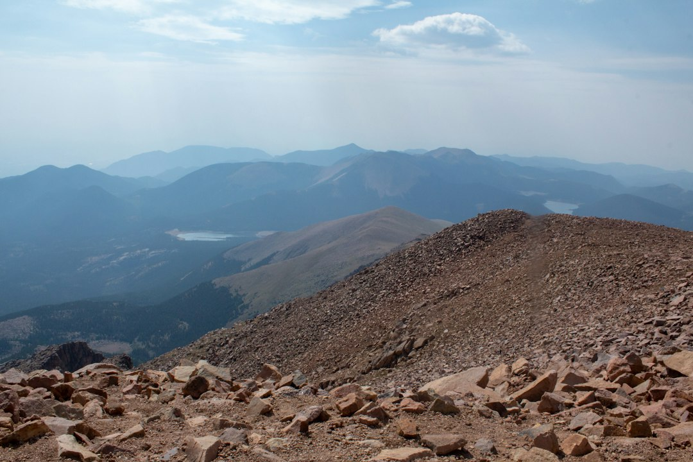
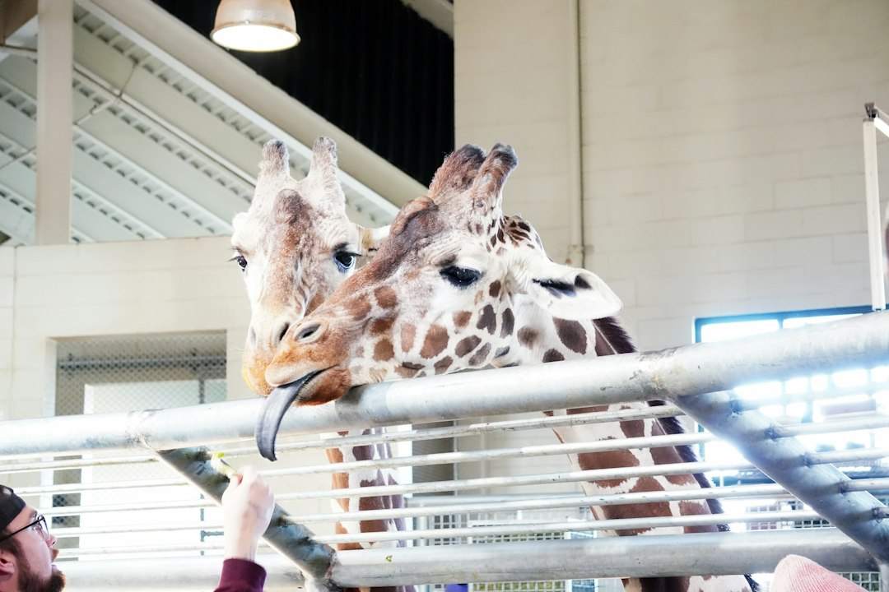
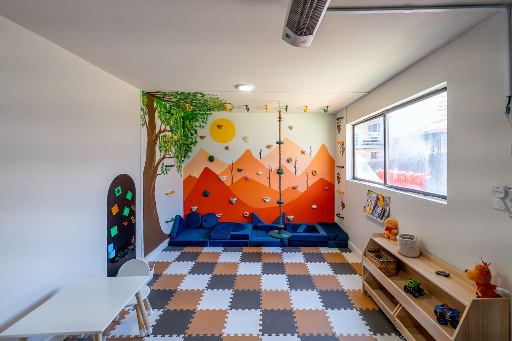
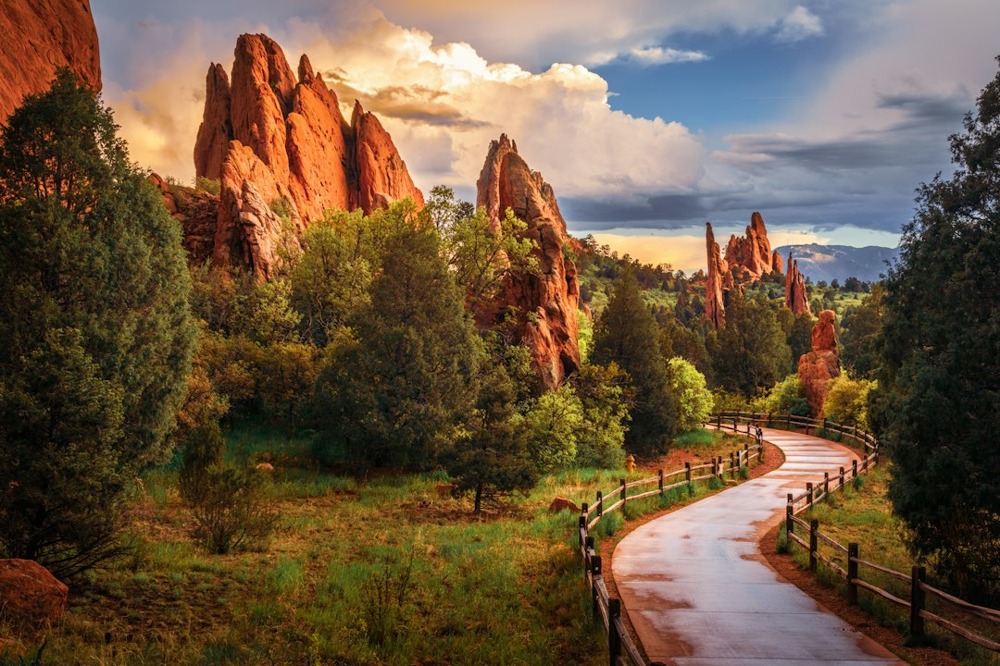
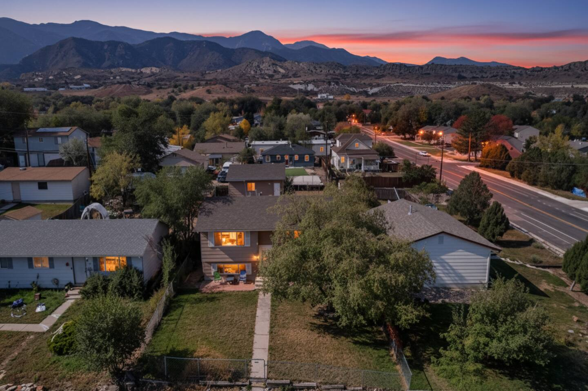
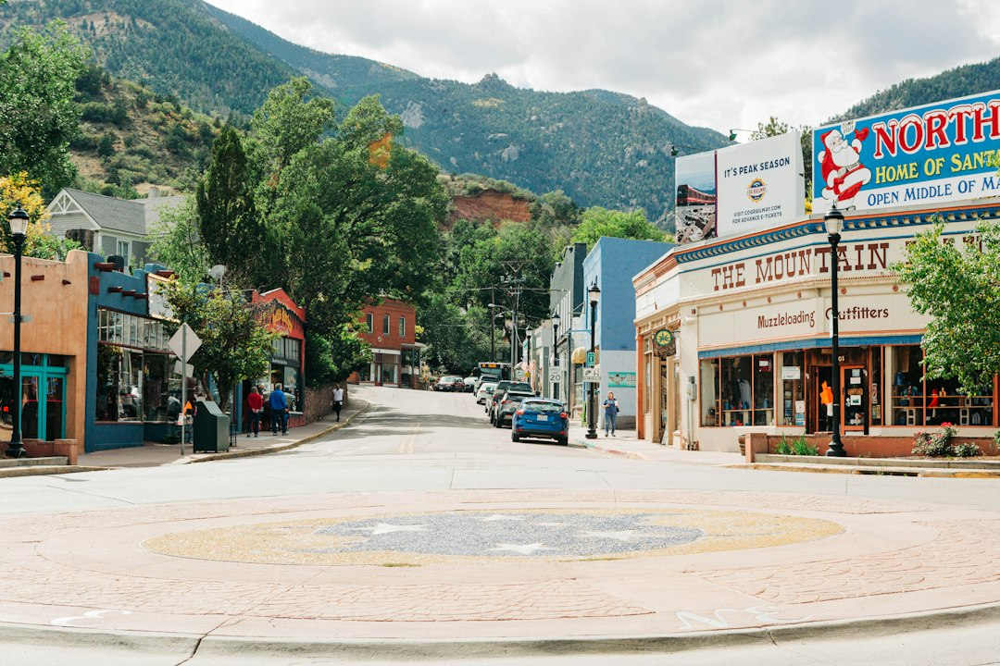
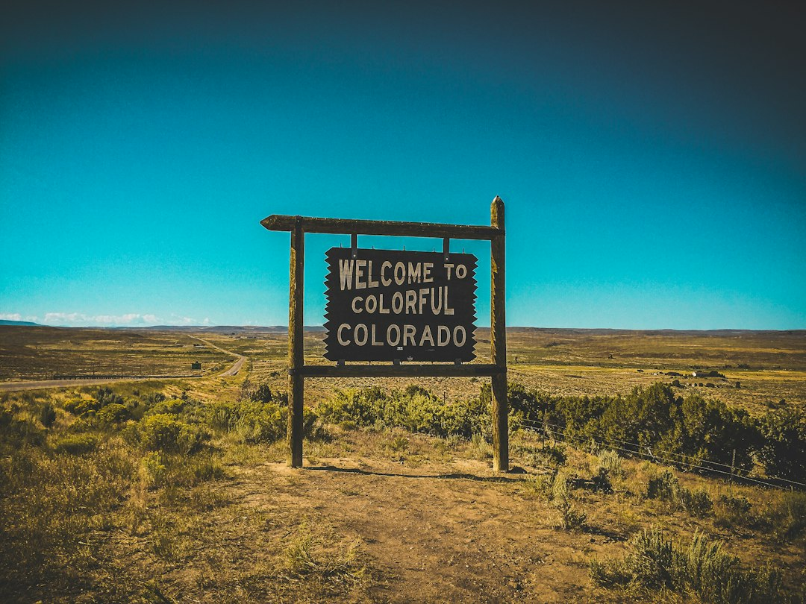
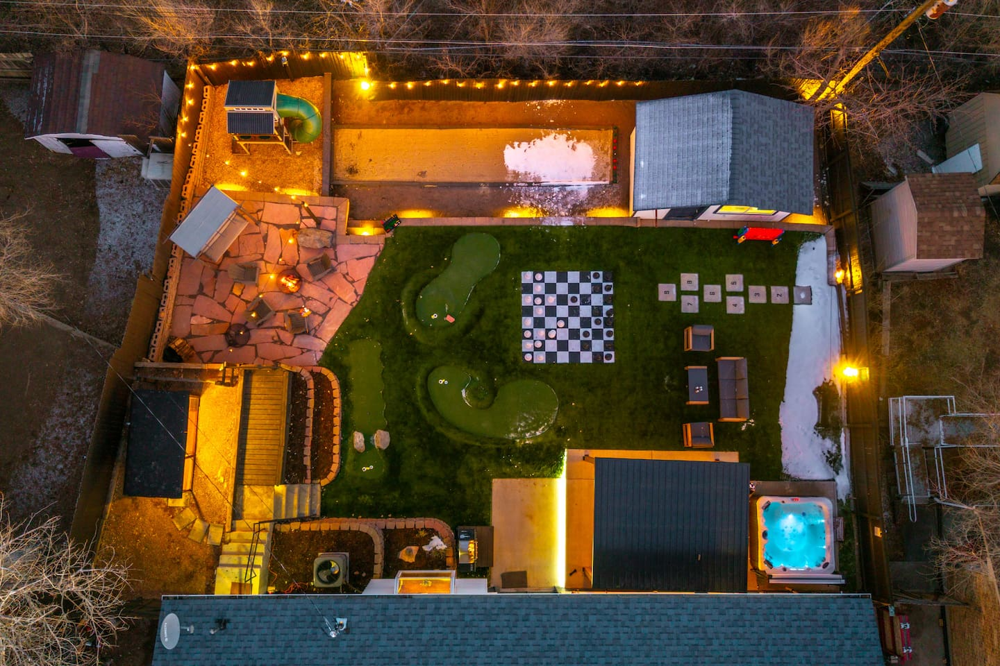
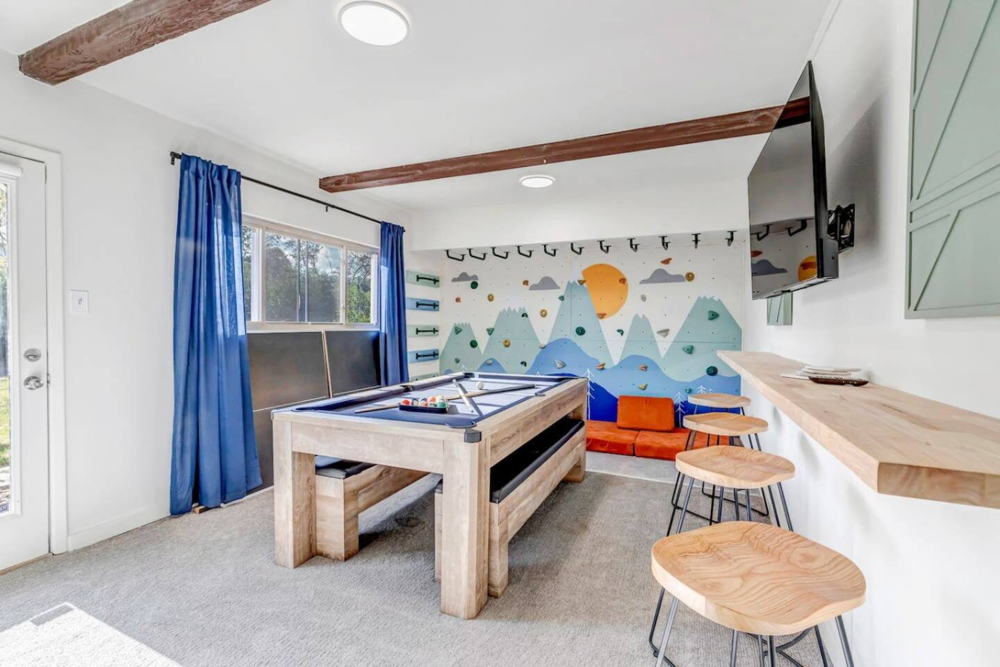

Everyone will tell you to visit Garden of the Gods and Pikes Peak. And you absolutely should. But Colorado Springs isn't a one-size-fits-all destination where you just check boxes off a list. The real magic happens when you tailor your trip to your own travel style.

Are you here to conquer mountains and push your limits? Or are you looking for a relaxing escape with stunning scenery and zero stress? Maybe you’re wrangling a crew of kids who need constant entertainment.

Forget the generic top-10 lists. This is your personal Colorado Springs travel guide, broken down into three perfect-day itineraries designed for a specific kind of traveler. Pick your path, or mix and match to create your ultimate adventure.

### Table of Contents
*   [The Adventurer's Itinerary: Conquer the Heights](#the-adventurers-itinerary-conquer-the-heights)
*   [The Family Fun Day: Unforgettable Memories](#the-family-fun-day-unforgettable-memories)
*   [The Relaxation Seeker's Escape: Unwind and Indulge](#the-relaxation-seekers-escape-unwind-and-indulge)
*   [Where to Stay for Your Perfect Colorado Springs Trip](#where-to-stay-for-your-perfect-colorado-springs-trip)
*   [Frequently Asked Questions](#frequently-asked-questions)

## The Adventurer's Itinerary: Conquer the Heights

This is for the traveler who packed hiking boots before they packed anything else. Your idea of a vacation is earning your views and feeling the burn in your legs. You want a challenge, not a chairlift (though we have those, too).

### Morning (7:00 AM): Ascend America's Mountain

You’re here for Pikes Peak, so let’s not waste any time. You have two main choices for a real adventure: hike it or bike it.

**The Hardcore Hike:** The Barr Trail is a 13-mile, 7,800-foot elevation gain beast. This is an all-day commitment for experienced, well-acclimated hikers only. Starting before dawn is non-negotiable.

**The Insider's Choice:** For a more manageable but still epic day, take the [Pikes Peak Cog Railway](https://www.broadmoor.com/pikes-peak-cog-railway/) to the summit. The secret here is to book the very first train of the day. You’ll beat the crowds and get crystal-clear morning light. Then, instead of riding down, hike the 13 miles *down* the Barr Trail. It’s still incredibly challenging on the knees, but far more doable than the ascent for most fit adventurers.

**Pro Tip:** Altitude is no joke. Spend a day or two in town acclimating before attempting a major Pikes Peak adventure. Drink an absurd amount of water.

### Lunch (1:00 PM): Refuel in Manitou Springs

After your descent, you’ll end up in the quirky, wonderful town of Manitou Springs. You'll be starving. Skip the tourist traps on the main drag and head to [Adam's Mountain Cafe](https://www.google.com/maps/search/?api=1&query=934+Manitou+Ave+Manitou+Springs+CO+80829) at [934 Manitou Ave](https://www.google.com/maps/search/?api=1&query=934+Manitou+Ave+Manitou+Springs+CO+80829). Their globally inspired comfort food, like the Nomad Gado Gado or the hearty sandwiches, is the perfect reward.

### Afternoon (3:00 PM): Climb or Scramble at Red Rock Canyon

While tourists flock to Garden of the Gods, locals who love to climb and scramble head to [Red Rock Canyon Open Space](https://www.google.com/maps/search/?api=1&query=3550+W+High+St+Colorado+Springs+CO+80904). Just a 10-minute drive from Manitou, this 1,474-acre park is a labyrinth of stunning red rock formations, challenging trails, and designated rock-climbing areas. The best part? It's free, and you can always find a quiet corner to explore. The Section 16 Trail loop offers a steep, rewarding climb with panoramic views of the city and plains.

### Evening (7:00 PM): Burgers and Brews

You've earned it. Head downtown to [The Skirted Heifer](https://www.google.com/maps/search/?api=1&query=204+N+Tejon+St+Colorado+Springs+CO+80903) for one of the best burgers of your life. They’re famous for their "skirt" of crispy, fried cheese that extends well beyond the bun. It's a casual, order-at-the-counter spot that focuses on high-quality, local ingredients. Pair it with a beer from a local brewery, and you've got the perfect end to an epic day.

## The Family Fun Day: Unforgettable Memories

This itinerary is all about maximizing fun and minimizing meltdowns. We’re talking hands-on experiences, incredible animals, and a home base that feels like its own private amusement park.

### Morning (9:00 AM): Walk with Giraffes at Cheyenne Mountain Zoo

This is not your average zoo. The [Cheyenne Mountain Zoo](https://www.google.com/maps/search/?api=1&query=4250+Cheyenne+Mountain+Zoo+Rd+Colorado+Springs+CO+80906) is built on the side of a mountain, offering incredible views alongside the amazing animal habitats.

**Must-Do:** The giraffe feeding experience is legendary. For a few dollars, you can get eye-to-eye with the world's largest giraffe herd and hand-feed them lettuce. It's a core memory waiting to happen.
**Local Tip:** Arrive right when they open at 9 AM. The animals are most active in the cool morning air, and you'll beat the worst of the crowds and the summer heat. The Mountaineer Sky Ride is also worth it for incredible views of the city.

### Lunch (12:30 PM): A Picnic with a View or Pizza Stop

You can pack a picnic and find a scenic spot at the zoo, or head just down the mountain for a quick and easy lunch. [MOD Pizza](https://www.google.com/maps/search/?api=1&query=1825+Southgate+Rd+Colorado+Springs+CO+80906) is a 5-minute drive away and a certified crowd-pleaser where everyone can build their own personal pizza.

### Afternoon (2:00 PM): Classic Fun at the North Pole

Lean into the nostalgia and take the kids to the [North Pole - Santa's Workshop](https://www.google.com/maps/search/?api=1&query=5050+Pikes+Peak+Hwy+Cascade+CO+80809). This charming, vintage amusement park is nestled at the base of Pikes Peak. It's perfect for younger kids (ages 2-10) with gentle rides, a magic show, and of course, a chance to meet Santa himself, even in July. It’s a delightfully old-school experience that provides a great contrast to the grand-scale nature surrounding it.

### Evening (6:00 PM): Your Private Fun Zone

After a long day of excitement, the last thing you want to do is wrangle tired kids at a crowded restaurant. This is where having the right home base makes all the difference.

For a larger family or group, a place like the **[Epic Family Home: Mini-Golf, Sauna, Hot Tub, Games](https://book.springlinestays.com/property/epic-family-home-mini-golf-sauna-hot-tub-games)** becomes the main event. Located at [19 Clover Circle](https://www.google.com/maps/search/?api=1&query=19+Clover+Circle+Colorado+Springs+CO+80906), this Colorado Springs vacation rental isn't just a place to sleep—it's a destination in itself. While the adults relax in the sauna or hot tub, the kids can burn off their remaining energy in the game room or on the private mini-golf course in the backyard. It's the ultimate way to end a perfect family day.

## The Relaxation Seeker's Escape: Unwind and Indulge

Your vacation goals are simple: beautiful views, great food, zero stress, and maybe a little bit of pampering. This itinerary is about slowing down and soaking in the serene side of Colorado Springs.

### Morning (9:30 AM): A Gentle Stroll Through a Masterpiece

Garden of the Gods is a must-see, but you don't have to tackle a strenuous hike to enjoy it.
**The Relaxing Route:** Drive the Juniper Way Loop and pull over at the many scenic overlooks. For the best experience, park at the main lot and take the Perkins Central Garden Trail. It’s a 1.5-mile paved loop that is wheelchair and stroller accessible, taking you right through the heart of the most iconic and dramatic red rock formations. Go on a weekday morning to feel like you have the place to yourself.

### Lunch (12:30 PM): Lakeside Elegance at The Broadmoor

Indulge in a bit of luxury with lunch at the historic [Broadmoor Hotel](https://www.google.com/maps/search/?api=1&query=1+Lake+Ave+Colorado+Springs+CO+80906). While there are many fine dining options, the best spot for a relaxing lunch is [Lake Terrace Dining Room](https://www.broadmoor.com/dining/lake-terrace) for their famous Sunday brunch, or the classic English pub vibe at the [Golden Bee](https://www.broadmoor.com/dining/the-golden-bee). Afterwards, take a peaceful stroll around Cheyenne Lake on the hotel grounds.

### Afternoon (3:00 PM): Soak and Shop in Manitou Springs

Head back to the charming town of Manitou Springs. The main draw here are the eight naturally carbonated mineral springs scattered throughout the town. You can grab a cup and sample each one—they all have a distinct taste! Afterwards, browse the eclectic mix of art galleries, crystal shops, and quirky boutiques that line Manitou Avenue. For ultimate relaxation, book a mineral soak or treatment at [SunWater Spa](https://www.sunwaterspa.com/).

### Evening (7:00 PM): A Cozy Dinner in Old Colorado City

End your day of leisure with a stroll through the historic streets of Old Colorado City (OCC). This charming district is filled with Victorian architecture, art galleries, and fantastic restaurants. For dinner, try [Paravicini's Italian Bistro](https://www.google.com/maps/search/?api=1&query=2802+W+Colorado+Ave+Colorado+Springs+CO+80904) for classic, robust Italian food in a lively setting.

After dinner, you don’t want a long drive home. Staying nearby is key to keeping the relaxed vibe going. The **[Views | 2 mins to OCC | Fire Pit | Games | Pets](https://book.springlinestays.com/property/views-2-mins-to-occ-fire-pit-games-pets)** property, located right at [1112 Arch St](https://www.google.com/maps/search/?api=1&query=1112+Arch+Street+Colorado+Springs+CO+80904), is the perfect retreat. You can be back from dinner in minutes, pour a glass of wine, and watch the city lights twinkle from the deck or gather around the fire pit for a perfect, peaceful end to your day.

## Where to Stay for Your Perfect Colorado Springs Trip

As you can see, where you stay can completely shape your experience. Choosing the right Colorado Springs vacation rental isn't just about having a bed; it's about creating a home base that complements your travel style.

-   **For Families:** Look for properties with amenities that keep everyone entertained, like game rooms, yards, or unique features like the mini-golf course at the **Epic Family Home: Mini-Golf, Sauna, Hot Tub, Games Springline Stays**.
-   **For Couples & Small Groups:** A home with great views, a relaxing fire pit or hot tub, and proximity to dining and shopping, like the **Views | 2 mins to OCC | Fire Pit | Games | Pets Springline Stays** property, is ideal.
-   **For Adventurers:** Consider a location with easy access to the trails and a comfortable place to recover, like the **Stunning Mountain Views, Hot Tub, Game Room Springline Stays** property, where you can soak your sore muscles in the hot tub after a long day of hiking.

No matter your itinerary, having a comfortable, private space to return to is the key to a truly memorable trip.

## Frequently Asked Questions

### What's the best month to visit Colorado Springs?
For pleasant weather perfect for hiking and outdoor activities, June through September is ideal. The fall months (September and October) are also beautiful with fewer crowds and stunning autumn colors. Winter is great for a cozier, less-crowded experience, but be prepared for snow and colder temperatures.

### How many days do you need to see Colorado Springs?
A 3-day weekend is enough to hit the main highlights like Pikes Peak and Garden of the Gods. However, to truly explore the different neighborhoods, enjoy some lesser-known trails, and travel at a more relaxed pace, we recommend 5-7 days.

### Do I need to worry about altitude sickness in Colorado Springs?
Colorado Springs sits at an elevation of over 6,000 feet, and nearby attractions are even higher. Some visitors may experience mild altitude sickness symptoms like headaches or shortness of breath. The best way to prevent this is to drink plenty of water (more than you think you need), avoid strenuous activity on your first day, and limit alcohol intake.

### Is Colorado Springs better for families or solo travelers?
It's fantastic for both! The city offers a huge range of activities that appeal to every type of traveler. With its abundance of outdoor adventures, it's a haven for solo adventurers and couples. At the same time, its world-class zoo, numerous parks, and family-friendly attractions make it a top-tier destination for those traveling with children.

---

Ready to plan your perfect day in the Pikes Peak region? The first step is securing your home base. Browse our collection of Colorado Springs properties and **[book direct with Springline Stays](https://www.springlinestays.com)** to get the best rates and personalized service for your adventure.

*Manitou Springs — a must-visit near our Colorado Springs properties.*

*Old Colorado City — a must-visit near our Colorado Springs properties.*

*[Epic Family Home: Mini-Golf, Sauna, Hot Tub, Games — Book your stay →](https://book.springlinestays.com/property/epic-family-home-mini-golf-sauna-hot-tub-games)*

*[Stunning Mountain Views, Hot Tub, Game Room — Book your stay →](https://book.springlinestays.com/property/family-friendly-firepit-hottub-views-games)*
