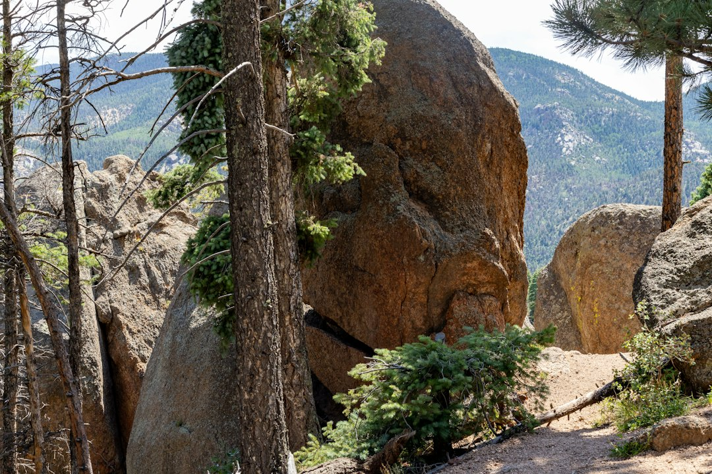
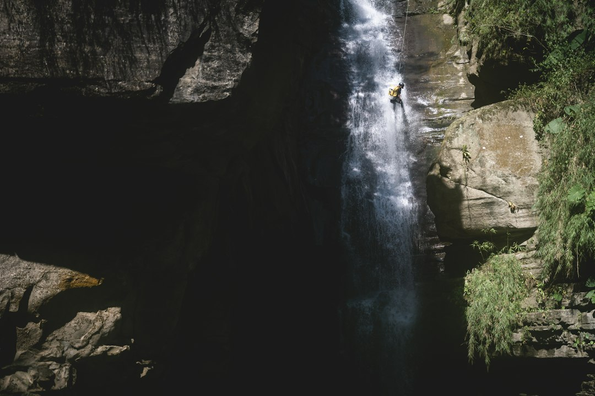
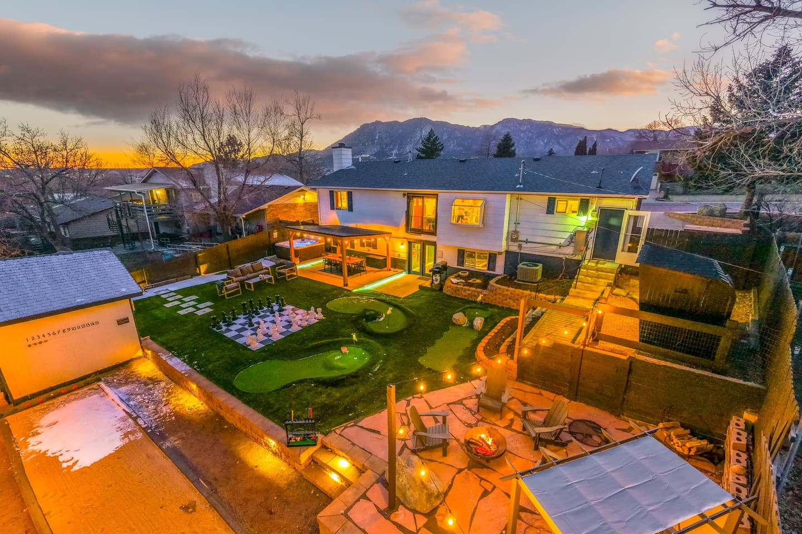
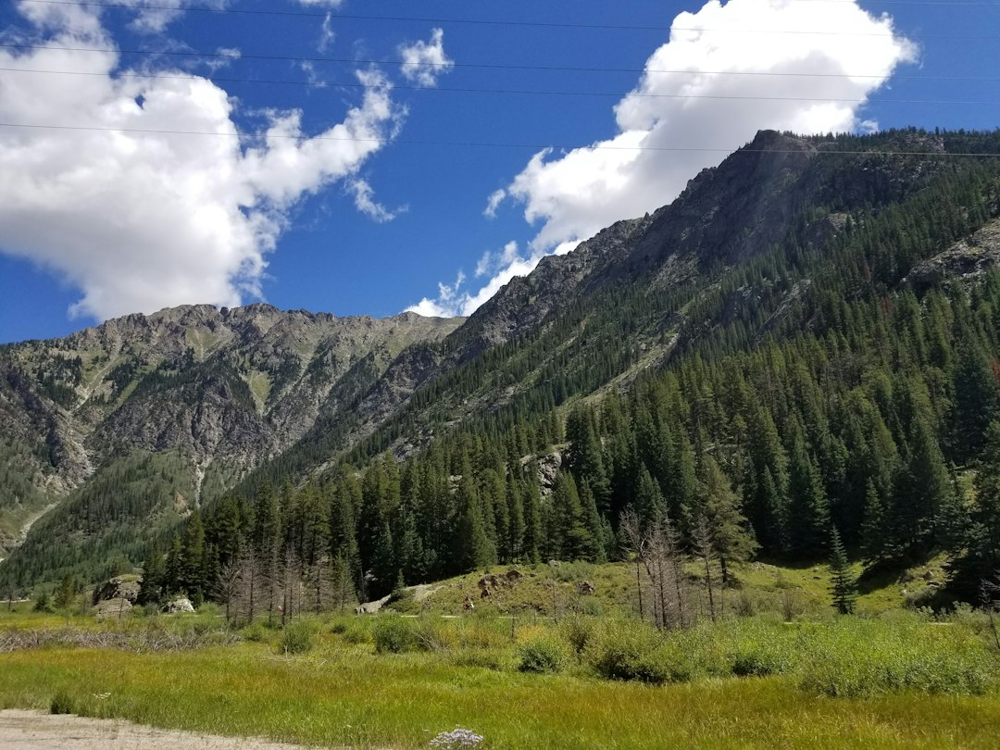
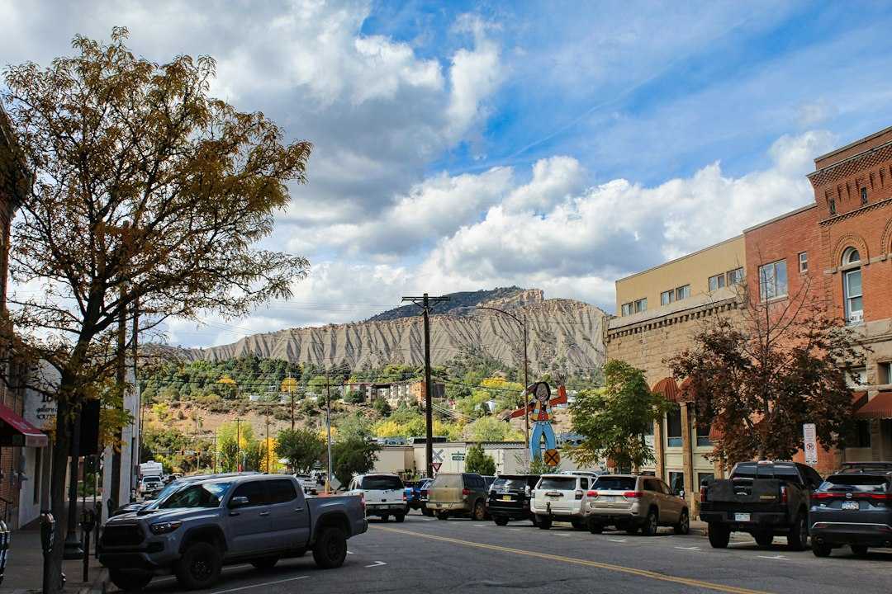
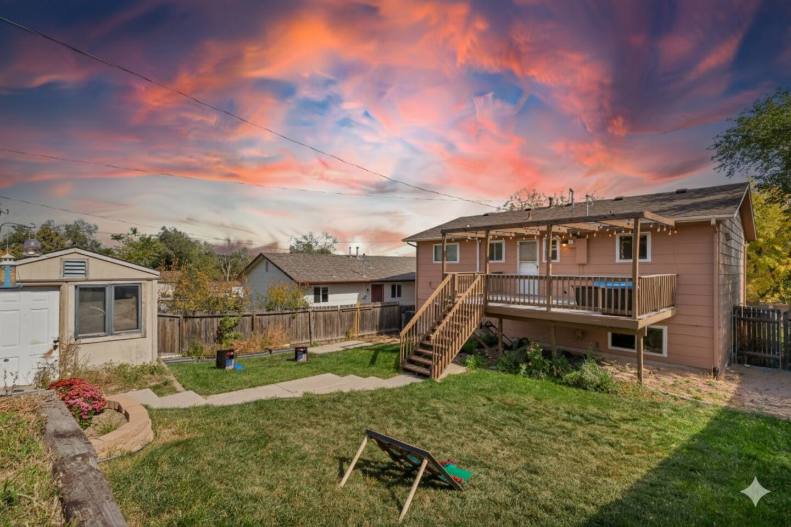

If your idea of a vacation involves more adrenaline than relaxation, you've picked the right place. Colorado Springs is an absolute playground for anyone who wants to push their limits, and while everyone knows about the pretty views from Garden of the Gods, the real magic happens when you get your heart rate up.

Forget the standard tourist trails. We're talking about climbing, soaring, and exploring the wilder side of the Pikes Peak region. This is your guide to crafting a trip that’s less about sightseeing and more about doing.

### Table of Contents
*   [Conquer the Altitudes: Beyond a Simple Drive](#altitudes)
*   [Adrenaline on the Rocks: Climbing, Zipping, and Exploring](#rocks)
*   [Go Deep: Subterranean and Historic Thrills](#deep)
*   [Make a Splash: Seasonal Water Adventures](#water)
*   [Fuel Your Adventure: Where to Eat and Drink](#fuel)
*   [Your Adventure Basecamp: Where to Stay in Colorado Springs](#stay)
*   [Frequently Asked Questions](#faq)

---

## Conquer the Altitudes: Beyond a Simple Drive

Seeing Pikes Peak is one thing; experiencing it is another. America's Mountain offers several ways to get your pulse pounding, each with a different level of commitment and bragging rights.

### The Manitou Incline: The Ultimate Fitness Challenge
Let’s get one thing straight: the Manitou Incline is not a hike. It’s a challenge. Gaining nearly 2,000 feet of elevation in just under a mile, this staircase of former railway ties is a rite of passage. The secret to surviving it? Go early—like, sunrise early—to avoid both the crowds and the brutal afternoon sun. The first quarter is deceptively easy, but don't be fooled. Pace yourself. The "false summit" about two-thirds of the way up is a soul-crusher, but the real top is worth it. Your reward is an incredible view and the much gentler 4-mile descent down the Barr Trail.

**Pro Tip:** You now need a free online reservation to hike the Incline, so book it in advance. Parking in Manitou is notoriously tricky; consider using the free shuttle from the Hiawatha Gardens building at [10 Old Man's Trail](https://www.google.com/maps/search/?api=1&query=10+Old+Man's+Trail+Manitou+Springs+CO).

### Pikes Peak Highway: Drive It Like You Mean It
Sure, anyone can drive the 19-mile paved road to the 14,115-foot summit, but the adventure is in how you do it. For a real thrill, rent a capable vehicle and tackle it on a clear morning when the hairpin turns feel like a real-life video game. Be prepared for the temperature to drop 30-40 degrees from the base to the summit. The drive takes about an hour up, but plan for at least three hours total to stop at the scenic overlooks and acclimate. The views from Devil's Playground are, in my opinion, even better than the summit itself. Once at the top, grab one of their world-famous high-altitude donuts—they’re mandatory.

### The Broadmoor's Pikes Peak Cog Railway
If you want the summit views without the white-knuckle driving or leg-burning climb, the Cog Railway is your ticket. It's the highest and longest cog railway in the world, and it was completely overhauled in 2021. The journey itself is the adventure, clinging to the mountainside and chugging through multiple ecological zones, from high plains to alpine tundra. Book your tickets *weeks* in advance, especially for weekend trips in the summer and fall. The best seats are on the "3-seat" side on the way up for the most expansive views of the reservoirs.

## Adrenaline on the Rocks: Climbing, Zipping, and Exploring

The iconic red rock formations of the area aren't just for looking at. They’re meant to be explored from every angle—including from above.

### Rock Climbing in Garden of the Gods
Yes, you can actually climb those surreal sandstone spires. Garden of the Gods is a world-renowned climbing spot, but it’s not a free-for-all. You need to register online for a free permit, and you absolutely must have experience or go with a guide. Companies like Front Range Climbing Co. offer guided trips for all skill levels. If you're a seasoned climber, the North Gateway Rock and the Three Graces are classic ascents. For beginners, a guided climb is one of the most unforgettable things to do in Colorado Springs and offers a perspective of the park that 99% of visitors will never see.

### Ziplining at Seven Falls
Seven Falls is stunning from the ground, but soaring over the canyon on a zipline is a whole other level of awesome. The Broadmoor Soaring Adventure features two different courses that will have you zipping between cliffs, crossing rope bridges, and rappelling down to the canyon floor. The Fins Course is faster and higher, while the Woods Course takes you through the forest. If you can, book the combo package to do both. It’s a half-day commitment, but the views of the 181-foot waterfall from a zipline are something you’ll never forget.

### Scrambling in Red Rock Canyon Open Space
Often called the "local's Garden of the Gods," Red Rock Canyon Open Space at [3550 W High St](https://www.google.com/maps/search/?api=1&query=3550+W+High+St+Colorado+Springs+CO) offers a less crowded but equally spectacular landscape. While it has great trails for hiking and mountain biking, the real fun for an adventurer is the rock scrambling. The Contemplative Trail leads to a quarry area where you can safely scramble up the rock formations for panoramic views of Pikes Peak and Garden of the Gods. It's a fantastic place to spend an afternoon feeling like a kid on a natural jungle gym.

## Go Deep: Subterranean and Historic Thrills

The adventure in Colorado Springs isn't just vertical; it's also subterranean.

### Cave of the Winds Mountain Park
Located just west of town in Williams Canyon, Cave of the Winds is more than just a simple cave tour. While the standard Discovery Tour is fascinating, adventure-seekers should book the Caving 101 tour. You’ll be outfitted with a headlamp and get to crawl and climb through undeveloped sections of the cave, navigating tight squeezes and muddy passages. It’s a fantastic, slightly claustrophobic thrill.

Above ground, the park has turned into a full-on adrenaline hub.
*   **The Terror-dactyl:** This giant swing launches you 150 feet into the canyon at nearly 100 miles per hour. It’s pure, terrifying fun.
*   **The Bat-a-Pult:** A 1,200-foot aerial ride that sends you flying across the canyon and back.
*   **Wind Walker Challenge Course:** A ropes course set on the edge of the 600-foot canyon cliff. Don’t look down.

### Exploring Manitou Springs
While it may seem like a quaint tourist town, Manitou Springs has a gritty, adventurous spirit. After tackling the Incline, spend an afternoon exploring its eccentricities. The real adventure is a scavenger hunt for the eight mineral springs scattered throughout the town, each with a unique (and sometimes weird) taste. Then, lose yourself in the vintage chaos of the Manitou Springs Penny Arcade, where you can play games that are over a hundred years old. It's a different kind of thrill—a throwback to a wilder, weirder time.

After a day of pushing your limits underground or on a cliff edge, you need a seriously comfortable place to crash, strategize for the next day, and maybe soak some sore muscles. For larger groups, a Colorado Springs vacation rental is the only way to go. The **Stunning Mountain Views, Hot Tub, Game Room Springline Stays** home is an ideal basecamp. It sleeps up to 11 and has—you guessed it—a hot tub with incredible views, which is the perfect remedy for an Incline-weary body.

## Make a Splash: Seasonal Water Adventures

When the weather heats up, the adventure moves to the water. The Arkansas River, about an hour's drive south of Colorado Springs, offers some of the best whitewater rafting in the country.

### Whitewater Rafting the Arkansas River
The stretch of the river that runs through Bighorn Sheep Canyon is perfect for first-timers and families, offering exciting Class II and III rapids. For the truly daring, the Royal Gorge section is where you’ll find the real action. This is advanced, heart-pounding rafting with continuous Class IV and V rapids that roar beneath the famous Royal Gorge Bridge.

Numerous outfitters in Cañon City, like Echo Canyon River Expeditions, offer half-day and full-day trips. A full-day trip through the Royal Gorge is an absolute epic. It’s a physically demanding and totally exhilarating way to experience one of Colorado’s most dramatic landscapes. Book this for a summer trip from June to August when the water levels are at their best.

## Fuel Your Adventure: Where to Eat and Drink

You can't send it on an empty stomach. Adventuring in Colorado Springs requires serious fuel, and these are the spots that deliver.

*   **For Pre-Hike Fuel:** Head to Mountainara Cucina Italiana ([817 W Colorado Ave](https://www.google.com/maps/search/?api=1&query=817+W+Colorado+Ave+Colorado+Springs+CO)) in Old Colorado City. Don't let the "Italian" name fool you; their breakfast burritos are legendary and the perfect portable fuel for a day on the mountain. Get the one with calabrian chili for an extra kick.
*   **For Post-Incline Recovery:** Adam's Mountain Cafe ([934 Manitou Ave](https://www.google.com/maps/search/?api=1&query=934+Manitou+Ave+Manitou+Springs+CO)) in Manitou is the spot. They serve hearty, wholesome food that will bring you back to life. The Nomad's Plate is my go-to for a bit of everything.
*   **For a Celebratory Burger and Beer:** After a long day, you've earned it. The Golden Bee at The Broadmoor is a classic, but for something more local and laid-back, check out Bingo Burger ([132 N Tejon St](https://www.google.com/maps/search/?api=1&query=132+N+Tejon+St+Colorado+Springs+CO)). Their Pueblo-chile-infused burgers and great selection of Colorado beers are the perfect end to an adventurous day.

## Your Adventure Basecamp: Where to Stay in Colorado Springs

Having the right home base is crucial for an adventure-packed trip. You need space for your gear, comfortable beds to recover in, and amenities that keep the fun going even after you’re back from the trail.

For the ultimate group trip where the adventure doesn't stop, you can't beat the **Epic Family Home: Mini-Golf, Sauna, Hot Tub, Games Springline Stays** property. Located conveniently at the [19 Clover address in Colorado Springs](https://www.google.com/maps/search/?api=1&query=19+Clover+Dr+Colorado+Springs+CO), this place is an attraction in itself. After a day of exploring, you can come home to your own private mini-golf course, unwind in the sauna or hot tub, and challenge your friends in the game room. It’s the perfect answer to the question of where to stay in Colorado Springs for a group that wants non-stop action.

For slightly smaller groups who want to be closer to the restaurants and shops of Old Colorado City, the **Views | 2 mins to OCC | Fire Pit | Games | Pets Springline Stays** is a fantastic choice. The location at [1112 Arch St](https://www.google.com/maps/search/?api=1&query=1112+Arch+St+Colorado+Springs+CO) is unbeatable for walking to dinner after a long day of adventure, and the fire pit is perfect for recapping the day's exploits under the stars.

---

## Frequently Asked Questions

### What is the best time of year for adventure travel in Colorado Springs?
It truly depends on your sport! Summer (June-August) is prime time for hiking, rock climbing, and whitewater rafting. Fall (September-October) offers cooler temperatures, golden aspen leaves, and fantastic conditions for mountain biking and hiking. Winter offers a different kind of adventure with snowshoeing opportunities and ice climbing for the truly bold. Spring can be unpredictable ("mud season"), but it's a great time to tackle lower-elevation trails before the summer crowds arrive.

### How do you deal with the altitude in Colorado Springs?
Colorado Springs sits at 6,035 feet, and many adventures take you much higher. The key is acclimatization. Take it easy your first day. Drink an obscene amount of water—more than you think you need. Avoid heavy alcohol consumption for the first 24-48 hours. If you're planning on summiting Pikes Peak or doing a strenuous high-altitude hike, try to spend a day or two in town first before going for it. Listen to your body; headaches and fatigue are early signs of altitude sickness.

### Do I need to book these adventure activities in advance?
Yes, absolutely. For things like the Pikes Peak Cog Railway, guided rock climbing, ziplining, and whitewater rafting, booking weeks or even months in advance is highly recommended, especially for peak season weekends. The free reservation for the Manitou Incline also fills up quickly. Spontaneity is great, but for the big-ticket adventures, planning ahead is essential to avoid disappointment.

### What should I pack for an adventure trip to Colorado Springs?
Layers are your best friend. The weather can change in an instant, especially in the mountains. A typical day can go from sunny and 75°F to a windy, cold hailstorm and back again. Pack moisture-wicking base layers, a fleece or mid-layer, and a waterproof/windproof outer shell. Sturdy, broken-in hiking boots are non-negotiable. Also, the sun is incredibly intense at altitude, so bring a hat, sunglasses, and high-SPF sunscreen.

---

Colorado Springs is a city that rewards those who are willing to get out and play. It offers endless opportunities to create stories you’ll be telling for years. So gear up, get out there, and find your next adventure.

When you’re ready to plan your trip, consider making one of our properties your home base. Booking directly with **[Springline Stays](https://www.springlinestays.com)** not only gets you the best rates but also ensures a seamless experience from a team that knows and loves this incredible city.

*Pikes Peak — a must-visit near our Colorado Springs properties.*

*Old Colorado City — a must-visit near our Colorado Springs properties.*

*[Epic Family Home: Mini-Golf, Sauna, Hot Tub, Games — Book your stay →](https://book.springlinestays.com/property/epic-family-home-mini-golf-sauna-hot-tub-games)*

*[Views | 2 mins to OCC | Fire Pit | Games | Pets — Book your stay →](https://book.springlinestays.com/property/views-2-mins-to-occ-fire-pit-games-pets)*
