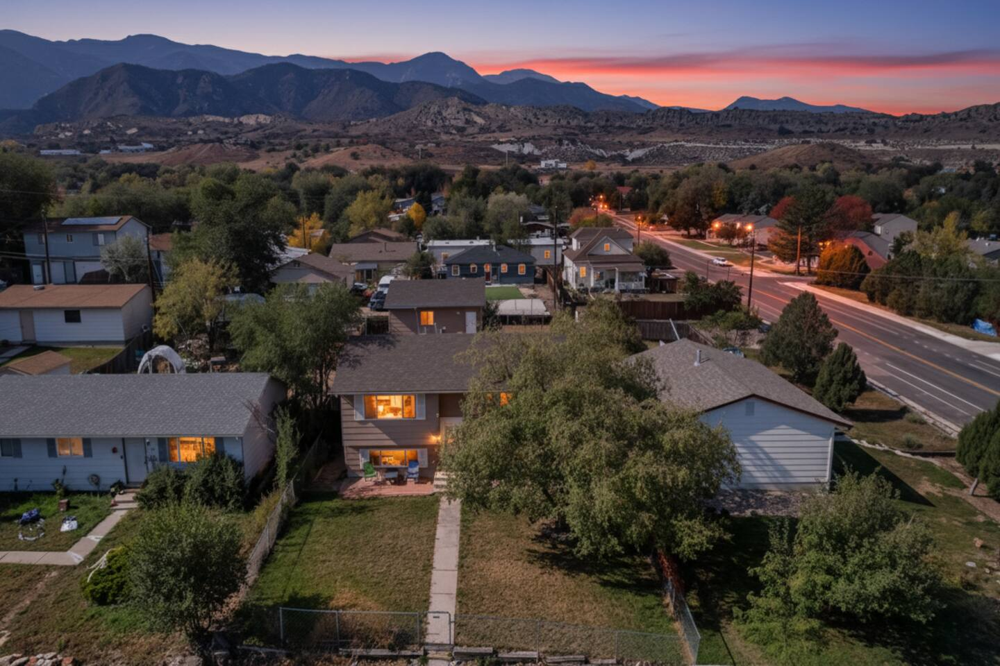
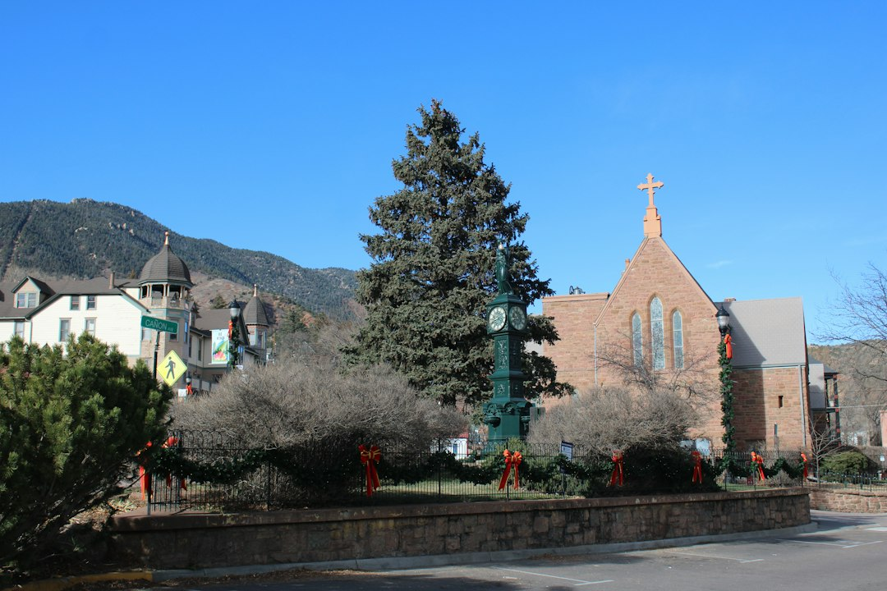
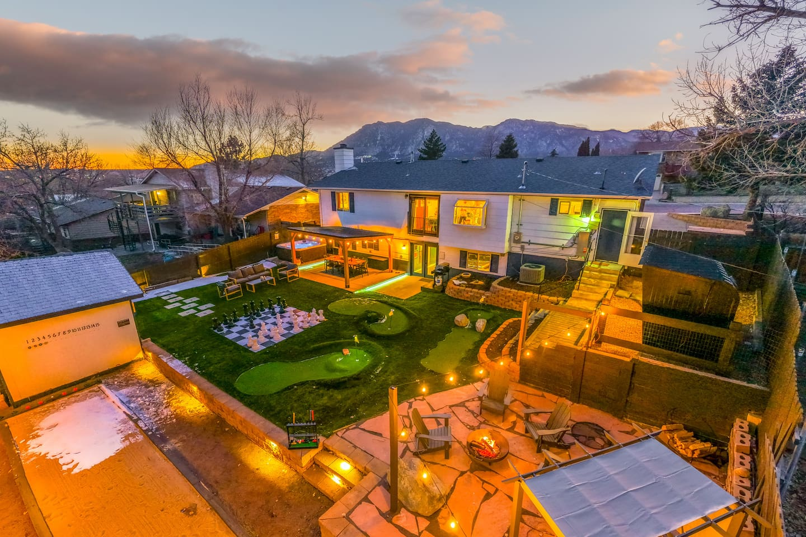
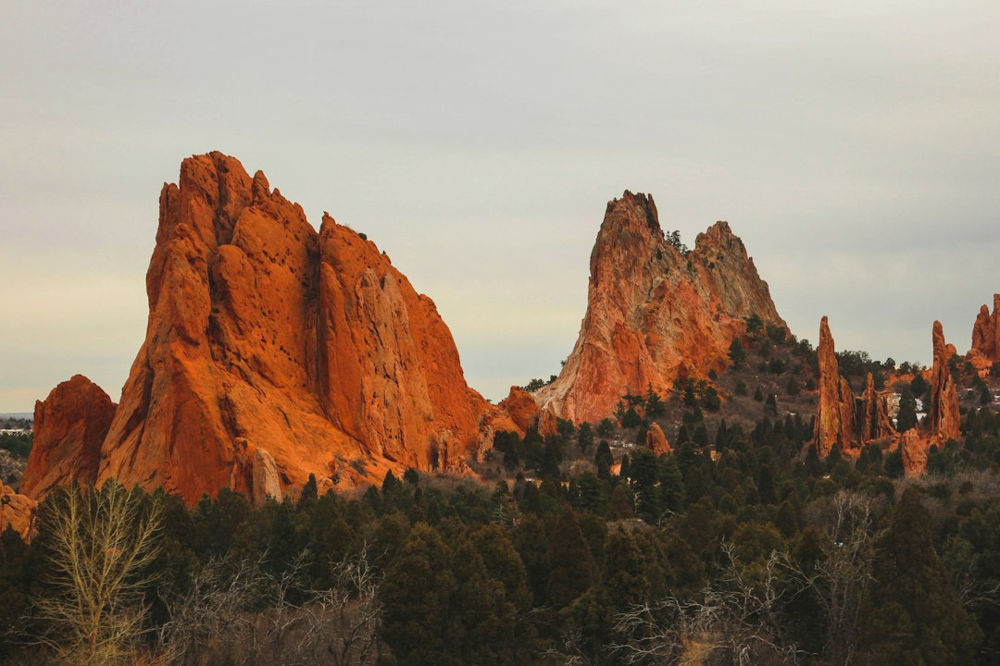
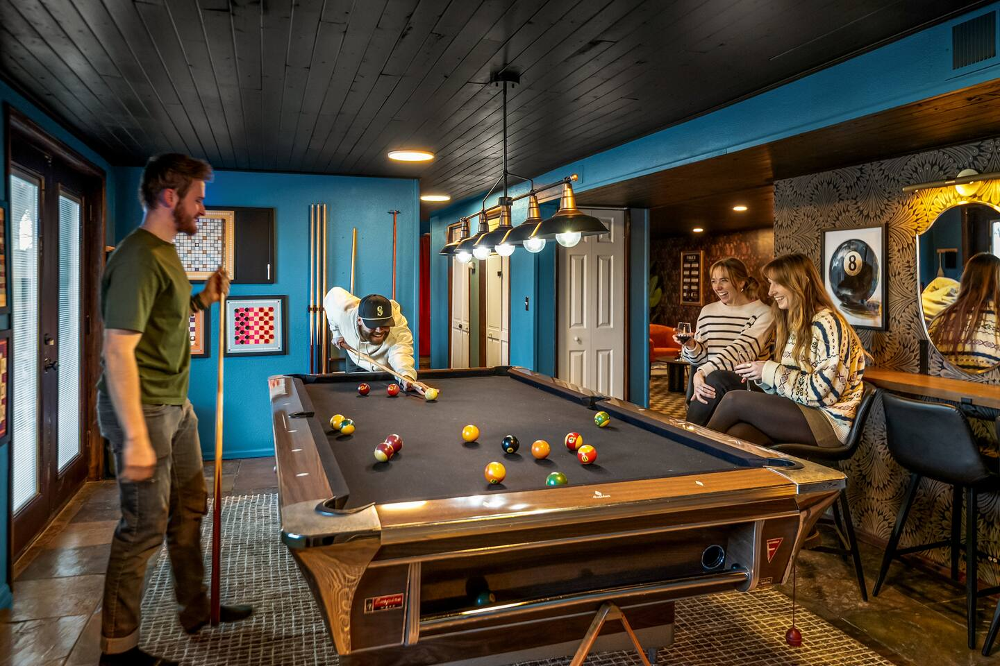

Choosing the right neighborhood in Colorado Springs can completely transform your trip. It's the difference between a vacation spent driving to every destination and one where your favorite coffee shop, trail, or brewery is just a short walk away. Do you want historic, walkable charm? Or would you rather have a huge backyard with mountain views and resort-style amenities?

Let's cut through the noise. This isn't a generic overview; it's a breakdown of the city's key areas to help you pick the perfect home base for your adventure.

### Table of Contents
*   [A Quick Guide: Comparing the Neighborhoods](#a-quick-guide-comparing-the-neighborhoods)
*   [Old Colorado City: For Historic Charm and Walkable Streets](#old-colorado-city-for-historic-charm-and-walkable-streets)
*   [Downtown Colorado Springs: For Urban Energy and Mountain Views](#downtown-colorado-springs-for-urban-energy-and-mountain-views)
*   [Manitou Springs: For Quirky, Artsy Mountain Vibes](#manitou-springs-for-quirky-artsy-mountain-vibes)
*   [The Westside: For Living Like a Local with Epic Amenities](#the-westside-for-living-like-a-local-with-epic-amenities)
*   [Frequently Asked Questions](#frequently-asked-questions)

***

### A Quick Guide: Comparing the Neighborhoods

| Neighborhood | Vibe | Best For | Proximity to Attractions |
| --- | --- | --- | --- |
| **Old Colorado City** | Historic, artsy, charming, laid-back | Couples, families, art lovers | 2 mins to Red Rock Canyon, 5 mins to Garden of the Gods |
| **Downtown COS**| Urban, energetic, foodie-focused | Young adults, business travelers | Walk to museums, dining, nightlife |
| **Manitou Springs** | Quirky, bohemian, tourist-friendly | Hikers, eclectic shoppers | Base of Pikes Peak & Manitou Incline |
| **The Westside** | Residential, spacious, quiet | Large groups, families, amenity-seekers | Central to everything by car (5-15 mins) |

***

### Old Colorado City: For Historic Charm and Walkable Streets

Before Colorado Springs was a city, there was Old Colorado City. This was the original capital of the Colorado Territory, and that Wild West history is baked into its DNA. Today, the main drag, Colorado Avenue, is lined with 19th-century brick buildings housing independent art galleries, unique boutiques, and some of the best restaurants in the city.

**The Vibe:** It’s relaxed and endlessly explorable. You can spend an entire day popping into galleries, grabbing a coffee at `Carnelian Coffee Co.`, and enjoying the public art. In the evening, the streets are alive with people heading to dinner, but it never feels overwhelming or loud. It strikes the perfect balance between lively and peaceful.

**Who Should Stay Here:**
If your ideal vacation involves strolling to get your morning coffee, spending afternoons browsing art, and having fantastic dinner options just a few blocks away, OCC is for you. It's incredibly romantic for couples but also great for families who appreciate a walkable home base.

**Don't-Miss Local Spots:**
*   **Dining:** You can't go wrong with [Paravicini's Italian Bistro](https://www.google.com/maps/search/?api=1&query=2802+W+Colorado+Ave+Colorado+Springs+CO+80904). It’s a local institution. The secret? Go for lunch to avoid the dinner rush. My go-to is the Gamberetti Scampi. For something more casual, `Front Range Barbeque` has a fantastic patio and live music.
*   **Shopping:** Skip the typical souvenir shops and head to `Eclectic CO.` for goods from over 100 local Colorado artists and makers.
*   **Proximity:** You are unbelievably close to the good stuff. It's a 5-minute drive to the main entrance of Garden of the Gods and less than that to Red Rock Canyon Open Space.

**Where to Stay in Old Colorado City:**
Being right on the main avenue can be a bit noisy. The sweet spot is staying a few blocks away in the surrounding residential area. You get the peace and quiet while still being a 5-minute walk from the action. For groups of up to eight, a home like the **[Views | 2 mins to OCC | Fire Pit | Games | Pets](https://book.springlinestays.com/property/views-2-mins-to-occ-fire-pit-games-pets)** vacation rental is a perfect example. It's strategically located near [1112 Arch St](https://www.google.com/maps/search/?api=1&query=1112+Arch+St+Colorado+Springs+CO), offering amazing Pikes Peak views from the deck and a private fire pit for recapping your day's adventures. This is how you do OCC right—close enough to walk, but far enough for quiet nights.

***

### Downtown Colorado Springs: For Urban Energy and Mountain Views

If you crave a more metropolitan feel, Downtown Colorado Springs delivers. It’s a vibrant grid of restaurants, cocktail bars, museums, and parks, all set against the dramatic backdrop of Pikes Peak. While it’s the city's business hub, it has a creative and energetic soul, especially along Tejon Street.

**The Vibe:** It’s polished and active. During the day, you’ll find a mix of professionals and visitors exploring the area. By night, it’s the city’s primary destination for dining and nightlife, from upscale restaurants to hidden speakeasies.

**Who Should Stay Here:**
Foodies, craft cocktail connoisseurs, and anyone who wants to be in the center of the action. If you plan on visiting the U.S. Olympic & Paralympic Museum or the Colorado Springs Fine Arts Center, staying downtown puts you within walking distance.

**Don't-Miss Local Spots:**
*   **Food & Drink:** `Shuga's` is a must-visit for its quirky decor and famous "Shuga's Hot Toddy," no matter the season. For an incredible dinner, `The Rabbit Hole` offers a unique, "Alice in Wonderland"-themed underground dining experience you have to book weeks in advance.
*   **Museums:** The [U.S. Olympic & Paralympic Museum](https://www.google.com/maps/search/?api=1&query=200+S+Sierra+Madre+St+Colorado+Springs+CO+80903) is a world-class, interactive museum that’s inspiring for all ages.
*   **Local Tip:** Take advantage of the free **Zeal Downtown Shuttle**. It runs a loop up and down Tejon Street, making it easy to hop between shops, restaurants, and parks without worrying about parking.

***

### Manitou Springs: For Quirky, Artsy Mountain Vibes

Nestled in the foothills right at the base of Pikes Peak, Manitou Springs is a town with a personality all its own. It’s funky, eclectic, and unapologetically a tourist town—but in the most charming way possible. The main street is a colorful collection of candy stores, art galleries, new-age shops, and vintage penny arcades. The town is famous for its eight naturally carbonated mineral springs, which you can taste for free as you wander.

**The Vibe:** Playful, bohemian, and a little bit weird (in a good way). It feels like a mountain resort town that decided to let its freak flag fly. Expect street performers, tarot card readers, and a constant stream of hikers coming down from the infamous Manitou Incline.

**Who Should Stay Here:**
Travelers looking for a unique, memorable experience. If you’re planning to conquer the Manitou Incline or drive the Pikes Peak Highway, staying here gives you a serious head start. It’s great for families with kids who will love the penny arcades and ice cream shops.

**Don't-Miss Local Spots:**
*   **The Manitou Incline:** This is a bucket-list challenge for fitness enthusiasts. It gains nearly 2,000 feet of elevation in less than a mile. Reservations are now required, so book online in advance!
*   **The Penny Arcade:** A sprawling, old-school arcade with hundreds of games, from vintage pinball and skeeball to classic horse-racing games that still only cost a quarter. It's pure, nostalgic fun.
*   **Local Tip:** Parking in Manitou is extremely difficult and expensive. Don't even try. Park for free at the Hiawatha Gardens lot ([10 Old Man's Trail](https://www.google.com/maps/search/?api=1&query=10+Old+Man's+Trail+Manitou+Springs+CO)) and take the free shuttle that runs every 15-20 minutes, dropping you right in the heart of town.

***

### The Westside: For Living Like a Local with Epic Amenities

What if you don't want to be in the middle of a bustling downtown? What if your priority is space, views, and a quiet home base to return to after a day of exploring? That's when you look to the residential neighborhoods on the west side of Colorado Springs, between Old Colorado City and the mountains.

**The Vibe:** This is where people actually live. The streets are quieter, the lots are bigger, and the homes often come with incredible amenities and unobstructed views of the Front Range. You trade the ability to walk to a restaurant for a private hot tub, a sprawling deck, and a yard for the kids (or dog) to run around in.

**Who Should Stay Here:**
Large families, multi-generational groups, or anyone planning a longer stay. If your group is big, finding a place that can comfortably accommodate everyone and keep them entertained is key. This is the perfect strategy for a Colorado Springs vacation rental that feels more like a private resort.

**Why it's a Great Basecamp:**
You are still incredibly central to everything, just by car. You're typically a 10-15 minute drive from Garden of the Gods, downtown, Cheyenne Mountain Zoo, and Old Colorado City. It's the perfect launchpad for all the region's top attractions.

**Where to Stay on the Westside:**
This area is where you find some of the most spectacular properties in the city. For a group of up to 11, the **[Stunning Mountain Views, Hot Tub, Game Room](https://book.springlinestays.com/property/family-friendly-firepit-hottub-views-games)** home near [26 Westmark](https://www.google.com/maps/search/?api=1&query=26+Westmark+Ave+Colorado+Springs+CO) is a prime example of getting more for your money—more space, a game room for the kids, and a hot tub with jaw-dropping views.

For the ultimate family reunion or group getaway, you can find homes that are destinations in themselves. The **[Epic Family Home: Mini-Golf, Sauna, Hot Tub, Games](https://book.springlinestays.com/property/epic-family-home-mini-golf-sauna-hot-tub-games)**, located near [19 Clover Circle N](https://www.google.com/maps/search/?api=1&query=19+Clover+Circle+N+Colorado+Springs+CO), is a perfect example. With your own private mini-golf course, a sauna, a hot tub, and a full game room, you might find it hard to leave. This is how you create core memories on a family vacation.

***

### Frequently Asked Questions

**What is the best area to stay in Colorado Springs for families?**
For families with young children, Old Colorado City is a fantastic choice due to its walkability, parks, and charming, low-key atmosphere. For larger families or those with teens, a larger home on the Westside offers more space and amenities like game rooms and hot tubs to keep everyone entertained.

**Is it better to stay in Colorado Springs or Manitou Springs?**
It depends on your priority. Stay in Manitou Springs if your trip is centered around hiking the Incline, exploring Pikes Peak, and you love a quirky, bohemian town. Stay in Colorado Springs for more diverse dining options, better access to a wider range of attractions like Garden of the Gods and the U.S. Olympic Museum, and a more central location for exploring the entire Pikes Peak region.

**Do I need a car in Colorado Springs?**
Yes, it is highly recommended. While you can stay in a walkable area like Old Colorado City or Downtown, the top attractions like Pikes Peak, Garden of the Gods, and Cheyenne Mountain Zoo are spread out. A car is essential to experience the best of what the area has to offer.

**What part of Colorado Springs is closest to Pikes Peak and Garden of the Gods?**
The west side of Colorado Springs, including Old Colorado City and Manitou Springs, is closest to both Pikes Peak and Garden of the Gods. Staying in these areas will significantly cut down your drive time to the region's most popular natural attractions.

---

No matter which neighborhood you choose, you’re setting yourself up for an incredible adventure at the foot of the Rockies. Each area offers a different way to experience the magic of this city.

Ready to find your perfect home base? Explore all of our handpicked homes and **[book your Colorado Springs vacation rental directly with Springline Stays](https://www.springlinestays.com)** to guarantee the best rates and skip the extra fees charged by third-party sites.

*Garden of the Gods — a must-visit near our Colorado Springs properties.*

*[Views | 2 mins to OCC | Fire Pit | Games | Pets — Book your stay →](https://book.springlinestays.com/property/views-2-mins-to-occ-fire-pit-games-pets)*

*[Epic Family Home: Mini-Golf, Sauna, Hot Tub, Games — Book your stay →](https://book.springlinestays.com/property/epic-family-home-mini-golf-sauna-hot-tub-games)*
