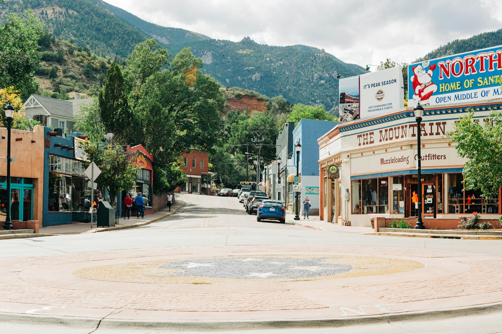
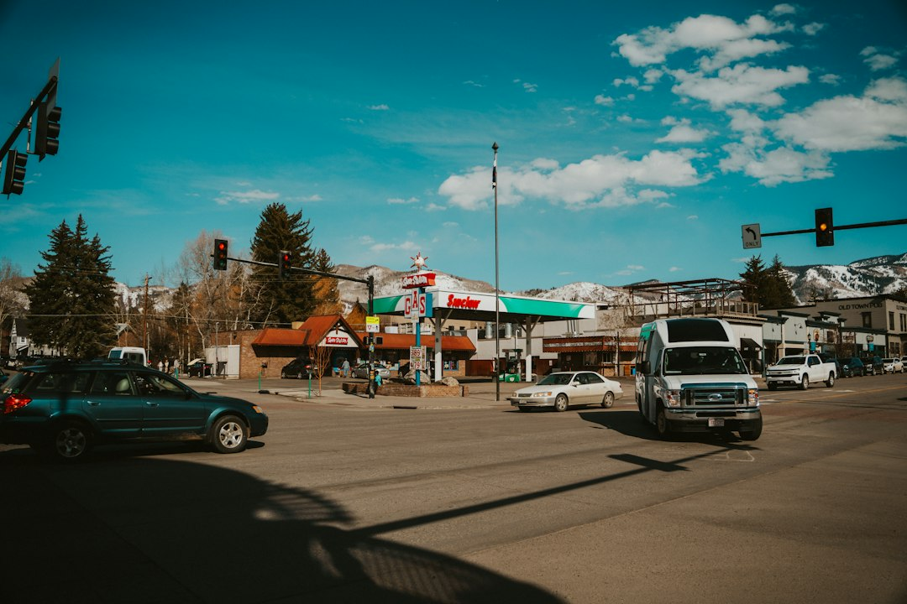
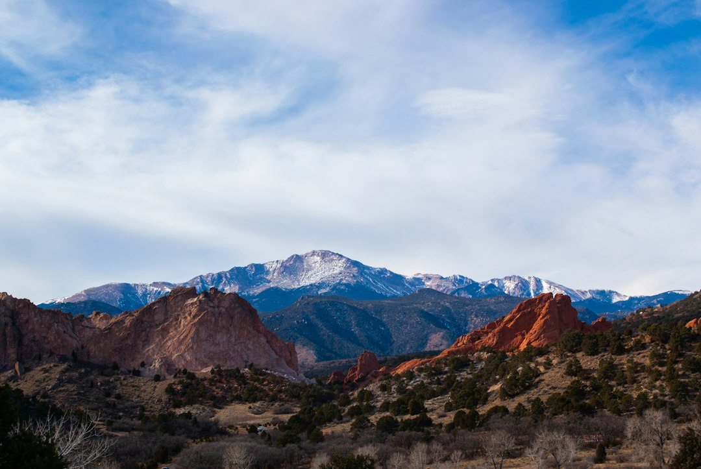
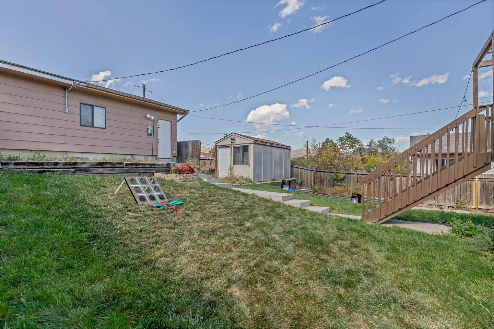
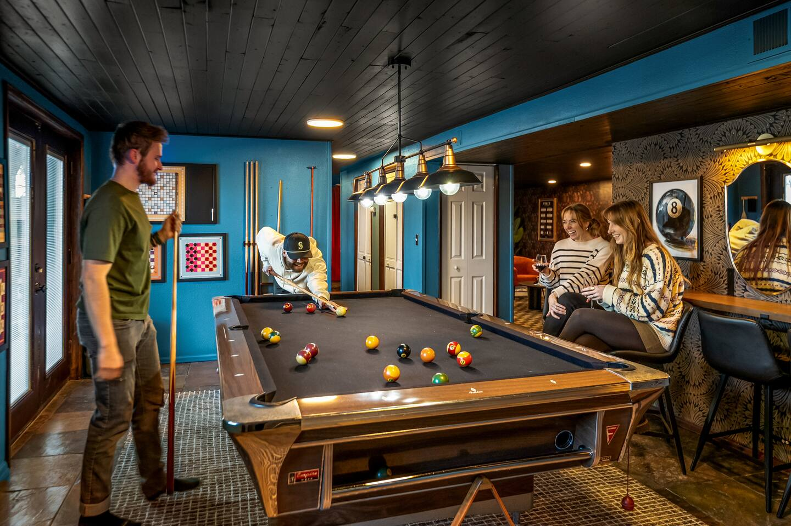

So you've decided to visit Colorado Springs—fantastic choice. You’ve probably got a list of must-sees: Garden of the Gods, Pikes Peak, maybe the Manitou Incline if you’re feeling particularly ambitious. But the single most important decision you'll make, the one that shapes your entire trip, is deciding *where* to set up your home base.

Choosing the right neighborhood is the difference between a good vacation and an unforgettable one. It determines your morning coffee run, your evening vibe, and how much time you spend in the car versus on the trail. This isn't just a list of areas; it's a breakdown of the city's personality, helping you find the corner of Colorado Springs that feels like it was made just for you.

### Table of Contents
*   [Old Colorado City: Historic Charm & Walkable Streets](#old-colorado-city-historic-charm--walkable-streets)
*   [The Westside: Adventure at Your Doorstep](#the-westside-adventure-at-your-doorstep)
*   [Manitou Springs: Quirky, Bohemian & Funky](#manitou-springs-quirky-bohemian--funky)
*   [Downtown Colorado Springs: Urban Energy & Culinary Hub](#downtown-colorado-springs-urban-energy--culinary-hub)
*   [The Broadmoor Area: Upscale Vistas & Resort Living](#the-broadmoor-area-upscale-vistas--resort-living)
*   [Frequently Asked Questions](#frequently-asked-questions)

---

## Old Colorado City: Historic Charm & Walkable Streets

**Vibe:** Imagine stepping back into the Wild West, but with art galleries, craft coffee, and incredible Italian food. That's Old Colorado City (OCC). As the original capital of the Colorado Territory, its tree-lined streets are packed with beautifully preserved 19th-century brick buildings that now house independent boutiques, art galleries, and some of the city's best restaurants. It's charming, highly walkable, and has a relaxed, artistic energy.

**Perfect For:** Couples on a romantic getaway, history buffs, and anyone who loves to spend their days strolling, shopping, and gallery-hopping.

### What to Do in Old Colorado City

*   **Walk Colorado Avenue:** This is the main drag and the heart of OCC. Pop into the art galleries—you'll find everything from contemporary Western art to stunning landscape photography. Don't miss Hunter-Wolff Gallery for its impressive sculpture collection.
*   **Dine Like a Local:** OCC is a food-lover's paradise. For a classic, can't-miss Italian dinner, make a reservation at **Paravicini's Italian Bistro** ([2802 W Colorado Ave](https://www.google.com/maps/search/?api=1&query=2802+W+Colorado+Ave+Colorado+Springs+CO)). My absolute favorite thing to order is the Gnocchi con Pesto. For something more casual, **Pizzeria Rustica** ([2527 W Colorado Ave](https://www.google.com/maps/search/?api=1&query=2527+W+Colorado+Ave+Colorado+Springs+CO)) serves authentic Neapolitan-style pizza from a wood-fired oven.
*   **Saturday Farmers Market:** From June through October, Bancroft Park transforms into a bustling market with local produce, fresh-baked bread, and artisanal goods. It's the perfect place to grab provisions for your stay.
*   **Simpich Showcase & Museum:** A truly unique and magical spot. This family-run theater features handcrafted marionettes in incredible productions. It's a hidden gem that feels like a step into a fairytale.

### Where to Stay in Old Colorado City

Being close to OCC means you can leave the car behind for dinner and drinks. For groups or families who want that perfect blend of location and comfort, our **[Views | 2 mins to OCC | Fire Pit | Games | Pets](https://book.springlinestays.com/property/views-2-mins-to-occ-fire-pit-games-pets)** property is an ideal choice. Located at 1112 Arch St, this Springline Stays home puts you a stone's throw from the action while offering a quiet retreat with a fire pit for those cool Colorado evenings. It's perfect for unwinding after a day of exploring, and it’s pet-friendly, so your four-legged friend can join the adventure.

## The Westside: Adventure at Your Doorstep

**Vibe:** Less a formal neighborhood and more a sprawling, outdoorsy area, the Westside is where the city starts to blend into the mountains. It's defined by its immediate access to iconic parks and trail systems. The vibe here is active, adventurous, and all about the views. You'll see more hiking boots than high heels, and the day starts early to catch the best light on the rocks.

**Perfect For:** Hikers, rock climbers, families with energetic kids, and anyone whose primary goal is to spend as much time outside as possible.

### What to Do on the Westside

*   **Garden of the Gods:** This is the main event, and for good reason. The towering red rock formations are breathtaking. **Local's Tip:** The main parking lots fill up by 9 AM, especially on weekends. To beat the crowds, enter the park from its western entrance off 30th Street for easier access to the quieter Siamese Twins and Balanced Rock trails. An early morning or late evening visit offers the best light and fewest people.
*   **Red Rock Canyon Open Space:** This is the local's alternative to Garden of the Gods. It has similar stunning red rock formations but with a fraction of the crowds and more dog-friendly trails. The Quarry Pass Trail offers fantastic views back toward Garden of the Gods and Pikes Peak.
*   **Bear Creek Regional Park:** A massive park with everything from tennis courts and playgrounds to an archery range and an incredible dog park. The trails here are generally flatter and perfect for a more relaxed walk or run.
*   **Fuel Up:** Before you hit the trails, grab a coffee and a legendary breakfast burrito from **El Super Taco** ([3120 W Colorado Ave](https://www.google.com/maps/search/?api=1&query=3120+W+Colorado+Ave+Colorado+Springs+CO)). It’s a no-frills spot that delivers big on flavor.

### Where to Stay on the Westside

After a long day of hiking, there's nothing better than coming home to a place where you can relax and recharge. For larger groups and families, the **[Stunning Mountain Views, Hot Tub, Game Room](https://book.springlinestays.com/property/family-friendly-firepit-hottub-views-games)** property is a perfect basecamp. This home, located at 26 Westmark, is a Springline Stays favorite for a reason. Imagine soaking in the private hot tub with a direct view of Pikes Peak as the sun sets, followed by a family foosball tournament in the game room. It’s the ultimate Colorado Springs vacation rental experience.

## Manitou Springs: Quirky, Bohemian & Funky

**Vibe:** Manitou Springs is technically its own town, but it's so close it feels like Colorado Springs' eccentric little sibling. Nestled at the base of Pikes Peak, this mountain town is a vibrant mix of New Age spirituality, old-school tourism, and bohemian art. The streets are lined with colorful, quirky shops, penny arcades, and natural mineral spring fountains you can drink from. It’s fun, a little touristy, and completely unique.

**Perfect For:** Travelers who love funky boutiques, families with kids who will adore the arcades, and anyone looking for a truly one-of-a-kind atmosphere.

### What to Do in Manitou Springs

*   **The Penny Arcade:** A must-do. This massive, rambling arcade has everything from vintage 1930s horse-racing games that still cost a nickel to modern video games. It’s a nostalgic trip for adults and a wonderland for kids.
*   **Taste the Springs:** There are eight naturally carbonated mineral springs scattered throughout the town, each with a slightly different taste and mineral content. Grab a cup and go on a self-guided tasting tour—it's a classic Manitou experience.
*   **The Manitou Incline:** Not for the faint of heart. This trail gains nearly 2,000 feet of elevation in just under a mile, straight up the side of the mountain on an old cable car route. It's a brutal but rewarding workout with epic views. **Important:** You now need to make a free online reservation to hike it.
*   **Shop and Explore:** The main street, Manitou Avenue, is a treasure trove of eclectic shops. You'll find everything from homemade fudge and crystal shops to art galleries and clothing boutiques.

**Local's Tip:** Parking in Manitou is notoriously difficult and expensive. Your best bet is to park at the free lot at [10 Old Man's Trail](https://www.google.com/maps/search/?api=1&query=10+Old+Man's+Trail+Manitou+Springs+CO) and take the free shuttle that runs a continuous loop through town.

## Downtown Colorado Springs: Urban Energy & Culinary Hub

**Vibe:** The city's core has undergone a major revitalization and is now a buzzing hub of activity. Downtown Colorado Springs combines a modern, energetic feel with historic architecture. It's home to the city's best restaurants, a thriving brewery scene, unique museums, and a growing number of cocktail bars and performance venues.

**Perfect For:** Foodies, craft beer lovers, and visitors who want to be in the center of the action with plenty of nightlife and dining options.

### What to Do Downtown

*   **U.S. Olympic & Paralympic Museum:** This state-of-the-art museum is an absolute must-see, whether you're a sports fan or not. The interactive exhibits and inspiring stories are incredibly well done. Plan to spend at least 2-3 hours here.
*   **Explore the Food Scene:** Downtown is the epicenter of the city's culinary evolution. For a unique experience, head to **COATI Uprise** ([514 S Tejon St](https://www.google.com/maps/search/?api=1&query=514+S+Tejon+St+Colorado+Springs+CO)), an industrial-chic food hall with a diverse range of vendors. For a cozy, date-night spot with an incredible menu, you can't beat **Shuga's** ([702 S Cascade Ave](https://www.google.com/maps/search/?api=1&query=702+S+Cascade+Ave+Colorado+Springs+CO))—try their famous spicy shrimp soup.
*   **First Friday Art Walk:** If your trip lines up with the first Friday of the month, you're in for a treat. Dozens of galleries and studios open their doors for a massive, city-wide art party with free admission, live music, and refreshments.
*   **Pikes Peak Center for the Performing Arts:** Check the schedule here for everything from Broadway tours and stand-up comedy to symphony performances. It’s a beautiful venue for a night out.

## The Broadmoor Area: Upscale Vistas & Resort Living

**Vibe:** Centered around the legendary, five-star Broadmoor Hotel, this neighborhood is synonymous with luxury, history, and stunning natural beauty. The area is characterized by stately homes, manicured landscapes, and its proximity to the Cheyenne Cañon. It's quieter and more residential than other parts of the city, offering a feeling of secluded elegance while still being just a short drive from major attractions.

**Perfect For:** Families looking for a resort-like experience, luxury travelers, and anyone who wants to be close to the Cheyenne Mountain Zoo and Seven Falls.

### What to Do in the Broadmoor Area

*   **Cheyenne Mountain Zoo:** Consistently ranked as one of the best zoos in the country, this is America's only mountain zoo. The highlight is feeding the giraffes by hand on a terrace with panoramic views of the city below. It’s an unforgettable experience for all ages.
*   **Seven Falls:** Walk up the 224 steps alongside the magnificent seven-tiered waterfall cascading 181 feet down a granite box canyon. It’s a spectacular sight, especially after a good rain.
*   **North Cheyenne Cañon Park:** This city-owned park is a local treasure and it's completely free. Drive up the scenic road to Helen Hunt Falls, or tackle the popular Columbine Trail for a beautiful canyon hike.
*   **Stroll The Broadmoor Grounds:** You don't have to be a guest to experience some of the magic. The public is welcome to walk around the beautiful lake, browse the high-end shops, and enjoy a drink at one of the hotel's stunning lounges.

### Where to Stay in the Broadmoor Area

To get that exclusive, resort-style feel with the privacy and space of your own home, you need a property that’s an attraction in itself. The **[Epic Family Home: Mini-Golf, Sauna, Hot Tub, Games](https://book.springlinestays.com/property/epic-family-home-mini-golf-sauna-hot-tub-games)** is exactly that. This incredible Colorado Springs vacation rental, located at 19 Clover, is a Springline Stays destination home. After a day at the zoo, the kids can play a round on the private mini-golf course while the adults relax in the sauna or hot tub. It’s a property designed for making memories, offering unparalleled amenities in one of the city’s most prestigious areas.

---

## Frequently Asked Questions

### What is the best area to stay in Colorado Springs?
The "best" area depends on your travel style. For walkability and historic charm with great restaurants, choose **Old Colorado City**. For immediate access to hiking and major parks like Garden of the Gods, the **Westside** is ideal. For a unique, bohemian vibe with funky shops, stay near **Manitou Springs**. For a more urban feel with nightlife and a top-tier food scene, **Downtown** is your spot.

### Do I need a car in Colorado Springs?
Yes, it is highly recommended. While some neighborhoods like Old Colorado City and Downtown are walkable within their boundaries, Colorado Springs is a sprawling city. To access the best hiking trails, parks, and attractions like Pikes Peak and the Cheyenne Mountain Zoo, you will absolutely need a car.

### What is the most walkable part of Colorado Springs?
Old Colorado City is arguably the most pleasantly walkable neighborhood for tourists. You can easily spend a full day exploring the shops, galleries, and restaurants along Colorado Avenue on foot. Downtown Colorado Springs is also very walkable, with a more urban and dense layout.

### How many days do you need to see Colorado Springs?
To comfortably see the main highlights like Garden of the Gods, Pikes Peak, and one or two other major attractions without feeling rushed, plan for at least 3 to 4 full days. If you're an avid hiker or want to explore more deeply, a 5 to 7-day trip will allow you to discover more local favorites and take a day trip to a nearby attraction like the Royal Gorge Bridge.

### What's the difference between staying in Colorado Springs and Manitou Springs?
Staying in Colorado Springs offers more variety in neighborhoods and puts you more central to the entire Pikes Peak region. Manitou Springs offers a very specific, quirky, mountain-town experience. It's fantastic if you love its unique vibe, but it can be crowded, and parking is a challenge. Staying in a nearby Colorado Springs neighborhood often provides more space and easier logistics while keeping Manitou just a short drive away.

---

No matter which neighborhood you choose, you're in for an incredible adventure in a city that perfectly blends urban culture with untamed nature. When you're ready to find that perfect home base for your trip, we invite you to **[book direct with Springline Stays](https://www.springlinestays.com)** for the best rates and a curated collection of homes designed to make your Colorado Springs vacation unforgettable.

*Garden of the Gods — a must-visit near our Colorado Springs properties.*

*[Views | 2 mins to OCC | Fire Pit | Games | Pets — Book your stay →](https://book.springlinestays.com/property/views-2-mins-to-occ-fire-pit-games-pets)*

*[Epic Family Home: Mini-Golf, Sauna, Hot Tub, Games — Book your stay →](https://book.springlinestays.com/property/epic-family-home-mini-golf-sauna-hot-tub-games)*
