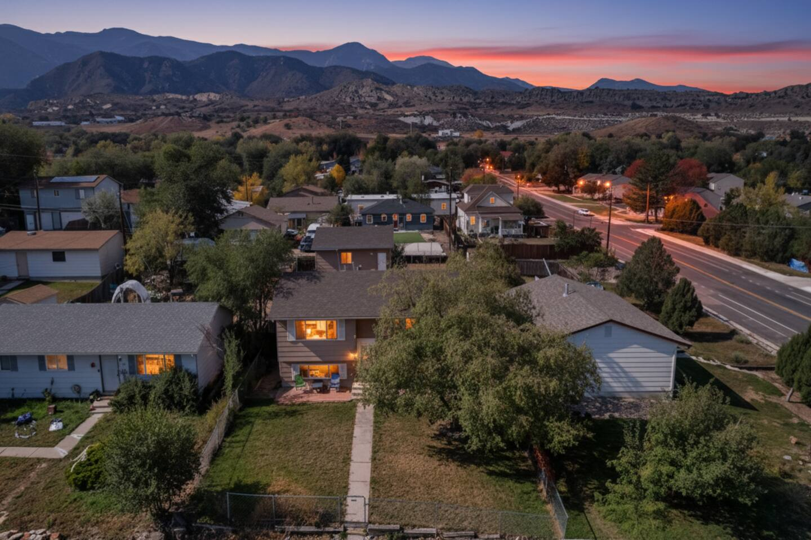
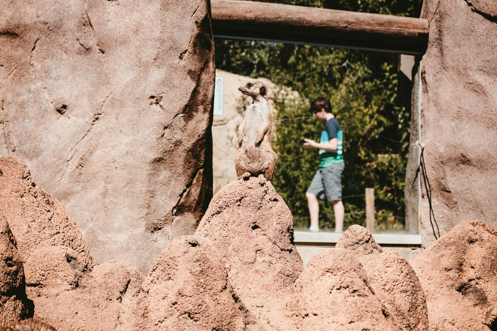
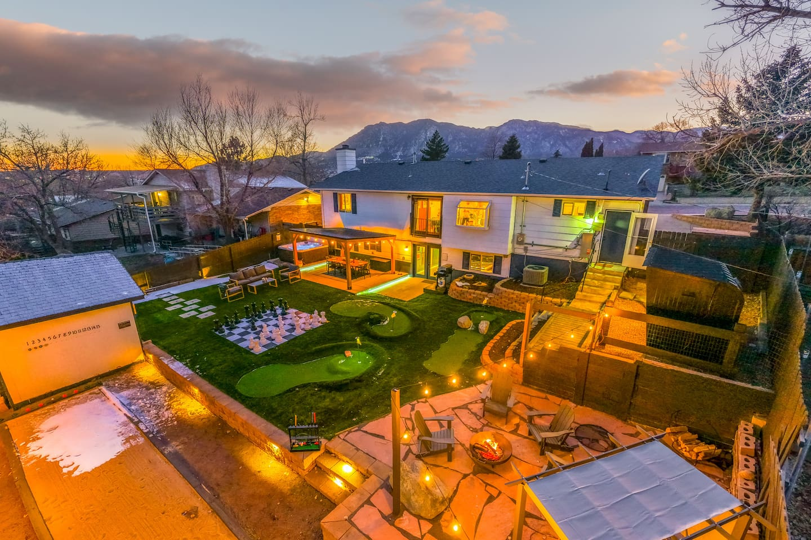
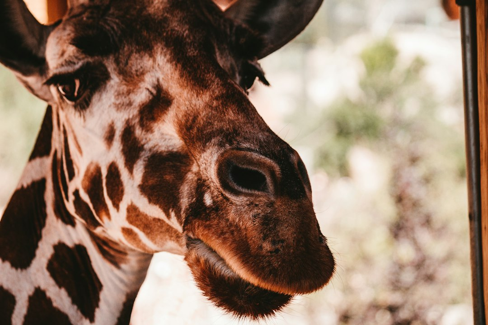
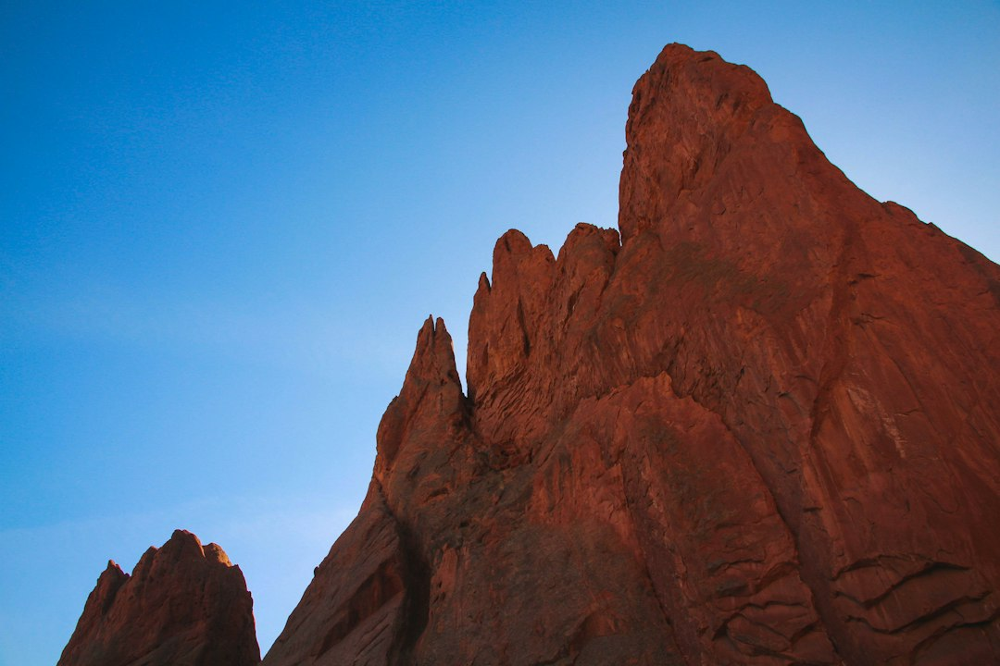
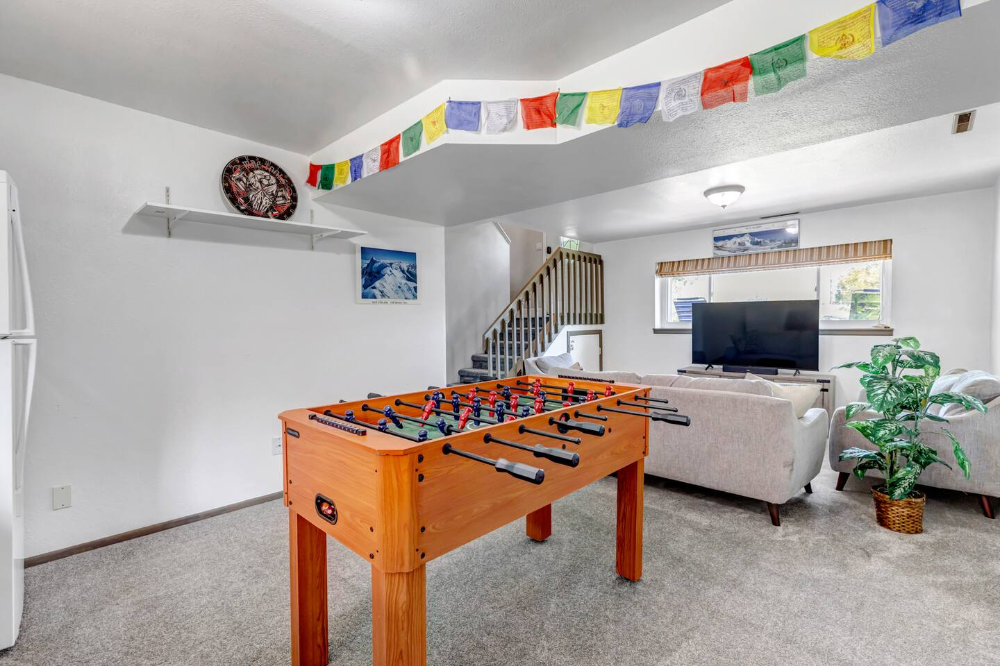

Finding the perfect place to stay in Colorado Springs isn't just about the house—it's about the neighborhood. The vibe of your home base can completely shape your trip, determining whether your mornings start with a walk to a historic coffee shop or with deer grazing outside your window against a mountain backdrop.

Are you here to hike every trail in sight? Are you a foodie looking for the best local spots? Or are you planning a multi-generational family trip where keeping kids and grandparents happy is the name of the game?

The right neighborhood makes all the difference. Instead of just dropping a pin on a map, let's walk through the city's key areas so you can find the perfect launchpad for your adventure. This is the ultimate guide to where to stay in Colorado Springs.

### Table of Contents
*   [Old Colorado City (The Westside): For History Buffs and Art Lovers](#old-colorado-city)
*   [The Broadmoor & Southwest: For Mountain Scenery and Family Adventures](#the-broadmoor-southwest)
*   [Downtown: For Urban Explorers and Foodies](#downtown)
*   [Manitou Springs: For a Quirky Mountain Town Vibe](#manitou-springs)
*   [Rockrimmon & The Northwest: For Quiet Retreats with a View](#rockrimmon-the-northwest)
*   [Frequently Asked Questions](#faq)

---

## Old Colorado City (The Westside): For History Buffs and Art Lovers

### The Vibe
Forget the high-rises and city bustle. The Westside, and specifically Old Colorado City (OCC), feels like stepping back into the Wild West, only with better art galleries and much better coffee. This was the original capital of the Colorado Territory, and that historic, frontier-town soul is palpable. Think brick-lined sidewalks, 19th-century buildings housing independent boutiques, and a fiercely local, creative spirit. It's walkable, charming, and less frenetic than Downtown, but with a personality all its own.

### Perfect For
Couples looking for a romantic getaway, art aficionados, and anyone who loves being able to park their car and explore on foot for hours. It’s the ideal spot if your vacation fantasy involves strolling to a bakery in the morning, gallery-hopping in the afternoon, and enjoying a fantastic Italian dinner at night.

### What to Do Here
The main artery is Colorado Avenue. Spend an afternoon wandering in and out of the shops and galleries. You'll find everything from Southwestern art at the Michael Garman Museum & Gallery to quirky gifts and local crafts.

*   **Dining:** You're spoiled for choice. For a classic, can't-miss Italian meal, make a reservation at **Paravicini's Italian Bistro** ([2802 W Colorado Ave](https://www.google.com/maps/search/?api=1&query=2802+W+Colorado+Ave+Colorado+Springs+CO)). If incredible Neapolitan-style pizza is calling your name, **Pizzeria Rustica** ([2527 W Colorado Ave](https://www.google.com/maps/search/?api=1&query=2527+W+Colorado+Ave+Colorado+Springs+CO)) is the spot—their patio is fantastic on a summer evening. For a more casual bite, the tacos at **T-Byrds Tacos & Tequila** ([26 E Kiowa St](https://www.google.com/maps/search/?api=1&query=26+E+Kiowa+St+Colorado+Springs+CO), a short drive away) are legendary.
*   **Proximity to Parks:** OCC is the gateway to the gods. You’re a literal 5-minute drive from the main entrance of **Garden of the Gods** and the less-crowded (but equally stunning) **Red Rock Canyon Open Space**. This makes it incredibly easy to pop over for a sunrise hike or a quick sunset drive before the crowds descend.
*   **Local Tip:** Parking on Colorado Avenue can be tricky on weekends. Look for side-street parking on the numbered streets (like 25th or 26th) a block or two off the main drag.

### Where to Stay in Old Colorado City
For groups who want to be immersed in the Westside vibe, finding a place with character and convenience is key. Our **[Views | 2 mins to OCC | Fire Pit | Games | Pets](https://book.springlinestays.com/property/views-2-mins-to-occ-fire-pit-games-pets)** home is perfectly situated. It's a cozy and stylish retreat that sleeps 8, putting you just a stone's throw from the heart of Old Colorado City.

After a day exploring the galleries, you can come back and soak in the mountain views from the living room or gather around the fire pit in the backyard. Plus, being pet-friendly means you don't have to leave your four-legged co-adventurer behind. This specific home, the `Views | 2 mins to OCC | Fire Pit | Games | Pets Springline Stays`, is a fantastic basecamp located near `1112 Arch St`. It gives you that perfect blend of neighborhood charm and easy access to Colorado Springs' biggest attractions.

---

## The Broadmoor & Southwest: For Mountain Scenery and Family Adventures

### The Vibe
Lush, established, and nestled right against the mountains. This part of town is defined by the grandeur of The Broadmoor hotel, with its sprawling, immaculate grounds. The surrounding neighborhoods are quiet and residential, with winding roads that offer stunning glimpses of Cheyenne Mountain. It feels a world away from the city, offering a sense of seclusion and luxury while still being incredibly close to some of the area's top family attractions.

### Perfect For
Families with kids of all ages, luxury seekers, and anyone whose primary goal is to be as close to the mountains as possible. If your itinerary includes the zoo, waterfalls, and scenic drives, this is your spot.

### What to Do Here
This area is an absolute playground for classic Colorado Springs activities.

*   **Cheyenne Mountain Zoo:** Consistently ranked one of the best zoos in the country, and for good reason. It’s built on the side of a mountain, so be prepared for a workout! The real magic is hand-feeding the giraffes with the city sprawling out below you. **Local Tip:** Buy your tickets online in advance for a specific entry time, as they often sell out, especially on weekends.
*   **Seven Falls:** A series of seven cascading waterfalls in a 1,250-foot-wall box canyon. It's a breathtaking sight. You can climb the 224 steps alongside the falls for an incredible view or take the in-mountain elevator to the "Eagle's Nest" lookout. It's owned by The Broadmoor, so expect a resort-level experience (and price tag).
*   **North Cheyenne Cañon Park:** This is the local's alternative to the more tourist-heavy spots. Drive up the scenic road (or hike/bike it) to access trails like **Helen Hunt Falls** and **St. Mary's Falls**. It's completely free and offers a rugged, authentic taste of the Front Range.

### Where to Stay in the Southwest
While The Broadmoor hotel is an option, a private vacation rental gives your family space to spread out, a kitchen for easy meals, and amenities that feel like your own private resort. For a group of up to 11, the **[Stunning Mountain Views, Hot Tub, Game Room](https://book.springlinestays.com/property/family-friendly-firepit-hottub-views-games)** home is an ideal choice in this part of town.

Imagine this: after a long day at the zoo, the kids can burn off their remaining energy in the game room while the adults relax in the hot tub, watching the sunset over the mountains. This home, known as the `Stunning Mountain Views, Hot Tub, Game Room Springline Stays`, is located in a quiet residential area near `26 Westmark`, offering the perfect blend of peaceful retreat and proximity to adventure. It’s the kind of place that makes your trip truly unforgettable.

---

## Downtown: For Urban Explorers and Foodies

### The Vibe
Energetic, modern, and increasingly vibrant. Downtown Colorado Springs is the cultural and culinary heart of the city. It’s a clean, manageable downtown with a grid of streets lined with local restaurants, craft cocktail bars, independent coffee shops, and museums. You'll see a mix of young professionals, Olympic athletes, and tourists all enjoying the buzz.

### Perfect For
Foodies, craft-beverage enthusiasts, museum-goers, and anyone who wants to be in the center of the action. If you prefer walking to dinner over driving and love having dozens of options at your fingertips, Downtown is your best bet.

### What to Do Here
Downtown is built for exploring on foot. Park your car and wander.

*   **U.S. Olympic & Paralympic Museum:** A must-visit. This state-of-the-art museum is an inspiring and interactive tribute to Team USA. Even if you're not a huge sports fan, the stories and exhibits are incredibly moving.
*   **Eat and Drink:** This is where the city's food scene shines. Grab a coffee and a pastry at **The Wild Goose Meeting House** ([401 N Tejon St](https://www.google.com/maps/search/?api=1&query=401+N+Tejon+St+Colorado+Springs+CO)). For a unique dinner experience, find the "secret" entrance to **The Rabbit Hole** ([101 N Tejon St](https://www.google.com/maps/search/?api=1&query=101+N+Tejon+St+Colorado+Springs+CO)), a whimsical underground restaurant. For creative cocktails, **Shame & Regret** ([15 E Bijou St, Suite B](https://www.google.com/maps/search/?api=1&query=15+E+Bijou+St,+Suite+B,+Colorado+Springs,+CO)) is a moody, fantastic spot.
*   **Acacia Park:** A lovely green space in the heart of downtown, often hosting farmers' markets, concerts, and an outdoor ice rink in the winter.

---

## Manitou Springs: For a Quirky Mountain Town Vibe

### The Vibe
Bohemian, eccentric, and unapologetically touristy—in the best way possible. Tucked in a canyon at the foot of Pikes Peak, Manitou Springs is a world unto itself. The streets are lined with colorful, Victorian-era buildings housing penny arcades, crystal shops, art galleries, and fudge parlors. The town was founded as a health resort, and you can still taste the naturally carbonated mineral water from the eight public fountains scattered throughout town.

### Perfect For
Travelers looking for a unique, funky basecamp. It's perfect for hikers tackling the Incline or Pikes Peak, and for those who enjoy a lively, slightly weird, mountain-town atmosphere.

### What to Do Here
Manitou is all about the experience.

*   **The Manitou Incline:** The holy grail for fitness enthusiasts. This trail gains nearly 2,000 feet of elevation in less than a mile, straight up the side of the mountain on the ties of a former cog railway. It is brutally difficult. **Crucial Tip:** You MUST make a free reservation online in advance. They will turn you away without one.
*   **Pikes Peak Cog Railway:** The classic, scenic way to reach the 14,115-foot summit of Pikes Peak without driving. The newly renovated trains and depot make for a comfortable and breathtaking journey.
*   **Walk the Strip:** The main street, Manitou Avenue, is an attraction in itself. Play vintage games at the Penny Arcade, sample the mineral spring waters (bring a cup!), and browse the eclectic shops.

---

## Rockrimmon & The Northwest: For Quiet Retreats with a View

### The Vibe
Quiet, scenic, and residential, with dramatic topography. The Rockrimmon area is characterized by its rolling hills, rock formations, and incredible views of the city and Pikes Peak. It feels more like a modern suburb than a historic neighborhood, but its convenience is unmatched. It offers easy access to I-25 (your gateway to Denver or southern Colorado) and is very close to the U.S. Air Force Academy.

### Perfect For
Families looking for a quiet home base, visitors to the Air Force Academy, or anyone who wants a spacious retreat with easy highway access for day trips.

### What to Do Here
This area is more about a peaceful setting, but it's a fantastic launchpad.

*   **U.S. Air Force Academy:** The Visitor Center is open to the public and offers a fascinating look into cadet life. The real star is the Cadet Chapel, an architectural masterpiece (check for its public access schedule as it undergoes renovations).
*   **Garden of the Gods:** You’re just a short drive from the northern entrance, which is often a less congested way to get into the park.
*   **Ute Valley Park:** A local favorite for hiking and mountain biking. It features a network of trails winding through hogback ridges and open meadows, offering great views without the crowds of Garden of the Gods.

### Where to Stay in the Northwest
This area is perfect for finding a larger home that can serve as a destination in itself. If you're traveling with a big family or group and want amenities that will keep everyone entertained, look no further than the **[Epic Family Home: Mini-Golf, Sauna, Hot Tub, Games](https://book.springlinestays.com/property/epic-family-home-mini-golf-sauna-hot-tub-games)**.

This isn't just a place to sleep; it's an experience. This incredible home sleeps 11 and comes with its own private mini-golf course, a sauna, a hot tub, and a fully-loaded game room. It’s the perfect way to end a day of Colorado exploring—or to spend a day when you just want to relax and have fun at home. This property, known to locals as the `Epic Family Home: Mini-Golf, Sauna, Hot Tub, Games Springline Stays` near `19 Clover`, is the ultimate family-friendly Colorado Springs vacation rental.

---

No matter which neighborhood you choose, you're just a short drive from the majestic beauty that makes this city one of a kind. The key is to pick the home base that matches your travel style.

Ready to find your perfect Colorado Springs launchpad? At Springline Stays, we offer a curated collection of homes in the city's best neighborhoods. When you book directly with us, you're guaranteed the best rates and a seamless experience from start to finish. Explore our homes and **[book your Colorado Springs vacation rental today](https://www.springlinestays.com)**.

## Frequently Asked Questions

### What is the best area to stay in Colorado Springs for families?
The Southwest area near The Broadmoor is fantastic for families. It offers close proximity to top attractions like the Cheyenne Mountain Zoo and Seven Falls. Neighborhoods like Rockrimmon in the Northwest are also great, offering quieter residential streets and larger homes with family-friendly amenities, while still providing easy access to parks and the Air Force Academy.

### Is it better to stay in Colorado Springs or Manitou Springs?
It depends on the vibe you're looking for. Stay in Manitou Springs if you want a quirky, walkable, bohemian mountain-town experience and plan to focus on hiking Pikes Peak or the Incline. Stay in Colorado Springs for a more central location with easier access to a wider variety of restaurants, neighborhoods, and attractions like Garden of the Gods and the U.S. Olympic & Paralympic Museum.

### What part of Colorado Springs is closest to Pikes Peak?
Manitou Springs is the town located at the base of Pikes Peak and is the starting point for both the Pikes Peak Cog Railway and the Manitou Incline. The west side of Colorado Springs, including Old Colorado City, is also very close, providing a short drive to the entrance of the Pikes Peak Highway.

### Do I need a car to get around Colorado Springs?
Yes, a car is highly recommended. While certain neighborhoods like Downtown and Old Colorado City are very walkable within their boundaries, Colorado Springs is a sprawling city. To access the best hiking trails and attractions like Garden of the Gods, Pikes Peak, and Cheyenne Mountain Zoo, you will need a vehicle.

### Where can I find a Colorado Springs vacation rental with a hot tub?
Many private vacation rentals offer hot tubs, which are perfect for relaxing after a day of hiking. At Springline Stays, we have several properties with this feature. For example, our **[Stunning Mountain Views, Hot Tub, Game Room](https://book.springlinestays.com/property/family-friendly-firepit-hottub-views-games)** home and our **[Epic Family Home](https://book.springlinestays.com/property/epic-family-home-mini-golf-sauna-hot-tub-games)** both feature private hot tubs for guests to enjoy. Booking direct is the best way to find homes with specific amenities like this.

*Cheyenne Mountain Zoo — a must-visit near our Colorado Springs properties.*

*Red Rock Canyon — a must-visit near our Colorado Springs properties.*

*[Epic Family Home: Mini-Golf, Sauna, Hot Tub, Games — Book your stay →](https://book.springlinestays.com/property/epic-family-home-mini-golf-sauna-hot-tub-games)*

*[Views | 2 mins to OCC | Fire Pit | Games | Pets — Book your stay →](https://book.springlinestays.com/property/views-2-mins-to-occ-fire-pit-games-pets)*
