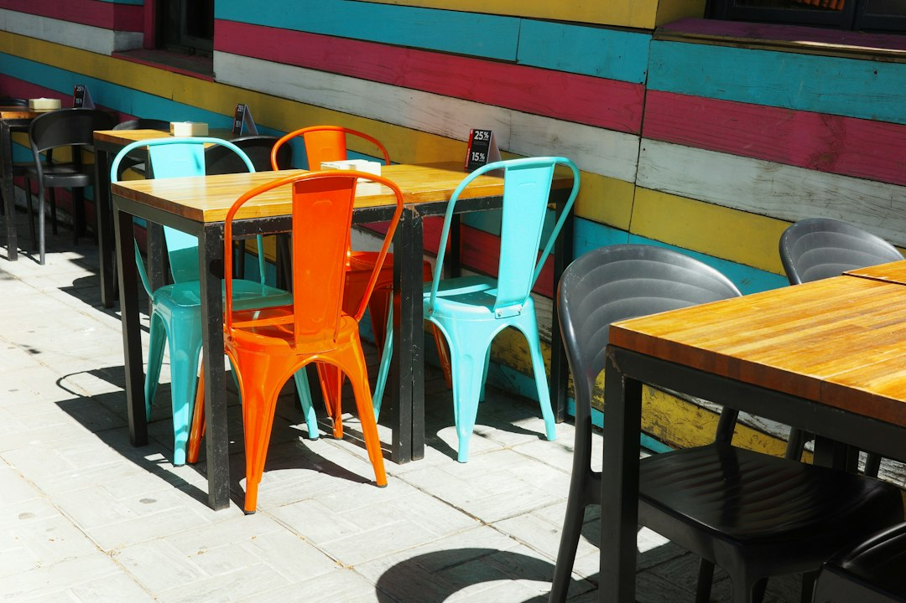
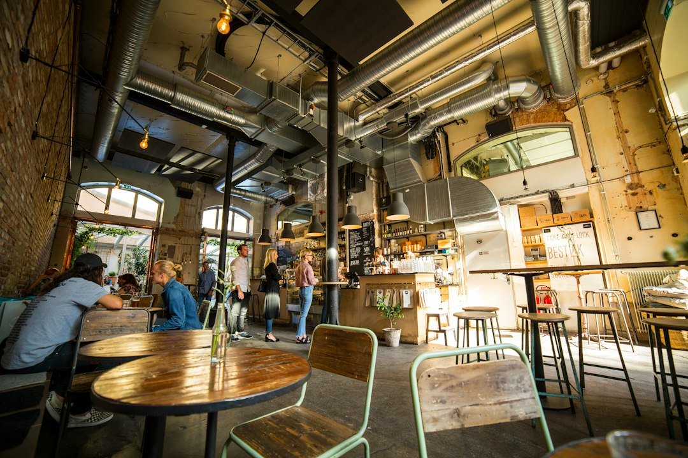
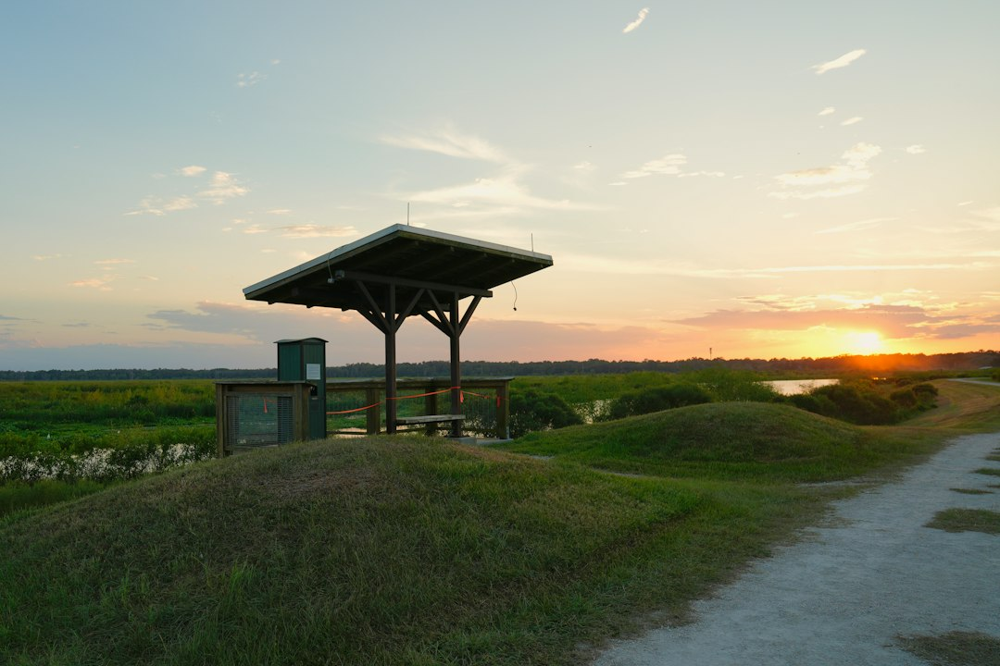
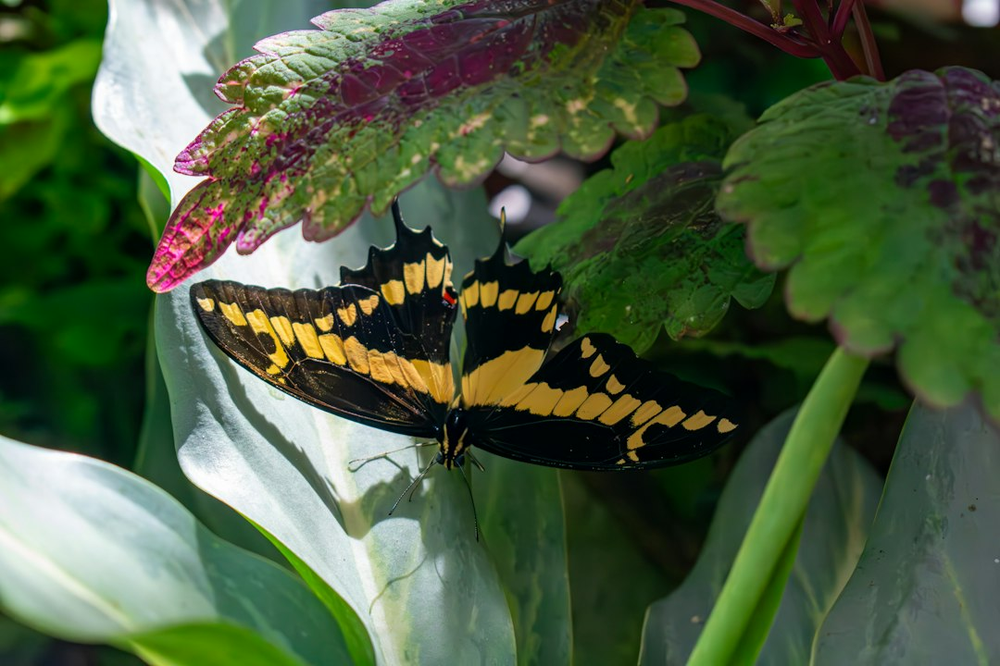
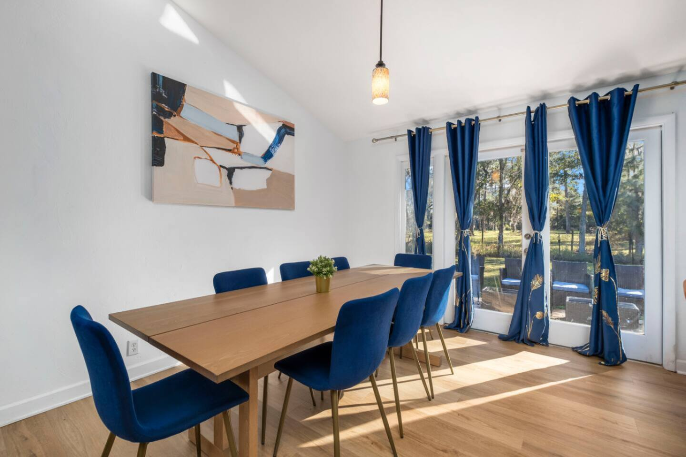

So you think you know Gainesville. You've heard about The Swamp, the gators, and the sea of orange and blue on a fall Saturday. But I'm going to let you in on a secret: one of the very best things to do in Gainesville has nothing to do with football and everything to do with food.

This city's culinary scene is a vibrant, eclectic, and seriously underrated powerhouse. It's a place where Southern comfort food happily coexists with authentic Vietnamese pho, where farm-to-table isn't a trend but a way of life, and where you can find a life-changing taco in the back of a Latin market.

Forget what you think you know about "college town" food. We're diving deep into the spots that locals cherish. This is your ultimate Gainesville travel guide for eating your way through the city.

### Table of Contents
*   [Start Your Day Right: Gainesville's Best Breakfast & Brunch](#start-your-day-right-gainesvilles-best-breakfast--brunch)
*   [Lunchtime Legends: Casual Feasts and Must-Try Sandwiches](#lunchtime-legends-casual-feasts-and-must-try-sandwiches)
*   [An International Tour: A Taste of the World in Gainesville](#an-international-tour-a-taste-of-the-world-in-gainesville)
*   [Dinner Destinations: From Hip Hangouts to Upscale Evenings](#dinner-destinations-from-hip-hangouts-to-upscale-evenings)
*   [Raise a Glass: Gainesville's Top Breweries and Cocktail Bars](#raise-a-glass-gainesvilles-top-breweries-and-cocktail-bars)
*   [Sweet Endings & Late-Night Cravings](#sweet-endings--late-night-cravings)

---

### Start Your Day Right: Gainesville's Best Breakfast & Brunch

Breakfast is non-negotiable, especially if you have a long day of exploring Paynes Prairie or Devil's Millhopper ahead. Here’s where to get your fuel.

#### The Flying Biscuit Cafe
A Southern institution with a funky twist. The name says it all—you *must* get the biscuits. They're fluffy, buttery clouds of perfection served with a side of cranberry-apple butter.
*   **The Vibe:** Casual, colorful, and always bustling. Expect a wait on weekends, but it’s worth it.
*   **Must-Order:** The Southern Scramble (scrambled eggs with bacon, collard greens, onions, and cheddar) or the namesake Flying Biscuit Breakfast.
*   **Local Tip:** Don't sleep on the "Creamy Dreamy Grits." They are, in fact, creamy and dreamy.
*   **Address:** [4150 NW 16th Blvd, Gainesville, FL 32605](https://www.google.com/maps/search/?api=1&query=4150+NW+16th+Blvd+Gainesville+FL+32605)

#### Halo Potato Donuts
This isn't your average donut shop. Halo makes their donuts from potatoes, which results in a ridiculously moist, fluffy, and cakey texture that’s unlike anything else. They make them fresh to order, so they arrive warm.
*   **The Vibe:** A small, counter-service spot with a cult following. The line can get long, so go early or be prepared to wait for greatness.
*   **Must-Order:** The Cinnamon Sugar is a classic, but the Fruity Pebbles and the seasonal flavors are always a win. Honestly, you can't go wrong.
*   **Local Tip:** They have great coffee, but for a real treat, pair your donuts with a cold brew.
*   **Address:** [1323 S Main St, Gainesville, FL 32601](https://www.google.com/maps/search/?api=1&query=1323+S+Main+St+Gainesville+FL+32601)

#### 43rd Street Deli & Breakfast House
A true Gainesville classic that's been serving the community for decades. This is where you go for a no-frills, absolutely delicious, classic American breakfast. The portions are generous and the service is friendly and fast.
*   **The Vibe:** Old-school diner feel. It’s comforting, familiar, and always reliable.
*   **Must-Order:** The "Gator Omelet" if you're feeling adventurous (yes, it has real gator meat) or any of their massive pancake stacks. Their corned beef hash is also top-notch.
*   **Local Tip:** They have two locations. The one on 39th Ave is typically a bit less crowded than the one closer to campus on 13th St.
*   **Address (39th Ave):** [5202 NW 39th Ave, Gainesville, FL 32606](https://www.google.com/maps/search/?api=1&query=5202+NW+39th+Ave+Gainesville+FL+32606)

### Lunchtime Legends: Casual Feasts and Must-Try Sandwiches

When midday hunger strikes, these spots deliver big on flavor without the formality of a dinner reservation.

#### Satchel's Pizza
Satchel's is more than a pizza place; it's a Gainesville experience. It's a quirky, art-filled compound with a junk-art gift shop, live music, and some of the best pizza you'll ever have. You can even dine in a vintage van.
*   **The Vibe:** Eclectic, funky, and family-friendly. It’s a feast for the eyes as much as it is for the stomach.
*   **Must-Order:** Build your own pie with their incredible variety of toppings, or get the "Satch-Pan," their take on a deep-dish. And whatever you do, get a side of their homemade salad dressing. People buy it by the bottle.
*   **Local Tip:** It's cash only! They have an ATM on-site, but it's best to come prepared. Also, ask for the "pep-pep-pepperoni" if you like a little extra spice.
*   **Address:** [1800 NE 23rd Ave, Gainesville, FL 32609](https://www.google.com/maps/search/?api=1&query=1800+NE+23rd+Ave+Gainesville+FL+32609)

#### Hogan's Great Sandwiches
Another Gainesville institution that has been slinging sandwiches since 1982. This is the definition of a local hero. The bread is baked fresh, the ingredients are high-quality, and the combinations are legendary.
*   **The Vibe:** A classic, no-nonsense sub shop. You're here for one thing: an amazing sandwich.
*   **Must-Order:** The "Hogan's Hero" is their signature Italian sub, and it's famous for a reason. The "French Dip" and the "Great Steak" are also hall-of-fame contenders.
*   **Local Tip:** Get your sandwich "all the way" and ask for a side of their hot pepper relish.
*   **Address:** [2327 NW 13th St, Gainesville, FL 32609](https://www.google.com/maps/search/?api=1&query=2327+NW+13th+St+Gainesville+FL+32609)

Finding a great spot to relax after a day of classes, meetings at Shands, or exploring the UF campus is key. Many of Gainesville's best quick bites are right in this area. If you’re traveling with your furry friend and want to stay in the heart of the action, our **[Walk to University, Pet Friendly, Cozy Townhome](https://book.springlinestays.com/property/walk-to-university-pet-friendly-5-min-to-uf)** is the perfect home base. You can drop off your things, leave the car, and walk to a dozen incredible lunch spots. It's the ultimate convenience when looking for where to stay in Gainesville.

### An International Tour: A Taste of the World in Gainesville

The university brings a world of cultures to Gainesville, and the food scene reflects that beautifully. Here's where to go for authentic international cuisine.

#### La Tienda
Tucked in the back of a Latin grocery store, La Tienda serves what are arguably the most authentic and delicious tacos in town. It's a true hidden gem.
*   **The Vibe:** In-the-know, bustling, and wonderfully chaotic. You order at the counter in the back of the store.
*   **Must-Order:** The tacos al pastor are divine, shaved right off the trompo. The carnitas and lengua are also exceptional. Grab a Mexican Coke from the cooler to complete the experience.
*   **Local Tip:** The menu is entirely in Spanish, so have your Google Translate ready or just point at what looks good. You can't miss.
*   **Address:** [2204 SW 13th St, Gainesville, FL 32608](https://www.google.com/maps/search/?api=1&query=2204+SW+13th+St+Gainesville+FL+32608)

#### Pho Ha Noi
When you need a comforting, flavorful bowl of soup, this is the place. Pho Ha Noi serves rich, aromatic, and deeply satisfying Vietnamese pho that rivals what you'd find in a much bigger city.
*   **The Vibe:** Simple, clean, and focused on the food. It’s a family-run spot where the quality speaks for itself.
*   **Must-Order:** The Pho Dac Biet (the special combination with rare steak, brisket, tendon, and tripe) is the go-to for pho purists. The Bún bò Huế is a spicy alternative that's equally incredible.
*   **Local Tip:** Don't be shy with the accompaniments! Load up your bowl with fresh basil, bean sprouts, lime, and jalapeños.
*   **Address:** [3550 SW 34th St #J, Gainesville, FL 32608](https://www.google.com/maps/search/?api=1&query=3550+SW+34th+St+J+Gainesville+FL+32608)

#### Mi Apa Latin Cafe
For a taste of Cuba, Mi Apa is an absolute must. It’s a vibrant, fast-casual spot serving up authentic Cuban sandwiches, pastries, and potent coffee 24/7.
*   **The Vibe:** Loud, lively, and full of energy, no matter the time of day. Perfect for a quick lunch or a very late-night snack.
*   **Must-Order:** The classic Cubano is pressed to perfection. Also, try the pastelitos (guava and cheese is a classic) and a colada (a shot of Cuban espresso meant for sharing) to power through your day.
*   **Local Tip:** Use the drive-thru for maximum efficiency, but don't forget to browse the pastry case inside at least once.
*   **Address (Alachua):** [15634 US-441, Alachua, FL 32615](https://www.google.com/maps/search/?api=1&query=15634+US-441+Alachua+FL+32615) (They have a Gainesville location too, but the Alachua one is a classic stop on the way to the springs).

### Dinner Destinations: From Hip Hangouts to Upscale Evenings

When the sun goes down, Gainesville's dinner scene comes alive. Whether you're looking for a funky local hangout or a sophisticated spot for a special occasion, you're covered.

#### The Top
If you had to pick one restaurant that embodies the spirit of Gainesville, it might be The Top. This beloved downtown spot is known for its incredible American fare (with tons of vegetarian/vegan options), eclectic decor, and a secretly awesome attached bar, The Arcade Bar.
*   **The Vibe:** Dimly lit, perpetually cool, and buzzing with energy. It's a favorite among students, locals, and visitors alike.
*   **Must-Order:** The burgers are legendary, and the Corn Nuggets with spicy-sweet sauce are an iconic appetizer. The Black Bean Tofu Burger is a masterpiece for non-meat eaters.
*   **Local Tip:** The wait can be very long. Put your name on the list and then head next door to The Arcade Bar for classic video games and a drink until your table is ready.
*   **Address:** [30 N Main St, Gainesville, FL 32601](https://www.google.com/maps/search/?api=1&query=30+N+Main+St+Gainesville+FL+32601)

#### Dragonfly Modern Izakaya & Sushi
For a more upscale and sophisticated experience, Dragonfly is the place. It's a stylish Japanese pub serving exquisite sushi, robata-grilled skewers, and creative cocktails in a beautiful setting.
*   **The Vibe:** Sleek, modern, and energetic. Perfect for a date night or a fun group dinner.
*   **Must-Order:** The "Cobra Kai" maki roll is a fan favorite, and the Pork Belly skewers from the robata grill are melt-in-your-mouth good. Their sake list is also extensive and well-curated.
*   **Local Tip:** Make a reservation, especially on a weekend. Their happy hour is one of the best in town for high-quality food and drinks at a great price.
*   **Address:** [201 SE 2nd Ave #104, Gainesville, FL 32601](https://www.google.com/maps/search/?api=1&query=201+SE+2nd+Ave+104+Gainesville+FL+32601)

#### Crane Ramen
Authentic, rich, and deeply flavorful ramen in the heart of downtown. Crane Ramen makes its noodles in-house and simmers its broths for hours, and you can taste the dedication in every single spoonful.
*   **The Vibe:** Industrial-chic with a long communal table and a lively open kitchen.
*   **Must-Order:** The Tonkotsu Shio is a pork-lover's dream, rich and creamy. The Paitan Chicken is a lighter but equally complex option. Don't skip the pork belly steam buns.
*   **Local Tip:** If you like spice, ask for their house-made chili oil. It adds a perfect kick without overwhelming the broth.
*   **Address:** [16 SW 1st Ave, Gainesville, FL 32601](https://www.google.com/maps/search/?api=1&query=16+SW+1st+Ave+Gainesville+FL+32601)

Planning a big group dinner or a family get-together? Coordinating a meal for a dozen people can be a challenge. A great solution is to grab amazing takeout from a spot like Satchel's or Mi Apa and bring it back to a place with plenty of room for everyone to eat together. Our **[Spacious Retreat Near UF & Shands](https://book.springlinestays.com/property/4-minutes-to-universityshands-bbq-spacious)** is ideal for this. With four bedrooms, a massive dining area, and a fantastic backyard with a grill, it's the perfect Gainesville vacation rental for making memories with your whole crew.

### Raise a Glass: Gainesville's Top Breweries and Cocktail Bars

Gainesville's craft beer and cocktail scene has exploded in recent years. After a day of exploring, here's where to unwind with a great drink.

#### First Magnitude Brewing Company
One of Gainesville's most popular breweries, First Magnitude (or "FM") has a huge, dog-friendly beer garden, a fantastic core lineup of beers, and a rotating cast of food trucks.
*   **The Vibe:** Laid-back, communal, and family-friendly. It's the perfect place to spend a sunny afternoon.
*   **Must-Drink:** The Vega (Blonde Ale) and the 72 (Pale Ale) are their flagships and are always excellent. Check the board for their seasonal and experimental brews.
*   **Address:** [1220 SE Veitch St, Gainesville, FL 32601](https://www.google.com/maps/search/?api=1&query=1220+SE+Veitch+St+Gainesville+FL+32601)

#### Cypress & Grove Brewing Co.
Housed in a beautifully restored historic ice plant, Cypress & Grove uses water from the Floridan aquifer to brew its crisp, clean, and refreshing beers.
*   **The Vibe:** A mix of industrial history and sunny, open-air charm. Their lawn is a fantastic place to hang out.
*   **Must-Drink:** Their lagers and pilsners are exceptional, a testament to their water quality. Try the Blonde Ale for something light and easy-drinking.
*   **Address:** [1001 NW 4th St, Gainesville, FL 32601](https://www.google.com/maps/search/?api=1&query=1001+NW+4th+St+Gainesville+FL+32601)

#### The Dime
For something a little more intimate and cocktail-focused, The Dime is a tiny, cozy bar hidden away downtown. The bartenders are true craftspeople, and the cocktail menu is inventive and delicious.
*   **The Vibe:** Dark, intimate, and sophisticated. It's a small space, so it can get crowded, but the quality is unmatched.
*   **Must-Drink:** You can't go wrong with one of their seasonal creations, but telling the bartender what you like and letting them create something for you is the best way to experience their talent.
*   **Address:** [4 E University Ave, Gainesville, FL 32601](https://www.google.com/maps/search/?api=1&query=4+E+University+Ave+Gainesville+FL+32601)

### Sweet Endings & Late-Night Cravings

#### Karma Cream
An organic and vegan-friendly cafe that's beloved for its incredible ice cream (both dairy and non-dairy), baked goods, and coffee.
*   **The Vibe:** A comfy, progressive, and welcoming coffee shop vibe.
*   **Must-Try:** Any of their unique vegan ice cream flavors. Even dairy-lovers will be impressed.
*   **Address:** [607 W University Ave, Gainesville, FL 32601](https://www.google.com/maps/search/?api=1&query=607+W+University+Ave+Gainesville+FL+32601)

#### Midnight Cookies
Exactly what it sounds like. This brilliant business delivers warm, gooey, freshly baked cookies until 3 AM. It's a Gainesville rite of passage.
*   **The Vibe:** Primarily a delivery service, but they have a small storefront. The real vibe is the joy of a warm cookie arriving at your door late at night.
*   **Must-Try:** The S'mores cookie is a masterpiece, and the classic Chocolate Chip is perfect.
*   **Address:** [3345 W University Ave, Gainesville, FL 32607](https://www.google.com/maps/search/?api=1&query=3345+W+University+Ave+Gainesville+FL+32607)

---

### Frequently Asked Questions

**Q: What food is Gainesville, FL known for?**
A: Gainesville doesn't have one single "famous" food, but it's known for its surprisingly diverse culinary scene. It has a strong farm-to-table movement thanks to its agricultural surroundings, a wealth of international options driven by the university, and beloved local institutions serving everything from classic Southern comfort food to iconic pizza and sandwiches.

**Q: What are the best restaurants near the University of Florida?**
A: The area around UF is packed with great restaurants. For a classic Gainesville experience, The Top is a must-visit. For amazing tacos, head to La Tienda. For a casual and fun atmosphere, Satchel's Pizza is legendary. Many of the spots mentioned in this guide are within a short walk, bike, or drive from campus.

**Q: Where is the best area to stay in Gainesville for foodies?**
A: To be in the heart of the action, staying near Downtown Gainesville or just west of the UF campus is a great choice. This puts you within walking distance of dozens of top-tier restaurants, bars, and breweries. This area offers a mix of casual eateries and upscale dining, covering almost every craving you might have.

**Q: Does Gainesville have any good breweries?**
A: Absolutely! Gainesville has a thriving craft beer scene. First Magnitude Brewing Company and Cypress & Grove Brewing Co. are two of the most popular, both offering fantastic beer and great outdoor spaces. You'll also find several smaller breweries and taprooms scattered throughout the city.

---

Gainesville's food scene is a journey worth taking. It's a reflection of the city itself: unpretentious, surprisingly diverse, and full of hidden gems waiting to be discovered.

Ready to eat your way through the city? The best adventures start with the perfect home base. By booking your Gainesville vacation rental directly with Springline Stays, you skip the extra fees from third-party sites and get the best possible rate, guaranteed.

Browse our Gainesville properties and **[book your foodie adventure today!](https://www.springlinestays.com)**

*Paynes Prairie Preserve — a must-visit near our Gainesville properties.*

*Butterfly Rainforest — a must-visit near our Gainesville properties.*

*[Walk to University, Pet Friendly, Cozy Townhome — Book your stay →](https://book.springlinestays.com/property/walk-to-university-pet-friendly-5-min-to-uf)*

*[Spacious Retreat Near UF & Shands — Book your stay →](https://book.springlinestays.com/property/4-minutes-to-universityshands-bbq-spacious)*
