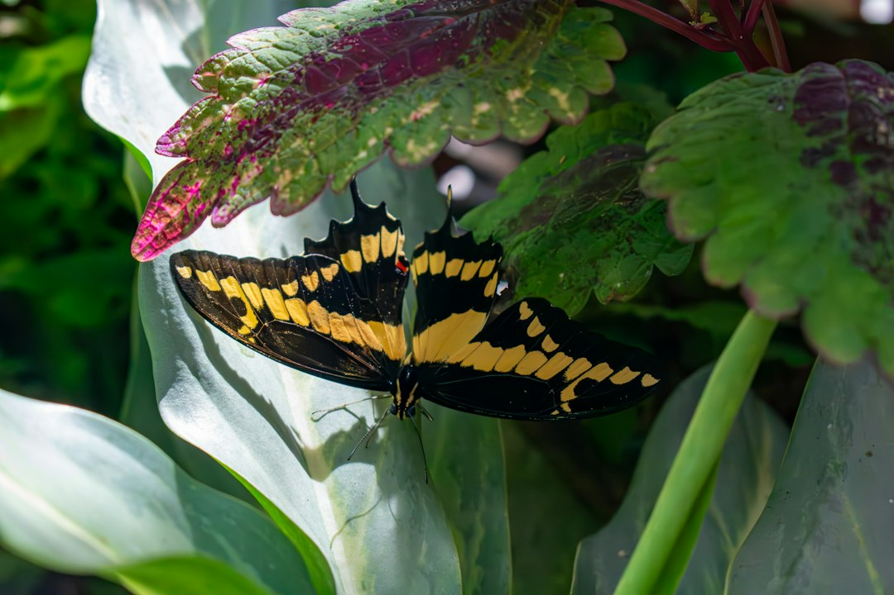
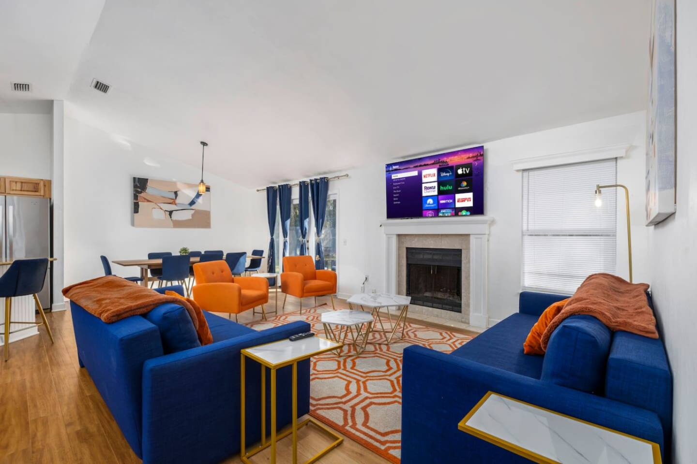
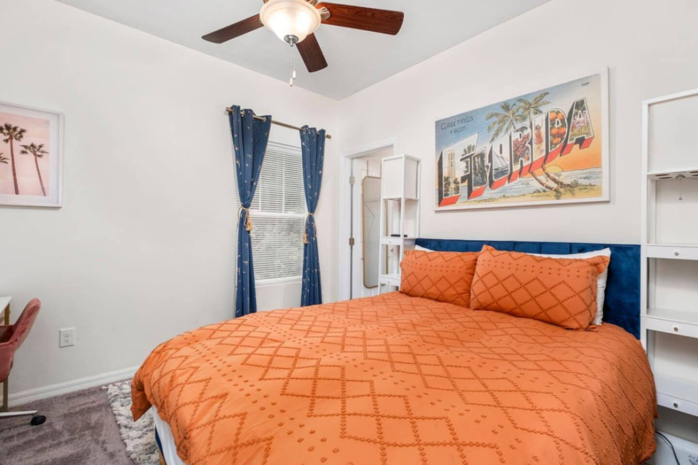

Forget everything you think you know about "college town food." Gainesville has a seriously impressive culinary scene that punches way above its weight, you just have to know where to look. It’s a city where farm-to-table isn't a trend, it's a way of life, and where you can find killer Cuban coffee, authentic sushi, and a life-changing slice of pizza all within a few blocks.

The key to unlocking Gainesville’s best food is to think in neighborhoods. Each one has its own distinct flavor and vibe, from the electric energy of Midtown on game day to the historic, laid-back cool of Downtown. This isn't just a list of restaurants; it's your guide to eating, drinking, and living like a local in Gainesville's best spots.

### Table of Contents
*   [Midtown & The University Area: The Gator Nation's Hub](#midtown--the-university-area-the-gator-nations-hub)
*   [Downtown Gainesville: Historic Streets and Modern Tastes](#downtown-gainesville-historic-streets-and-modern-tastes)
*   [South Gainesville: Your Gateway to Nature and Neighborhood Eats](#south-gainesville-your-gateway-to-nature-and-neighborhood-eats)
*   [Bonus Neighborhood: The Haile Village Charm](#bonus-neighborhood-the-haile-village-charm)
*   [Frequently Asked Questions](#frequently-asked-questions)

---

## Midtown & The University Area: The Gator Nation's Hub

This is the epicenter of all things University of Florida. The energy here is palpable, especially during the fall. It's loud, it's fun, and it's packed with students, alumni, and fans. But it’s not just about cheap eats for students; some of Gainesville’s most iconic and beloved institutions are right here.

### Where to Eat in Midtown

*   **Satchel's Pizza:** Let's get this out of the way: you *must* go to Satchel's. It's a Gainesville rite of passage. The vibe is pure funky, outsider art, with a gift shop, a greenhouse, and even a van you can dine in. But the pizza is the real star. They make their own sodas and the salads with their famous vinaigrette are legendary. **Pro Tip:** There will be a wait, so go at an off-time or plan to hang out and enjoy the atmosphere. It's worth it. Address: [1800 NE 23rd Ave](https://www.google.com/maps/search/?api=1&query=1800+NE+23rd+Ave+Gainesville+FL).
*   **The Swamp Restaurant:** A true UF landmark. After being torn down and rebuilt, it's back and better than ever, right across from campus. It’s the quintessential spot for a pre-game beer or a post-class burger. It gets absolutely packed on game days, but the spirited atmosphere is part of the experience.
*   **Krishna Lunch:** Served on the UF Plaza of the Americas, this is a healthy, delicious, and incredibly affordable vegetarian meal beloved by generations of students. For a few bucks, you get a heaping plate of food. It's an essential, grounding Gainesville experience.

### What to Drink

*   **Midpoint Park & Eatery:** This is a fantastic food truck park and beer garden that offers something for everyone. It's a more relaxed spot to grab a local craft brew and sample different cuisines without committing to a full sit-down restaurant.
*   **Pascal's Coffeehouse:** A cozy, multi-level coffee shop right across from campus that feels like a quiet escape from the Midtown buzz. Perfect for grabbing a quality latte and a pastry.

### Things to Do

When you’re not eating, you’re soaking in the Gator spirit. Walk through the beautiful UF campus, catch a show at the Curtis M. Phillips Center for the Performing Arts, or of course, head to **Ben Hill Griffin Stadium** (The Swamp) to see why it's one of the most intimidating venues in college football.

### Where to Stay in Midtown

If your trip is centered around the university—whether for a game, graduation, or just visiting—staying within walking distance is a game-changer. Parking is a nightmare, so being able to leave your car and walk everywhere is the ultimate luxury.

For a classic Gainesville experience, the **[Walk to University, Pet Friendly, Cozy Townhome](https://book.springlinestays.com/property/walk-to-university-pet-friendly-5-min-to-uf)** is perfect. It sleeps six and, crucially, lets you bring your furry friend along. It’s a comfortable home base just a short stroll from campus and the stadium, saving you from game-day traffic headaches.

## Downtown Gainesville: Historic Streets and Modern Tastes

Just a short drive from campus, Downtown Gainesville feels like a different world. The historic brick buildings house some of the city's best restaurants, independent boutiques, and a thriving arts scene. It's where the grad students, professionals, and locals go for a great night out.

### Where to Eat Downtown

*   **The Top Restaurant:** If Satchel's is the first must-do, The Top is 1A. This place is a Gainesville institution with a dark, moody, eclectic vibe. They are famous for their burgers and corn nuggets (get the nuggets, trust me). They have a massive menu with tons of vegetarian and vegan options, so everyone in your group will be happy. The bar is also one of the best in the city. Address: [30 N Main St](https://www.google.com/maps/search/?api=1&query=30+N+Main+St+Gainesville+FL).
*   **Dragonfly Sushi & Sake Co.:** This isn't your average sushi joint. Dragonfly is a sleek, modern izakaya (Japanese gastropub) perfect for a date night or a fun group dinner. The fish is incredibly fresh, and their craft cocktails are fantastic. **Local Tip:** Go during happy hour for great deals on food and drinks, but make a reservation as it fills up fast.
*   **Boca Fiesta:** "Tacos, tequila, and toilets." That's their motto. This punk-rock taco spot is all about fun. They have a huge patio, frequent live music, and a menu of creative tacos (including alligator and vegan options). It's casual, affordable, and always a good time.

### What to Drink

Downtown is the heart of Gainesville's craft beer scene.
*   **Cypress & Grove Brewing Co.:** Housed in a beautifully restored ice plant, this brewery has a fantastic, spacious lawn perfect for sunny afternoons. They focus on classic, well-brewed styles.
*   **First Magnitude Brewing Company:** A bit further south of the main downtown hub, but worth the short drive. They have a huge taproom, a sprawling outdoor space (The Source), and consistently great beer with a wide variety of styles.

### Things to Do

*   **Depot Park:** A stunningly renovated community park with a playground, splash pad, and a waterfront promenade. It's the perfect place to walk off a big meal. The Cade Museum for Creativity and Invention is also located here.
*   **Hippodrome Theatre:** Known locally as "The Hipp," this historic theatre is the cultural soul of Gainesville, offering professional plays, films, and art gallery exhibits year-round.
*   **Union Street Farmers Market:** Every Wednesday from 4-7 PM, Bo Diddley Plaza transforms into a vibrant market with local produce, baked goods, and crafts. It's a fantastic way to experience the local community.

## South Gainesville: Your Gateway to Nature and Neighborhood Eats

South of Archer Road, Gainesville becomes more spacious and residential, but it's also where you'll find some of the area's most incredible natural attractions and a host of convenient, delicious eateries. This is a great area to stay if you want a bit more room to breathe while still being a short drive from campus and downtown.

### Where to Eat in South Gainesville

*   **Mi Apa Latin Café:** For a quick, affordable, and outrageously delicious meal, Mi Apa is the spot. This Cuban cafe serves up perfect cortaditos, incredible guava and cheese pastries, and fantastic sandwiches. The "Mi Apa" sandwich is a must-try. There are a few locations, but the one on Archer Road is a popular hub. Address: [114 SW 34th St](https://www.google.com/maps/search/?api=1&query=114+SW+34th+St+Gainesville+FL).
*   **4 Rivers Smokehouse:** Consistently ranked among the best BBQ in Florida, 4 Rivers is a carnivore's paradise. Their brisket is melt-in-your-mouth perfection, and the side dishes (especially the mac & cheese and fried okra) are just as good. Expect a line, but it moves quickly.
*   **Kanapaha Botanical Gardens:** While not a restaurant, their summer Moonlight Walk events often feature food trucks and live music, making for a magical evening of dining amongst the flowers.

### Things to Do

This part of town is all about the outdoors.
*   **Paynes Prairie Preserve State Park:** A National Natural Landmark, this massive savanna is home to wild horses, bison, and hundreds of bird species. Climb the observation tower near the north entrance on US-441 for breathtaking panoramic views, especially at sunset.
*   **Sweetwater Wetlands Park:** A fantastic place for a walk and some incredible bird-watching. The trails are flat and accessible, winding through beautiful marshes and ponds.
*   **Devil's Millhopper Geological State Park:** Descend a 120-foot boardwalk into a massive sinkhole that shelters a miniature rainforest. It’s a cool, shaded oasis, especially on a hot Florida day.

### Where to Stay in South Gainesville

If you're traveling with a larger family or group, or perhaps visiting for work at UF Health Shands Hospital, this area is ideal. You get more space for your money and easy access to both nature and the city's main arteries.

The **[Spacious Retreat Near UF & Shands](https://book.springlinestays.com/property/4-minutes-to-universityshands-bbq-spacious)** is a perfect home base for a big crew. It accommodates up to 12 guests and has a great backyard with a BBQ grill. It’s just minutes from the hospital and a straight shot to campus, but it also provides a quiet, comfortable escape after a long day of exploring Paynes Prairie or cheering in The Swamp.

## Bonus Neighborhood: The Haile Village Charm

For a completely different vibe, take a short drive out to Haile Village Center. This picturesque, new-urbanist neighborhood is built around a charming village green with boutiques, restaurants, and a fantastic Saturday morning farmers market. Grab a coffee at Patticakes, have a traditional English pint at The Queen's Arms, or enjoy a gourmet dinner at L'Avion. It feels like a small town escape right within the city.

---

## Frequently Asked Questions

**What food is Gainesville, FL known for?**
Gainesville doesn't have one single iconic dish like a Philly cheesesteak. Instead, it's known for its incredibly diverse and high-quality food scene that champions local farms. You'll find everything from authentic Cuban and Vietnamese cuisine to classic Southern BBQ and inventive, farm-to-table restaurants. Institutions like Satchel's Pizza and The Top are local legends.

**Where is the best area to stay in Gainesville?**
The best area depends on your trip's purpose. For anything UF-related (games, graduation, campus tours), staying in **Midtown** is unbeatable for its walkability. For a more cultural, nightlife-focused trip with great restaurants, **Downtown** is your best bet. If you're with a large group, need proximity to UF Health Shands, or want easier access to nature preserves like Paynes Prairie, **South Gainesville** offers more space and convenience.

**Is Gainesville a walkable city?**
Certain neighborhoods in Gainesville are very walkable. You can easily spend a day exploring Downtown or the area around the UF campus (Midtown) on foot. However, to get between neighborhoods and explore the natural attractions on the outskirts of the city, you will need a car.

**What are some can't-miss restaurants for a first-time visitor?**
If you only have time for a few, the absolute can't-miss trio would be: **Satchel's Pizza** for the iconic, quirky experience and great pizza; **The Top** for its amazing food (get the corn nuggets!), cool atmosphere, and great bar; and **Mi Apa Latin Café** for a quick, delicious, and authentic taste of Cuban coffee and sandwiches.

---

No matter which neighborhood you choose to explore, you'll find that Gainesville's food scene is as vibrant and diverse as the city itself. So come hungry, be adventurous, and get ready to discover your new favorite spot.

When you're planning your culinary tour of Gainesville, don't forget to book your stay. Booking a vacation rental gives you a local home base and the freedom to explore. For the best rates and a curated selection of properties, check out our Gainesville homes and **[book direct with Springline Stays](https://www.springlinestays.com)**.

*Butterfly Rainforest — a must-visit near our Gainesville properties.*

*Devil's Millhopper State Park — a must-visit near our Gainesville properties.*

*[Spacious Retreat Near UF & Shands — Book your stay →](https://book.springlinestays.com/property/4-minutes-to-universityshands-bbq-spacious)*

*[Walk to UF Stadium, No Cleanup, Cozy Townhome — Book your stay →](https://book.springlinestays.com/property/walk-to-campus-restaurants-cozy-townhome)*
