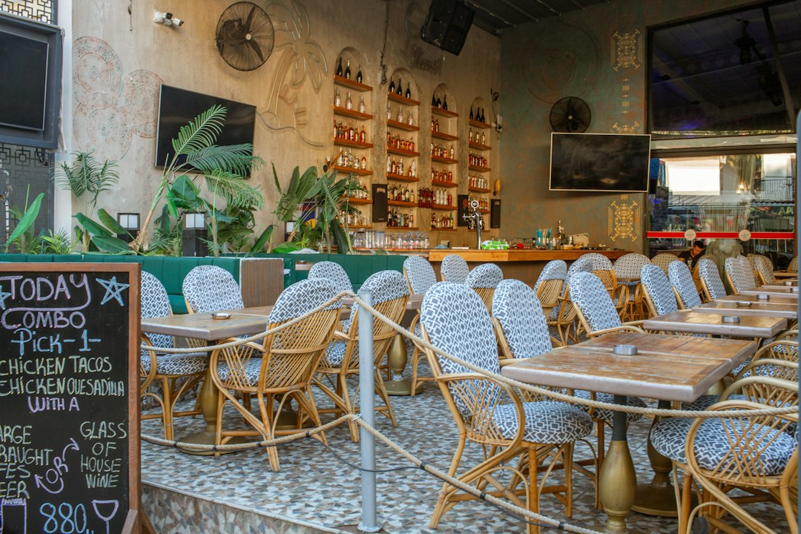
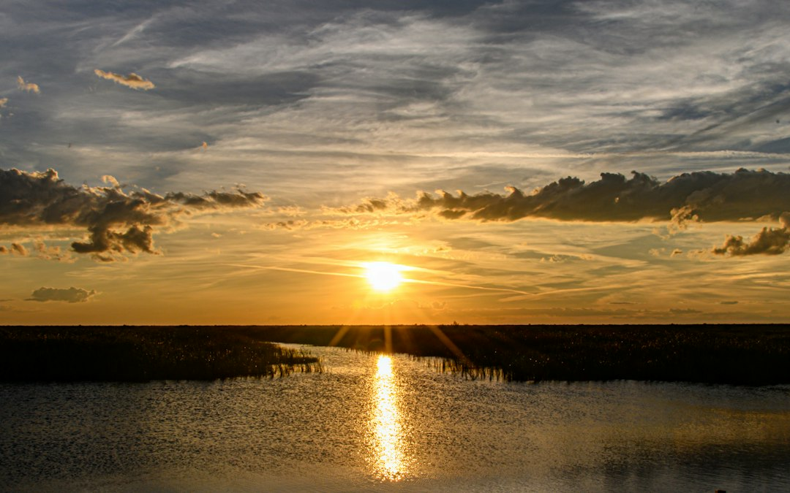
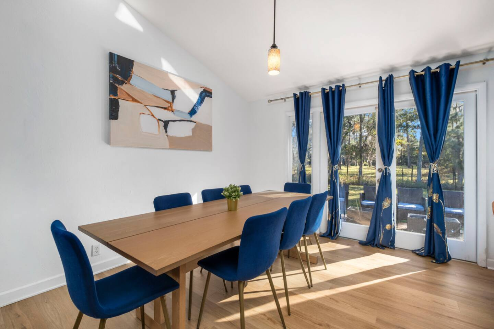
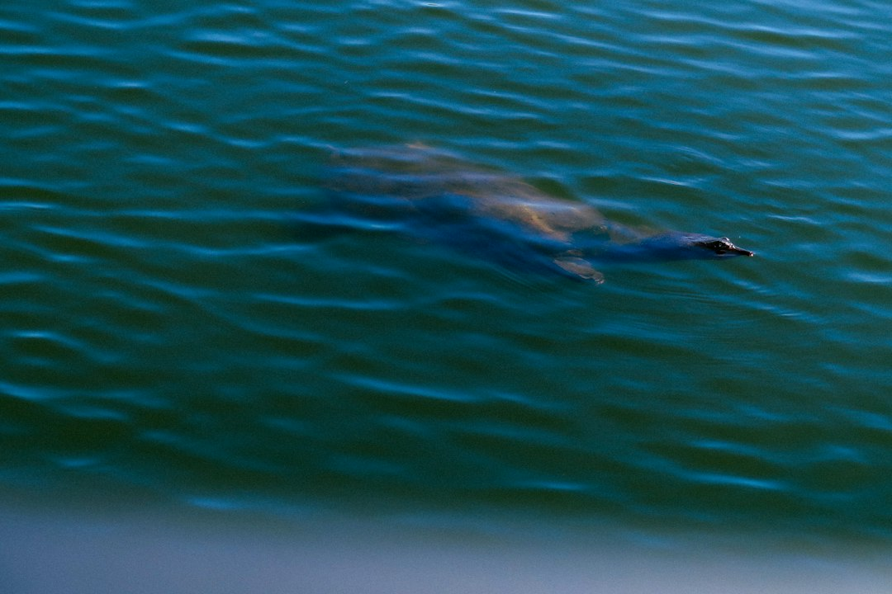

You've probably heard about the University of Florida and The Swamp. And yes, you should absolutely see them. But the Gainesville that exists beyond the campus brochure is where the real magic happens. It’s a city of quirky pizzerias in garden junkyards, serene wetlands teeming with wildlife just minutes from downtown, and a surprisingly vibrant arts scene.

If you want to skip the tourist traps and experience the city like someone who actually lives here, you're in the right place. This isn't your average Gainesville travel guide. This is your roadmap to the city's best-kept secrets, from the brunch spot worth the weekend wait to the nature trail you haven't seen on Instagram yet.

### Table of Contents
*   [The Unofficial Gainesville Food Tour](#the-unofficial-gainesville-food-tour)
*   [Beyond the Campus: Secret Spots & Local Favorites](#beyond-the-campus-secret-spots--local-favorites)
*   [Where to Stay for a True Gainesville Experience](#where-to-stay-for-a-true-gainesville-experience)
*   [Frequently Asked Questions About Visiting Gainesville](#frequently-asked-questions-about-visiting-gainesville)

## The Unofficial Gainesville Food Tour

Forget the national chains clustered on Archer Road. Gainesville's culinary scene is fiercely independent and full of character. Here's where you should actually be eating.

### Breakfast & Brunch That's Worth the Wait

Start your day strong at one of these beloved local institutions. A quick tip: on weekends, especially during the school year, go early or be prepared for a short wait. It's always worth it.

*   **Flying Biscuit Cafe:** The name says it all. The biscuits are fluffy, buttery perfection, and they come with a cranberry apple butter that's downright addictive. While it's a small regional chain, the Gainesville location feels uniquely local. **My go-to order:** The Southern Scramble, but you can't go wrong with the Creamy Dreamy Grits. Find it at [4150 NW 16th Blvd](https://www.google.com/maps/search/?api=1&query=4150+NW+16th+Blvd+Gainesville+FL).
*   **43rd Street Deli & Breakfast House:** This is an old-school Gainesville classic. It’s not fancy, but the portions are huge, the service is friendly, and the food is consistently fantastic. It's the kind of place where you'll see students, professors, and families all enjoying a classic American breakfast. Their pancakes are the size of hubcaps. You've been warned. Located at [12202 NW 43rd St](https://www.google.com/maps/search/?api=1&query=12202+NW+43rd+St+Gainesville+FL).

### Lunch Spots You'll Dream About Later

Gainesville does casual lunch better than almost anywhere. These are the spots that locals rave about and visitors quickly fall in love with.

*   **Satchel's Pizza:** This is more than a restaurant; it's a Gainesville experience. You might eat in a van, a greenhouse, or under a canopy of mismatched junk art. The pizza is legendary—get the "Satch Pan" deep dish if you're feeling ambitious. They also make their own sodas (the "Sodazac" is a must-try). Don't forget to visit the "Lightning Salvage" gift shop in the back. It's a rite of passage. Prepare for a wait, but embrace the funky atmosphere while you do. Address: [1800 NE 23rd Ave](https://www.google.com/maps/search/?api=1&query=1800+NE+23rd+Ave+Gainesville+FL).

*   **La Tienda:** Tucked away in a small Latin market, this is where you'll find the most authentic tacos in town. It's a no-frills counter-service spot, and that's the beauty of it. The menu is in Spanish, the horchata is fresh, and the tacos al pastor are life-changing. It's a true hidden gem that feels a world away from the college town vibe. Grab a seat at [2204 SW 13th St](https://www.google.com/maps/search/?api=1&query=2204+SW+13th+St+Gainesville+FL).

### Dinner Destinations: From Casual to Classy

Whether you're looking for a laid-back bite after a day of exploring or a more upscale dining experience, Gainesville delivers.

*   **The Top:** A downtown institution known for its eclectic menu, moody lighting, and incredible bar. It's a hub for Gainesville's creative scene and has some of the best vegetarian and vegan options in the city (the tempeh is famous for a reason). Even devout carnivores will be satisfied with their gourmet burgers. It gets busy, so put your name on the list and grab a drink at the bar. Find it at [30 N Main St](https://www.google.com/maps/search/?api=1&query=30+N+Main+St+Gainesville+FL).
*   **Embers Wood Grill:** When you're ready to celebrate or just want an exceptional meal, Embers is the place. Known for its steaks, fresh seafood, and an award-winning wine list, it's one of Gainesville's premier fine-dining spots. The service is impeccable, and the food is cooked to perfection over a wood-fired grill. It’s a splurge, but one you won’t regret. Book a table at [3545 SW 34th St A](https://www.google.com/maps/search/?api=1&query=3545+SW+34th+St+A+Gainesville+FL).

### Breweries & Bars with Local Flavor

Gainesville has a thriving craft beer scene. These two breweries are the undisputed heavyweights, each offering a distinct vibe.

*   **First Magnitude Brewing Company:** A huge, family-friendly (and dog-friendly) space with a sprawling beer garden that always has a great food truck on-site. It's the perfect place to spend a sunny afternoon. Try their core beers like the 72 Pale Ale or Vega Blonde Ale.
*   **Swamp Head Brewery:** With a deep commitment to sustainability and conservation, Swamp Head embodies the "Drink Florida" ethos. Their tasting room, "The Wetlands," opens up to a beautiful patio overlooking a conservation area. Their Wild Night Honey Cream Ale is a local favorite.

## Beyond the Campus: Secret Spots & Local Favorites

Once you're fueled up, it's time to explore the unique things to do in Gainesville that don't involve a football.

### Get Your Nature Fix (Without the Crowds)

Everyone knows about Paynes Prairie and Ichetucknee Springs (and they are amazing!), but these spots offer a different, often quieter, taste of North Florida's wild beauty.

*   **Sweetwater Wetlands Park:** This is arguably one of the best places in Florida to see alligators and birds in a natural setting. It’s a man-made wetland, but nature has completely taken over. A wide, accessible boardwalk stretches for miles over the marsh, allowing for incredible, safe-distance wildlife viewing. The secret is to go an hour before sunset when the birds are most active and the gators are on the move. The light is incredible.

*   **Morningside Nature Center:** Step back in time at this living history farm. You can wander through a longleaf pine forest, visit an 1840s cabin, and see heritage-breed farm animals. On the first Saturday of the month, they have live interpreters who demonstrate blacksmithing, cooking on a wood stove, and other historical crafts. It's a wonderfully peaceful and educational alternative to the more rugged state parks.
*   **Cellon Oak Park:** Looking for a quick, awe-inspiring stop? This small park is home to Florida's largest live oak tree, estimated to be over 350 years old. Its massive, sprawling branches are a sight to behold and make for a fantastic photo op. It's a five-minute detour that's well worth it.

### Uncover Gainesville's Quirky Culture

The city's creative spirit extends far beyond the university's art departments.

*   **The Hippodrome Theatre ("The Hipp"):** Housed in a beautiful historic courthouse downtown, The Hipp is the cultural heart of Gainesville. It shows a curated selection of independent and foreign films you won't find at the multiplex, alongside a season of professional live theatre productions. It's the perfect answer to "What should we do tonight?" Check their schedule at [25 SE 2nd Pl](https://www.google.com/maps/search/?api=1&query=25+SE+2nd+Pl+Gainesville+FL).
*   **The AUK Market:** Located in the eclectic South Main Station district, The AUK Market is a beautifully curated space featuring local artisans, vintage clothing, handmade jewelry, and unique home goods. It's the best place in town to find a souvenir that isn't a UF t-shirt.
*   **Vinyl Shopping on University Ave:** For music lovers, a stop at Hear Again Records is a must. Spend an hour flipping through bins of new and used vinyl. It’s a classic record store experience that’s a refreshing change of pace.

## Where to Stay for a True Gainesville Experience

To truly explore Gainesville's local flavor, your home base matters. Ditching the sterile hotel rooms on the interstate for a comfortable Gainesville vacation rental in a real neighborhood puts you right in the heart of the action. You get more space, more privacy, and a feel for what it's actually like to live here.

For couples, small families, or friends in town for a UF game or campus event, location is everything. You want to be able to park your car once and enjoy the weekend. A property like the **[Walk to UF Stadium, No Cleanup, Cozy Townhome](https://book.springlinestays.com/property/walk-to-campus-restaurants-cozy-townhome)** is ideal for this. Imagine walking to Ben Hill Griffin Stadium, exploring Midtown's restaurants on foot, and then coming back to a clean, comfortable space. The "no cleanup" policy for this 818-1 Springline Stays property is a game-changer after a long day of cheering on the Gators.

If you're traveling with a four-legged friend, the sister property, the **[Walk to University, Pet Friendly, Cozy Townhome](https://book.springlinestays.com/property/walk-to-university-pet-friendly-5-min-to-uf)**, offers the same unbeatable walkability with a welcoming policy for your pet.

For larger groups—think multi-generational family trips, graduation celebrations, or a reunion with old college friends—space and amenities are key. Coordinating a big group is much easier when everyone can stay under one roof. The **Spacious Retreat Near UF & Shands by Springline Stays (4403)** is a fantastic solution. With room for up to 12 guests and four bedrooms, it gives everyone space to spread out. Plus, having a full kitchen and a BBQ grill means you can cook some meals at home, saving money and creating great memories after a day exploring Gainesville's hidden gems.

Choosing the right place to stay is the first step in crafting a memorable trip. Booking a well-located vacation rental lets you live like a local, not just a visitor.

## Frequently Asked Questions About Visiting Gainesville

### What is the best time of year to visit Gainesville?
Fall (September-November) is arguably the best. The oppressive summer humidity breaks, the weather is perfect for exploring the nature trails, and the energy of football season is contagious. Spring (March-May) is also beautiful, with blooming flowers at the botanical gardens and fewer crowds than in the fall.

### Is Gainesville a walkable city?
The areas immediately around the University of Florida campus and the downtown core are very walkable. However, to experience the incredible natural attractions like Paynes Prairie, Devil's Millhopper, or the springs, you will definitely need a car.

### What food is Gainesville known for?
Gainesville doesn't have a single signature dish like a Philly cheesesteak, but it's known for its incredibly diverse and independent food scene. It's a city that champions farm-to-table dining, supports a huge range of international cuisines, and has iconic, one-of-a-kind institutions like Satchel's Pizza that locals are fiercely proud of.

### What should I not miss in Gainesville besides the university?
Don't leave without experiencing the unique natural landscape. See the wild horses and bison at Paynes Prairie Preserve at sunset, descend into the lush, prehistoric-feeling sinkhole at Devil's Millhopper Geological State Park, and see hundreds of free-flying butterflies at the Butterfly Rainforest. These are the experiences that truly define North Central Florida.

---

Now that you're armed with an insider's list, you're ready to experience the real Gainesville—the one full of flavor, nature, and quirky charm that lies just beyond the campus gates.

Ready to plan your trip? The best Gainesville vacation rentals fill up quickly, especially during football season and graduation weekends. Browse our handpicked homes and **[book your Gainesville stay directly with Springline Stays](https://www.springlinestays.com)** to guarantee the best rates and enjoy personalized, local service.

*Depot Park — a must-visit near our Gainesville properties.*

*[Walk to University, Pet Friendly, Cozy Townhome — Book your stay →](https://book.springlinestays.com/property/walk-to-university-pet-friendly-5-min-to-uf)*

*[Walk to UF Stadium, No Cleanup, Cozy Townhome — Book your stay →](https://book.springlinestays.com/property/walk-to-campus-restaurants-cozy-townhome)*
