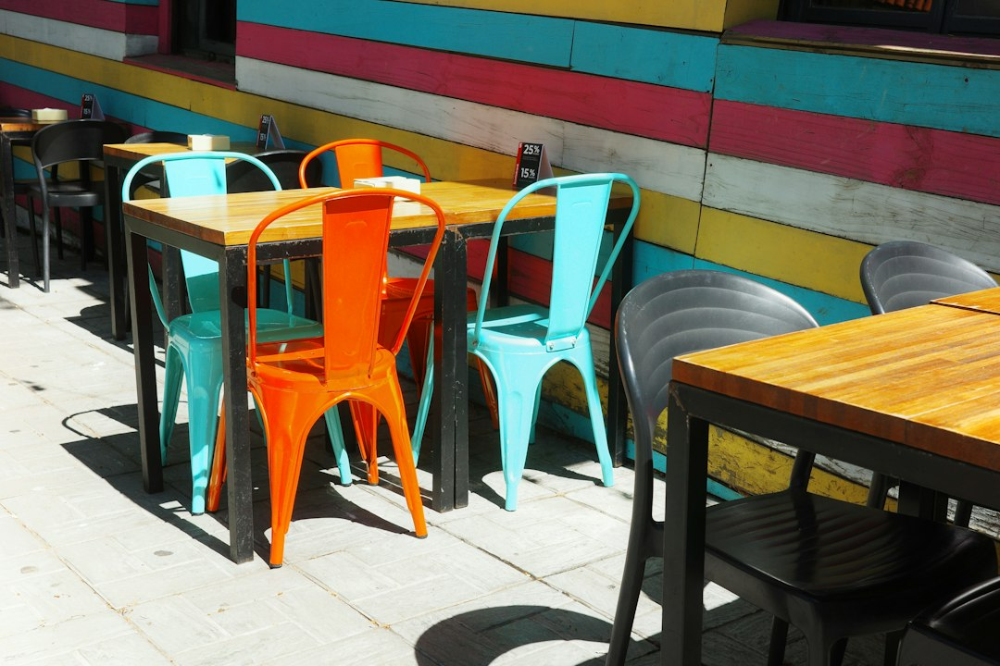
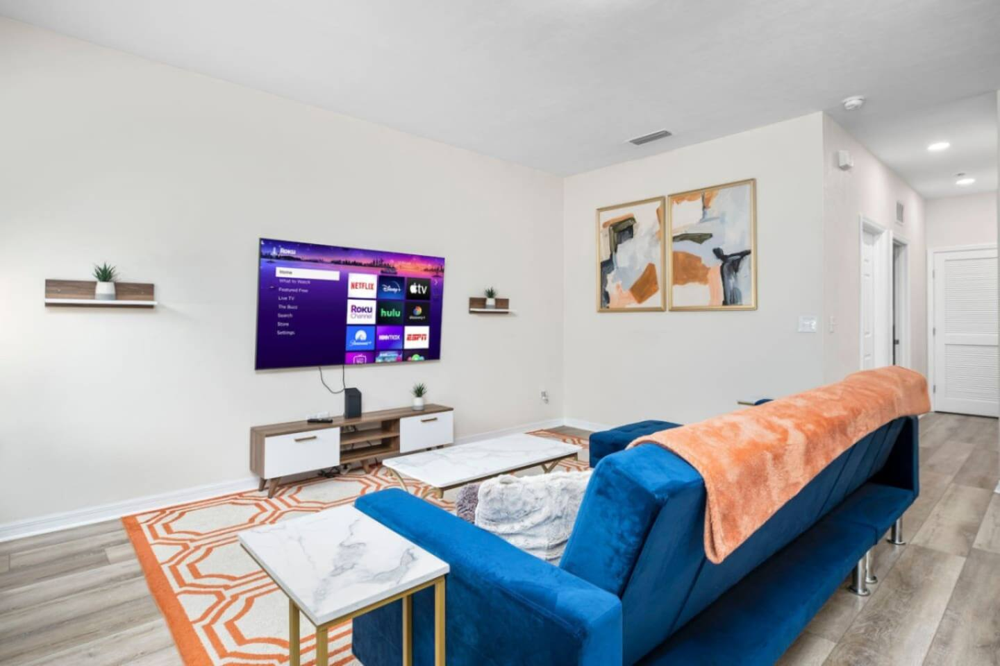
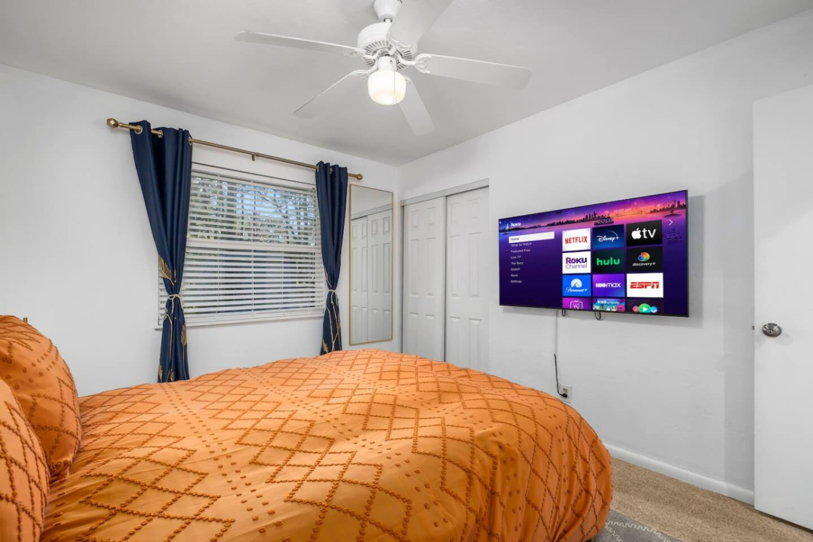
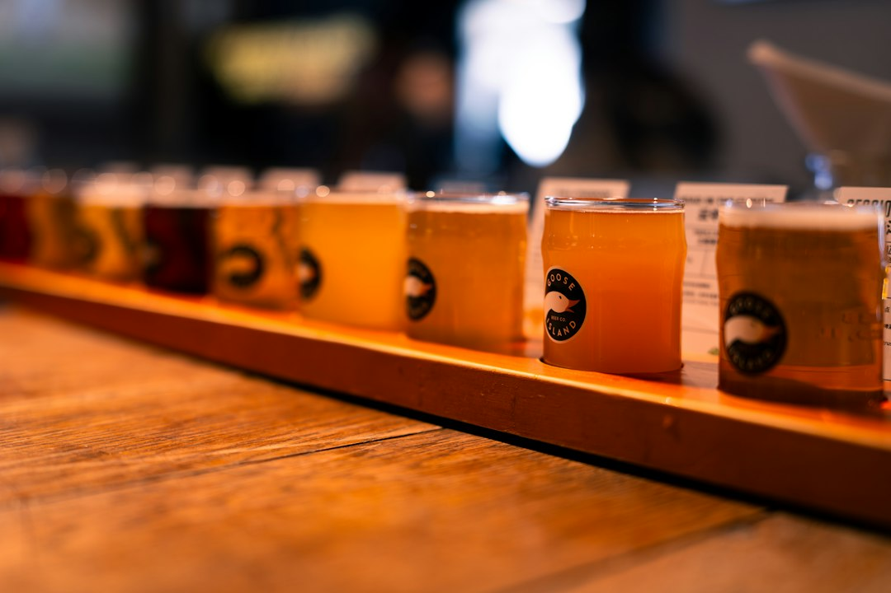
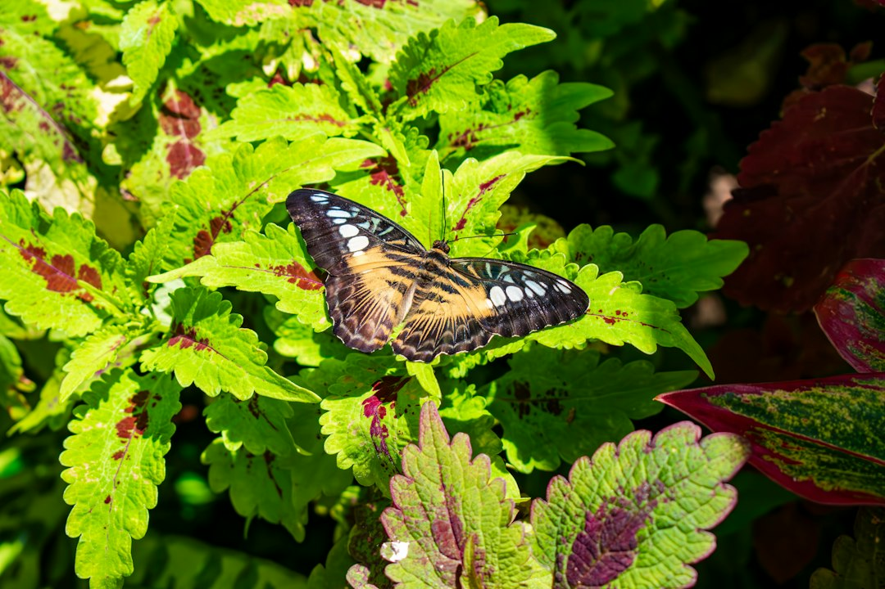
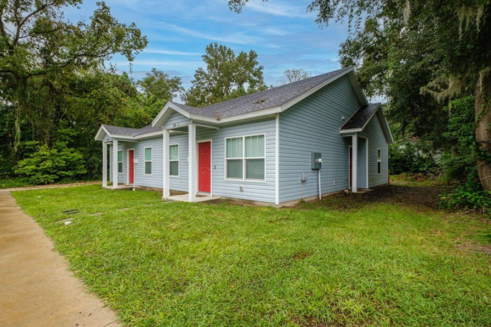

Gainesville might be famous for the Gators, but let's talk about what really matters after a long day of exploring campus or hiking a nature trail: where you're going to eat. It’s easy to get trapped in the sea of fast-food chains that dot Archer Road, but you’d be missing out. The real Gainesville has a surprisingly diverse and fiercely local food scene, with culinary gems tucked away in historic downtown buildings, bustling food parks, and unassuming strip malls.

Forget what you think you know about college town food. We're diving deep into the spots that locals frequent, from legendary pizzerias to upscale sushi and authentic Southern barbecue. This is your ultimate guide to eating well in Gainesville.

### Table of Contents
*   [Downtown Gainesville: The Heart of the Culinary Scene](#downtown-gainesville-the-heart-of-the-culinary-scene)
*   [Midtown & Campus Eats: Fueling Up Near the University](#midtown--campus-eats-fueling-up-near-the-university)
*   [South Gainesville & Beyond: Hidden Gems Worth the Drive](#south-gainesville--beyond-hidden-gems-worth-the-drive)
*   [For the Craft Beer & Cocktail Enthusiast](#for-the-craft-beer--cocktail-enthusiast)
*   [Sweet Treats to End Your Day](#sweet-treats-to-end-your-day)
*   [Frequently Asked Questions](#frequently-asked-questions)

## Downtown Gainesville: The Heart of the Culinary Scene

Downtown is where Gainesville sheds its college-town skin and shows off a more sophisticated side. Restored brick buildings, shady live oaks, and a vibrant, walkable core make it the perfect place for a date night, a celebratory dinner, or a fantastic brunch. Parking can be a bit of a hunt during peak hours, so plan to arrive a little early or use the city's main parking garage on SE 2nd St.

### The Top Restaurant
**Address:** [30 N Main St, Gainesville, FL 32601](https://www.google.com/maps/search/?api=1&query=30+N+Main+St+Gainesville+FL+32601)  
**Vibe:** Eclectic, dimly lit, and always buzzing.  
This is a Gainesville institution. If you ask ten locals for a restaurant recommendation, at least eight of them will mention The Top. The menu is a mix of American classics with a vegetarian and vegan-friendly twist. Their burgers are legendary, but so are their tempeh and tofu dishes.

**Local Tip:** There will be a wait, especially on a weekend. My secret is to put your name on the list and then head next door to The Atlantic or The Dime for a craft cocktail. They'll text you when your table is ready. The Corn Nuggets are a non-negotiable appetizer, and you can’t go wrong with the Pesto-Gouda Turkey Burger.

### Dragonfly Modern Izakaya & Sushi
**Address:** [201 SE 2nd Ave #104, Gainesville, FL 32601](https://www.google.com/maps/search/?api=1&query=201+SE+2nd+Ave+%23104+Gainesville+FL+32601)  
**Vibe:** Sleek, modern, and energetic.  
Dragonfly is much more than a sushi joint; it's an experience. It's the go-to spot for celebrations, anniversaries, and any night you want to feel a little fancy. The menu features classic sushi rolls, inventive signature creations, and a fantastic selection of robatayaki (Japanese grill) skewers and small plates designed for sharing.

**Local Tip:** Make a reservation, especially for a group. While the sushi is fantastic (try The Kraken roll), don't sleep on the small plates. The "Crispy" Rice and the Braised Pork Belly are absolute showstoppers. Their cocktail menu is one of the best in the city.

### Crane Ramen
**Address:** [16 SW 1st Ave, Gainesville, FL 32601](https://www.google.com/maps/search/?api=1&query=16+SW+1st+Ave+Gainesville+FL+32601)  
**Vibe:** Casual, cozy, and aromatic.  
On a cool day, there's nothing better than a steaming bowl of authentic ramen from Crane. They take their broth seriously, simmering it for hours to develop a deep, complex flavor that's miles away from the instant noodles of your college days. The space is small and intimate, with a long bar overlooking the open kitchen.

**Local Tip:** The Spicy Paitan Shio is a crowd-pleaser with a perfect kick, but the rich, porky Tonkotsu Shoyu is the true classic. Add a seasoned egg (aji tamago)—it's essential.

## Midtown & Campus Eats: Fueling Up Near the University

Midtown is the bustling district directly across from the University of Florida campus. It's the epicenter of student life, especially on game days. The food here is generally more casual, affordable, and geared toward a crowd that's always on the move. This is where you'll find some of Gainesville's most iconic and time-honored cheap eats.

### Satchel's Pizza
**Address:** [1800 NE 23rd Ave, Gainesville, FL 32609](https://www.google.com/maps/search/?api=1&query=1800+NE+23rd+Ave+Gainesville+FL+32609)  
**Vibe:** Quirky, funky, and one-of-a-kind.  
Okay, technically it's a short drive from campus, but no Gainesville food guide is complete without Satchel's. This place is a wonderland of folk art, with seating available in a vintage van, under an airplane, or in a greenhouse. The pizza is phenomenal—deep-dish or thin crust with a dizzying array of toppings. But the real star might be their house-made salad dressing, which is so popular they sell it by the bottle.

**Local Tip:** Satchel's is **cash only**, though they do have an ATM and their own "Satch-card" system. The wait can be epic, so go at an off-hour if you can. A slice and a salad is a classic combo that will fill you up for a reasonable price. Don't forget to visit the gift shop, Lightning Salvage, in the back.

### El Indio
**Address:** [407 NW 13th St, Gainesville, FL 32601](https://www.google.com/maps/search/?api=1&query=407+NW+13th+St+Gainesville+FL+32601)  
**Vibe:** No-frills, fast, and consistently delicious.  
For decades, El Indio has been serving up quick, delicious, and affordable Mexican food to students and locals. The tiny building with the drive-thru window is a landmark. Whether you're grabbing a quick lunch or a late-night snack, it always hits the spot.

**Local Tip:** The Puffy Tacos are what they're known for—a lightly fried, pillowy tortilla filled with your choice of meat. The Tostada de Ceviche is another sleeper hit, especially on a hot Florida day.

After a long day exploring campus or cheering at Ben Hill Griffin Stadium, the last thing you want is a long drive back to your rental. Staying within walking distance of the action is a game-changer. For a group of up to six, a place like the [**Walk to UF Stadium, No Cleanup, Cozy Townhome**](https://book.springlinestays.com/property/walk-to-campus-restaurants-cozy-townhome) puts you just a short stroll from these Midtown classics. You can leave your car parked and enjoy the city's best casual eats without worrying about traffic or parking. If you're bringing your furry friend along for the trip, the nearly identical and equally convenient [**Walk to University, Pet Friendly, Cozy Townhome**](https://book.springlinestays.com/property/walk-to-university-pet-friendly-5-min-to-uf) is another fantastic option.

## South Gainesville & Beyond: Hidden Gems Worth the Drive

Venture away from the university, and you'll be rewarded with some of the city's best-kept culinary secrets. South Gainesville, in particular, is home to a growing number of fantastic local restaurants, food parks, and specialty shops that are well worth the 10-15 minute drive from downtown.

### 4th Ave Food Park
**Address:** [409 SW 4th Ave, Gainesville, FL 32601](https://www.google.com/maps/search/?api=1&query=409+SW+4th+Ave+Gainesville+FL+32601)  
**Vibe:** Relaxed, communal, and family-friendly.  
This beautifully designed outdoor space is one of the best additions to Gainesville in years. It features a collection of permanent food trucks and stalls surrounding a shared courtyard with plenty of seating. It's the perfect solution when your group can't agree on what to eat. You can get tacos from Satch-Squared (Satchel's Detroit-style pizza sibling), burgers from Fehrenbacher's, coffee from Opus, and drinks from the bar.

**Local Tip:** It's very popular with families and graduate students. The string lights make it a magical spot in the evening. It's an ideal place to relax for a few hours.

### Pearl's Country Store & Barbecue
**Address:** [106 NE US Hwy 441 a, Micanopy, FL 32667](https://www.google.com/maps/search/?api=1&query=106+NE+US+Hwy+441+a+Micanopy+FL+32667)  
**Vibe:** Rustic, authentic, and mouth-watering.  
If you have a car and a craving for true Florida barbecue, make the short drive south to Micanopy (pronounced mick-a-no-pee) for Pearl's. Located in a charming old country store, they serve up incredible smoked brisket, ribs, and pulled pork with all the classic sides.

**Local Tip:** Get there early, because they often sell out of the most popular meats. The brisket is the star, but the Datil-Peach glazed chicken wings are a local obsession. Grab a seat on the porch and enjoy the old-Florida atmosphere.

For larger families or groups visiting for a UF Health or Shands event, having a comfortable home base with plenty of room is essential. The [**Spacious Retreat Near UF & Shands**](https://book.springlinestays.com/property/4-minutes-to-universityshands-bbq-spacious) is a fantastic choice, sleeping up to 12 guests. It's located conveniently close to South Gainesville's best spots and even has its own BBQ grill in the backyard, so you can try your hand at smoking some ribs after being inspired by the local pitmasters.

## For the Craft Beer & Cocktail Enthusiast

Gainesville's drinking scene has matured far beyond cheap college bars. The city is home to a fantastic community of craft breweries and sophisticated cocktail lounges.

### First Magnitude Brewing Co.
**Address:** [1220 SE Veitch St, Gainesville, FL 32601](https://www.google.com/maps/search/?api=1&query=1220+SE+Veitch+St+Gainesville+FL+32601)  
**Vibe:** Sprawling, family-friendly, and laid-back.  
Located right off the Gainesville-Hawthorne State Trail, First Magnitude (or "FM") is a massive brewery with a huge beer garden. It's dog-friendly, kid-friendly, and always has a diverse lineup of food trucks. Their 72 Pale Ale is a local staple, but be sure to check their tap list for seasonal and experimental brews.

### Cypress & Grove Brewing Company
**Address:** [1001 NW 4th St, Gainesville, FL 32601](https://www.google.com/maps/search/?api=1&query=1001+NW+4th+St+Gainesville+FL+32601)  
**Vibe:** Historic, charming, and community-focused.  
Housed in a beautifully restored ice and water plant, Cypress & Grove uses water from a 300-foot-deep artesian well right on the property to brew their beer. The result is a selection of clean, crisp, and refreshing lagers and ales. Their shaded lawn is a perfect place to spend a sunny afternoon.

### Madrina's
**Address:** [9 W University Ave, Gainesville, FL 32601](https://www.google.com/maps/search/?api=1&query=9+W+University+Ave+Gainesville+FL+32601)  
**Vibe:** Intimate, stylish, and expertly crafted.  
This "Old Havana" inspired cocktail bar is a true gem. The bartenders are serious about their craft, mixing up both classic and inventive cocktails with precision and flair. It’s a small space, so it feels intimate and exclusive. If you appreciate a perfectly made Old Fashioned or want to try something new and exciting, this is your spot.

## Sweet Treats to End Your Day

You've got to save room for dessert. Gainesville has a couple of legendary local spots that will satisfy any sweet tooth.

### Sweet Dreams of Gainesville
**Address:** [3437 W University Ave, Gainesville, FL 32607](https://www.google.com/maps/search/?api=1&query=3437+W+University+Ave+Gainesville+FL+32607)  
**Vibe:** Whimsical, local, and full of flavor.  
For over 20 years, Sweet Dreams has been serving homemade ice cream with a rotating menu of creative and delicious flavors. You'll find classics alongside inventive concoctions like "Blueberry Cobbler" or "Mayan Chocolate." They make everything in-house with quality ingredients, and you can taste the difference.

### Karma Cream
**Address:** [607 W University Ave, Gainesville, FL 32601](https://www.google.com/maps/search/?api=1&query=607+W+University+Ave+Gainesville+FL+32601)  
**Vibe:** Hipster, organic, and vegan-friendly.  
Karma Cream is the go-to for organic, vegan, and dairy-free treats. They offer a huge selection of non-dairy ice creams, baked goods, and fantastic organic coffee and espresso drinks. It's a cozy spot to hang out and enjoy a guilt-free (or guilt-full) treat.

---

## Frequently Asked Questions

### What food is Gainesville, FL known for?
Gainesville doesn't have one single signature dish like Philly has the cheesesteak. Instead, it's known for its vibrant and independent restaurant scene. Iconic local institutions like Satchel's Pizza are a must-try for any visitor, and the city has a strong craft brewery culture. You'll find a great mix of Southern comfort food, authentic international cuisine, and creative New American dishes.

### Are there good restaurants near the University of Florida?
Absolutely. The area known as Midtown, directly across University Avenue from campus, is packed with restaurants. You can find everything from quick and casual spots like El Indio (Mexican) and Italian Gator Pizza to more lively sit-down options like The Swamp Restaurant, a classic game-day hangout.

### What are the best family-friendly restaurants in Gainesville?
For a great family-friendly atmosphere, head to the 4th Ave Food Park, where everyone can choose what they want from different food stalls in a fun outdoor setting. Satchel's Pizza is another fantastic choice with its quirky, art-filled environment that kids love. First Magnitude Brewing Co. is also very welcoming to families, with a large beer garden where kids have room to run around.

### Where can I find the best brunch in Gainesville?
The Top hosts a very popular weekend brunch with a great mix of sweet and savory dishes and excellent bloody marys. Another great option is The Keys Grill & Piano Bar at Celebration Pointe, which offers a brunch with a coastal vibe. For a more casual and unique morning treat, Halo Potato Donuts offers incredible donuts made from potato dough that are a local favorite.

---

No matter what you're craving, Gainesville's food scene delivers far beyond the expectations of a typical college town. Now that you know where to eat like a local, the only thing left is to find the perfect home base for your culinary adventures.

Ready to plan your trip? Find the perfect home away from home and **[book your Gainesville vacation rental directly with Springline Stays](https://www.springlinestays.com)** for the best rates and personalized, local service.

*Butterfly Rainforest — a must-visit near our Gainesville properties.*

*Devil's Millhopper State Park — a must-visit near our Gainesville properties.*

*[Spacious Retreat Near UF & Shands — Book your stay →](https://book.springlinestays.com/property/4-minutes-to-universityshands-bbq-spacious)*

*[Walk to UF Stadium, No Cleanup, Cozy Townhome — Book your stay →](https://book.springlinestays.com/property/walk-to-campus-restaurants-cozy-townhome)*
