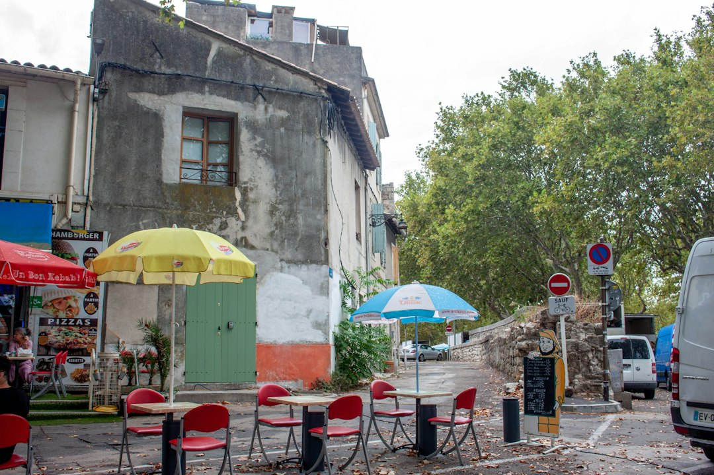
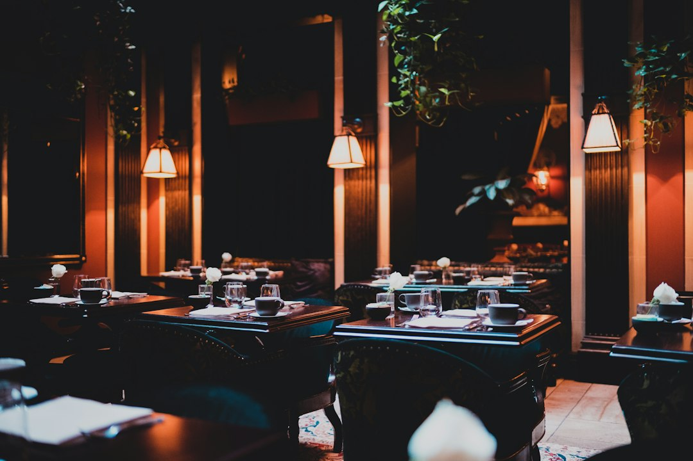
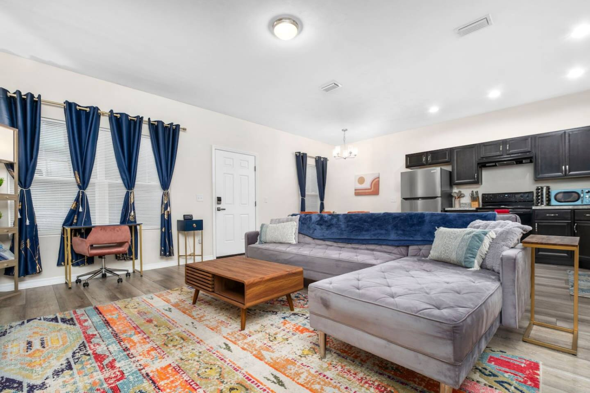
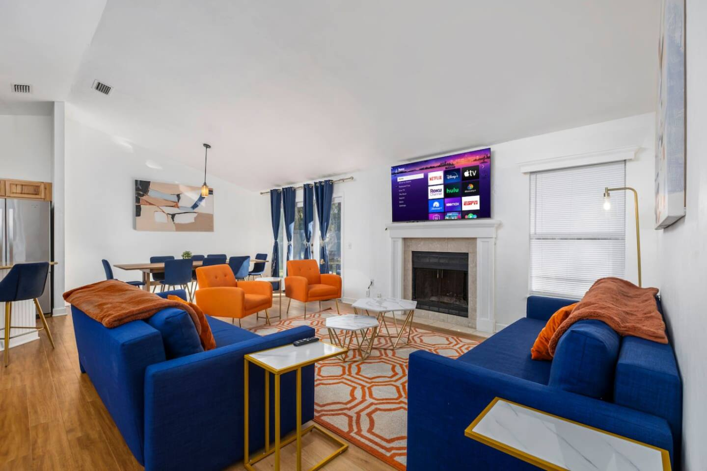
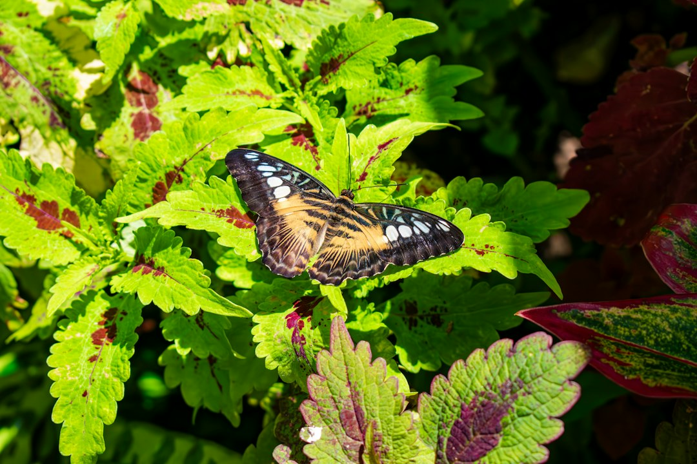
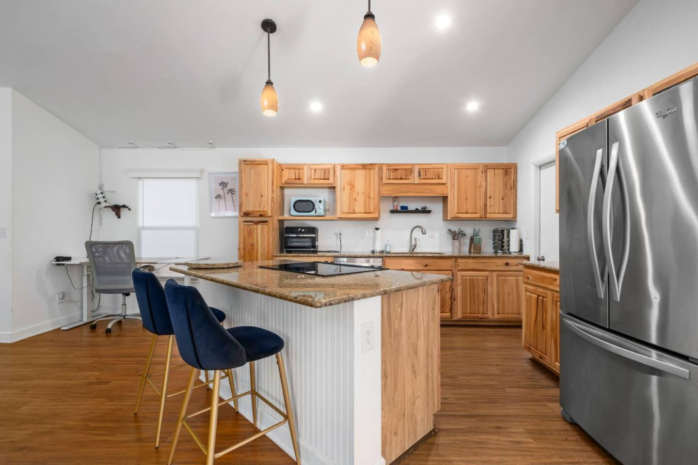
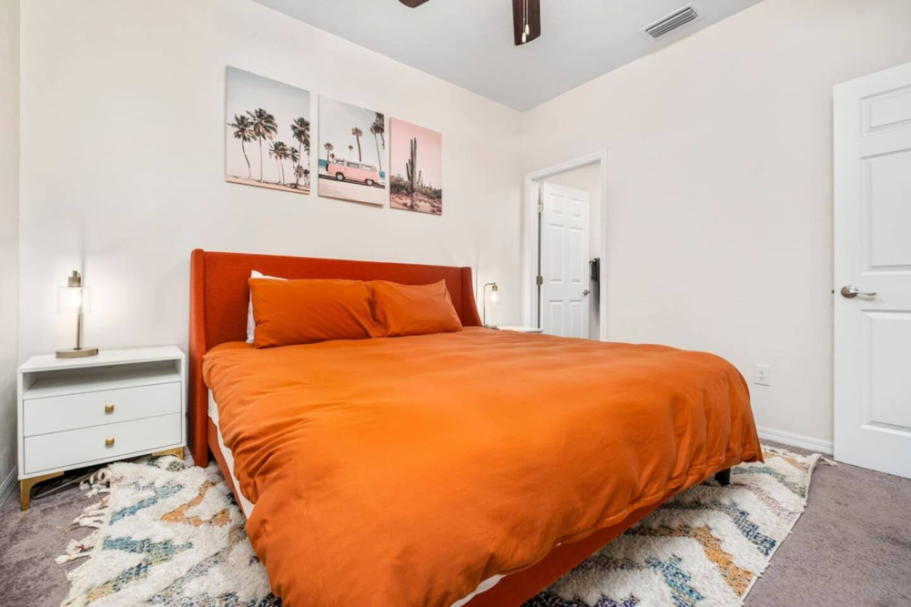

Forget everything you think you know about college town food. Gainesville’s dining scene is a heavyweight contender, packed with everything from authentic Vietnamese pho that will cure what ails you to Southern comfort food that’ll make you want to call your grandma. This isn't just about grabbing a quick bite before the game; eating your way through the city is one of the absolute best things to do in Gainesville.

As a university town, you get this incredible mix of cheap, delicious eats and high-end dining funded by visiting parents and university donors, all within a few square miles. Ready to dive in? Here’s your ultimate foodie travel guide to Gainesville.

### Table of Contents
*   [Can't-Miss Breakfast & Brunch Spots](#breakfast)
*   [The Ultimate Lunch Break](#lunch)
*   [Dinner Destinations Worth Planning For](#dinner)
*   [Gainesville's Craft Beer & Cocktail Scene](#drinks)
*   [Don't Miss the Local Markets](#markets)
*   [Sweet Treats & Late-Night Cravings](#dessert)
*   [Where to Stay for Your Gainesville Foodie Tour](#stay)
*   [Gainesville Foodie FAQs](#faq)

## Can't-Miss Breakfast & Brunch Spots

Starting your day right is non-negotiable. These spots are local institutions for a reason.

### The Flying Biscuit Cafe
This place is a Southern breakfast icon. Yes, it's a small chain, but the Gainesville location feels entirely local. The main draw is, unsurprisingly, their fluffy, buttery biscuits served with a side of cranberry-apple butter. My go-to order is the Southern Scramble, but you can't go wrong with their Creamy Dreamy Grits.
*   **Pro Tip:** It gets packed on weekend mornings. Use their online waitlist to save yourself some time standing on the sidewalk.
*   **Address:** [4150 NW 16th Blvd, Gainesville, FL 32605](https://www.google.com/maps/search/?api=1&query=4150+NW+16th+Blvd+Gainesville+FL+32605)

### Civilization
Tucked away in a quiet neighborhood near Depot Park, Civilization is a gem that serves globally-inspired dishes in a quirky, charming old house. Their weekend brunch is legendary. The menu changes, but if you see the Huevos Rancheros or the Tofu Scramble, get them. The real secret weapon is their beautiful, sprawling patio shaded by old oak trees—it’s the perfect setting for a lazy Sunday morning.
*   **Pro Tip:** Arrive early, especially if the weather is nice. The patio tables are the first to go.
*   **Address:** [1511 NW 2nd St, Gainesville, FL 32601](https://www.google.com/maps/search/?api=1&query=1511+NW+2nd+St+Gainesville+FL+32601)

### 43rd Street Deli & Breakfast House
If you're craving a classic, no-frills American diner experience, this is your spot. It’s been a Gainesville staple since 1986. They serve breakfast all day, and their portions are massive. The pancakes are bigger than your head, and the omelets are stuffed to the brim. It’s the kind of place where the coffee is always flowing and the service is friendly and fast.
*   **Pro Tip:** They have two locations. The one on 43rd street is the original, but the one on 34th is just as good and sometimes less crowded.
*   **Address (Original):** [4401 NW 25th Pl, Gainesville, FL 32606](https://www.google.com/maps/search/?api=1&query=4401+NW+25th+Pl+Gainesville+FL+32606)

## The Ultimate Lunch Break

Gainesville's lunch scene is diverse, quick, and always delicious.

### Satchel's Pizza
Let's get one thing straight: Satchel's isn't just a pizza place; it's a Gainesville rite of passage. The vibe is pure eclectic chaos, with local art, a salvaged van you can dine in, a greenhouse seating area, and a playground for the kids. The pizza itself is phenomenal—deep-dish or thin crust with a dizzying array of toppings.
*   **Pro Tip:** Don't skip the Satch Salad. The house-made vinaigrette is so good they sell it by the bottle. Also, be prepared for a wait. Call ahead for takeout to bypass the line, or plan to enjoy a local soda from their shop while you wait for a table. **Cash only**, though they have an ATM on site.
*   **Address:** [1800 NE 23rd Ave, Gainesville, FL 32609](https://www.google.com/maps/search/?api=1&query=1800+NE+23rd+Ave+Gainesville+FL+32609)

### La Tienda
Some of the best food is found in the most unassuming places. La Tienda is a perfect example. It's a small Latin market with a tiny, no-frills kitchen in the back that serves up some of the most authentic and delicious tacos in Florida. The menu is simple: choose your meat (al pastor, carnitas, lengua) and enjoy. Grab a Mexican Coke from the cooler to complete the experience.
*   **Pro Tip:** This is a true hole-in-the-wall. Seating is extremely limited, so plan to take your food to go.
*   **Address:** [2204 SW 13th St, Gainesville, FL 32608](https://www.google.com/maps/search/?api=1&query=2204+SW+13th+St+Gainesville+FL+32608)

### Crane Ramen
When a cool front blows through North Florida, the entire city collectively craves a bowl of ramen from Crane. Located in the heart of downtown, this spot serves up rich, flavorful broth, perfectly cooked noodles, and delicious toppings. The Spicy Miso Paitan is a crowd favorite, and their pork buns are a must-order starter. They also have a fantastic cocktail and sake list.
*   **Pro Tip:** They have a great happy hour on weekdays with deals on drinks and small plates.
*   **Address:** [16 SW 1st Ave, Gainesville, FL 32601](https://www.google.com/maps/search/?api=1&query=16+SW+1st+Ave+Gainesville+FL+32601)

## Dinner Destinations Worth Planning For

From date nights to celebratory family meals, these are the places to book for dinner.

### The Top Restaurant
If you ask ten locals for a dinner recommendation, nine of them will say "The Top." This downtown institution is famous for its moody, dimly-lit atmosphere, incredible burgers (both meat and vegan), and extensive menu that caters to literally everyone. Their corn nuggets with spicy mayo are the stuff of legends. They also have an attached bar and a classic arcade, making it a full evening's entertainment.
*   **Pro Tip:** They don't take reservations, and the wait can be long. My advice? Go on a weeknight or put your name in and grab a drink at one of the many nearby bars while you wait.
*   **Address:** [30 N Main St, Gainesville, FL 32601](https://www.google.com/maps/search/?api=1&query=30+N+Main+St+Gainesville+FL+32601)

### Spurrier's Gridiron Grille
Opened by the Head Ball Coach himself, Steve Spurrier, this is more than just a restaurant—it's a shrine to Florida Gators football. But even if you're not a sports fan, the food is seriously impressive. Located in the Celebration Pointe complex, it's an upscale steakhouse with fantastic seafood, a great wine list, and top-tier service. The real star is Visors, the rooftop bar with panoramic views and craft cocktails.
*   **Pro Tip:** Make a reservation, especially on a game weekend. And don't leave without checking out the Heisman trophy and other memorabilia on display.
*   **Address:** [4860 Celebration Pointe Ave #100, Gainesville, FL 32608](https://www.google.com/maps/search/?api=1&query=4860+Celebration+Pointe+Ave+100+Gainesville+FL+32608)

### Embers Wood Grill
When you're looking for a true fine-dining experience for a special occasion, Embers is the answer. The focus is on dishes cooked over a custom-built wood-fired grill, which imparts an incredible flavor to their prime steaks and fresh seafood. The wine list is one of the best in the state, and the ambiance is elegant and refined.
*   **Pro Tip:** This is a splurge, but worth it. The "Wine and Dine" menu offered on certain nights is a great value for a multi-course meal.
*   **Address:** [3545 SW 34th St A, Gainesville, FL 32608](https://www.google.com/maps/search/?api=1&query=3545+SW+34th+St+A+Gainesville+FL+32608)

## Gainesville's Craft Beer & Cocktail Scene

The food scene is great, but the drink scene might be even better.

### First Magnitude Brewing Company
"F-Mag" is the quintessential Gainesville brewery. It has a massive, family-friendly (and dog-friendly) beer garden, a rotating lineup of fantastic food trucks, and a core set of award-winning beers like the Vega Blonde Ale and 72 Pale Ale. It's the perfect place to spend a sunny afternoon.
*   **Pro Tip:** They often host events like trivia, live music, and even yoga in the beer garden. Check their schedule before you go.
*   **Address:** [1220 SE Veitch St, Gainesville, FL 32601](https://www.google.com/maps/search/?api=1&query=1220+SE+Veitch+St+Gainesville+FL+32601)

### Cypress & Grove Brewing Co.
Housed in a beautifully restored historic ice plant, Cypress & Grove specializes in crisp, clean lagers and classic ales. The taproom has a relaxed, neighborhood feel, and they draw their water from the Floridan aquifer right on site. It’s a great spot to cool off after biking the nearby Hawthorne Trail.
*   **Pro Tip:** They fill growlers and crowlers to go, so you can take some of their delicious beer back to your vacation rental.
*   **Address:** [1091 NW 4th St, Gainesville, FL 32601](https://www.google.com/maps/search/?api=1&query=1091+NW+4th+St+Gainesville+FL+32601)

### The Dime
If craft cocktails are more your speed, seek out The Dime. This tiny, speakeasy-style bar is hidden in plain sight downtown. The bartenders are true artists, mixing up creative concoctions and perfectly executed classics. The space is intimate and cozy, making it an ideal spot for a pre-dinner drink or a quiet nightcap.
*   **Pro Tip:** It's small, so it's not great for large groups. But for a party of two or three, it's perfect.
*   **Address:** [4 E University Ave, Gainesville, FL 32601](https://www.google.com/maps/search/?api=1&query=4+E+University+Ave+Gainesville+FL+32601)

## Don't Miss the Local Markets

To truly eat like a local, you have to shop like one. Gainesville's farmers markets are a fantastic way to sample fresh Florida produce, artisanal goods, and connect with the community.

### Union Street Farmers Market
Every Wednesday, from 4 PM to 7 PM, Bo Diddley Plaza in downtown Gainesville transforms into a bustling hub of local farmers, bakers, and artisans. You can find everything here from seasonal produce and local honey to fresh-baked bread and handmade pasta. It’s the perfect place to grab ingredients for a home-cooked meal.
*   **Pro Tip:** Come hungry. There are always food vendors serving up delicious ready-to-eat meals.
*   **Address:** [111 E University Ave, Gainesville, FL 32601](https://www.google.com/maps/search/?api=1&query=111+E+University+Ave+Gainesville+FL+32601)

### Haile Farmers Market
Located in the charming Haile Plantation Village Center, this Saturday morning market (8:30 AM to noon) has a more relaxed, neighborhood feel. It's a great place to stroll with a coffee in hand, chat with vendors, and pick up everything from organic blueberries and grass-fed beef to homemade soaps and fresh flowers.
*   **Address:** [5213 SW 91st Terrace, Gainesville, FL 32608](https://www.google.com/maps/search/?api=1&query=5213+SW+91st+Terrace+Gainesville+FL+32608)

## Sweet Treats & Late-Night Cravings

### Sweet Dreams Ice Cream
This local ice cream parlor is beloved for its homemade, creative flavors that rotate constantly. You'll find classics alongside inventive scoops like "Coconut Curry" or "Avocado." They pride themselves on using high-quality, local ingredients, and you can taste the difference.
*   **Pro Tip:** They post their daily flavors on their Facebook page if you want to check before you go.
*   **Address:** [3437 W University Ave, Gainesville, FL 32607](https://www.google.com/maps/search/?api=1&query=3437+W+University+Ave+Gainesville+FL+32607)

### Midnight Cookies
A true University of Florida student staple that has become a city-wide obsession. Midnight Cookies delivers warm, gooey, freshly-baked cookies right to your door until the wee hours of the morning. Flavors range from classic Chocolate Chip to decadent S'mores and Cookies 'n Cream. It's the perfect end to a night out.
*   **Pro Tip:** You can also visit their storefront if you don't want to wait for delivery. A cookie and a glass of milk is the ultimate late-night snack.
*   **Address:** [3345 W University Ave, Gainesville, FL 32607](https://www.google.com/maps/search/?api=1&query=3345+W+University+Ave+Gainesville+FL+32607)

## Where to Stay for Your Gainesville Foodie Tour

Having a comfortable, central home base is key to any culinary adventure. You need a place to stash your farmers market haul and relax after a big meal. Figuring out where to stay in Gainesville can be easy if you prioritize location.

If your foodie tour is centered around the university and downtown areas, with plans to hit up spots like The Top, Crane Ramen, and The Dime, you can't beat the location of our townhomes. The **[Walk to University, Pet Friendly, Cozy Townhome](https://book.springlinestays.com/property/walk-to-university-pet-friendly-5-min-to-uf)** is perfect for a small group or family (and their furry friend!). You can literally leave your car and explore the best of downtown and Midtown on foot, working up an appetite between stops.

Bringing a bigger crew for a graduation celebration or a foodie family reunion? The **[Spacious Retreat Near UF & Shands](https://book.springlinestays.com/property/4-minutes-to-universityshands-bbq-spacious)** is ideal. With room for 12, a fantastic full kitchen, and a backyard BBQ area, you can even try your hand at recreating some local flavors after a trip to the Union Street Farmers Market. This spacious Springline Stays property is just a short drive from all the action but gives you plenty of space to spread out and relax.

## Gainesville Foodie FAQs

**What food is Gainesville, FL known for?**
While there's no single dish, Gainesville is known for its surprisingly diverse food scene. Key highlights include Southern comfort food, an abundance of excellent vegetarian and vegan options thanks to the university population, and iconic local institutions like Satchel's Pizza that are a must-visit for anyone in town.

**Does Gainesville have a downtown with restaurants?**
Yes, Historic Downtown Gainesville is a major dining hub. Here you'll find a concentration of some of the city's best restaurants, from upscale dining to casual pubs and ramen shops. It's very walkable, making it easy to hop from a pre-dinner cocktail bar to a restaurant to a brewery afterward.

**Are there good vegetarian or vegan restaurants in Gainesville?**
Absolutely. Gainesville is incredibly vegetarian and vegan-friendly. Restaurants like The Top are famous for having as many (or more) creative plant-based options as meat dishes. You'll also find great options at places like Civilization, Karma Cream, and Daily Green.

**Where can I find the best craft beer in Gainesville?**
Gainesville has a thriving craft beer scene. The two must-visit breweries are First Magnitude Brewing Company, known for its huge beer garden and classic ales, and Cypress & Grove Brewing Co., which operates out of a historic ice plant and specializes in lagers.

---

Ready to eat your way through Gainesville? From casual bites to celebratory dinners, the city's food scene is a destination in itself. When you're ready to plan your trip, skip the extra fees and get the best rates by booking your Gainesville vacation rental directly with **[Springline Stays](https://www.springlinestays.com)**.

*Butterfly Rainforest — a must-visit near our Gainesville properties.*

*[Spacious Retreat Near UF & Shands — Book your stay →](https://book.springlinestays.com/property/4-minutes-to-universityshands-bbq-spacious)*

*[Walk to UF Stadium, No Cleanup, Cozy Townhome — Book your stay →](https://book.springlinestays.com/property/walk-to-campus-restaurants-cozy-townhome)*
