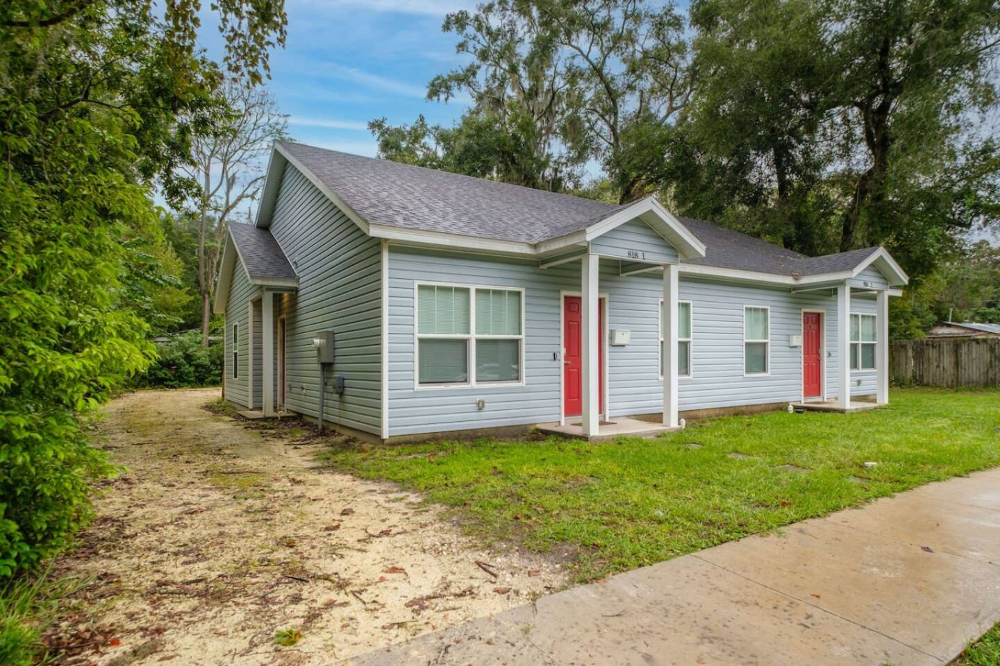
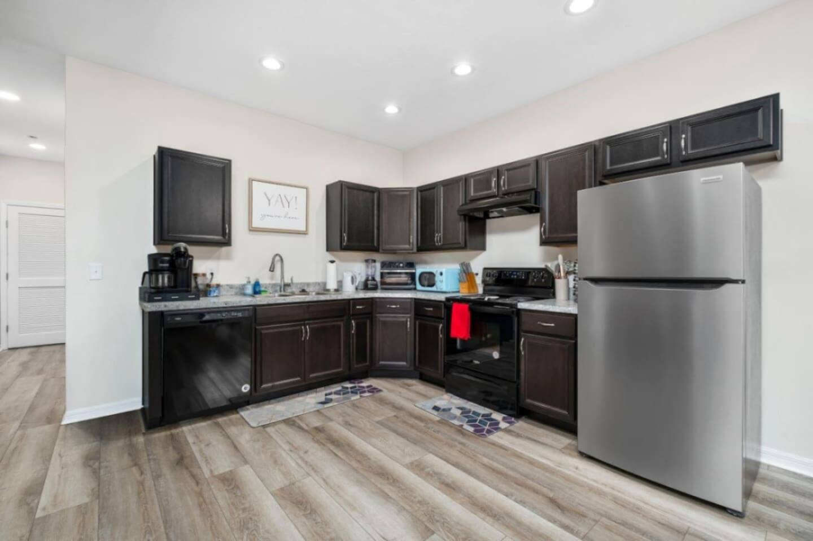

Forget the chains on University Ave. If you *really* want to eat in Gainesville, you need to know where the locals go. This isn't a list of the most convenient spots to grab a bite between classes; this is a curated tour of the places that define the city's surprisingly diverse and delicious food scene.

From legendary pizza joints with cult-like followings to authentic taco spots hidden in plain sight, we're skipping the lines for the tourist traps and getting right to the good stuff. Get ready to eat your way through Gainesville.

### Table of Contents
*   [Gainesville's Must-Try Breakfast & Brunch Spots](#breakfast)
*   [Lunch Like a Local: Quick Bites and Casual Feasts](#lunch)
*   [Dinner Destinations: From Downtown Hotspots to Hidden Gems](#dinner)
*   [Sweet Treats & Late-Night Bites](#dessert)
*   [Where to Grab a Drink: Breweries and Cocktail Bars](#drinks)
*   [Where to Stay for Your Gainesville Foodie Tour](#stay)
*   [Gainesville Foodie Guide: FAQ](#faq)

## Gainesville's Must-Try Breakfast & Brunch Spots

Starting your day right is non-negotiable, and Gainesville has some truly unique spots to get your morning fuel, whether you're craving classic Southern comfort or something completely unexpected.

### The Flying Biscuit Cafe
If you're looking for a quintessential Southern breakfast, this is it. The name says it all—the biscuits are fluffy, buttery, and served with a side of cranberry-apple butter that's downright addictive. The menu is huge, but you can't go wrong with the Creamy Dreamy Grits (a signature dish for a reason) and the Southern Scramble.

*   **Local's Tip:** It gets packed on weekends, especially after 10 AM. Go early or try to snag a spot on their weekday waitlist to cut down on time.
*   **Address:** [4150 NW 16th Blvd, Gainesville, FL 32605](https://www.google.com/maps/search/?api=1&query=4150+NW+16th+Blvd+Gainesville+FL+32605)

### Halo Potato Donuts
This isn't your average donut shop. Halo makes their donuts from potatoes, which results in a ridiculously light, fluffy, and moist texture that's unlike anything you've had before. The flavors are always rotating and creative, from classic glazed and cinnamon sugar to more adventurous options like Fruity Pebbles or Maple Bacon. My personal favorite is the simple vanilla bean glazed—it lets the unique texture of the donut shine.

*   **Local's Tip:** They make a limited number of donuts each day and often sell out before noon, especially on weekends. Get there when they open for the best selection.
*   **Address:** [1323 S Main St, Gainesville, FL 32601](https://www.google.com/maps/search/?api=1&query=1323+S+Main+St+Gainesville+FL+32601)

### Bagels & Noodles
Yes, you read that right. This Gainesville institution has been serving up a bizarre but beloved combination of New York-style bagels and Vietnamese noodle soup (Pho) for years. It sounds strange, but it just *works*. One person in your group can get a classic bacon, egg, and cheese on a fresh-baked everything bagel, while another gets a steaming, fragrant bowl of Pho Tai. It’s the kind of quirky, only-in-a-college-town spot that you have to experience.

*   **Local's Tip:** The "B&N Special" Pho is loaded with everything and is a perfect cure-all after a late night out.
*   **Address:** [1222 W University Ave, Gainesville, FL 32601](https://www.google.com/maps/search/?api=1&query=1222+W+University+Ave+Gainesville+FL+32601)

## Lunch Like a Local: Quick Bites and Casual Feasts

Lunch in Gainesville is all about casual, flavor-packed meals that reflect the city's laid-back vibe. These are the places you'll find locals returning to week after week.

### Satchel's Pizza
Satchel's isn't just a restaurant; it's a Gainesville landmark. This place is an explosion of folk art, with a gift shop in a van, a greenhouse for dining, and eclectic decor everywhere you look. But the main event is the pizza. They serve up incredible deep-dish and thin-crust pies with a signature swirl of sauce on top. And whatever you do, *do not* skip the house salad with the vinaigrette dressing. People buy it by the bottle for a reason.

*   **Local's Tip:** The wait can be long, but it's part of the experience. Grab a house-made soda, explore the grounds, and enjoy the atmosphere. They are also cash-only, but there's an ATM on site.
*   **Address:** [1800 NE 23rd Ave, Gainesville, FL 32609](https://www.google.com/maps/search/?api=1&query=1800+NE+23rd+Ave+Gainesville+FL+32609)

### La Tienda
For the most authentic tacos in Gainesville, head straight to La Tienda. Tucked away in the back of a small Latin grocery store, this no-frills counter serves up incredible tacos, tortas, and sopes. The tortillas are fresh, the meats are perfectly seasoned, and the salsa bar is legit. My go-to is always the al pastor tacos, with marinated pork shaved right off the spit.

*   **Local's Tip:** It’s a small space with limited seating. Be prepared to take your food to go, or try to visit during an off-peak hour like 2 PM.
*   **Address:** [2204 SW 13th St, Gainesville, FL 32608](https://www.google.com/maps/search/?api=1&query=2204+SW+13th+St+Gainesville+FL+32608)

### Curia on the Drag
While known for its excellent coffee, Curia has a fantastic all-vegan food menu that even carnivores will love. The "Curiaussi" is a brilliant vegan take on a sausage roll, and their rotating selection of sandwiches and bowls is always fresh and creative. The best part is the atmosphere—a sprawling, shady outdoor space with tons of seating that feels like a hidden oasis.

*   **Local's Tip:** This is a great spot to bring your laptop and work for a few hours while enjoying a great lunch and coffee. The Wi-Fi is strong and the vibe is relaxed.
*   **Address:** [2029 NW 6th St, Gainesville, FL 32609](https://www.google.com/maps/search/?api=1&query=2029+NW+6th+St+Gainesville+FL+32609)

## Dinner Destinations: From Downtown Hotspots to Hidden Gems

When the sun goes down, Gainesville's dining scene comes alive. Whether you're looking for a legendary burger, upscale sushi, or a celebratory steak, you'll find it here.

### The Top Restaurant & Bar
Ask anyone in Gainesville for a dinner recommendation, and The Top will almost certainly be on their list. This dimly lit, bustling downtown spot is famous for its incredible burgers (both meat and vegetarian), creative entrees, and a fantastic bar. They have one of the most extensive vegetarian and vegan menus in the city, so it's a crowd-pleaser for any group. The corn nuggets with powdered sugar are a must-order appetizer.

*   **Local's Tip:** They don't take reservations, and the wait can easily be over an hour on a weekend night. Put your name in and grab a drink at the adjoining Arcade Bar while you wait.
*   **Address:** [30 N Main St, Gainesville, FL 32601](https://www.google.com/maps/search/?api=1&query=30+N+Main+St+Gainesville+FL+32601)

### Dragonfly Sushi & Sake Co.
For a more upscale dining experience, Dragonfly is the go-to spot for modern Japanese cuisine in downtown Gainesville. The atmosphere is sleek and energetic, and the menu is packed with inventive sushi rolls, delicious robata-grilled skewers, and an impressive selection of sake. The "Cobra Kai" roll and the pork belly skewers are standouts.

*   **Local's Tip:** Make a reservation, especially if you're planning to go on a Friday or Saturday night. It's a popular spot for date nights and special occasions.
*   **Address:** [201 SE 2nd Ave #104, Gainesville, FL 32601](https://www.google.com/maps/search/?api=1&query=201+SE+2nd+Ave+104+Gainesville+FL+32601)

### Embers Wood Grill
Celebrating a graduation, an anniversary, or a big Gators win? Embers is where you go. This is Gainesville's premier steakhouse, known for its prime cuts of meat cooked over a wood-fired grill, extensive wine list, and impeccable service. The Capital Grille-style "Generous Pour" wine event they sometimes host is a fantastic value. It's a splurge, but one that's worth it for a memorable meal.

After a big dinner downtown, you'll want a comfortable place to relax. If you're traveling with a big group of fellow foodies, the **[Spacious Retreat Near UF & Shands](https://book.springlinestays.com/property/4-minutes-to-universityshands-bbq-spacious)** is a fantastic option. This Springline Stays property sleeps up to 12 guests and has a full kitchen for storing all those delicious leftovers. It's just a quick 10-minute drive from the downtown dining scene, giving you easy access without the noise.

*   **Local's Tip:** Don't sleep on the sides—the truffle mac & cheese and the roasted wild mushrooms are incredible.
*   **Address:** [3545 SW 34th St A, Gainesville, FL 32608](https://www.google.com/maps/search/?api=1&query=3545+SW+34th+St+A+Gainesville+FL+32608)

## Sweet Treats & Late-Night Bites

Your culinary tour isn't complete without dessert. Gainesville has some iconic spots to satisfy your sweet tooth.

### Sweet Dreams Ice Cream
A local institution for over 20 years, Sweet Dreams makes all their ice cream in-house and boasts a rotating list of dozens of unique, homemade flavors. You'll find classics alongside creative concoctions like "Blueberry Muffin" or "Kahlua Krunch." They always have excellent dairy-free options as well.

*   **Address:** [3437 W University Ave, Gainesville, FL 32607](https://www.google.com/maps/search/?api=1&query=3437+W+University+Ave+Gainesville+FL+32607)

### Midnight Cookies
Exactly what it sounds like and exactly what you need. This spot delivers warm, gooey, fresh-baked cookies until 3 AM on weekends. It's a rite of passage for UF students and a delicious indulgence for anyone. The classic chocolate chip is perfect, but the S'mores cookie is a game-changer.

*   **Address:** [3345 W University Ave, Gainesville, FL 32607](https://www.google.com/maps/search/?api=1&query=3345+W+University+Ave+Gainesville+FL+32607)

## Where to Grab a Drink: Breweries and Cocktail Bars

Gainesville's craft beer and cocktail scene has exploded in recent years. These are the top spots to grab a drink.

### First Magnitude Brewing Company
"F-Mag" is arguably the heart of Gainesville's brewery scene. They have an excellent, diverse tap list (try the 72 Pale Ale), a massive, dog-friendly beer garden, and a rotating cast of fantastic food trucks. It's the perfect place to spend a sunny afternoon.

*   **Local's Tip:** Check their social media for the food truck schedule and special events like trivia nights or live music.
*   **Address:** [1220 SE Veitch St, Gainesville, FL 32601](https://www.google.com/maps/search/?api=1&query=1220+SE+Veitch+St+Gainesville+FL+32601)

### Cypress & Grove Brewing Company
Located in a beautifully restored ice and water plant, Cypress & Grove focuses on classic, well-executed beer styles. Their lager and porter are fantastic. The taproom and outdoor space are a bit more relaxed and low-key than First Magnitude, making it a great spot for a quiet conversation over a good beer.

*   **Address:** [1091 NW 4th St, Gainesville, FL 32601](https://www.google.com/maps/search/?api=1&query=1091+NW+4th+St+Gainesville+FL+32601)

### The Dime
If craft cocktails are more your speed, seek out The Dime. This cozy, speakeasy-style bar is hidden inside the Civil Liberties restaurant downtown. The bartenders are true mixologists who can whip up a classic Old Fashioned or a creative new concoction based on your preferences. The vibe is intimate and sophisticated.

*   **Local's Tip:** It's a small space and can get crowded. If there's a wait, it's worth it. Just be patient and you'll be rewarded with one of the best cocktails in town.
*   **Address:** [17 SW 1st St, Gainesville, FL 32601](https://www.google.com/maps/search/?api=1&query=17+SW+1st+St+Gainesville+FL+32601)

## Where to Stay for Your Gainesville Foodie Tour

To make the most of your culinary adventures, you need a comfortable home base with a kitchen for leftovers and a central location. A Gainesville vacation rental gives you the space and flexibility to explore like a local.

If you're planning a trip around the UF game day schedule but still want to dive into the food scene, staying within walking distance of campus is key. Our **[Walk to University, Pet Friendly, Cozy Townhome](https://book.springlinestays.com/property/walk-to-university-pet-friendly-5-min-to-uf)** is perfect for this. You can leave the car behind, explore restaurants near campus, and even bring your furry friend along to a brewery like First Magnitude. For a similar location without a pet, the **[Walk to UF Stadium, No Cleanup, Cozy Townhome](https://book.springlinestays.com/property/walk-to-campus-restaurants-cozy-townhome)** offers the same incredible convenience.

Choosing the right place to stay in Gainesville can make all the difference, putting you right in the heart of the action with all the comforts of home.

## Gainesville Foodie Guide: FAQ

**What food is Gainesville, FL known for?**
Gainesville doesn't have one single signature dish like Philly has the cheesesteak. Instead, it's known for its incredibly diverse and independent food scene. You'll find a vibrant mix of authentic international cuisine (especially Latin American and Vietnamese), creative vegan/vegetarian options, legendary pizza places like Satchel's, and classic Southern comfort food.

**What are the best restaurants near the University of Florida campus?**
Near campus, you'll find iconic spots that are beloved by students and locals alike. Bagels & Noodles and The Top are must-visits within a short distance. For something a little further but still a Gainesville staple, Satchel's Pizza is an essential experience. University Avenue itself is lined with countless quick-service options perfect for a bite between campus tours.

**Does Gainesville have a good bar scene?**
Absolutely. Gainesville has a thriving craft beer scene anchored by breweries like First Magnitude Brewing and Cypress & Grove, both with fantastic taprooms and outdoor spaces. For cocktails, downtown offers everything from high-energy bars to intimate, speakeasy-style lounges like The Dime.

**Is it better to stay downtown or near campus in Gainesville?**
It depends on your trip's focus! If your visit is centered on UF events like a football game, graduation, or campus tour, staying near the university is most convenient. If you're more interested in nightlife, fine dining, and boutique shopping, staying closer to the downtown area is a great choice. A vacation rental can offer a great middle ground, providing a quiet neighborhood feel just a short drive from both areas.

---

Ready to eat your way through Gainesville? The first step is finding the perfect home base for your culinary adventure. Explore our properties and **[book your stay directly with Springline Stays](https://www.springlinestays.com)** to get the best rates and start planning your delicious trip.

*Devil's Millhopper State Park — a must-visit near our Gainesville properties.*

*[Walk to University, Pet Friendly, Cozy Townhome — Book your stay →](https://book.springlinestays.com/property/walk-to-university-pet-friendly-5-min-to-uf)*

*[Walk to UF Stadium, No Cleanup, Cozy Townhome — Book your stay →](https://book.springlinestays.com/property/walk-to-campus-restaurants-cozy-townhome)*
