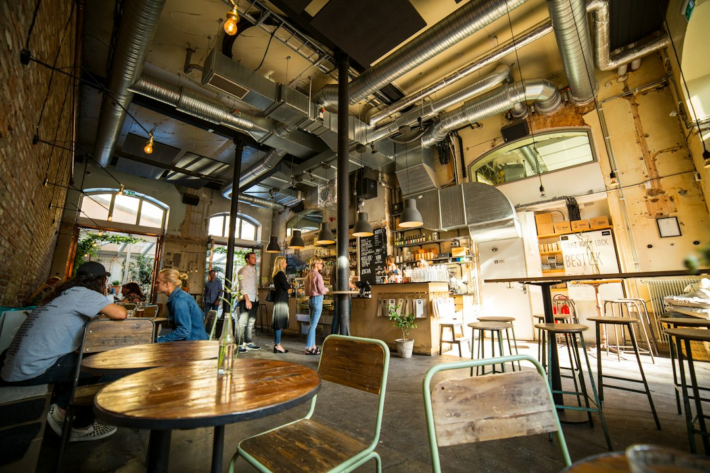
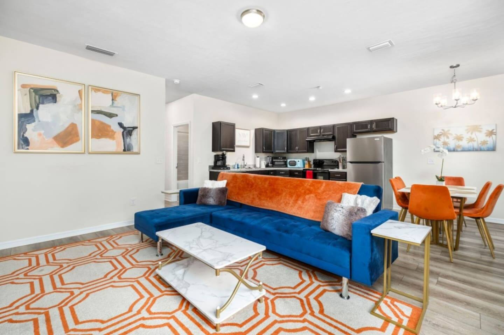
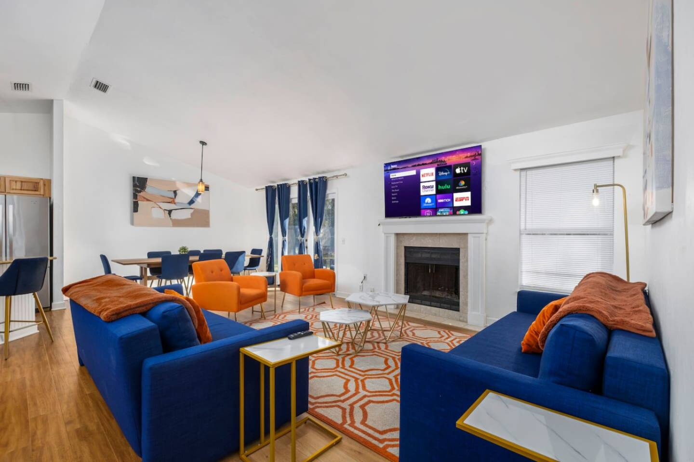
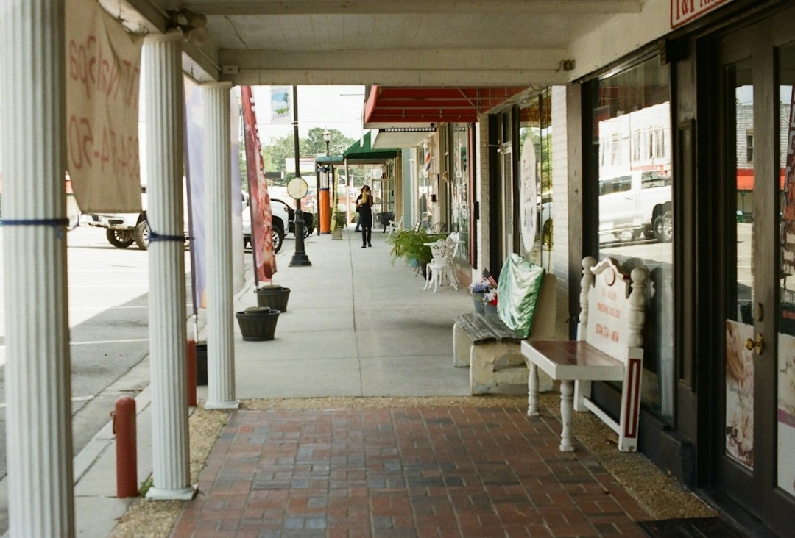
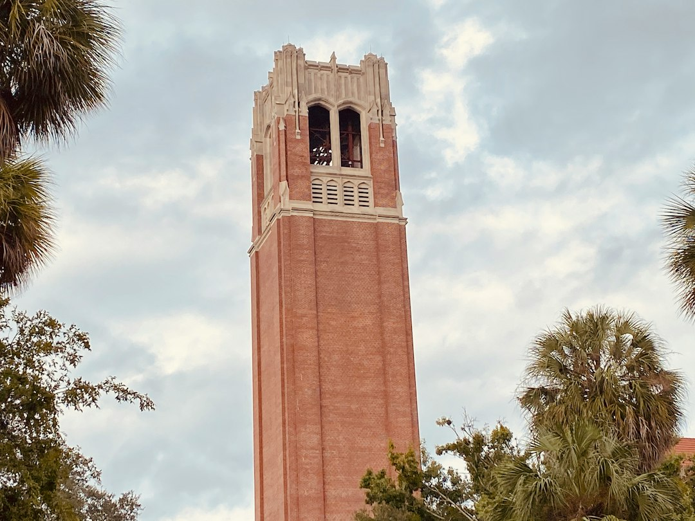

So you think Gainesville is just a college town with chain restaurants and late-night pizza? Think again. Tucked away between the live oaks and brick-lined streets is a surprisingly vibrant and diverse food scene that punches way above its weight class. Forget what you think you know; this is where you’re *actually* going to eat and drink on your next trip.

We're skipping the tourist traps and generic recommendations. This is the real deal—the spots that locals frequent, the hidden gems you won't find on a top-10 list, and the absolute can't-miss dishes that make Gainesville's food scene special. Whether you're here for a Gators game, visiting family, or exploring the nature preserves, get ready to eat well.

### Table of Contents
*   [Downtown Gainesville: The Culinary Heartbeat](#downtown-gainesville-the-culinary-heartbeat)
*   [Midtown & The University Ave Strip: Fueling the Gator Nation](#midtown--the-university-ave-strip-fueling-the-gator-nation)
*   [Archer Road & Butler Plaza: Convenient Classics and Hidden Gems](#archer-road--butler-plaza-convenient-classics-and-hidden-gems)
*   [Haile Plantation: A Quaint Village with Big Flavor](#haile-plantation-a-quaint-village-with-big-flavor)
*   [Worth the Drive: Unique Finds on the Outskirts](#worth-the-drive-unique-finds-on-the-outskirts)
*   [Frequently Asked Questions About Gainesville's Food Scene](#frequently-asked-questions-about-gainesvilles-food-scene)

## Downtown Gainesville: The Culinary Heartbeat

Downtown is the epicenter of Gainesville's independent restaurant scene. It's walkable, historic, and packed with everything from upscale dining to dive bars with legendary food. Park your car once and spend an evening exploring.

### For a Special Night Out

When you want to impress a date, celebrate an occasion, or just treat yourself, these are your go-to spots.

*   **Dragonfly Sushi & Sake Co.** ([201 SE 2nd Ave #104](https://www.google.com/maps/search/?api=1&query=201+SE+2nd+Ave+%23104+Gainesville+FL)): This isn't your average sushi joint. Dragonfly is an experience. The vibe is sleek and modern, the cocktails are inventive, and the sushi is impeccable. **Local Tip:** Don't just stick to the rolls. The Robatayaki (Japanese grill) items are incredible—try the pork belly or the black cod. Make a reservation, especially on a weekend.
*   **The Top** ([30 N Main St](https://www.google.com/maps/search/?api=1&query=30+N+Main+St+Gainesville+FL)): A true Gainesville institution. The Top has a cult following for a reason. It's dimly lit, covered in local art, and serves up some of the best American comfort food with a twist. They have incredible burgers (the vegan/vegetarian options are legendary), amazing cocktails, and a killer brunch. The wait can be long, but trust me, it's worth it.
*   **Prime & Pearl** ([4949 Celebration Pointe Ave](https://www.google.com/maps/search/?api=1&query=4949+Celebration+Pointe+Ave+Gainesville+FL)): If you're looking for a classic high-end steakhouse and oyster bar experience, this is it. Located in Celebration Pointe just a short drive from downtown, it's perfect for anniversaries or closing a business deal. The dry-aged steaks are the star, but the raw bar is equally impressive.

### Casual Bites & Local Brews

Sometimes you just want great food and a cold beer without the fuss. Downtown delivers in a big way.

*   **First Magnitude Brewing Co.** ([1220 SE Veitch St](https://www.google.com/maps/search/?api=1&query=1220+SE+Veitch+St+Gainesville+FL)): One of Gainesville's most beloved breweries, F.M. has a huge, beautiful beer garden and a fantastic rotation of food trucks. It’s the perfect place to spend a sunny afternoon. Check their social media to see which food truck is there—they’re all great. Their Vega Blonde Ale is a local classic.
*   **Cypress & Grove Brewing Company** ([1001 NW 4th St](https://www.google.com/maps/search/?api=1&query=1001+NW+4th+St+Gainesville+FL)): Housed in a beautifully restored ice plant, Cypress & Grove focuses on classic, well-made beer styles. Their outdoor space is fantastic and family-friendly, and they often have live music. They don't serve food, but you're welcome to bring your own or order from a nearby spot.
*   **Boca Fiesta** ([232 SE 1st St](https://www.google.com/maps/search/?api=1&query=232+SE+1st+St+Gainesville+FL)): "Death-Proof" tacos and burritos in a punk-rock setting. What's not to love? Boca Fiesta is a downtown staple for affordable, delicious, and inventive Mexican-inspired food. The Gator Tacos are a must-try for the adventurous, but the California Burrito is a personal favorite. Their back patio often hosts live music and events.

## Midtown & The University Ave Strip: Fueling the Gator Nation

This is the heart of student life, and the food scene reflects that: it's fast, it's affordable, and it's delicious. If you're staying near campus for a game or a university event, you won't have to go far for a great meal.

### Quick, Classic, and Unforgettable

*   **Krishna Lunch** ([Plaza of the Americas, UF Campus](https://www.google.com/maps/search/?api=1&query=Plaza+of+the+Americas+UF+Campus+Gainesville+FL)): You cannot claim to have experienced Gainesville without having Krishna Lunch. Served every weekday on the Plaza of the Americas, this all-you-can-eat vegetarian/vegan meal is a decades-old tradition. For a few bucks, you get a heaping plate of delicious, healthy food. The almond dressing for the salad is liquid gold.
*   **El Indio Mexican Restaurant** ([407 NW 13th St](https://www.google.com/maps/search/?api=1&query=407+NW+13th+St+Gainesville+FL)): A no-frills, family-owned spot that has been serving students and locals for decades. The prices are unbeatable, the portions are huge, and the food is consistently good. The Super Burrito is legendary. It's the perfect quick lunch or dinner spot.
*   **Italian Gator Pizza by the Slice** ([1728 W University Ave](https://www.google.com/maps/search/?api=1&query=1728+W+University+Ave+Gainesville+FL)): When that late-night craving hits, this is the answer. It’s an iconic spot right across from campus serving up huge, foldable New York-style slices. Don’t overthink it—just grab a slice of pepperoni and enjoy.

Staying close to the action in Midtown makes game days and campus visits a breeze. You can ditch the car and walk to the stadium, then grab a celebratory bite on the way back.

For a small group or family, our [Walk to UF Stadium, No Cleanup, Cozy Townhome](https://book.springlinestays.com/property/walk-to-campus-restaurants-cozy-townhome) (818-1 Springline Stays) is the perfect home base. You're literally steps from Ben Hill Griffin Stadium and all the great Midtown eats. If you're bringing your four-legged Gator fan, the [Walk to University, Pet Friendly, Cozy Townhome](https://book.springlinestays.com/property/walk-to-university-pet-friendly-5-min-to-uf) (818-2 Springline Stays) offers the same unbeatable location with a pet-friendly policy. Imagine walking back from the game and being home in minutes, with a full kitchen ready for you.

## Archer Road & Butler Plaza: Convenient Classics and Hidden Gems

This sprawling commercial corridor has all the familiar chains you could want, but don't let that fool you. There are some fantastic local spots hiding in plain sight, making it a convenient and surprisingly diverse area for dining, especially for larger groups.

### Best Bets for Families & Groups

*   **Mi Apá Latin Café** ([114 SW 34th St](https://www.google.com/maps/search/?api=1&query=114+SW+34th+St+Gainesville+FL) & [15634 NW US Hwy 441, Alachua](https://www.google.com/maps/search/?api=1&query=15634+NW+US+Hwy+441+Alachua+FL)): If you only eat at one place on this list, make it Mi Apá. This authentic Cuban cafe is a Gainesville treasure. The Cafe con Leche will change your life, the pastries (get a guava and cheese pastelito) are addictive, and the Cuban sandwich is arguably the best in Florida. It's counter-service, fast, and always buzzing.
*   **4 Rivers Smokehouse** ([3262 SW 35th Blvd](https://www.google.com/maps/search/?api=1&query=3262+SW+35th+Blvd+Gainesville+FL)): A Florida-based chain that feels like a local spot. This is some of the best BBQ you'll find in the city. The brisket is the star of the show—smoky, tender, and juicy. **Local Tip:** The sides are just as good as the meat. Don't skip the Smokehouse Corn or the Baked Cheese Grits.

### Hidden in Plain Sight

*   **Yummy House** ([3102 SW 34th St](https://www.google.com/maps/search/?api=1&query=3102+SW+34th+St+Gainesville+FL)): Tucked into a strip mall, Yummy House serves authentic Hong Kong-style dim sum and Cantonese cuisine. It's bustling, a bit chaotic, and absolutely delicious. Go for brunch on a weekend for the full dim sum cart experience. The Salt and Pepper Calamari is a must-order.
*   **Beque Holic** ([3812 W Newberry Rd #1d](https://www.google.com/maps/search/?api=1&query=3812+W+Newberry+Rd+%231d+Gainesville+FL)): For a fun, interactive dining experience, Beque Holic offers authentic Korean BBQ. You grill your own high-quality meats at your table, which comes with an endless supply of delicious banchan (side dishes). It's a fantastic option for a group of friends.

If you're traveling with a big crew for a graduation, family reunion, or a big game, finding a place to stay—and a restaurant to fit everyone—can be a challenge. Our [Spacious Retreat Near UF & Shands](https://book.springlinestays.com/property/4-minutes-to-universityshands-bbq-spacious) (4403 Springline Stays) sleeps up to 12 guests and is perfectly located just minutes from Archer Road's diverse dining options. You get the space to relax together, a full kitchen and BBQ for meals at home, and easy access to restaurants that can accommodate your whole party.

## Haile Plantation: A Quaint Village with Big Flavor

Just a 15-minute drive from the university, the Haile Village Center feels like a different world. This charming, new urbanist neighborhood is built around a town square with shops, green spaces, and some excellent restaurants.

*   **Haile Farmers Market** ([5213 SW 91st Terrace](https://www.google.com/maps/search/?api=1&query=5213+SW+91st+Terrace+Gainesville+FL)): Held every Saturday morning, rain or shine, this is one of the best farmers markets in the area. You'll find local produce, fresh baked goods, artisan cheeses, and prepared foods. It's a great place to grab breakfast and soak up the local atmosphere.
*   **Volcanic Sushi + Sake** ([5141 SW 91st Way #101](https://www.google.com/maps/search/?api=1&query=5141+SW+91st+Way+%23101+Gainesville+FL)): Another top-tier sushi spot, Volcanic offers a more relaxed, neighborhood feel than Dragonfly. The menu is creative and extensive, with plenty of options for both sushi purists and those who love inventive rolls.
*   **L'Avion** ([4860 SW 34th St](https://www.google.com/maps/search/?api=1&query=4860+SW+34th+St+Gainesville+FL)): This spot is a bit outside Haile proper but embodies the same "hidden gem" quality. It's a fantastic French & Vietnamese bistro that's perfect for a quiet, delicious lunch. The Banh Mi and Pho are authentic and flavorful.

## Worth the Drive: Unique Finds on the Outskirts

Some of Gainesville's best food requires a short drive, but you'll be rewarded with unique flavors and experiences.

*   **Blue Gill Quality Foods** ([1310 S Main St](https://www.google.com/maps/search/?api=1&query=1310+S+Main+St+Gainesville+FL)): Located in the up-and-coming South Main district, Blue Gill offers elevated Southern cuisine in a rustic-chic setting. It's a great spot for brunch or dinner, with dishes like Shrimp & Grits and a fantastic fried chicken sandwich.
*   **Satchel's Pizza** ([1800 NE 23rd Ave](https://www.google.com/maps/search/?api=1&query=1800+NE+23rd+Ave+Gainesville+FL)): Satchel's is more than a pizza place; it's a Gainesville experience. The decor is a quirky, eclectic collection of folk art. You can eat in a van, a greenhouse, or under the stars. The pizza is phenomenal—deep-dish or thin-crust with a huge list of toppings. **Pro Tip:** They are cash-only, but there's an ATM on site. Be prepared for a wait, but you can explore the grounds while you do.
*   **Sweet Dreams of Gainesville** ([3437 W University Ave](https://www.google.com/maps/search/?api=1&query=3437+W+University+Ave+Gainesville+FL)): For dessert, you have to go to Sweet Dreams. This local ice cream shop has been making incredible, homemade ice cream for decades. They have a rotating menu of unique, community-inspired flavors alongside the classics. You can't go wrong.

Gainesville's food scene is a direct reflection of the city itself: diverse, unpretentious, and full of hidden treasures. So next time you're planning a trip, come hungry. This Gainesville travel guide is just the start of the delicious things to do in Gainesville.

---

## Frequently Asked Questions About Gainesville's Food Scene

### What food is Gainesville, FL known for?
While there isn't one single dish like a Philly cheesesteak, Gainesville is known for its incredibly diverse and independent food scene. Key experiences include the traditional vegetarian **Krishna Lunch** on UF's campus, authentic Cuban food from places like **Mi Apá Latin Café**, and quirky, iconic institutions like **Satchel's Pizza**.

### Are there any good breweries in Gainesville?
Absolutely! Gainesville has a thriving craft beer scene. **First Magnitude Brewing Co.** and **Cypress & Grove Brewing Company** are two of the most popular, both known for their excellent beer, large outdoor spaces, and community-focused events. Swamp Head Brewery is another local giant famous for its Florida-inspired brews.

### Where is the best place for brunch in Gainesville?
You have many great options! For a classic, hearty brunch, **The Top** downtown is a local favorite with fantastic cocktails. **Blue Gill Quality Foods** on South Main Street offers excellent Southern-style brunch dishes. If you're looking for something quicker, the pastries and coffee at **Mi Apá Latin Café** are unbeatable.

### What are the best Gainesville restaurants for a large group?
For large groups, you'll want a place with ample seating and a diverse menu. **4 Rivers Smokehouse** on Archer Road is great for big parties with its cafeteria-style service. Many of the breweries, like **First Magnitude**, have huge beer gardens and food trucks, making them ideal for accommodating big, casual get-togethers. Our **Spacious Retreat Near UF & Shands** is the perfect Gainesville vacation rental for large groups, putting you close to these options.

---

Ready to eat your way through Gainesville? The best trips start with the perfect home base. By choosing a Gainesville vacation rental, you get the space, privacy, and amenities of a home, putting you right in the heart of these incredible neighborhoods.

**[Book your Gainesville stay directly with Springline Stays](https://www.springlinestays.com) and save on fees while getting the best local recommendations!**

*University of Florida — a must-visit near our Gainesville properties.*

*[Walk to University, Pet Friendly, Cozy Townhome — Book your stay →](https://book.springlinestays.com/property/walk-to-university-pet-friendly-5-min-to-uf)*

*[Spacious Retreat Near UF & Shands — Book your stay →](https://book.springlinestays.com/property/4-minutes-to-universityshands-bbq-spacious)*
