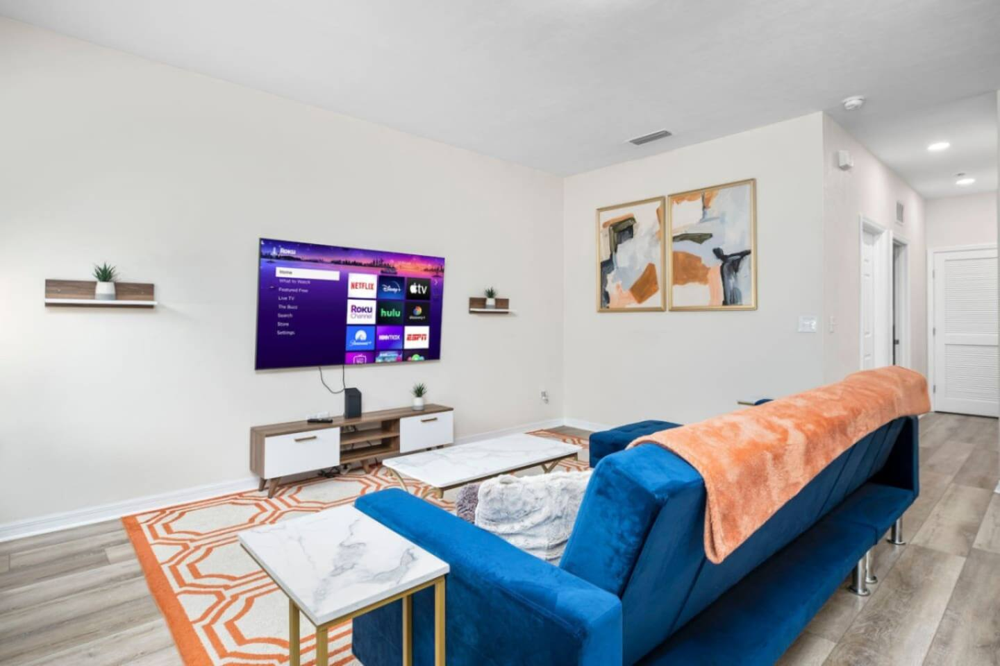
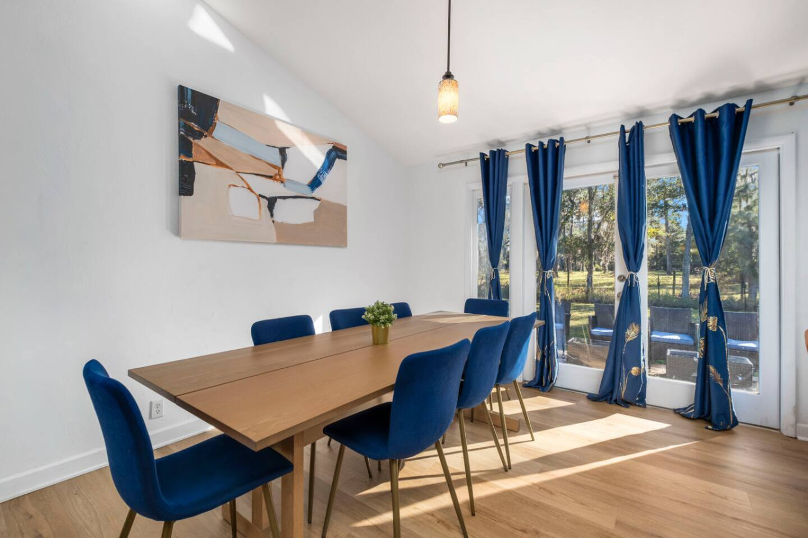
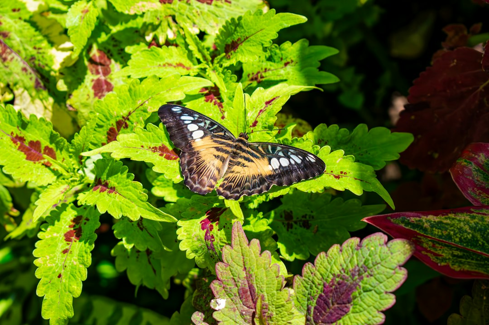
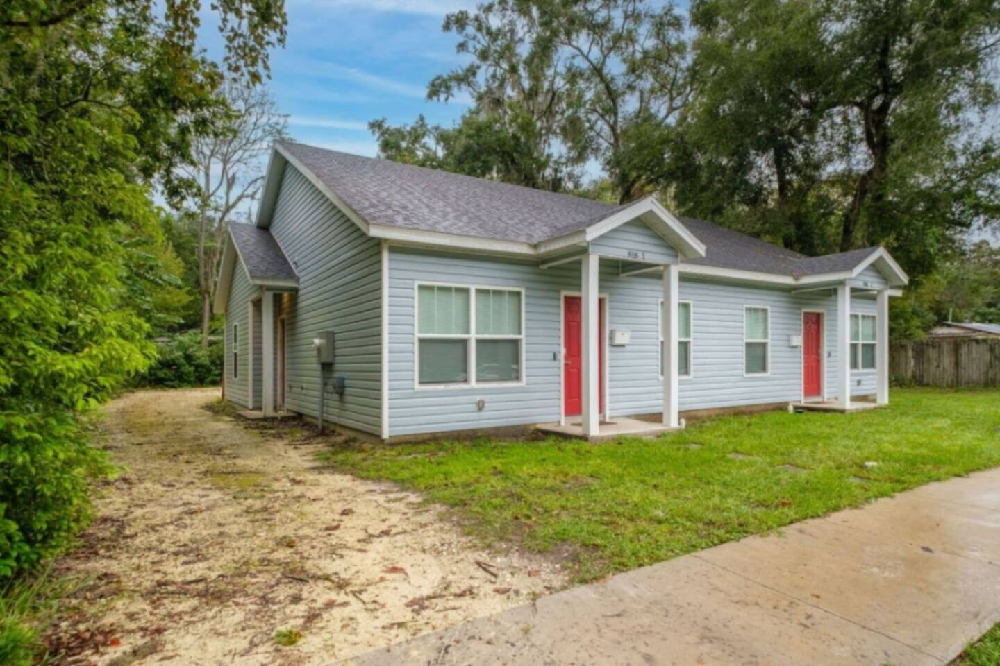

Gainesville is so much more than just a college town, and where you choose to stay completely shapes your experience. Are you here to bleed orange and blue for a game weekend, explore historic streets packed with incredible food, or use the city as a launchpad for world-class nature excursions?

Forget generic hotel listings. Let's break down the real vibe of Gainesville's best neighborhoods so you can find the perfect home base for your trip.

### Table of Contents
*   [Near UF & The Swamp: The Heart of Gator Nation](#near-uf-the-swamp-the-heart-of-gator-nation)
*   [Downtown Gainesville: History, Arts, and Incredible Food](#downtown-gainesville-history-arts-and-incredible-food)
*   [Southeast Gainesville: For Families, Nature Lovers, and Medical Visitors](#southeast-gainesville-for-families-nature-lovers-and-medical-visitors)
*   [Midtown: The Student Social Hub](#midtown-the-student-social-hub)
*   [Haile Plantation: Quaint Village Charm](#haile-plantation-quaint-village-charm)
*   [Quick Guide: Which Gainesville Neighborhood is Right for You?](#quick-guide-which-gainesville-neighborhood-is-right-for-you)
*   [Gainesville Neighborhood FAQs](#gainesville-neighborhood-faqs)

---

## Near UF & The Swamp: The Heart of Gator Nation

**Vibe:** Electric, convenient, and pulsing with orange and blue energy. This is ground zero for anything related to the University of Florida.

If your trip revolves around a football game at Ben Hill Griffin Stadium (The Swamp), a campus tour, a graduation ceremony, or visiting a student, staying here is a no-brainer. The ability to walk to campus and avoid the notoriously tricky game-day parking is a luxury you won't regret. Even on non-event weekends, the area is buzzing with life, and you're surrounded by classic Gainesville institutions.

### What to Do in the UF Area

*   **Catch a Game:** Whether it's football at The Swamp, basketball at the O'Connell Center, or baseball at Condron Ballpark, the energy is unbeatable.
*   **Explore Campus:** Take a stroll through the historic University of Florida campus. Don't miss the Century Tower, University Auditorium, and Plaza of the Americas.
*   **Florida Museum of Natural History:** Get lost for hours exploring Florida's unique cultural and natural history. The main attraction is the Butterfly Rainforest, a stunning four-story screened enclosure with hundreds of free-flying butterflies and birds. It’s an absolute must-do.
*   **Harn Museum of Art:** Right next to the natural history museum, the Harn boasts an impressive collection of over 11,000 works, with a focus on Asian, African, and modern art.

### Where to Eat Near Campus

*   **The Swamp Restaurant:** A Gainesville landmark reborn. Located right across from campus on University Avenue, it's the quintessential pre-game or post-game spot for a burger and a beer.
*   **Krishna Lunch:** An on-campus institution since 1971. For a few dollars, you get a heaping plate of delicious, healthy vegetarian/vegan food. Find them in the Plaza of the Americas on weekdays during the semester.
*   **Satchel's Pizza:** Technically a short drive from campus, but it's a rite of passage. This wildly eclectic spot serves some of the best pizza in Florida in a funky, art-filled setting. Be prepared for a wait, but it's worth every minute.

### Where to Stay Near UF

For the ultimate convenience, you need a spot where you can park your car and forget about it. Being able to walk to the stadium and back without dealing with traffic is a game-changer.

If you're traveling with a small group or family, the **[Walk to UF Stadium, No Cleanup, Cozy Townhome](https://book.springlinestays.com/property/walk-to-campus-restaurants-cozy-townhome)** is an ideal choice. It sleeps up to six and puts you a literal five-minute walk from the stadium. Plus, the "no cleanup" part means you can focus on enjoying your trip, not doing chores on your way out.

For those traveling with a four-legged friend, the **[Walk to University, Pet Friendly, Cozy Townhome](https://book.springlinestays.com/property/walk-to-university-pet-friendly-5-min-to-uf)** offers the same unbeatable location and cozy setup for six guests, with the added bonus of being pet-friendly. It’s perfect for alumni who can't bear to leave their furry Gator fan at home. This Gainesville vacation rental makes campus access a breeze.

## Downtown Gainesville: History, Arts, and Incredible Food

**Vibe:** Sophisticated yet funky. Historic brick buildings house some of the city's best restaurants, independent boutiques, theaters, and live music venues.

If you're a foodie, an art lover, or someone who enjoys a good cocktail bar, Downtown is your spot. It’s more "grown-up" than the areas immediately surrounding campus, offering a vibrant nightlife and cultural scene that stands on its own. It's walkable, charming, and the central hub for local events and festivals at Bo Diddley Plaza.

### What to Do in Downtown Gainesville

*   **Hippodrome Theatre:** Known locally as "The Hipp," this is Florida’s most celebrated professional theatre, housed in a beautiful historic former post office. Catch a play, an independent film, or browse the art gallery.
*   **Bo Diddley Plaza:** The community's living room. There’s almost always something happening here, from free concerts on Friday nights to farmers' markets and cultural festivals.
*   **Explore the Murals:** Downtown and the adjacent Grove Street area are covered in fantastic murals by local and international artists. It’s an outdoor art gallery perfect for a sunny afternoon stroll.
*   **Go Brewery Hopping:** Downtown is the epicenter of Gainesville's craft beer scene. Start at **First Magnitude Brewing Company** for its huge outdoor space and excellent beer, then head to **Cypress & Grove Brewing Co.**, which is housed in a historic ice plant and uses water from a 300-foot-deep well on the property.

### Where to Eat Downtown

*   **The Top Restaurant:** A beloved Gainesville institution known for its eclectic, vegetarian-friendly menu and legendary bar. My personal tip: go for the corn nuggets. You can't go wrong with any of their burgers, and their weekend brunch is fantastic. Expect a wait, but you can kill time at the attached arcade bar.
*   **Dragonfly Modern Izakaya:** One of the best dining experiences in the city. This Japanese pub serves incredible sushi, robatayaki skewers, and craft cocktails in a stylish, energetic atmosphere.
*   **Crane Ramen:** Authentic, soul-warming ramen that will transport you straight to Japan. The Spicy Paitan is a local favorite.
*   **Wyatt's Coffee:** For your morning fuel, Wyatt's is a small, quality-focused shop serving up expertly crafted espresso drinks and pour-overs.

## Southeast Gainesville: For Families, Nature Lovers, and Medical Visitors

**Vibe:** Quiet, spacious, and incredibly convenient to both nature and major medical centers.

This part of town offers a bit more breathing room than the dense areas around campus and downtown. It’s an excellent choice for larger groups, families with kids, or anyone visiting for work at UF Health Shands Hospital or the Malcom Randall VA Medical Center. Its secret weapon is its proximity to some of Gainesville’s most incredible natural attractions.

### What to Do in Southeast Gainesville

*   **Paynes Prairie Preserve State Park:** A National Natural Landmark that will make you feel like you've stepped into another world. From the 50-foot-high observation tower near [4801 Camp Ranch Rd, Micanopy, FL](https://www.google.com/maps/search/?api=1&query=4801+Camp+Ranch+Rd%2C+Micanopy%2C+FL), you can see the park's famous wild horses and bison roaming the vast wetlands. The La Chua Trail on the north rim is the best place to see alligators—and lots of them.
*   **Depot Park:** One of the best city parks in Florida. It features a fantastic playground with a splash pad, a beautiful promenade around a central pond, and the Cade Museum for Creativity and Invention. The park is connected to several bike trails, making it a great starting point for a ride. The address is [874 SE 4th St, Gainesville, FL](https://www.google.com/maps/search/?api=1&query=874+SE+4th+St%2C+Gainesville%2C+FL).
*   **Kanapaha Botanical Gardens:** 68 acres of stunning gardens to explore, including Florida's largest public display of bamboo and the state's largest herb garden. It's a peaceful, beautiful escape.

### Where to Eat in Southeast Gainesville

*   **4th Ave Food Park:** A collection of permanent food trucks surrounding a shared seating area. You can find everything from tacos and pizza to banh mi and crepes. Great for groups where everyone wants something different.
*   **Goldie's Burgers:** A classic, no-frills drive-in that has been serving Gainesville since the 1960s. Their "Big G" is a local legend.
*   **Humble Wood Fire:** Located in the South Main Station complex, this spot serves up some of the best Neapolitan-style pizza in town, fired in a giant wood-burning oven.

### Where to Stay in Southeast Gainesville

When you need more space for a large family, a reunion, or a group trip, this area is perfect. You get more room to spread out while still being a quick 5-10 minute drive from both downtown and the university.

The **[Spacious Retreat Near UF & Shands](https://book.springlinestays.com/property/4-minutes-to-universityshands-bbq-spacious)** is a fantastic option for groups of up to 12. With four bedrooms, a fully equipped kitchen, and a backyard with a BBQ, it's designed for gathering. Its location is ideal for those who need easy access to the hospitals or want a comfortable home base after a long day exploring Paynes Prairie. This is one of the top Gainesville vacation rental choices for big groups.

## Midtown: The Student Social Hub

**Vibe:** Loud, energetic, and 100% student-focused. This is the heart of undergraduate nightlife.

Located on University Avenue between downtown and the UF campus, Midtown is a dense strip of bars, casual eateries, and apartment complexes. If you're 21 and looking for a party, this is your mecca. If you're a family or looking for a quiet getaway, this is probably an area you'll want to visit during the day and stay elsewhere.

It’s worth a stop for a casual lunch at places like **JJ's Tavern** or **Relish**, but the real action happens after 10 PM on a Thursday, Friday, or Saturday night when the streets are packed with students.

## Haile Plantation: Quaint Village Charm

**Vibe:** Picturesque, family-friendly, and self-contained. It feels like its own small town.

Located in southwest Gainesville, Haile Plantation is a master-planned community known for its beautiful tree-lined streets, extensive walking and biking trails, and charming village center. It's a world away from the student-centric hustle of the areas near campus.

The **Haile Village Center** is the heart of the community, with brick-paved streets, boutique shops, and excellent restaurants like **The Top's** sister restaurant, **L'Avion,** and the cozy **Volcanic Sushi + Sake**. The Saturday morning farmers market here is one of the best in the region, drawing vendors and shoppers from all over. Staying in Haile is a great option if you're looking for a peaceful, quiet retreat while still being a 15-20 minute drive from UF and downtown.

---

## Quick Guide: Which Gainesville Neighborhood is Right for You?

| Neighborhood           | Vibe                               | Best For                                                               |
| ---------------------- | ---------------------------------- | ---------------------------------------------------------------------- |
| **Near UF & The Swamp**| Energetic, Convenient, Collegiate  | Game days, campus visits, alumni events, prospective students.         |
| **Downtown**           | Historic, Artsy, Foodie-Focused    | Couples, foodies, nightlife, cultural events, business travelers.      |
| **Southeast GNV**      | Quiet, Spacious, Nature-Adjacent   | Large families, groups, medical visitors, nature lovers.               |
| **Midtown**            | Loud, Student-centric, Party-Ready | Current students, young visitors looking for nightlife.                |
| **Haile Plantation**   | Upscale, Quaint, Family-Friendly   | Relaxing getaways, families with young kids, those seeking a quiet stay. |

---

## Gainesville Neighborhood FAQs

### What is the best area to stay in Gainesville, FL?
The "best" area depends entirely on your reason for visiting. For anything UF-related, like football games or graduation, staying within walking distance of campus is unbeatable. For a trip focused on food, arts, and nightlife, Downtown is the best choice. For larger groups, families, or those wanting proximity to nature preserves like Paynes Prairie, Southeast Gainesville is ideal.

### Is it better to stay downtown or near UF in Gainesville?
If you're in town for a university event, stay near UF to avoid traffic and parking headaches. The convenience is worth it. If you're not tied to a campus schedule and prefer a wider variety of restaurants, bars, and cultural venues within walking distance, Downtown offers a more diverse and sophisticated experience.

### Where do families stay in Gainesville?
Families often prefer Southeast Gainesville or the Haile Plantation area. These neighborhoods offer more space, quieter surroundings, and easy access to family-friendly activities like Depot Park, the Butterfly Rainforest, and Kanapaha Botanical Gardens. A Gainesville vacation rental with multiple bedrooms and a kitchen is often more comfortable and economical for a family than a hotel.

### Can you visit Gainesville without a car?
If you stay either Downtown or right next to the UF campus, you can get by without a car for most of your trip. Both areas are very walkable, and the RTS bus system is efficient for getting between them. However, to explore the area's incredible natural attractions like the state parks and springs, you will definitely need a car.

---

No matter which neighborhood you choose, Gainesville has a unique charm that's waiting to be discovered. From the roar of the stadium to the silent beauty of a prairie sunrise, the city offers a diverse range of experiences.

Ready to find your perfect Gainesville home base? Explore our curated collection of properties and **[book your stay directly with Springline Stays](https://www.springlinestays.com)** to get the best rates and local service.

*Butterfly Rainforest — a must-visit near our Gainesville properties.*

*Depot Park — a must-visit near our Gainesville properties.*

*[Walk to UF Stadium, No Cleanup, Cozy Townhome — Book your stay →](https://book.springlinestays.com/property/walk-to-campus-restaurants-cozy-townhome)*

*[Walk to University, Pet Friendly, Cozy Townhome — Book your stay →](https://book.springlinestays.com/property/walk-to-university-pet-friendly-5-min-to-uf)*
