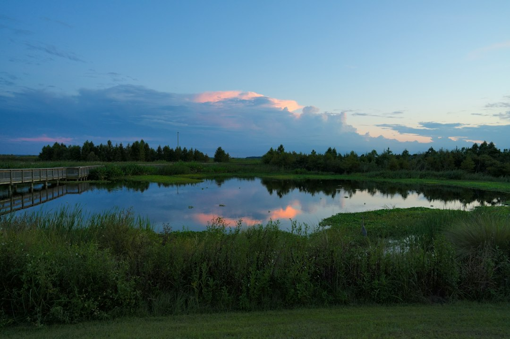
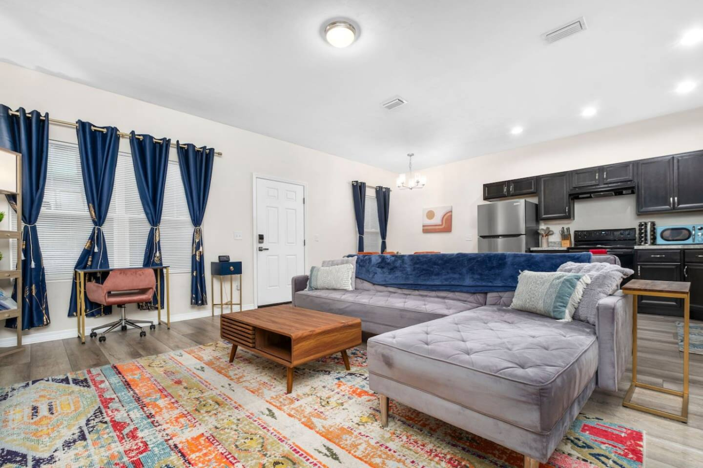
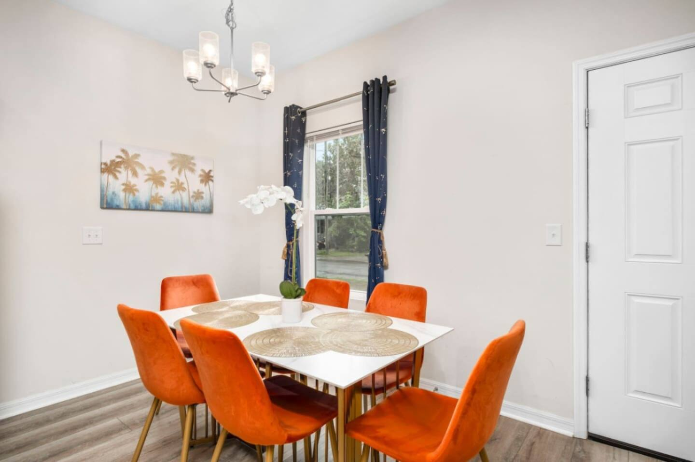

Don't just book a place in Gainesville; book a *neighborhood*. Where you stay completely shapes your trip, whether you're here for the big game, a campus visit, or to explore the wild side of North Florida. Choosing between a spot where you can hear the roar of the stadium and a quiet street lined with historic Victorian homes can be the difference between a good trip and an unforgettable one.

Most travel guides will give you a generic list of things to do, but they won't tell you about the distinct personality of each part of town. That's where this guide comes in. We're breaking down Gainesville's key neighborhoods to help you find the perfect home base that matches your trip's unique DNA.

### Table of Contents
*   [Midtown/University Area: The Heart of the Gator Nation](#midtown-university-area-the-heart-of-the-gator-nation)
*   [Downtown Gainesville: The Cultural & Culinary Hub](#downtown-gainesville-the-cultural-culinary-hub)
*   [Southwest Gainesville: Convenience for Families & Large Groups](#southwest-gainesville-convenience-for-families-large-groups)
*   [Haile Plantation: The Quaint Village Escape](#haile-plantation-the-quaint-village-escape)
*   [The Historic Duckpond District: Old Florida Charm](#the-historic-duckpond-district-old-florida-charm)
*   [Quick Guide: Which Gainesville Neighborhood is for You?](#quick-guide-which-gainesville-neighborhood-is-for-you)
*   [Frequently Asked Questions](#frequently-asked-questions)

## Midtown/University Area: The Heart of the Gator Nation

### The Vibe
Electric, energetic, and unapologetically orange and blue. Midtown is the epicenter of student life at the University of Florida. The streets—particularly West University Avenue—are a constant buzz of students walking to class, grabbing a bite, or heading out for the night. On a game day, this energy multiplies by a thousand. If you thrive on being in the middle of the action and want the quintessential UF experience, this is your spot.

### Best For
Game day fanatics, prospective students and their families, returning alumni on a nostalgia tour, and anyone who wants to ditch the car and explore the university on foot.

### What to See & Do
The main attraction here is, of course, the **University of Florida** campus itself. Spend a day wandering through the iconic brick buildings, visit the Reitz Union, and pay your respects to the bull gator statue outside **Ben Hill Griffin Stadium** (aka The Swamp).

*   **Game Day Central:** If you're in town for a football game, this is ground zero for tailgating, pre-gaming at the bars, and the famous "Gator Walk." The secret to a stress-free game day? Don't even think about driving. Stay in Midtown and enjoy the short, celebratory walk to the stadium.
*   **Live Music & Nightlife:** Venues like The Social at Midtown and Salty Dog Saloon are student staples. It's loud, it's fun, and it's the place to be after a Gator win.
*   **Casual Eats:** This area is packed with quick, affordable, and delicious food options. Think pizza by the slice at Italian Gator, loaded burritos, and classic pub fare.

### Where to Stay in Midtown
The key to staying in Midtown is finding a comfortable retreat that's just steps from the excitement. Being able to walk to campus, the stadium, and your favorite restaurants is a game-changer. For small groups or families who want that unbeatable convenience, a townhome is the perfect solution.

If you’re here for the game and want to be able to hear the roar of the crowd from your doorstep, you can't get any closer than the **[Walk to UF Stadium, No Cleanup, Cozy Townhome](https://book.springlinestays.com/property/walk-to-campus-restaurants-cozy-townhome)**. It’s a stylish and comfortable base camp for all your Gator adventures.

And if your furry best friend is also a Gator fan, the **[Walk to University, Pet Friendly, Cozy Townhome](https://book.springlinestays.com/property/walk-to-university-pet-friendly-5-min-to-uf)** offers the same incredible location with a welcoming policy for your four-legged companion. Both the 818-1 and 818-2 Springline Stays properties put the best of the university area at your fingertips.

## Downtown Gainesville: The Cultural & Culinary Hub

### The Vibe
Just a short drive or bus ride east of campus, Downtown Gainesville feels like a different world. It’s the city’s historic and cultural heart, with a vibe that's more "craft cocktail" than "keg stand." Restored brick buildings house some of the city's best restaurants, independent boutiques, and live music venues. The crowd is a mix of young professionals, artists, and long-time locals.

### Best For
Foodies, couples on a getaway, art and theater lovers, and anyone who wants a vibrant nightlife scene that extends beyond the college bars.

### What to See & Do
Downtown is incredibly walkable and packed with discoveries around every corner.

*   **Hippodrome Theatre:** This cultural anchor, housed in a stunning former federal building from 1911, offers professional theatre, indie films, and an art gallery. Catching a show here is a Gainesville rite of passage. `[25 SE 2nd Pl](https://www.google.com/maps/search/?api=1&query=25+SE+2nd+Pl+Gainesville+FL)`
*   **Bo Diddley Plaza:** This open-air community space is always hosting something, from free concerts on Friday nights to the Union Street Farmer's Market every Wednesday. It's the perfect spot to people-watch.
*   **Depot Park:** A beautifully revitalized public space, Depot Park features walking trails, a playground with a splash pad, and the Cade Museum for Creativity and Invention. It connects directly to the Gainesville-Hawthorne State Trail for cyclists and runners. `[874 SE 4th St](https://www.google.com/maps/search/?api=1&query=874+SE+4th+St+Gainesville+FL)`
*   **The Food Scene:** This is where Gainesville shines. Enjoy sophisticated Southern fare at The Top, inventive Japanese tapas at Dragonfly, or incredible cocktails at Madrina's. My personal pro-tip: don't skip the brunch at Boca Fiesta's backyard, The Palomino.

### A Local's Take
Parking downtown can be tricky on a Friday or Saturday night. Your best bet is the city parking garage on SW 2nd St. Or, better yet, use a rideshare service so you can fully enjoy the fantastic bar scene, from the arcade games at Arcade Bar to the local brews at First Magnitude Brewing Company, which is just a stone's throw away.

## Southwest Gainesville: Convenience for Families & Large Groups

### The Vibe
Think of Southwest Gainesville, particularly the area along Archer Road, as the city's modern and convenient corridor. It's more suburban in feel, with wider roads, newer construction, and easy access to shopping centers. It's less about walkability and more about accessibility—to I-75, to Shands Hospital, and to some of the area's best natural attractions.

### Best For
Large families or groups, visitors to UF Health Shands Hospital or the VA, and travelers who want a comfortable, spacious home base for exploring the greater Gainesville area and its natural wonders.

### What to See & Do
This neighborhood is the perfect launchpad for some of North Florida’s most breathtaking natural beauty.

*   **Kanapaha Botanical Gardens:** Home to Florida's largest public display of bamboo and a stunning giant Victorian water lily collection in the summer. It's an easy, beautiful walk for all ages. `[4730 SW 58th Dr](https://www.google.com/maps/search/?api=1&query=4730+SW+58th+Dr+Gainesville+FL)`
*   **Florida Museum of Natural History & Butterfly Rainforest:** Located on the UF campus but most easily accessed from the southwest side, this is a must-do. Walking through the lush, screened-in rainforest as hundreds of butterflies flutter around you is pure magic.
*   **Paynes Prairie Preserve State Park:** Just a short drive south, you can see wild horses and bison roam this vast savanna. The view from the observation tower at sunrise is spectacular.

### Where to Stay in Southwest Gainesville
This area is defined by larger homes with more space, making it ideal for bigger groups. For those traveling with the whole crew for a graduation, a medical conference, or a family reunion, having a home with room to spread out is key.

Our **[Spacious Retreat Near UF & Shands](https://book.springlinestays.com/property/4-minutes-to-universityshands-bbq-spacious)** is the perfect example. Sleeping up to 12 guests, this 4403 Springline Stays property gives you a comfortable gathering space, a full kitchen for family meals, and quick access to the hospitals, campus, and the highway for those day trips to the springs.

## Haile Plantation: The Quaint Village Escape

### The Vibe
Step into Haile Plantation and you might forget you're in Florida. This master-planned community is designed with a "new urbanism" philosophy, centered around a charming village with cobblestone streets, brick storefronts, and a weekly farmers market. It's quiet, picturesque, and incredibly family-friendly, with miles of walking and biking trails shaded by mature oaks.

### Best For
Families with younger children, couples seeking a quiet and romantic retreat, and anyone who values a peaceful, community-oriented atmosphere.

### What to See & Do
The heart of the action here is the **Haile Village Center**.

*   **Haile Farmers Market:** Every Saturday morning, rain or shine, the village center comes alive with vendors selling fresh local produce, artisan bread, handmade crafts, and more. My advice: go early, grab a coffee and a pastry from Patticakes, and just wander. It's the best way to start a weekend.
*   **Boutique Shopping & Dining:** The village is home to a handful of excellent local spots. Enjoy a memorable dinner at The Queen's Arms (a traditional British pub) or L'Avion a Vin, and browse the unique gifts at The Perfect Gift.
*   **Walking & Biking Trails:** A network of paved trails winds through the entire community, connecting parks and neighborhoods. It’s a safe and scenic way to get some exercise and enjoy the lush landscape.

### A Local's Take
Haile feels a world away, but it's only about a 15-20 minute drive to the UF campus and downtown. It offers a fantastic balance: a peaceful place to stay with easy enough access to the city's main attractions when you want them.

## The Historic Duckpond District: Old Florida Charm

### The Vibe
The Duckpond is one of Gainesville’s oldest and most beautiful neighborhoods. Take a stroll down its quiet, gas-lit streets and you'll be transported back in time. The area is a stunning showcase of meticulously preserved Victorian, Queen Anne, and Colonial Revival homes, all shaded by a dense canopy of ancient oak trees. It's purely residential, radiating a sense of peace, history, and architectural grace.

### Best For
Architecture buffs, history lovers, and travelers looking for a serene and scenic home base that's still within walking distance of downtown's excitement.

### What to See & Do
The main activity in the Duckpond is simply to walk and admire.

*   **Self-Guided Architectural Tour:** The best way to experience the neighborhood is on foot. Start at the **Thomas Center** ([302 NE 6th Ave](https://www.google.com/maps/search/?api=1&query=302+NE+6th+Ave+Gainesville+FL)), a beautifully restored Mediterranean Revival hotel that now serves as a cultural center, and just meander through the surrounding blocks.
*   **Proximity to Downtown:** The southern edge of the Duckpond blends right into downtown, so you're only a 5-10 minute walk from the restaurants, theaters, and parks mentioned in the Downtown section. It's the perfect "best of both worlds" location.

### A Local's Take
While you'll find some charming inns and B&Bs here, vacation rentals are less common, making it a truly residential experience. It’s the kind of place where neighbors wave as you walk by. Just remember to be respectful, as these are private homes, not a theme park. The best time for a walk is in the late afternoon when the "golden hour" light filters through the Spanish moss.

## Quick Guide: Which Gainesville Neighborhood is for You?

Still undecided? Here's a quick cheat sheet:

*   **For the ultimate Gator fan:** Midtown/University Area
*   **For the foodie & culture lover:** Downtown Gainesville
*   **For large groups & medical visitors:** Southwest Gainesville
*   **For a quiet, family-friendly trip:** Haile Plantation
*   **For historic charm & a peaceful vibe:** The Historic Duckpond District

## Find Your Perfect Gainesville Home Base
Choosing the right neighborhood is the first step to an amazing Gainesville trip. It sets the tone and puts the things you care about most right at your doorstep. Whether you want to be in the center of the celebration or tucked away in a quiet, historic corner of the city, Gainesville has a place for you.

When you're ready to plan your visit, we invite you to explore our curated collection of Gainesville vacation rentals. By booking your stay directly with **[Springline Stays](https://www.springlinestays.com)**, you’ll always get the best rates, avoid extra fees, and receive personalized service from a team that knows and loves this city.

---

### Frequently Asked Questions

**What is the best area to stay in Gainesville, FL?**
The "best" area depends on your trip's purpose. For University of Florida events and a lively atmosphere, stay in the Midtown/University Area. For the best restaurants, arts, and culture, choose Downtown. For larger groups, medical visits, and easy access to nature, Southwest Gainesville is ideal. For a quiet, family-friendly village feel, consider Haile Plantation.

**Is it better to stay in Downtown or Midtown Gainesville?**
Choose Midtown if your trip revolves around the University of Florida—especially for football games, graduation, or campus tours. The energy is high and focused on student life. Choose Downtown for a more diverse and sophisticated experience with better dining, live theater, and a nightlife scene that caters to a broader audience beyond college students.

**How far is downtown Gainesville from UF?**
Downtown Gainesville is very close to the University of Florida campus. It's about a 5-10 minute drive (1.5 to 2 miles) from the eastern edge of campus to the heart of downtown. You can also take a direct bus or even walk it in about 30-40 minutes.

**Can you get around Gainesville without a car?**
Yes, but it depends on where you stay. If you stay in Midtown or Downtown, you can easily get by without a car, as these areas are very walkable and well-serviced by the RTS bus system. If you stay in more suburban areas like Southwest Gainesville or Haile Plantation, you will likely need a car to access most attractions and amenities.

*Depot Park — a must-visit near our Gainesville properties.*

*Paynes Prairie Preserve — a must-visit near our Gainesville properties.*

*[Walk to University, Pet Friendly, Cozy Townhome — Book your stay →](https://book.springlinestays.com/property/walk-to-university-pet-friendly-5-min-to-uf)*

*[Walk to UF Stadium, No Cleanup, Cozy Townhome — Book your stay →](https://book.springlinestays.com/property/walk-to-campus-restaurants-cozy-townhome)*
