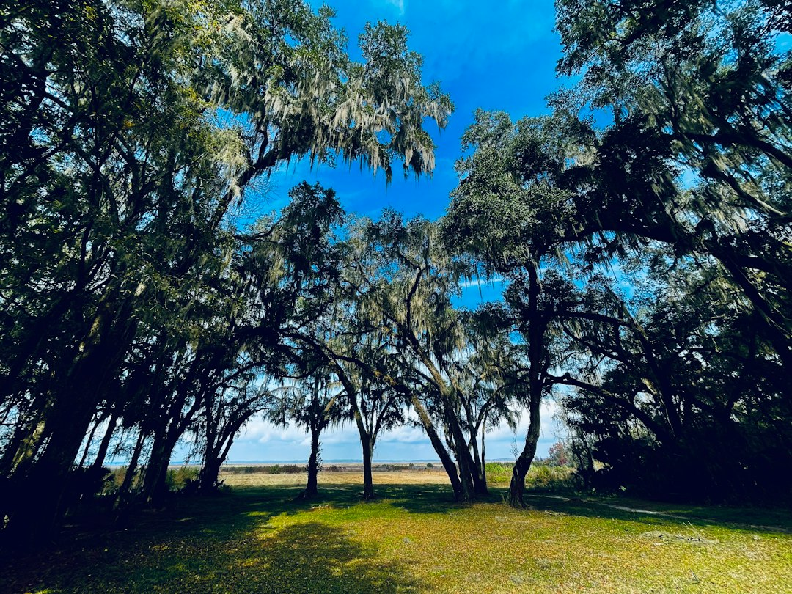
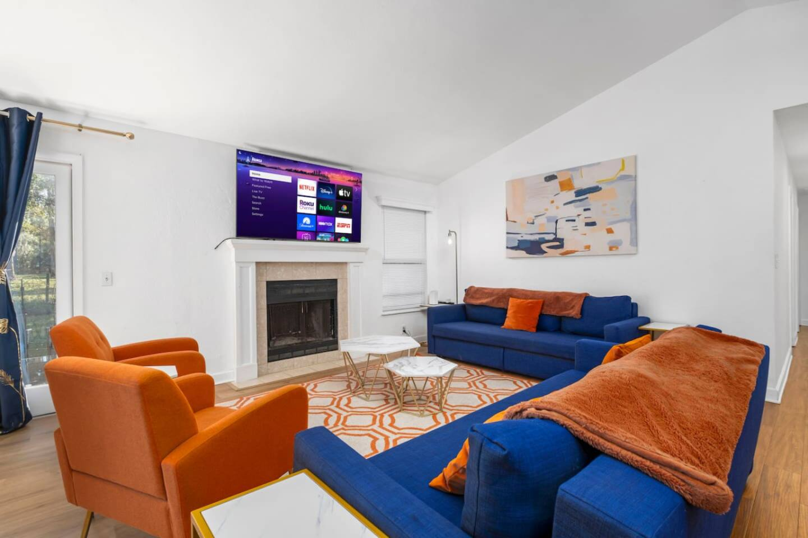
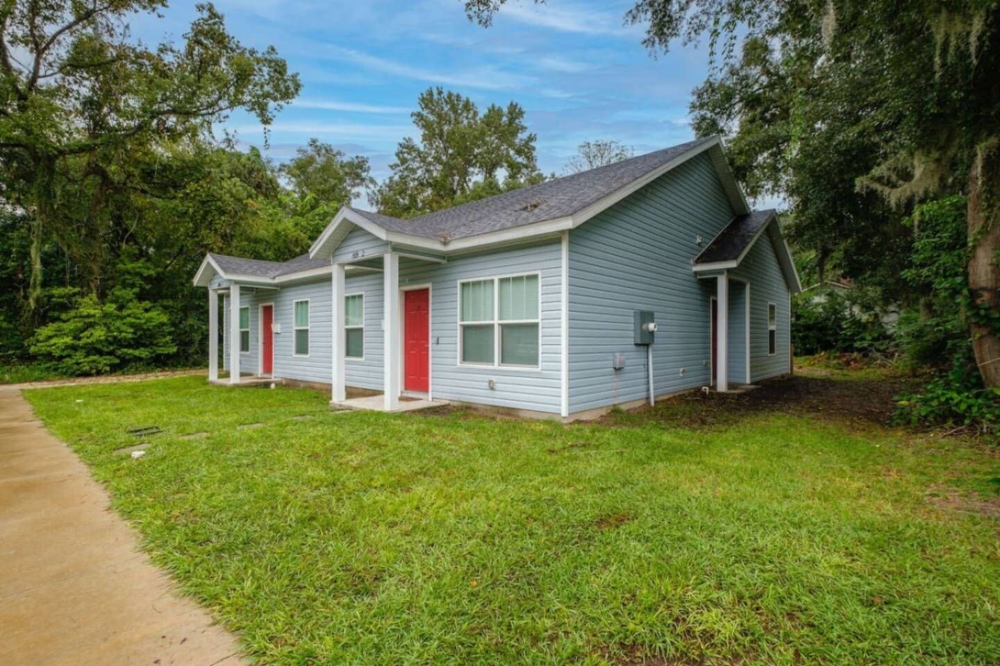

So you're coming to Gainesville. Forget everything you think you know about college towns. Beyond the sea of orange and blue, there's a city brimming with incredible nature, a surprisingly sophisticated food scene, and distinct neighborhoods, each with its own personality. Figuring out where to plant your flag for the weekend (or longer) is the single most important decision you'll make. It dictates the entire vibe of your trip.

Are you here to bleed orange and blue at The Swamp? Or are you looking for a quiet, romantic getaway under moss-draped oaks? Maybe you're a foodie hunting for the next great craft beer and farm-to-table meal.

Don't just book the closest hotel to I-75. Let's break down the real lay of the land so you can find the perfect home base for your Gainesville adventure.

### Table of Contents
*   [The University Corridor: For the Die-Hard Gator Fan](#the-university-corridor-for-the-die-hard-gator-fan)
*   [Downtown Gainesville: For Culture, Food, and Nightlife](#downtown-gainesville-for-culture-food-and-nightlife)
*   [The Duckpond & Historic Southeast: For a Quiet, Charming Escape](#the-duckpond--historic-southeast-for-a-quiet-charming-escape)
*   [The SW Archer Road Area: For Convenience & Larger Groups](#the-sw-archer-road-area-for-convenience--larger-groups)
*   [A Note on Micanopy: For the Antiquer and Nature Lover](#a-note-on-micanopy-for-the-antiquer-and-nature-lover)
*   [Frequently Asked Questions](#frequently-asked-questions)

---

## The University Corridor: For the Die-Hard Gator Fan

### The Vibe
This is the epicenter of Gator Nation. The energy here is palpable, especially from Thursday to Sunday during the school year. The air buzzes with student life, the streets are filled with scooters, and the pulse of the city is dictated by the UF academic and athletic calendar. If you're in town for a campus tour, a conference, or—most importantly—a football game, this is where you want to be. It's loud, it's convenient, and it's unapologetically Gainesville.

### Who It's For
*   **Gator Parents & Alumni:** You're here to relive the glory days or visit your student. Being able to walk to campus and your old haunts is non-negotiable.
*   **Football Fans:** On a game weekend, the entire area transforms into a massive tailgate. Staying here means you can walk to Ben Hill Griffin Stadium, avoiding the nightmare of game-day traffic and parking.
*   **Prospective Students:** Get a real feel for campus life by immersing yourself in the heart of it.

### What to Do Here
*   **Ben Hill Griffin Stadium (The Swamp):** Even on a non-game day, it's worth walking by this iconic stadium. You can often peek inside from the gates at the north end zone.
*   **University Avenue:** This is the main artery running along the north edge of campus. It's lined with classic student-centric restaurants and bars. Don't miss a stop at The Swamp Restaurant (its new location) or a slice from Italian Gator Pizza.
*   **Explore the UF Campus:** It's a beautiful campus worth a stroll. Check out the Century Tower, Plaza of the Americas, and the peaceful Lake Alice, where you're almost guaranteed to spot a few alligators sunning themselves (from a safe distance!).
*   **Florida Museum of Natural History:** Home to the stunning Butterfly Rainforest, this is a must-do. You can spend hours here. It's technically on the southwest edge of campus, but easily accessible from this area.

### Where to Stay in the University Corridor
The key here is walkability. You want to park your car once and forget about it. For small groups or families who want to be in the thick of it all, a townhome is the perfect solution.

If you're coming for a game, the **[Walk to UF Stadium, No Cleanup, Cozy Townhome](https://book.springlinestays.com/property/walk-to-campus-restaurants-cozy-townhome)** is an absolute game-changer. This 2-bed, 6-guest spot (officially 818-1 Springline Stays) puts you a literal stone's throw from the action. Imagine waking up, walking to brunch, and then strolling to the stadium without ever needing your car keys.

If you're bringing a furry friend along to explore Gainesville's many dog-friendly parks, the sister property, the **[Walk to University, Pet Friendly, Cozy Townhome](https://book.springlinestays.com/property/walk-to-university-pet-friendly-5-min-to-uf)** (818-2 Springline Stays), offers the same unbeatable location with the bonus of being pet-friendly.

---

## Downtown Gainesville: For Culture, Food, and Nightlife

### The Vibe
Just a short drive east of campus, Downtown Gainesville feels like a different world. Historic brick buildings house independent boutiques, art galleries, and some of the best restaurants in the city. The vibe is more "young professional" than "undergrad." It's where locals go for a nice dinner, to catch a show, or to listen to live music at the Bo Diddley Plaza. It’s the cultural and culinary heart of the city.

### Who It's For
*   **Foodies:** From upscale sushi to inventive farm-to-table fare, Downtown is a culinary playground.
*   **Couples & Groups of Friends:** The concentration of great bars, breweries, and entertainment venues makes it perfect for a fun, walkable weekend.
*   **Culture Vultures:** With the Hippodrome Theatre, local art galleries, and frequent festivals, there's always something creative happening.

### What to Do Here
*   **The Hippodrome Theatre:** Affectionately known as "The Hipp," this historic former courthouse is now the city's premier venue for professional theatre, indie films, and art exhibits. Check their schedule at `thehipp.org`.
*   **Bo Diddley Plaza:** This open-air community plaza ([111 E University Ave](https://www.google.com/maps/search/?api=1&query=111+E+University+Ave+Gainesville+FL)) hosts everything from free concerts on Friday nights to a weekly farmers' market. It's the city's living room.
*   **Brewery Hop:** Downtown is a hub for craft beer. Start at First Magnitude Brewing Company (a bit south of the main drag but worth it), then head to Cypress & Grove Brewing Co. and Blackadder Brewing Company.
*   **Restaurant Crawl:** You can't go wrong here, but a few standouts are essential. Dragonfly Sushi for an incredible atmosphere and modern Japanese, The Top for its legendary vegan-friendly menu and eclectic vibe, and Paramount Grill for an upscale, classic date night. My personal tip for The Top: Go early or be prepared for a wait, and always get a side of the corn nuggets.

---

## The Duckpond & Historic Southeast: For a Quiet, Charming Escape

### The Vibe
Step into a postcard from old Florida. The Duckpond neighborhood, located just southeast of Downtown, is one of the city's most beautiful and sought-after historic districts. Think sprawling Victorian homes, quiet streets shaded by a canopy of ancient live oaks, and residents taking leisurely evening strolls. It's peaceful, picturesque, and feels miles away from the college town hustle, yet it's just a 5-minute drive from the heart of downtown.

### Who It's For
*   **Families with Young Kids:** The quiet streets and proximity to parks make it a relaxing home base.
*   **Couples Seeking a Romantic Getaway:** The scenery is straight out of a movie.
*   **Anyone Needing a Break:** If your idea of a vacation is reading a book on a front porch swing, this is your spot.

### What to Do Here
*   **Take a Walk:** This is the main event. Simply wander the streets (like NE 7th St or NE 3rd Ave) and admire the stunning, beautifully preserved architecture.
*   **Depot Park:** This award-winning park ([874 SE 4th St](https://www.google.com/maps/search/?api=1&query=874+SE+4th+St+Gainesville+FL)) is a masterpiece of urban renewal. It features a fantastic kids' play area with a splash pad, a large pond with a walking path, and the Cade Museum for Creativity and Invention. It also connects to the Gainesville-Hawthorne State Trail for cyclists.
*   **Sweetwater Branch Inn:** While it's a hotel, their Sunday brunch is a local institution and a great way to experience the historic charm of the area even if you aren't staying there.

---

## The SW Archer Road Area: For Convenience & Larger Groups

### The Vibe
Let's call this Gainesville's "practical" hub. The area stretching along SW Archer Road is modern, convenient, and packed with every amenity you could possibly need. It's home to the massive Butler Plaza shopping center, UF Health Shands Hospital, and the VA Hospital. While it lacks the historic charm of the Duckpond or the electric energy of the University Corridor, its strategic location and access to services make it an incredibly smart place to stay, especially for certain types of travelers.

### Who It's For
*   **Large Families & Groups:** This area has larger homes and more spacious vacation rental options than the tighter-packed areas near campus.
*   **Traveling Medical Professionals or Families:** If you're in town for anything related to Shands or the VA, staying here is a no-brainer.
*   **Shoppers & Creature-Comfort Seekers:** With Whole Foods, Trader Joe's, Target, and hundreds of other stores and chain restaurants, everything you need is within a five-minute drive.

### What to Do Here
*   **Kanapaha Botanical Gardens:** A true Gainesville gem. Explore 68 acres of stunning gardens, including Florida's largest public display of bamboos and the largest herb garden in the Southeast. The giant Victoria water lilies are a must-see in the summer. Find it at [4700 SW 58th Dr](https://www.google.com/maps/search/?api=1&query=4700+SW+58th+Dr+Gainesville+FL).
*   **Shopping at Butler Plaza:** If you need to do some serious shopping, this is the place. It's one of the largest retail centers in the country.
*   **Easy Access to I-75:** This neighborhood is right on the interstate, making it the perfect launchpad for day trips to the natural springs like Ichetucknee or a visit to the charming town of Micanopy.

### Where to Stay in the SW Archer Road Area
This area is perfect for finding a property with more breathing room. If you're traveling with the whole crew, a place like the **[Spacious Retreat Near UF & Shands](https://book.springlinestays.com/property/4-minutes-to-universityshands-bbq-spacious)** is exactly what you need. This 4-bed home (4403 Springline Stays) sleeps up to 12 guests, offering plenty of space to spread out after a long day of exploring. It provides the perfect balance: a quiet, comfortable home base just minutes away from the hospitals, the university, and major shopping centers.

---

## A Note on Micanopy: For the Antiquer and Nature Lover

Just a 20-minute drive south of Gainesville lies Micanopy (pronounced mick-uh-NO-pee), a town that time seems to have forgotten. Known as "the town that time forgot," its main street, Cholokka Boulevard, is lined with antique shops, mossy oaks, and historic buildings. It's a fantastic day trip, but for those truly looking to disconnect, staying in or near Micanopy offers a unique experience. You'd be trading city convenience for unparalleled peace and proximity to Paynes Prairie Preserve State Park, a 21,000-acre savanna where you can see wild horses and bison roam. This is a great choice for a Gainesville travel guide focused on nature.

---

## Frequently Asked Questions

### What is the best area to stay in Gainesville?
The "best" area truly depends on your reason for visiting.
*   For **UF events and games**, stay in the **University Corridor** for walkability and atmosphere.
*   For **dining, nightlife, and culture**, choose **Downtown Gainesville**.
*   For a **quiet, romantic, or peaceful family trip**, the **Duckpond Historic District** is ideal.
*   For **convenience, large groups, or medical-related travel**, the **SW Archer Road** area is most practical.

### Is it better to stay downtown or near UF in Gainesville?
If your trip revolves around the university, stay near UF. The convenience is unbeatable, especially on game days when traffic is gridlocked. If you're more interested in exploring the city's food scene, bars, and cultural venues, and you aren't tied to a campus schedule, Downtown offers a more diverse and mature atmosphere. The two areas are only a 5-10 minute drive apart, so you can easily enjoy both regardless of where you stay.

### Do I need a car in Gainesville?
Yes, for the most part. While the University Corridor and Downtown are very walkable within their respective boundaries, Gainesville is a sprawling city. To get between neighborhoods, visit the incredible natural parks like Devil's Millhopper or Paynes Prairie, or even just go to the grocery store, you will almost certainly need a car. The exception is if your trip is 100% focused on UF campus activities and you stay within walking distance.

### What is the most walkable neighborhood in Gainesville?
Gainesville has two primary walkable hubs. The **University Corridor**, centered on University Avenue, is the most walkable for students and campus visitors, with dozens of restaurants, shops, and campus buildings within a small radius. **Downtown Gainesville** is the other, offering a compact grid of bars, restaurants, theaters, and parks that you can easily explore on foot for a full weekend without needing a car.

---

No matter which neighborhood you choose, Gainesville has a way of surprising people. It's a city of deep roots, vibrant energy, and stunning natural beauty. Now that you know the lay of the land, you can find the perfect home base for your trip.

When you're ready to book, consider a local vacation rental for an authentic experience. Browse our curated homes and **[book direct with Springline Stays](https://www.springlinestays.com)** to get the best rates and skip the extra fees from third-party sites. We can't wait to host you in Gator Country!

*Devil's Millhopper State Park — a must-visit near our Gainesville properties.*

*University of Florida — a must-visit near our Gainesville properties.*

*[Spacious Retreat Near UF & Shands — Book your stay →](https://book.springlinestays.com/property/4-minutes-to-universityshands-bbq-spacious)*

*[Walk to UF Stadium, No Cleanup, Cozy Townhome — Book your stay →](https://book.springlinestays.com/property/walk-to-campus-restaurants-cozy-townhome)*
