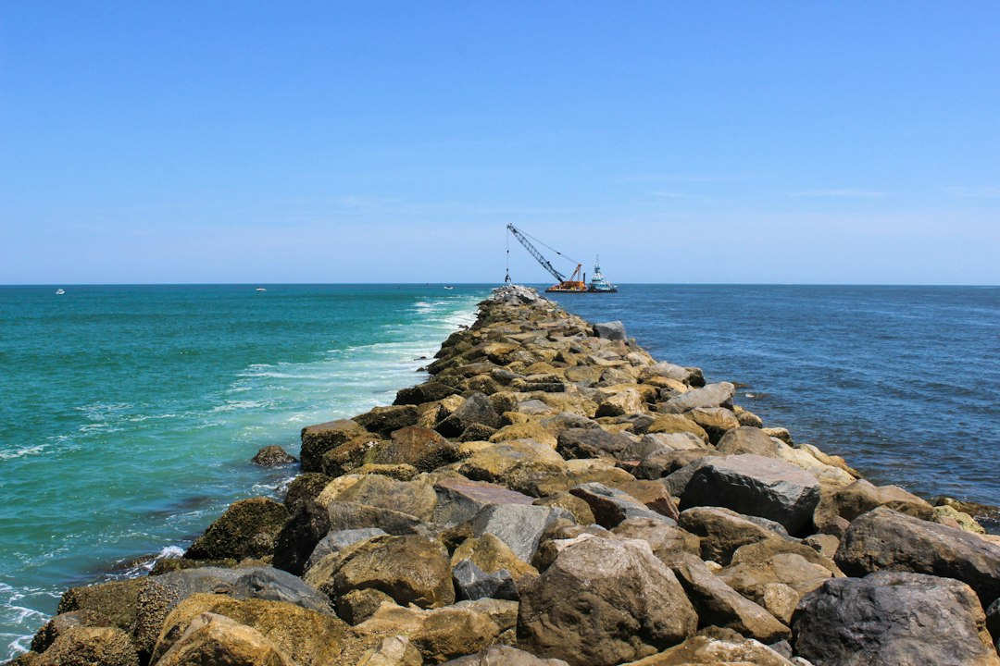
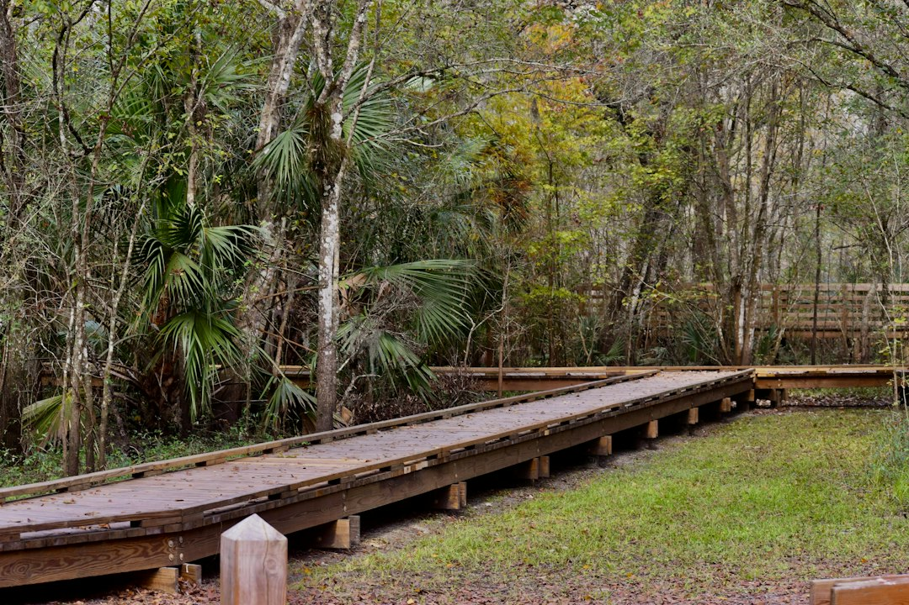
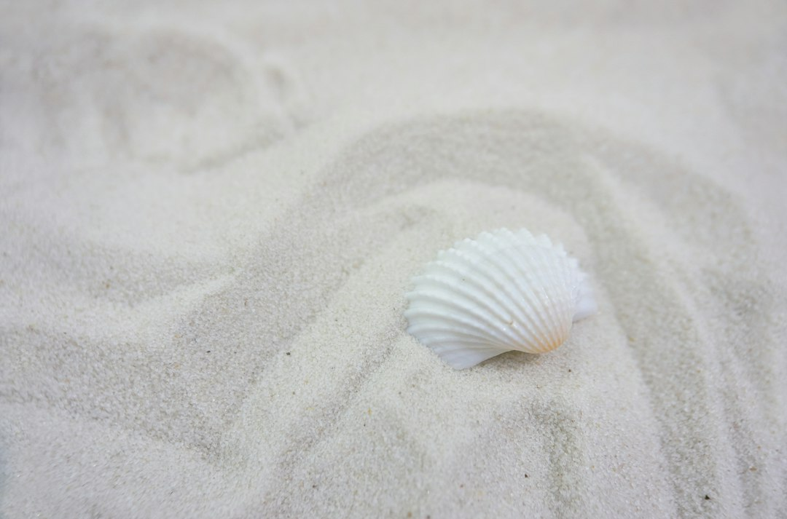
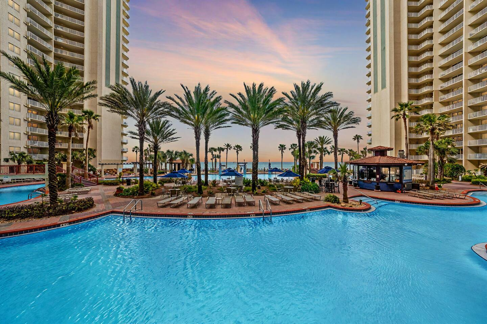
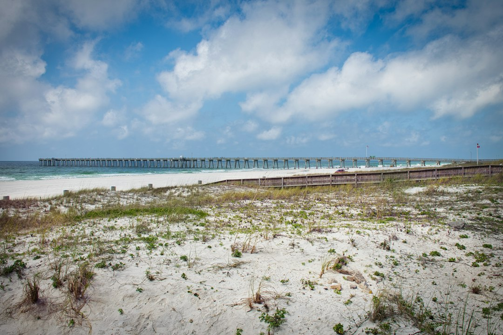
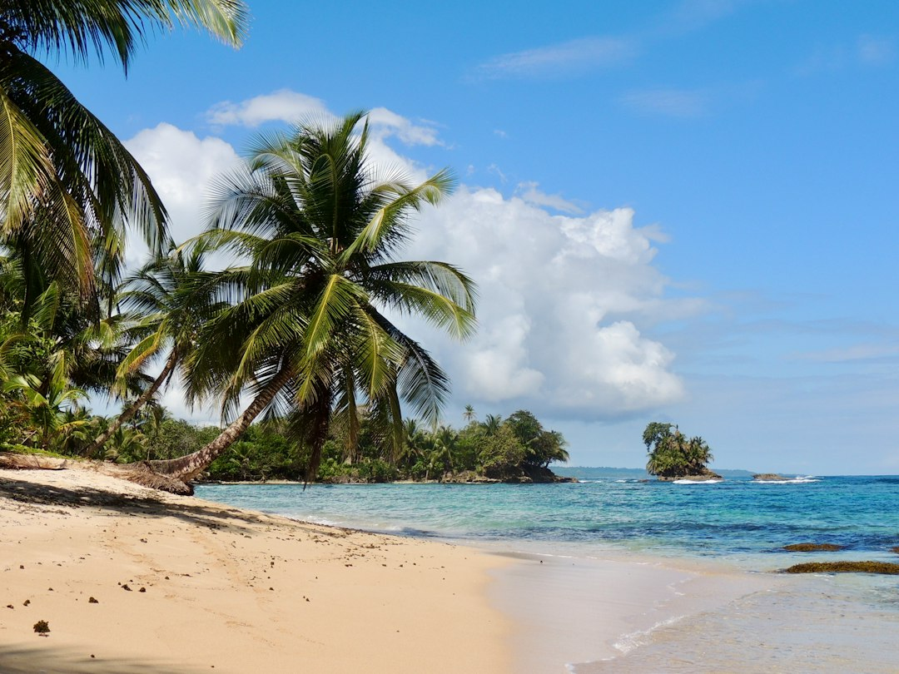

Everyone comes to Panama City Beach for the 27 miles of sugar-white sand, and for good reason. It's world-famous. But the real magic, the kind of vacation you'll talk about for years, happens just beyond the main drag, where the pavement gives way to pine flatwoods and the Gulf's roar is replaced by the gentle lapping of bay waters.

If you're looking to experience a different side of PCB—the wild, untouched, and incredibly beautiful side—you've come to the right place. This isn't your average list of tourist traps. This is your guide to exploring the natural wonders of Panama City Beach like a local, from sprawling wilderness parks to serene coastal dune lakes.

### Table of Contents
*   [St. Andrews State Park: More Than Just a Pretty Beach](#st-andrews-state-park-more-than-just-a-pretty-beach)
*   [Conservation Park: Your Wilderness Oasis in the City](#conservation-park-your-wilderness-oasis-in-the-city)
*   [The "Other" Side of the Water: Exploring Grand Lagoon](#the-other-side-of-the-water-exploring-grand-lagoon)
*   [A Quick Trip to Shell Island (The Easy Way)](#a-quick-trip-to-shell-island-the-easy-way)
*   [Where to Stay to Access it All](#where-to-stay-to-access-it-all)
*   [Frequently Asked Questions About Exploring PCB](#frequently-asked-questions-about-exploring-pcb)

## St. Andrews State Park: More Than Just a Pretty Beach

St. Andrews is consistently ranked as one of the best beaches in the country, but treating it as just another spot to lay out your towel is a huge mistake. This 1,200-acre park, located at the far eastern tip of PCB at [4607 State Park Ln, Panama City, FL 32408](https://www.google.com/maps/search/?api=1&query=4607+State+Park+Ln+Panama+City+FL+32408), is a diverse ecosystem of pristine beaches, sand dunes, pine forests, and marshlands.

### H3: Fish the Jetties and Watch for Dolphins
The massive rock jetties that separate the Gulf of Mexico from the St. Andrews Pass are the park's main artery. Anglers line the rocks year-round, casting for Spanish mackerel, redfish, and flounder. But the real show happens in the water.

This pass is a major thoroughfare for bottlenose dolphins. The secret to a guaranteed sighting is to come during a tidal change—either incoming or outgoing—at sunrise or sunset. The dolphins come in to feed, and it's not uncommon to see them leaping out of the water as they chase schools of fish. It’s one of the most incredible free shows in all of Florida.

### H3: Explore the "Kiddie Pool" and Gator Lake
On the bay side of the park, you’ll find a protected lagoon known locally as the "kiddie pool." The water is calm, clear, and shallow, making it the perfect spot for families with young children who aren't quite ready for the Gulf's waves. It's also a fantastic launch point for kayaks and paddleboards.

For a change of scenery, take a short walk on the Gator Lake Trail. This easy, accessible path offers great views of the small freshwater lake where you can spot wading birds, turtles, and yes, the occasional alligator sunning itself on the bank. Just remember to keep a safe distance and never feed the wildlife.

**Local Tip:** Instead of driving from the Gulf side to the bay side, rent a bike from the camp store. You can easily pedal between the different areas of the park and explore some of the quieter, less-traveled paths.

## Conservation Park: Your Wilderness Oasis in the City

If you told someone you were going for a 10-mile hike in the middle of Panama City Beach, they'd probably think you were crazy. But just a few minutes from the bustling beachfront is a 2,900-acre wilderness preserve that feels a world away: Conservation Park. Located at [100 Conservation Dr, Panama City Beach, FL 32413](https://www.google.com/maps/search/?api=1&query=100+Conservation+Dr+Panama+City+Beach+FL+32413), this park is a treasure for hikers, bikers, and birdwatchers.

### H3: Choose Your Trail: From Short Strolls to Long Treks
The park features over 24 miles of trails, with 12 different routes ranging from a quick 0.6-mile loop to an 11-mile monster. The trails are a mix of packed dirt paths and elevated wooden boardwalks that cross over pristine cypress domes.

*   **For a quick taste:** Try the Cypress Pond Trail (0.6 miles). It's a beautiful, easy loop on a boardwalk that showcases the wetland habitat.
*   **For a moderate hike:** The Green Trail (4.5 miles) is a local favorite. It takes you through a variety of ecosystems, from open fields to dense pine forests.
*   **For a challenge:** Combine the Red, Yellow, and Orange trails for a long-distance trek that will make you forget you're just minutes from the beach.

### H3: Wildlife and What to Pack
Conservation Park is a vital part of the local ecosystem and a major corridor for wildlife. Keep your eyes peeled for white-tailed deer, foxes, coyotes, and an incredible array of birdlife, including bald eagles.

**Local Tip:** Go first thing in the morning. Not only will you beat the Florida heat, but the animals are far more active at dawn. No matter what time of year, bring more water than you think you'll need and a good-quality bug spray—the mosquitos can be formidable, especially in the shaded, wetter areas. The park is completely free to enter, so there's no excuse not to check it out.

## The "Other" Side of the Water: Exploring Grand Lagoon

While the Gulf gets all the attention, the Grand Lagoon on the north side of the barrier island offers a completely different kind of water-based adventure. This large, protected body of water is the hub for boating, kayaking, and paddleboarding. The water is generally much calmer than the Gulf, making it an ideal place to explore at your own pace.

### H3: Kayaking and Paddleboarding Adventures
The best way to experience the lagoon is from the water itself. You can rent kayaks or stand-up paddleboards (SUPs) from numerous vendors along Thomas Drive. From there, you have acres of calm water to explore.

My favorite route is to paddle east from the rental spots towards St. Andrews State Park. As you get closer to the pass, the water becomes incredibly clear, and you can often see fish, rays, and even sea turtles swimming beneath you. It’s a peaceful, serene experience that offers a unique perspective on the area’s geography.

### H3: A Post-Adventure Bite
After a few hours on the water, you’ll have worked up an appetite. The Grand Lagoon area is dotted with classic waterfront spots. Forget the fancy chains—head to a place like Schooners Last Local Beach Club. It’s right on the sand, super casual, and the perfect place to grab a grouper sandwich and a cold drink while you watch the sunset. The cannon they fire at sunset every night is a beloved local tradition.

## A Quick Trip to Shell Island (The Easy Way)

We have a whole guide dedicated to the wonders of Shell Island, but for the nature lover on a tighter schedule, it's worth knowing the simplest way to experience this 7-mile undeveloped barrier island.

Forget booking an expensive, all-day tour. The easiest and most authentic way to get there is via the official Shell Island Shuttle, which departs from within St. Andrews State Park. It’s a quick, no-frills boat ride that drops you on the island's bay side. From there, it’s a short walk across the dunes to the pristine, empty Gulf-front beaches.

Spend an hour or two hunting for sand dollars (the key is to look in the shallow surf right after high tide), watch the shorebirds, and enjoy the blissful quiet. The shuttle runs on a regular schedule, so you can easily hop back when you're ready. It’s the perfect way to get a taste of one of Florida's last truly wild coastlines without committing your entire day.

## Where to Stay to Access it All

After a day spent hiking through pine forests, paddling across calm bays, and exploring wild barrier islands, you need a comfortable place to come back to—a place where you can kick off your sandy shoes and relax with a view that reminds you why you came to Panama City Beach. You want the best of both worlds: easy access to nature and the comfort of a beautiful beachfront retreat.

For couples or small families, the **[On the Beach | Ocean Views | Sleeps 6](https://book.springlinestays.com/property/beachfront-hot-tub-ocean-views-sleeps-6)** condo is the perfect home base. It puts you right on the sand with incredible, unobstructed Gulf views, so you can watch for dolphins from your own private balcony. It’s the ideal spot to unwind after a day exploring the parks, offering all the comforts of home in the heart of Panama City Beach.

Being centrally located means you're just a short drive from St. Andrews State Park to the east and Conservation Park to the west, giving you the perfect launchpad for all your outdoor adventures.

## Frequently Asked Questions About Exploring PCB

### What is the best time of year to visit Panama City Beach for nature lovers?
Hands down, the best seasons are fall (October-November) and spring (March-April). The weather is phenomenal—warm but not brutally hot and humid—the summer crowds have thinned out, and the water is still pleasant. It's the ideal time for hiking, biking, and paddling.

### Are the parks in Panama City Beach free to visit?
It varies. Conservation Park is completely free to enter and park. St. Andrews State Park has a per-vehicle entrance fee (typically around $8), which is well worth the cost for a full day of access to its diverse amenities and pristine beaches.

### Can you really see dolphins from the shore in Panama City Beach?
Absolutely. Your best bet is to post up near the jetties at St. Andrews State Park around sunrise or sunset. They frequently come into the pass to feed. It's also very common to spot them from the balcony of a beachfront condo, so keep your eyes on the water!

### Where is the best place for hiking in PCB?
For serious hiking and trail variety, Conservation Park is the undisputed champion with over 24 miles of trails. For more of a scenic coastal walk that combines beach, dunes, and a bit of forest, the trails within St. Andrews State Park are fantastic.

---

Ready to explore the wild side of Panama City Beach? The best adventures always start with the perfect home base. Skip the hidden fees and get the guaranteed best rate on your stay by booking your **Panama City Beach vacation rental** directly with Springline Stays.

We can't wait to host you on your next adventure.

*Conservation Park — a must-visit near our Panama City Beach properties.*

*Shell Island — a must-visit near our Panama City Beach properties.*

*[On the Beach | Ocean Views | Sleeps 6 — Book your stay →](https://book.springlinestays.com/property/beachfront-hot-tub-ocean-views-sleeps-6)*
