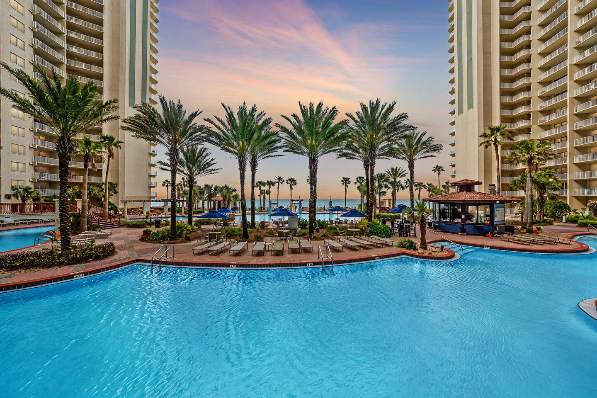
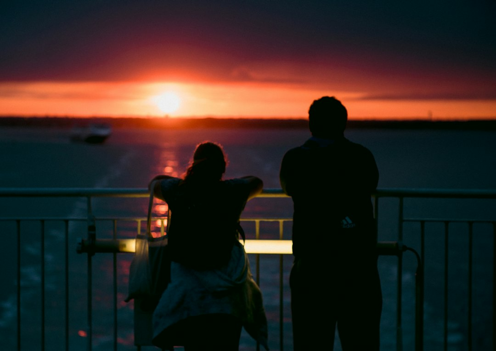
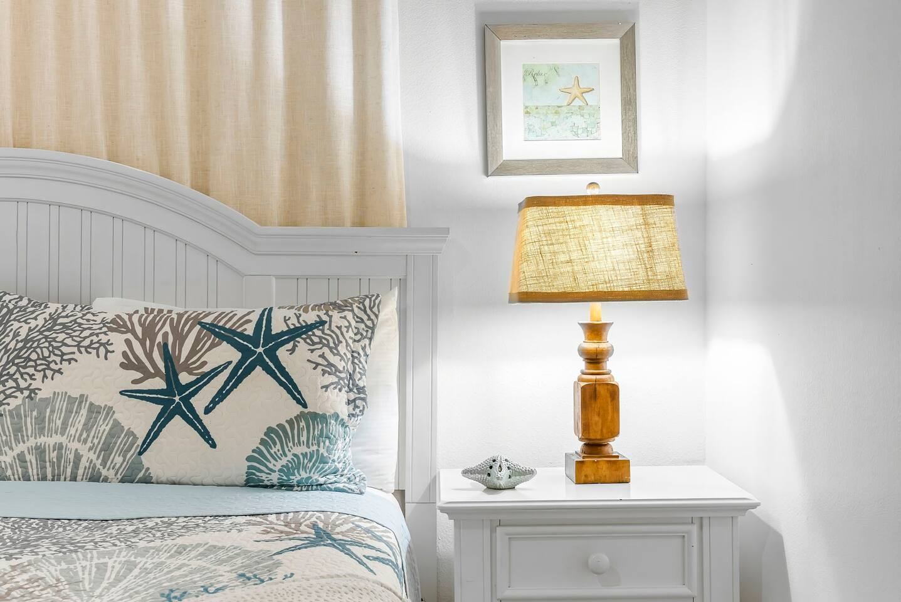
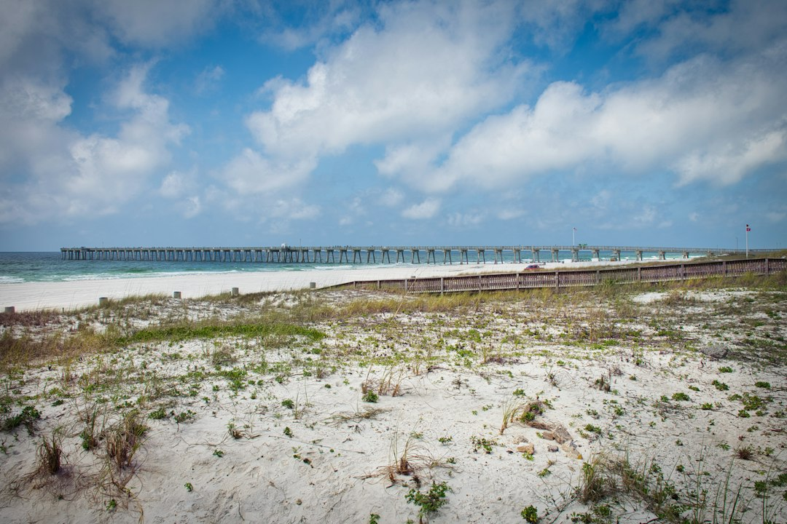
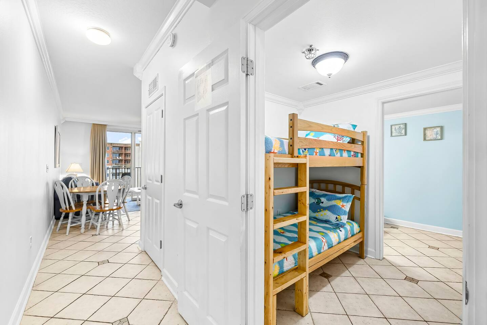

Forget everything you think you know about Panama City Beach. If your mind immediately jumps to crowded beaches and spring break chaos, you're missing the other side of PCB—the one with quiet sunset dinners, secluded nature trails, and miles of sugar-white sand that feel like they belong only to you. This is the Panama City Beach for couples, and it's the perfect backdrop for a romantic escape.

The secret is simply knowing where to look and when to visit. Ditch the peak summer season, and you’ll discover a coastal town that’s relaxed, beautiful, and full of intimate experiences. Whether you're planning an anniversary, a special occasion, or just need to reconnect, this is your guide to crafting the perfect romantic getaway.

### Table of Contents
*   [Your Perfect Romantic Home Base](#your-perfect-romantic-home-base)
*   [Unforgettable Dining for Two](#unforgettable-dining-for-two)
*   [Romantic Activities Beyond the Beach Chair](#romantic-activities-beyond-the-beach-chair)
*   [Finding Seclusion and Natural Beauty](#finding-seclusion-and-natural-beauty)
*   [Frequently Asked Questions](#frequently-asked-questions)

## Your Perfect Romantic Home Base

Let's be honest: the foundation of any great romantic trip is where you stay. You're not looking for a cramped hotel room. You're looking for a space that feels like a retreat—a place to unwind, enjoy the view, and just be together. For a trip like this, waking up to the sound of waves isn't a luxury; it's a requirement.

Imagine starting your morning with coffee on a private balcony, watching dolphins play in the emerald surf, or ending your day with a glass of wine as the sun melts into the Gulf. This is why choosing a beachfront condo is non-negotiable. It sets the tone for the entire vacation, turning simple moments into cherished memories.

For a truly special trip, a space like the **[On the Beach | Ocean Views | Sleeps 6](https://book.springlinestays.com/property/beachfront-hot-tub-ocean-views-sleeps-6)** is an ideal choice. While it can accommodate more, it's a fantastic option for a couple wanting a spacious, modern retreat right on the sand. Having a full kitchen means you can enjoy a lazy breakfast in your pajamas, and the direct ocean views from the living area and balcony are simply unbeatable. It’s the kind of place you’ll be happy to return to after a day of exploring.

## Unforgettable Dining for Two

While a cozy dinner in your rental is always an option, Panama City Beach has some incredible restaurants that are perfect for a special night out. The key is to look beyond the casual beach bars and find the spots that prioritize atmosphere just as much as the menu.

### Sunset Dinner at Firefly
If you ask anyone for the most romantic restaurant in PCB, Firefly will almost always be the answer. Step inside, and you'll understand why. The main dining room is built around a magnificent, sprawling tree illuminated by hundreds of twinkling lights. It's enchanting, intimate, and feels worlds away from the beach outside. The menu is upscale American with a Southern twist, and the service is always impeccable.

*   **Local Tip:** You absolutely must book a table in the main dining room under the tree, and do it well in advance, especially for a weekend. My go-to order is the she-crab soup to start, followed by their legendary pepper-crusted stuffed filet.
*   **Location:** [535 Richard Jackson Blvd, Panama City Beach, FL 32407](https://www.google.com/maps/search/?api=1&query=535+Richard+Jackson+Blvd+Panama+City+Beach+FL+32407)

### Casual and Chic at The Grand Marlin
For breathtaking water views and some of the freshest seafood in town, The Grand Marlin is a must-visit. Overlooking the Grand Lagoon, this spot boasts a sophisticated yet relaxed "island-casual" vibe. The multi-level deck is the perfect place to watch the boats drift by as the sun goes down. The menu is centered around fresh-caught fish, and their oyster bar is one of the best around.

*   **Local Tip:** Arrive for their happy hour (usually 3-6 PM) to snag a spot on the deck. You can enjoy fantastic drink specials and half-priced oysters before the main dinner crowd arrives. It’s the best way to experience the view without the wait.
*   **Location:** [5323 N Lagoon Dr, Panama City Beach, FL 32408](https://www.google.com/maps/search/?api=1&query=5323+N+Lagoon+Dr+Panama+City+Beach+FL+32408)

### A Hidden Gem: The Bay
For a different kind of waterfront dining, head to The Bay. Located on the shores of the serene Choctawhatchee Bay, it offers a more laid-back, local atmosphere. With a sandy beach area, fire pits, and live music, it’s a fantastic place to unwind. The food is a creative mix of Southern gulf coast cuisine and sushi, offering something for everyone.

*   **Local Tip:** Don't skip the sushi menu—it's surprisingly excellent. If there's live music, grab a cocktail and find a spot on the bayside beach. It's a more relaxed and authentic experience than many of the big Gulf-front restaurants.
*   **Location:** [24215 Hwy 331 S, Santa Rosa Beach, FL 32459](https://www.google.com/maps/search/?api=1&query=24215+Hwy+331+S+Santa+Rosa+Beach+FL+32459) (Just across the bridge from PCB)

## Romantic Activities Beyond the Beach Chair

As tempting as it is to spend your entire vacation lounging on the sand, Panama City Beach offers plenty of activities perfect for two.

### Take a Sunset Cruise
There is nothing more classically romantic than being on the water as the sky erupts in color. A sunset sail is one of the best ways to experience the beauty of the Gulf Coast. Several companies offer tours, from large catamarans to more intimate sailboat charters. Watching dolphins leap through the boat's wake with a fiery sunset as the backdrop is an experience you won't soon forget. Look for operators like Island Time Sailing, which offers a cruise on a beautiful schooner that feels a bit more classic and less like a party boat.

### Explore St. Andrews State Park... The Quiet Way
St. Andrews State Park is one of the crown jewels of PCB, known for its pristine beaches and jetties. While the main beach area can get busy, the park offers plenty of opportunities for a quiet adventure for two.

*   **Local Tip:** Skip the main beach and rent a double kayak from the park's marina. Paddle across the channel to Shell Island or explore the calmer waters on the Grand Lagoon side. You can often spot herons, ospreys, and other coastal birds. Pack a small cooler with drinks and snacks, find a deserted patch of sand, and enjoy a private picnic.

### Stroll Hand-in-Hand Through Pier Park
While primarily known as a shopping and entertainment hub, Pier Park takes on a different, more romantic feel in the evening. The sea breeze, the glow of the storefronts, and the distant sound of the waves create a lovely atmosphere for a leisurely walk.

*   **Local Tip:** The best experience is to ride the SkyWheel right at dusk. From the top of the climate-controlled gondola, you get an incredible panoramic view of the coastline just as the city lights begin to twinkle on. It's a breathtaking and surprisingly intimate moment high above the hustle and bustle.

## Finding Seclusion and Natural Beauty

The true romance of Panama City Beach is found in its quiet corners, away from the main thoroughfares. It’s about discovering the natural beauty that has drawn people here for generations.

### Discover the Unspoiled Beauty of Conservation Park
A world away from the condos and beach shops lies Conservation Park, a 2,900-acre wilderness preserve. With over 24 miles of trails and a mile of boardwalks, it’s a sanctuary for hikers, bird-watchers, and anyone looking to reconnect with nature. The flat, sandy trails wind through cypress domes and pine forests, offering a peaceful escape.

*   **Local Tip:** For a short and scenic walk, head for the Cypress Pond Trail. It's an easy, accessible loop on a boardwalk that takes you over a beautiful cypress swamp. Go in the morning before it gets too hot, and you'll feel like you have the whole park to yourselves.
*   **Location:** [100 Conservation Dr, Panama City Beach, FL 32413](https://www.google.com/maps/search/?api=1&query=100+Conservation+Dr+Panama+City+Beach+FL+32413)

### The "Secret" West End Beaches
The 27 miles of Panama City Beach are not all created equal. For a more secluded beach experience, simply drive west. Past the high-rises and commotion of Pier Park, Front Beach Road becomes a quieter, more residential stretch. The public beach access points here are smaller and farther apart, meaning the crowds thin out dramatically.

*   **Local Tip:** Look for the numbered Public Beach Access points west of Route 79. Find a spot to park, walk over the dunes, and you’ll often be rewarded with a huge stretch of pristine sand with only a few other people in sight, especially on a weekday. This is the PCB the locals love.

If having that quieter beach experience right outside your door is a priority, finding a beachfront condo on this less-crowded side of town is key. Waking up and walking straight out to a peaceful stretch of sand is what makes a place like the **[On the Beach | Ocean Views | Sleeps 6](https://book.springlinestays.com/property/beachfront-hot-tub-ocean-views-sleeps-6)** so perfect for a romantic trip. It combines the convenience of a modern rental with the tranquility of the less-traveled shore.

## Frequently Asked Questions

### Is Panama City Beach a good destination for a couples' vacation?
Absolutely. While it's famous for family vacations and spring break, PCB has a sophisticated and romantic side. By visiting during the shoulder seasons (spring and fall) and seeking out upscale restaurants, secluded nature spots, and quieter beaches, couples can enjoy a truly relaxing and memorable getaway.

### What is the most romantic restaurant in Panama City Beach?
While "most romantic" is subjective, Firefly is consistently celebrated for its enchanting atmosphere, particularly its main dining room featuring a large, brightly-lit indoor tree. For couples who find romance in stunning water views and fresh seafood, The Grand Marlin overlooking the Grand Lagoon is another top choice.

### What are some free romantic things to do in PCB?
Panama City Beach offers many free romantic activities. Pack a blanket and watch the spectacular sunset from the beach, take a long walk hand-in-hand along the quieter West End beaches, go for a morning hike on the boardwalks at Conservation Park, or enjoy an evening of window shopping and people-watching at Pier Park.

***

Ready to plan your escape from the everyday? The perfect trip starts with the perfect place to stay, and nothing beats the romance of a private beachfront retreat. Find your ideal Panama City Beach vacation rental and **[book direct with Springline Stays](https://www.springlinestays.com)** to get the best rates and save on unnecessary fees. Your romantic getaway awaits.

*St. Andrews State Park — a must-visit near our Panama City Beach properties.*

*[On the Beach | Ocean Views | Sleeps 6 — Book your stay →](https://book.springlinestays.com/property/beachfront-hot-tub-ocean-views-sleeps-6)*
