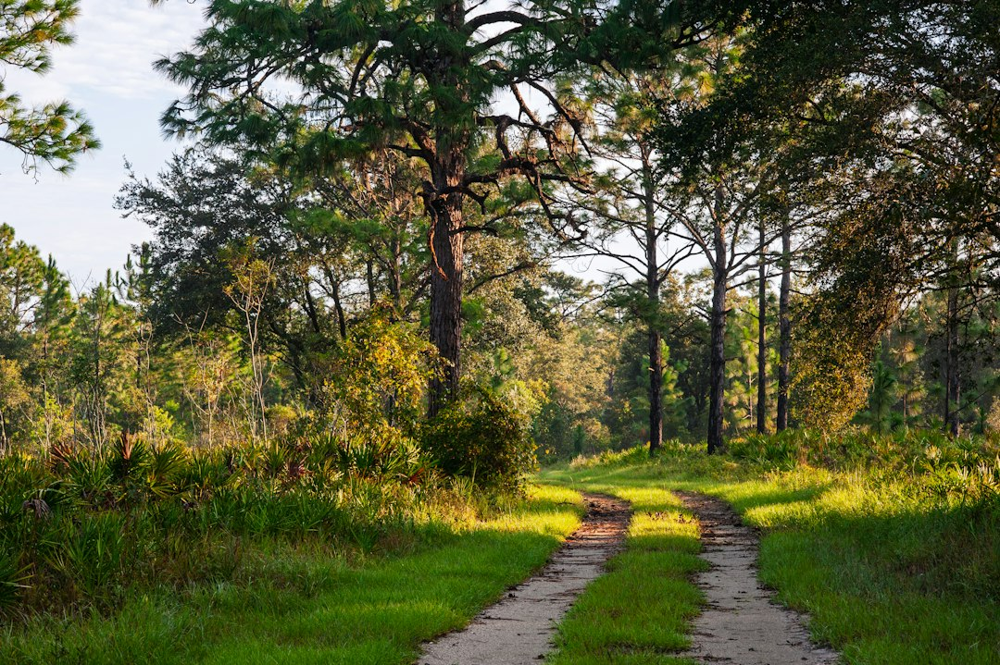
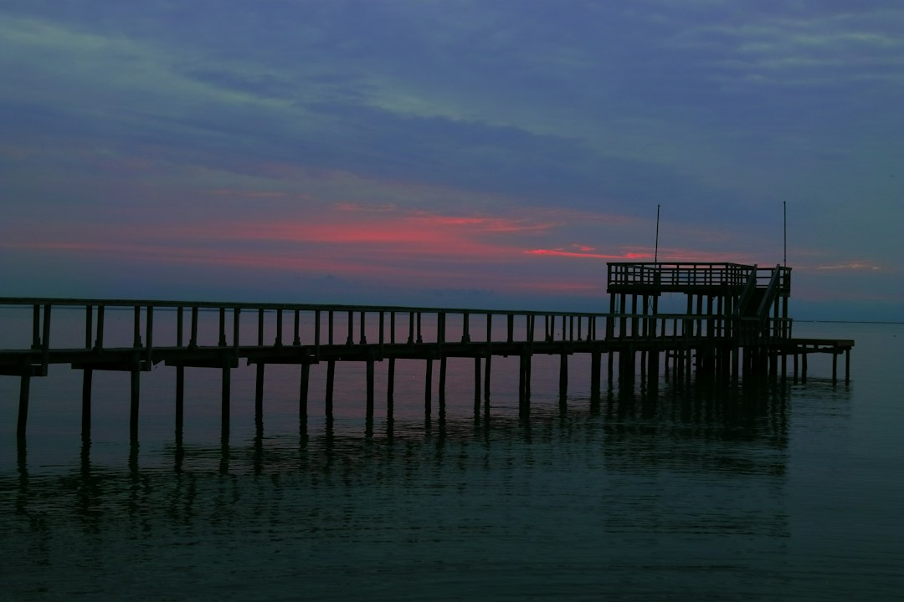
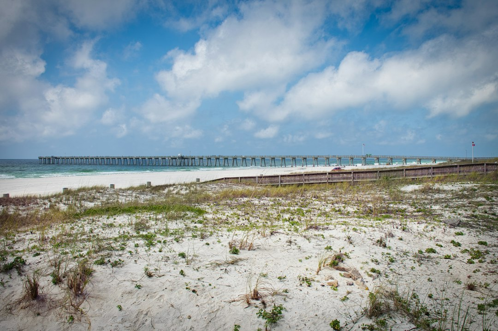
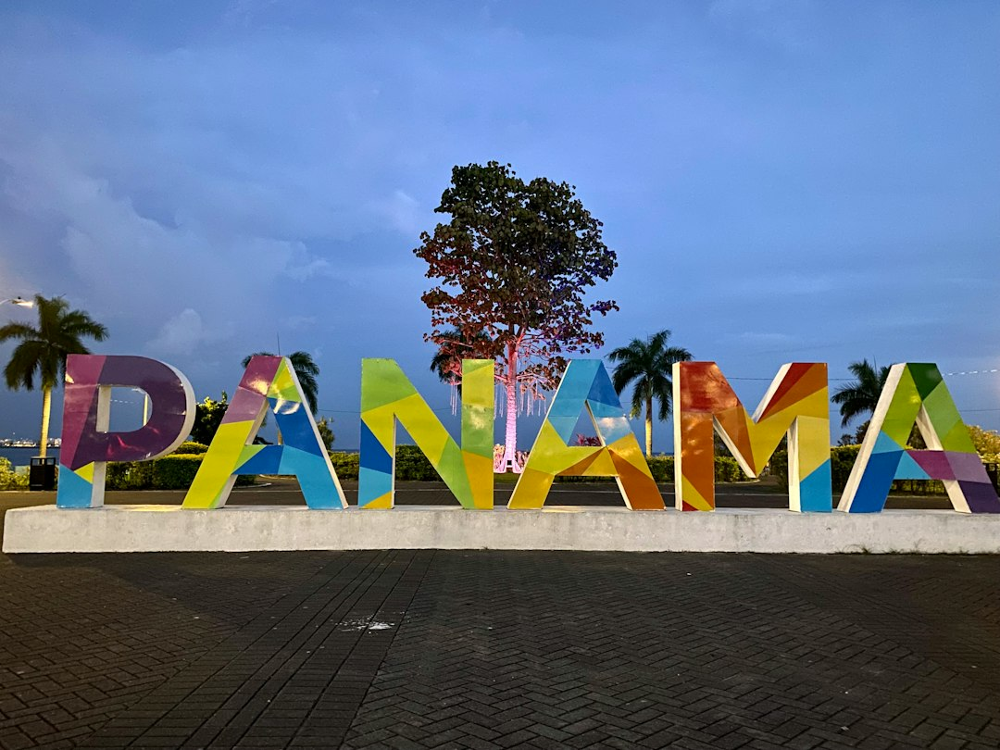
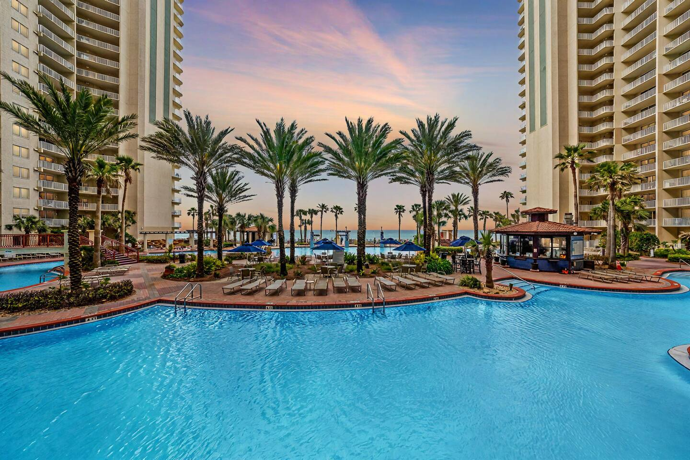

Think Panama City Beach is just 27 miles of sprawling white sand and turquoise water? You're not wrong, but you're not entirely right, either. For those of us who get a little restless after an hour on a beach towel, PCB is an incredible, and often overlooked, outdoor playground.

Beyond the shoreline lies a world of pristine nature preserves, winding forest trails, and serene coastal dune lakes perfect for exploration. This is the side of Panama City Beach that most visitors miss. It's where you can trade the crowds for the call of a coastal bird and the hum of traffic for the gentle lap of a paddle in the water.

If your ideal vacation involves a bit of sweat, some breathtaking scenery, and a story to tell, you've come to the right place. Here’s how to have an unforgettable active adventure in Panama City Beach.

### Table of Contents
*   [Explore the Wild Side of St. Andrews State Park](#explore-the-wild-side-of-st-andrews-state-park)
*   [Get Lost (in a Good Way) at Conservation Park](#get-lost-in-a-good-way-at-conservation-park)
*   [Get on the Water (Without the Party Barge)](#get-on-the-water-without-the-party-barge)
*   [Experience Pier Park from a Different Angle](#experience-pier-park-from-a-different-angle)
*   [Your Adventure Basecamp: Where to Stay in Panama City Beach](#your-adventure-basecamp-where-to-stay-in-panama-city-beach)

## Explore the Wild Side of St. Andrews State Park

St. Andrews State Park is so much more than its famous "kiddie pool" and jetty beach. This 1,200-acre park, located at the far eastern end of the beach, is a sanctuary for both wildlife and adventure-seekers. It sits between the Gulf of Mexico and the Grand Lagoon, offering two distinct coastal environments to explore. Plan to spend at least half a day here—you’ll need it.

### Hiking the Heron Pond and Gator Lake Trails
Lace-up your sneakers and leave the flip-flops behind. The park has two fantastic, easy-to-moderate hiking trails.

*   **Heron Pond Trail:** This path winds through a flatwood pine forest before opening up to a beautiful freshwater marsh. It's a fantastic spot for birding. You’ll see everything from majestic herons and egrets to ospreys circling overhead. The trail is a loop, so you can’t get lost, and it’s a peaceful escape from the beach buzz.
*   **Gator Lake Trail:** As the name implies, keep your eyes peeled for alligators sunning themselves along the banks of the lake. This short, scenic trail offers a glimpse into a different ecosystem just steps from the dunes. My advice? Go early in the morning when the wildlife is most active and the air is still cool.

### Snorkeling the Jetties
The rock jetties that separate the park's inlet from the Gulf are one of the best and most accessible snorkeling spots in the region. The rocks create a calm, protected area that acts as a nursery for an incredible array of marine life. You can expect to see sheepshead, spadefish, redfish, and countless species of colorful smaller fish.

**The local secret:** The best time to snorkel is during an incoming high tide. This brings in clear water from the Gulf, dramatically improving visibility. You can rent snorkel gear from the park’s camp store if you don't have your own. Just be mindful of boat traffic in the channel and always swim with a buddy.

### Kayaking and Paddleboarding in the Grand Lagoon
While the Gulf side can get choppy, the waters of the Grand Lagoon on the north side of the park are typically calm and perfect for paddling. You can rent kayaks and stand-up paddleboards (SUPs) right inside the park. It’s a completely different perspective, allowing you to explore quiet coves and get up close to wading birds along the shore. Paddle out towards Shell Island for a truly memorable afternoon.

**Details:**
*   **Address:** [4607 State Park Ln, Panama City, FL 32408](https://www.google.com/maps/search/?api=1&query=4607+State+Park+Ln+Panama+City+FL+32408)
*   **Cost:** $8 per vehicle.

## Get Lost (in a Good Way) at Conservation Park

If you really want to stretch your legs, head to Conservation Park on the west end of PCB. This massive, 2,900-acre wilderness preserve is a local treasure and a complete departure from the typical beach scene. It features over 24 miles of trails, some paved, some dirt, all winding through beautiful cypress domes and pine forests.

### Choosing Your Trail: Biking vs. Hiking
The trail system is a series of interconnected loops ranging from 0.6 miles to 11 miles, so you can choose your own adventure.

*   **For Bikers:** The trails are mostly flat and well-maintained, making them perfect for a mountain bike or even a sturdy hybrid. The longer loops are fantastic for getting a real workout in while surrounded by nature. You can cover a lot of ground and experience the full diversity of the park's landscape.
*   **For Hikers & Trail Runners:** The softer, unpaved trails are a dream for runners and walkers. My personal favorite is the Cypress Pond loop—it’s short, but the boardwalk section that takes you over the wetlands feels like you’ve entered another world.

### Wildlife Spotting: What to Look For
This park is teeming with wildlife. It’s a designated bird-watching hot spot, so bring your binoculars. You’re also likely to see white-tailed deer, raccoons, and yes, alligators in the wetland areas (always keep a safe distance). The park is a crucial part of the local watershed, and the effort to preserve this habitat is evident everywhere you look.

### Pro-Tip: Go Early or Late
The best time to visit is either early in the morning or in the hour before sunset. Not only will you avoid the midday heat (especially in summer), but this is also when the animals are most active. **Crucial advice:** Bring more water than you think you need and a good bug spray, especially during the warmer months. There are restrooms and a covered pavilion at the trailhead, but once you're on the trails, you're on your own.

**Details:**
*   **Address:** [100 Conservation Dr, Panama City Beach, FL 32413](https://www.google.com/maps/search/?api=1&query=100+Conservation+Dr+Panama+City+Beach+FL+32413)
*   **Cost:** Free.

## Get on the Water (Without the Party Barge)

Active water time in PCB doesn’t have to mean a crowded dolphin cruise or a pontoon boat rental. There are plenty of ways to engage with the water on a more personal level.

### Guided Eco-Tours by Kayak
Several local outfitters offer guided eco-tours of the area's more remote waterways, like the coastal dune lakes just west of PCB. These rare geological features are found in only a few places on Earth. Paddling through them is a serene and educational experience. A guide can point out the unique flora and fauna and explain the fascinating hydrology that makes these lakes so special. Coldwater Excursions is a great local company that runs fantastic tours.

### Finding Your Zen on a Stand-Up Paddleboard
The calm, early morning Gulf is the perfect place for a sunrise SUP session. It’s an incredible full-body workout and a meditative experience all in one. You can rent boards from dozens of places along the beach. My recommendation is to find a spot away from the major condo complexes, like the beaches on the far west end, for a more peaceful paddle. Watch for dolphins—they often cruise just beyond the sandbar in the mornings.

### Wreck Diving for the Certified Adventurer
Panama City Beach is known as the "Wreck Capital of the South" for a reason. The Gulf floor is littered with sunken ships, bridge spans, and artificial reefs, creating a haven for marine life and a playground for scuba divers. If you’re a certified diver, you can’t miss this. Local dive shops like Panama City Diving can take you out to explore famous sites like the 465-foot USS Oriskany (the world's largest artificial reef) or the historic "Tarpon" shipwreck.

## Experience Pier Park from a Different Angle

Pier Park is famous for its shopping, dining, and entertainment, but it's also a great destination for the active traveler.

### Biking the Back Beach Road Trail
The Gayle's Trails system includes a paved path that runs parallel to Panama City Beach Parkway (Back Beach Road). You can easily bike from Conservation Park all the way to Pier Park, a roughly 6-mile ride one-way. It’s a safe and scenic way to travel, avoiding traffic and getting some exercise. Lock up your bike and you’re ready to explore the shops or grab a bite to eat.

### Fishing off the Russell-Fields Pier
Stretching over 1,500 feet into the Gulf, the Russell-Fields Pier is an iconic landmark and an angler's paradise. For a small fee, you can walk the pier or rent some gear and try your hand at catching Spanish mackerel, king mackerel, cobia, and more, depending on the season. Even if you don't fish, a walk to the end of the pier is a must-do. You get a stunning panoramic view of the coastline and an almost guaranteed show from pelicans and dolphins.

**Details:**
*   **Address:** [16201 Front Beach Rd, Panama City Beach, FL 32413](https://www.google.com/maps/search/?api=1&query=16201+Front+Beach+Rd+Panama+City+Beach+FL+32413)
*   **Cost:** $4 per person to walk, $7 per person to fish.

## Your Adventure Basecamp: Where to Stay in Panama City Beach

After a long day of hiking, paddling, or diving, you need a comfortable place to recharge. You want somewhere you can drop your gear, wash off the salt and sand, and relax with an unbeatable view. Forget cramped hotel rooms—a dedicated vacation rental gives you the space and amenities to truly unwind.

For a couple or a small family, having a basecamp right on the water is a game-changer. Imagine ending your day of adventure by soaking in a private hot tub on your balcony, watching the sunset paint the sky over the Gulf. A place like the **[On the Beach | Ocean Views | Sleeps 6](https://book.springlinestays.com/property/beachfront-hot-tub-ocean-views-sleeps-6)** condo offers exactly that. It's the perfect spot to rest your tired muscles and plan the next day’s excursion, with the sound of the waves right outside your door. Having a full kitchen also means you can whip up a hearty breakfast before you head out, saving you time and money.

## Frequently Asked Questions (FAQ)

**Q: What is the best time of year for outdoor activities in Panama City Beach?**
A: Spring (March-May) and Fall (September-November) offer the best weather for outdoor adventures in PCB. You'll find pleasant temperatures, lower humidity, and fewer crowds than in the peak summer season. The water is still warm enough for swimming and snorkeling, and the conditions are perfect for hiking and biking.

**Q: Are there good hiking trails in Panama City Beach?**
A: Absolutely! While known for its beaches, PCB is home to two fantastic hiking destinations. St. Andrews State Park has shorter, scenic trails like the Heron Pond Trail, while Conservation Park offers over 24 miles of diverse trails through pine forests and cypress wetlands, perfect for longer hikes or trail running.

**Q: Can you see wildlife in Panama City Beach?**
A: Yes! Beyond the dolphins and sea turtles in the Gulf, the state parks and preserves are rich with wildlife. In St. Andrews State Park and Conservation Park, it's common to see alligators, white-tailed deer, raccoons, and a huge variety of coastal and migratory birds, including herons, egrets, and ospreys.

**Q: Is Panama City Beach good for more than just beaches?**
A: Definitely. While the beaches are world-class, PCB offers a wealth of other activities. It's a fantastic destination for outdoor enthusiasts, with opportunities for kayaking, paddleboarding, hiking, biking, fishing, and scuba diving in pristine natural environments just minutes from the main tourist areas.

---

Ready to trade your beach towel for a trail map? Panama City Beach has a wilder side waiting for you to explore. From the quiet trails of a nature preserve to the vibrant reefs below the waves, there's an adventure here for every speed.

When you're ready to plan your active getaway, find the perfect home base for your trip. **[Book your stay directly with Springline Stays](https://www.springlinestays.com)** for the best rates, local expertise, and a comfortable retreat to come home to after a day of exploring.

*Panama City Beach — a must-visit near our Panama City Beach properties.*

*Shell Island — a must-visit near our Panama City Beach properties.*

*[On the Beach | Ocean Views | Sleeps 6 — Book your stay →](https://book.springlinestays.com/property/beachfront-hot-tub-ocean-views-sleeps-6)*
