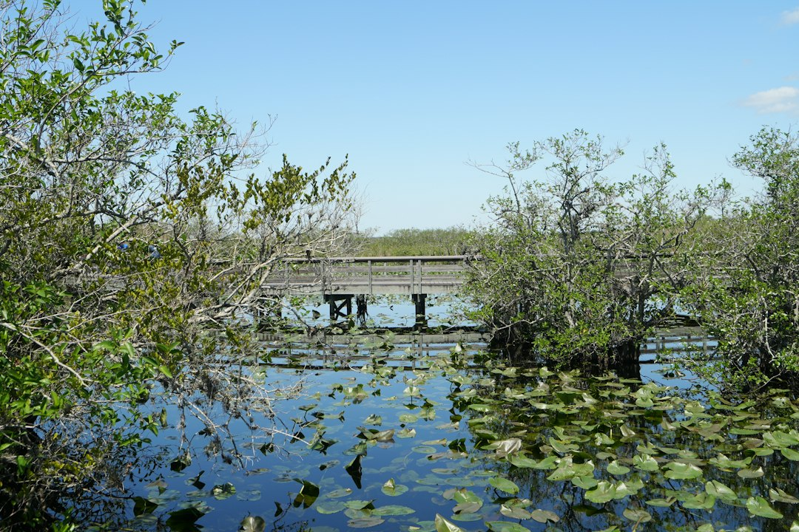
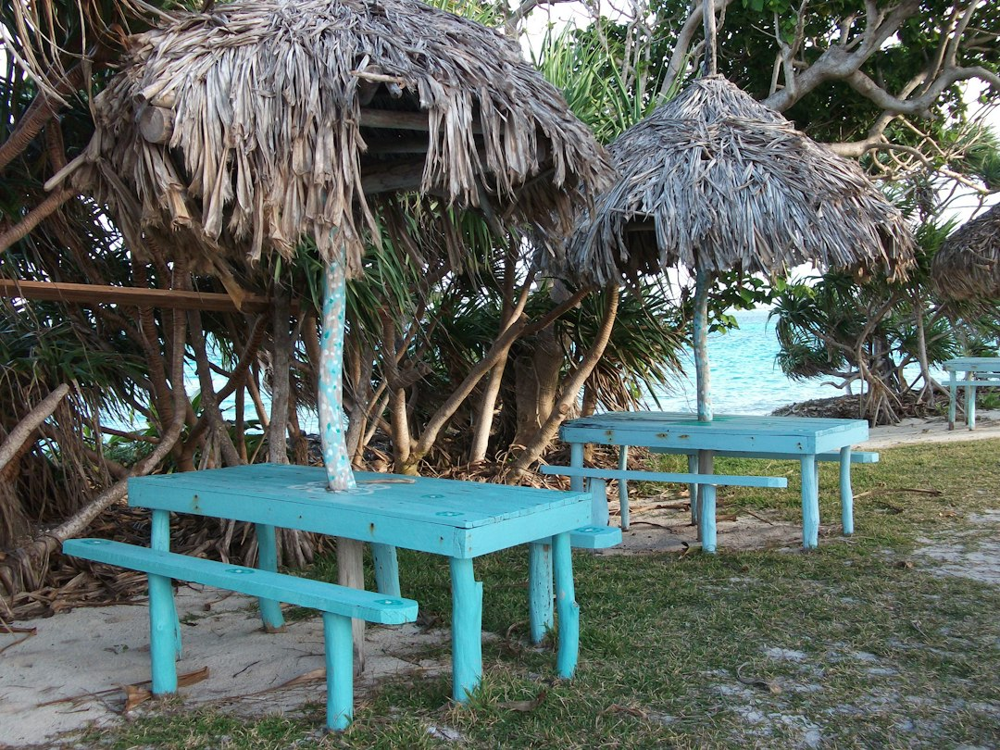
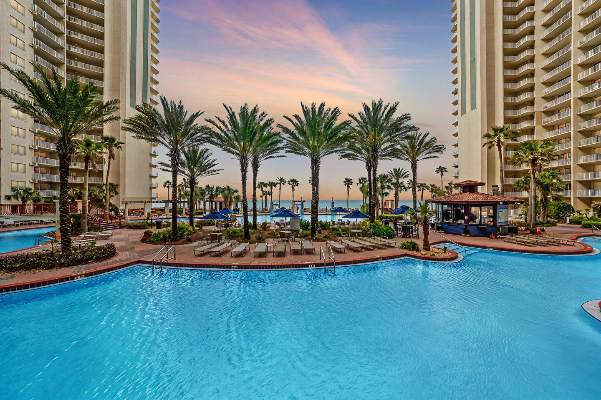
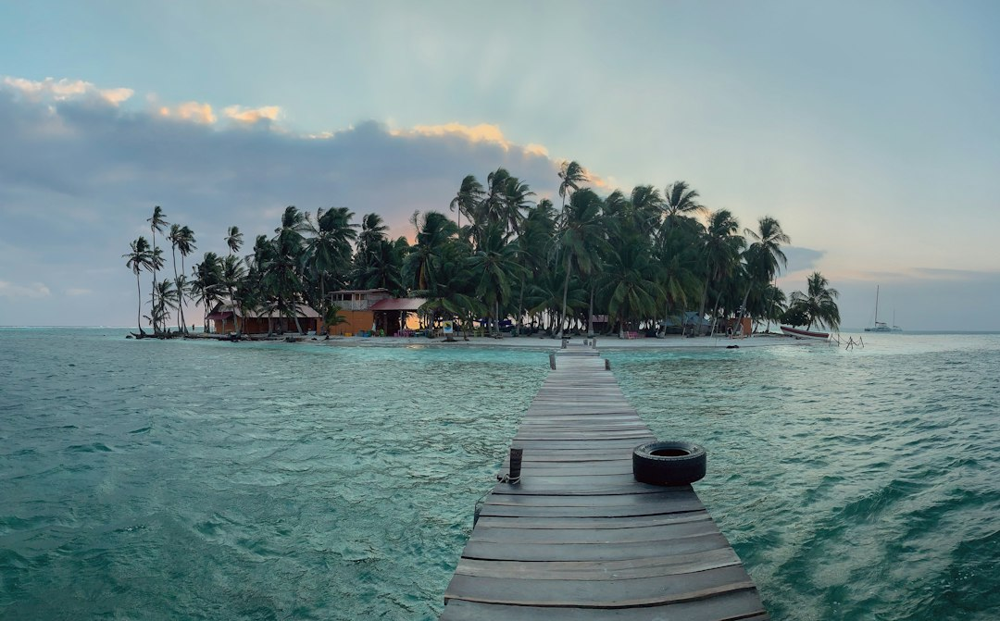
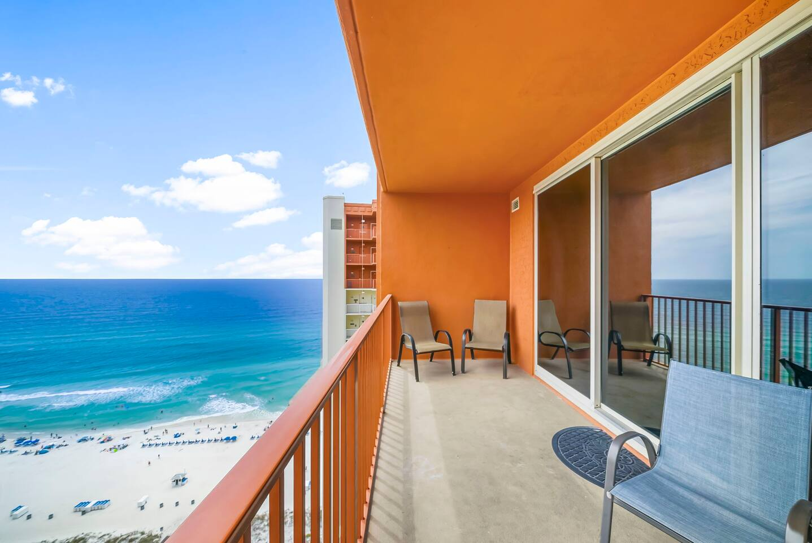

Everyone knows about Panama City Beach's 27 miles of sugar-white sand. But what if I told you the real magic of PCB lies just beyond the beach towels and waterfront bars? If you're tired of the same old tourist trail, you've come to the right place. We're pulling back the curtain on the spots that locals love—the quiet trails, the killer coffee shops, and the unique experiences that make this slice of the Emerald Coast so much more than just a spring break destination.

Forget the tourist traps. Let's explore the real Panama City Beach.

### Table of Contents
*   [Escape the Crowds: PCB's Natural Wonders (Besides the Beach)](#escape-the-crowds-pcbs-natural-wonders-besides-the-beach)
    *   [Hike, Bike, and Birdwatch at Conservation Park](#hike-bike-and-birdwatch-at-conservation-park)
    *   [Find Seclusion at St. Andrews State Park](#find-seclusion-at-st-andrews-state-park)
*   [Eat and Drink Like a Local](#eat-and-drink-like-a-local)
    *   [For Your Morning Buzz: The Pour](#for-your-morning-buzz-the-pour)
    *   [The Ultimate Laid-Back Lunch: Finn's Island Style Grub](#the-ultimate-laid-back-lunch-finns-island-style-grub)
    *   [A Sunset Drink with History: The Taproom](#a-sunset-drink-with-history-the-taproom)
*   [Unique Panama City Beach Experiences You Won't Find in a Brochure](#unique-panama-city-beach-experiences-you-wont-find-in-a-brochure)
    *   [Go on a Mural Hunt in Historic St. Andrews](#go-on-a-mural-hunt-in-historic-st-andrews)
    *   [Shop Local at the Grand Lagoon Waterfront Market](#shop-local-at-the-grand-lagoon-waterfront-market)
    *   [Do Pier Park the Right Way](#do-pier-park-the-right-way)
*   [The Perfect Home Base for Your PCB Adventure](#the-perfect-home-base-for-your-pcb-adventure)
*   [Frequently Asked Questions About Visiting Panama City Beach](#frequently-asked-questions-about-visiting-panama-city-beach)
*   [Your Off-the-Beaten-Path PCB Trip Awaits](#your-off-the-beaten-path-pcb-trip-awaits)

---

## Escape the Crowds: PCB's Natural Wonders (Besides the Beach)

The Gulf is gorgeous, but sometimes you need a break from the sand. Panama City Beach is surrounded by incredible nature preserves that offer a completely different kind of coastal beauty.

### Hike, Bike, and Birdwatch at Conservation Park

Just a few miles from the bustling Front Beach Road lies a 2,900-acre oasis of calm. The **Panama City Beach Conservation Park** ([100 Conservation Drive](https://www.google.com/maps/search/?api=1&query=100+Conservation+Drive+Panama+City+Beach+FL)) is a local treasure, offering over 24 miles of trails that wind through cypress domes and pine forests.

**Local Tip:** The trails are mostly flat and well-marked, making it great for all skill levels. The one-mile Gayle's Trail boardwalk is perfect for a quick, easy stroll. For a longer adventure, rent bikes and tackle one of the 5- or 11-mile loops. Go early in the morning for the best bird-watching—I've spotted everything from ospreys to bald eagles here. Remember to pack bug spray and plenty of water, especially in the summer. It's one of the best free things to do in Panama City Beach.

### Find Seclusion at St. Andrews State Park

Okay, **St. Andrews State Park** ([4607 State Park Ln](https://www.google.com/maps/search/?api=1&query=4607+State+Park+Ln+Panama+City+Beach+FL)) isn't exactly a secret, but most visitors make a beeline for the ferry to Shell Island (which, while amazing, has its own guide). The secret is knowing *where* to go inside the park.

Instead of the main beach, head to the "kiddie pool," a calm, protected lagoon perfect for families. Or, my personal favorite, walk out along the fishing pier and the rock jetties. You get a stunning view of the pass where the Gulf meets the bay, and it's one of the best spots to watch dolphins playing at sunrise or sunset. The Gator Lake trail offers a chance to see alligators, deer, and wading birds in a setting that feels a world away from the condos.

## Eat and Drink Like a Local

While PCB has fantastic seafood (we've written about it!), the local food scene is much more diverse. Here are a few spots you might not find on the main tourist lists.

### For Your Morning Buzz: The Pour

Forget the big chains. The Pour ([12902 Front Beach Rd](https://www.google.com/maps/search/?api=1&query=12902+Front+Beach+Rd+Panama+City+Beach+FL)) is a community-focused coffee shop with a seriously good brew. It’s a bit of a haven from the beach chaos. Their specialty lattes are creative and delicious (try the 'Salty Local' if it's on the menu), and it's the perfect place to fuel up before a day of exploring. It’s not just a coffee shop; it’s a vibe.

### The Ultimate Laid-Back Lunch: Finn's Island Style Grub

Tucked away next to Mr. Surf's Surf Shop, Finn's ([7220 Thomas Dr](https://www.google.com/maps/search/?api=1&query=7220+Thomas+Dr+Panama+City+Beach+FL)) is the definition of a hidden gem. This little food shack serves up some of the best tacos, bowls, and fresh-pressed juices in town.

**My Go-To Order:** The Ahi Tuna Tacos are life-changing. Fresh, perfectly seasoned, and exactly what you want to eat on a beach vacation. Grab your food, sit at one of the picnic tables, and enjoy the authentic, no-frills Florida atmosphere. They also have a newer location on the west end if you're staying that way.

### A Sunset Drink with History: The Taproom

For a real local bar experience, head over the bridge to Historic St. Andrews and find **The Taproom** ([1010 Beck Ave](https://www.google.com/maps/search/?api=1&query=1010+Beck+Ave+Panama+City+FL)). It's been around since the 1960s and feels like it. No frills, no fancy cocktails—just cold beer, friendly locals, and a shuffleboard table. It's the perfect place to wind down after a day in the sun and hear some real local stories. It’s cash only, so come prepared.

## Unique Panama City Beach Experiences You Won't Find in a Brochure

Ready to make some truly unique memories? Add these off-the-beaten-path activities to your Panama City Beach travel guide.

### Go on a Mural Hunt in Historic St. Andrews

The historic neighborhood of St. Andrews is a breath of fresh air. Park your car and just wander. The area has embraced public art, and you'll find incredible, large-scale murals on the sides of buildings, each telling a story about the area's fishing heritage and coastal culture. It's a fantastic, free way to spend an afternoon and get some amazing photos that aren't the typical beach selfie.

### Shop Local at the Grand Lagoon Waterfront Market

If you're in town on a Saturday or Sunday morning, skip the souvenir shops and head to the **Grand Lagoon Waterfront Market** ([5551 N Lagoon Dr](https://www.google.com/maps/search/?api=1&query=5551+N+Lagoon+Dr+Panama+City+Beach+FL)). Here, local farmers, bakers, and artisans sell everything from fresh produce and local honey to handmade jewelry and art. It's the perfect place to grab ingredients for a fresh dinner back at your rental or find a truly unique souvenir.

### Do Pier Park the Right Way

Pier Park is PCB's massive outdoor shopping and entertainment hub, and it can be overwhelming. The secret is to treat it like a neighborhood, not a single destination.

*   **Go Early or Late:** Avoid the midday and early evening crowds. A morning stroll with a coffee before the shops open is surprisingly peaceful.
*   **Explore the Edges:** The best shops are often the smaller boutiques tucked away in **The Boardwalk** and **Pier Park West**, across the street from the main drag.
*   **The Farmer's Market:** On weekends, there's a great farmer's market in the center of Pier Park. It's a fantastic spot for local flavor.
*   **Skip the Chain Restaurants:** While there are plenty of options, try a local spot like The Brass Tap for craft beer or I LOVE SUGAR for a wild candy experience.

## The Perfect Home Base for Your PCB Adventure

Exploring all these hidden gems requires a great place to come back to. While you're off the beaten path during the day, there's nothing wrong with wanting a classic, on-the-sand experience at night. That’s the perfect balance. You want a home base that gives you that breathtaking Gulf view you came for, while still being a short drive from all these local spots.

For a couple or small family, a place like our [**On the Beach | Ocean Views | Sleeps 6**](https://book.springlinestays.com/property/beachfront-hot-tub-ocean-views-sleeps-6) condo is ideal. You can spend your mornings sipping coffee on the private balcony watching the waves, head out to Conservation Park for an afternoon hike, and be back in time to watch the sunset from your living room. Having a full kitchen means you can cook up the fresh finds from the farmer's market. It’s the best of both worlds—a prime location for your Panama City Beach vacation rental that serves as the perfect launchpad for authentic adventures.

## Frequently Asked Questions About Visiting Panama City Beach

### What is the least crowded time to visit Panama City Beach?
The sweet spots are April-May and September-October. During these "shoulder seasons," the weather is fantastic, the summer crowds have thinned out, and you'll find better deals on accommodations. The water is still warm enough for swimming, and the atmosphere is much more relaxed.

### Are there things to do in Panama City Beach besides the beach?
Absolutely! As this guide shows, you can hike or bike through thousands of acres of nature preserves at Conservation Park, explore the history and art of St. Andrews, kayak in the Grand Lagoon, shop at local markets, and enjoy a diverse food scene that goes far beyond seafood.

### What part of Panama City Beach is best to stay in?
It depends on your vibe. The West End is generally quieter and more family-oriented, with less high-rise density. The East End, near St. Andrews State Park, offers a mix of condos and older beach homes. The central area near Pier Park is the busiest but puts you in the middle of the action. Choosing a central Panama City Beach vacation rental gives you easy access to both the quiet nature spots and the main attractions.

### Is Panama City Beach good for walking?
While Front Beach Road has a sidewalk, PCB is quite spread out. Areas like Pier Park and Historic St. Andrews are very walkable within themselves, but you will need a car to travel between the different areas of the city and to access places like Conservation Park.

## Your Off-the-Beaten-Path PCB Trip Awaits

Panama City Beach is a place with layers. It's easy to stick to the surface—the beautiful beaches, the bustling piers, the familiar restaurants. But the most rewarding trips happen when you dig a little deeper. Use this guide to find your own hidden gems and create a vacation story that’s uniquely yours.

When you’re ready to plan your adventure, we’d love to host you. Booking your stay directly with us ensures you get the best rates and personalized service for your perfect home away from home.

**[Explore our Panama City Beach properties and book direct with Springline Stays!](https://www.springlinestays.com)**

*Shell Island — a must-visit near our Panama City Beach properties.*

*[On the Beach | Ocean Views | Sleeps 6 — Book your stay →](https://book.springlinestays.com/property/beachfront-hot-tub-ocean-views-sleeps-6)*
