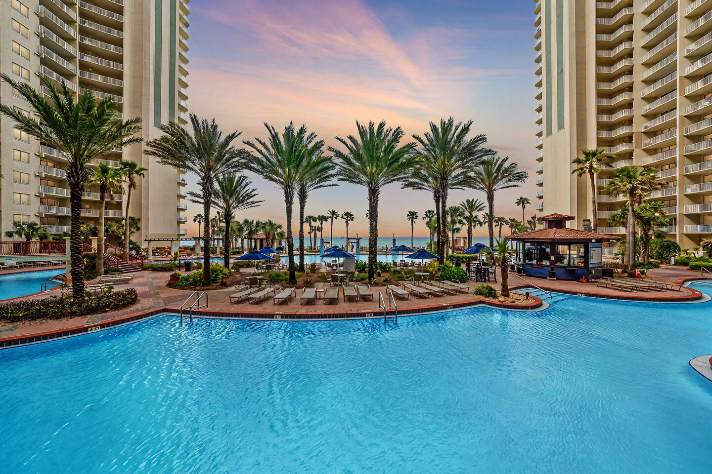
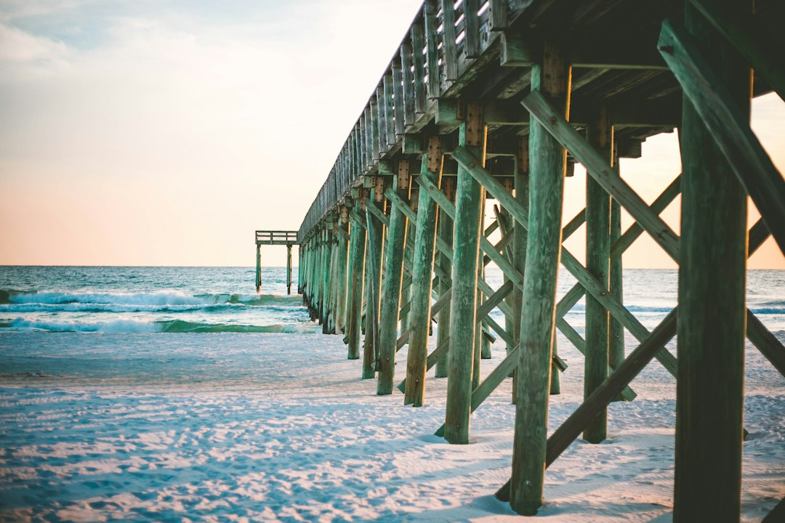
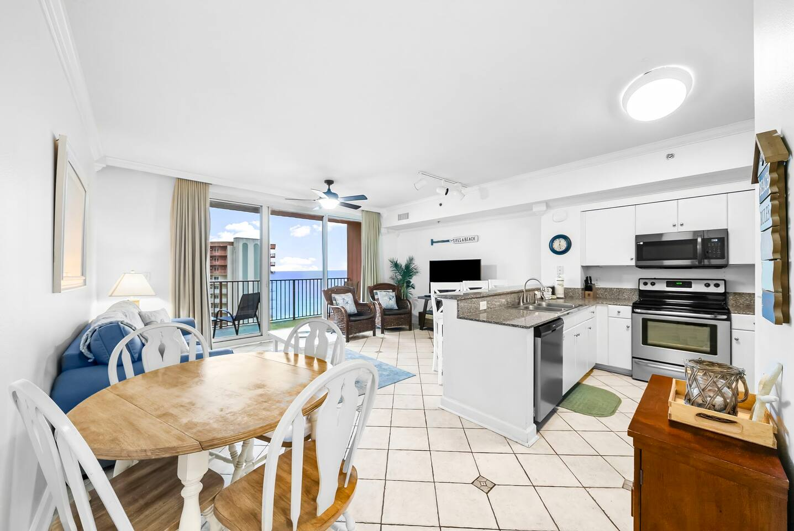

So you’re thinking about Panama City Beach, and your mind immediately goes to 27 miles of sugar-white sand, sparkling emerald water, and sunny beach days. You’re not wrong. But what if I told you there’s a whole other side to PCB, a wilder side waiting just beyond the dunes?

This is the Panama City Beach for the explorers, the adventurers, and anyone who wants to trade a crowded beach towel for a quiet hiking trail or a serene paddle through a coastal dune lake. We’re talking about lush pine forests, protected wetlands teeming with wildlife, and some of the most pristine coastal habitats in the entire state. If you want to experience the authentic Florida Panhandle, this is your guide.

### Table of Contents
*   [Explore St. Andrews State Park: A Coastal Treasure](#explore-st-andrews-state-park-a-coastal-treasure)
*   [Discover Conservation Park: 24 Miles of Trails Await](#discover-conservation-park-24-miles-of-trails-await)
*   [Shell Island: Your Day Trip to Paradise](#shell-island-your-day-trip-to-paradise)
*   [Exploring PCB's Waterways by Kayak or SUP](#exploring-pcbs-waterways-by-kayak-or-sup)
*   [Your Perfect Basecamp in Panama City Beach](#your-perfect-basecamp-in-panama-city-beach)

## Explore St. Andrews State Park: A Coastal Treasure

St. Andrews State Park is consistently ranked one of the best beaches in the country, but limiting it to just a "beach" is a massive understatement. This 1,200-acre park, located at the far eastern tip of Panama City Beach, is a peninsula of diverse ecosystems. It's bordered by the Gulf of Mexico on one side, the St. Andrews Pass on another, and the Grand Lagoon on the third. It’s an outdoor lover's playground.

Find it at: [4607 State Park Ln, Panama City, FL 32408](https://www.google.com/maps/search/?api=1&query=4607+State+Park+Ln+Panama+City+FL+32408)

### Hiking the Heron Pond and Gator Lake Trails

Forget the flip-flops for a bit and put on some walking shoes. The park has two fantastic, easy-to-navigate hiking trails.

*   **Heron Pond Trail:** This is a gentle walk through a flatwood pine forest that leads you to the historic turpentine still. It’s a great way to see a different side of the coastal environment.
*   **Gator Lake Trail:** As the name suggests, this trail offers a scenic overlook of Gator Lake, where you can often spot alligators sunning themselves on the banks (from a safe distance, of course!).

**Local Tip:** Go first thing in the morning. Not only will you beat the Florida heat, but the wildlife is far more active. You’ll hear a symphony of bird calls and have the best chance of spotting a deer crossing the path.

### Snorkeling the Jetties

The rock jetties that form the St. Andrews Pass create an incredible artificial reef system, making this one of the best and most accessible snorkeling spots in the area. The water inside the "kiddie pool," a protected swimming area next to the jetties, is usually calm and clear. You can expect to see everything from sheepshead and snapper to blue crabs and maybe even a passing octopus.

**The secret to a great snorkel session here is timing.** Check the tide charts and plan your visit for the hour or so leading up to high tide. This is when crystal-clear water from the Gulf pushes into the pass, giving you the best possible visibility.

### Fishing and Pier Access

If you've got an angler in your group, they'll be in heaven. The park has two fishing piers: one on the Gulf side for surf fishing and a second, larger T-shaped pier on the Grand Lagoon side. You can catch Spanish mackerel, redfish, flounder, and more, depending on the season. You don’t even need a Florida fishing license to fish from the pier, as the park's entrance fee covers it.

## Discover Conservation Park: 24 Miles of Trails Await

Tucked away on the west end of Panama City Beach, just a short drive from the bustling Front Beach Road, is a 2,900-acre oasis of protected wilderness. The Panama City Beach Conservation Park is a testament to the area's commitment to preserving its natural wetlands and pine forests. For hikers, trail runners, and cyclists, this place is a must-visit.

Find it at: [100 Conservation Dr, Panama City Beach, FL 32413](https://www.google.com/maps/search/?api=1&query=100+Conservation+Dr+Panama+City+Beach+FL+32413)

### Choosing Your Trail: From Easy Loops to Long Treks

The park offers an impressive network of over 24 miles of trails and a mile of boardwalks, with something for every fitness level.

*   **Easy Loops (1-2 miles):** There are 12 different trails to choose from, many of which can be combined into short, easy loops. The Cypress Pond Trail (0.6 miles) is a fantastic short walk on a boardwalk over the wetlands.
*   **Long Treks (5-11 miles):** For a more serious workout, you can tackle the longer color-coded routes. The Green Trail is an 11-mile loop that will take you through the heart of the park's diverse landscapes.

The trails are well-marked and mostly flat, making them accessible for most people. Leashed dogs are welcome, too!

### What to Bring and When to Go

This isn't a walk on the beach. Come prepared.
*   **Bug Spray:** This is non-negotiable, especially during the warmer, wetter months. The wetlands are beautiful, but they're also mosquito heaven.
*   **Water:** There are no water fountains on the trails. Bring more than you think you'll need.
*   **Sunscreen & Hat:** While many trails are shaded, there are plenty of open areas.
*   **Good Shoes:** Sneakers are fine for the shorter boardwalks, but for the longer sandy trails, closed-toe hiking shoes are best.

The best time for a long hike is during the cooler months from October to April. The spring brings a stunning display of wildflowers, while the fall offers crisp air and fewer bugs.

### Wildlife Spotting Opportunities

Keep your voice down and your eyes peeled. This park is a major stop on the Great Florida Birding Trail, so you can expect to see herons, egrets, and osprey. Look for tracks in the sandy soil—you'll likely see signs of white-tailed deer, raccoons, and coyotes. The best time for spotting larger animals is at dawn or dusk near the edges of the forest.

## Shell Island: Your Day Trip to Paradise

No list of PCB's natural wonders would be complete without Shell Island. This undeveloped, 7-mile-long barrier island is the definition of pristine. Think towering sand dunes, a secluded inland lake, and a coastline littered with incredible shells. It's a place to truly disconnect.

While we have a complete [Shell Island Guide](/blog/shell-island-guide-how-to-visit-panama-city-beachs-best-kept-secret/), here’s the adventurer's take on it.

### How to Get There: The Adventurous Route

The easiest way to get there is the official Shell Island Shuttle from St. Andrews State Park. But for a real adventure, rent your own boat. A pontoon boat for the day gives you the freedom to explore the entire bayside of the island, drop anchor in a secluded cove, and find a stretch of beach all to yourself. You're also much more likely to have incredible, up-close encounters with the pods of bottlenose dolphins that famously play in the pass and the bay.

### What to Do on the Island: Beyond Sunbathing

This is an active beach day.
*   **Shelling:** Walk the shoreline, especially along the Gulf side after high tide, to find sand dollars, whelks, and conchs.
*   **Snorkeling:** The grass flats on the bay side are a nursery for all sorts of juvenile fish, crabs, and marine life.
*   **The Golden Rule:** The most important tip for visiting Shell Island is this: **there are absolutely no facilities.** No restrooms, no trash cans, no concession stands. You must pack in everything you need for the day and, more importantly, pack out every single piece of trash. Leave it even cleaner than you found it.

## Exploring PCB's Waterways by Kayak or SUP

The Gulf is incredible, but some of the best paddling experiences are found in the calmer backwaters. Renting a kayak or stand-up paddleboard (SUP) opens up a whole new perspective on the local environment.

### Camp Helen State Park and Lake Powell

Located on the far west end of PCB, bordering 30A, Camp Helen State Park is unique because it's bordered by water on three sides: the Gulf, the Phillips Inlet, and Lake Powell. Lake Powell is the largest coastal dune lake in Florida, a rare geological feature where fresh water and salt water mix. You can rent kayaks and paddleboards right in the park and spend hours exploring the calm, brackish waters. It’s a fantastic spot for birdwatching and a peaceful escape from the waves.

Find it at: [23937 Panama City Beach Pkwy, Panama City Beach, FL 32413](https://www.google.com/maps/search/?api=1&query=23937+Panama+City+Beach+Pkwy+Panama+City+Beach+FL+32413)

### Grand Lagoon

The massive body of water behind St. Andrews State Park is another paddler's dream. It’s protected from the open Gulf, making it perfect for beginners or a windy day. You can paddle around the marinas, explore the shorelines, and even find your way to a waterfront restaurant. My favorite move is to paddle over to a spot like The Grand Marlin, tie up, and grab a bite to eat before paddling back as the sun sets.

## Your Perfect Basecamp in Panama City Beach

After a long day of hiking the trails at Conservation Park or paddling against the current around Shell Island, there’s nothing better than coming back to a comfortable spot where you can kick up your feet and relax. You need a place to wash off the salt and sand, a full kitchen to prep snacks and lunches for your next day's expedition, and a balcony to watch the sun go down.

For a couple or a small family, a beachfront condo is the perfect blend of adventure and relaxation. A place like **[On the Beach | Ocean Views | Sleeps 6](https://book.springlinestays.com/property/beachfront-hot-tub-ocean-views-sleeps-6)** gives you that direct access to the sand and surf PCB is famous for, while still being just a short drive from all these amazing natural parks. You can spend the morning hiking and the afternoon lounging by the pool. Plus, having an in-unit washer and dryer is a game-changer for handling sweaty hiking clothes and salty swimwear. It's the ideal way to build a Panama City Beach vacation rental experience that gives you the best of both worlds.

## Panama City Beach Outdoor Adventures: FAQ

**What is the best time of year for hiking in Panama City Beach?**
The best and most comfortable time for hiking is during the fall, winter, and spring (October through May). The temperatures are cooler and the humidity is lower. Summer hiking is possible, but you must go very early in the morning and bring plenty of water and bug spray.

**Can you see wildlife in Panama City Beach?**
Absolutely! Beyond the famous dolphins and sea turtles, the state parks and conservation areas are home to white-tailed deer, alligators, coyotes, and a huge variety of resident and migratory birds. Early morning and dusk are the best times for wildlife spotting.

**Are the state parks in PCB family-friendly?**
Yes, St. Andrews State Park and Camp Helen State Park are very family-friendly. They have calm swimming areas, easy walking trails, picnic tables, and restroom facilities. Conservation Park's shorter boardwalk trails are also great for kids, but the longer, more rustic trails are better suited for older children and adults.

**Do I need to book a tour to see dolphins in Panama City Beach?**
While many excellent boat tours are available, you don't necessarily need one. Dolphins frequently swim close to shore and are often spotted from the beach or a condo balcony. For a more reliable and up-close experience, renting a pontoon boat and exploring the waters around Shell Island is one of the best ways to see them play in their natural habitat.

---

Ready to explore the wilder side of Panama City Beach? The first step is finding the perfect home base for all your adventures. From there, the trails, waterways, and pristine beaches are yours to discover. Browse our curated collection of Panama City Beach vacation rentals and **[book directly with Springline Stays](https://www.springlinestays.com)** to save on fees and get the best rates for your trip.

*Conservation Park — a must-visit near our Panama City Beach properties.*

*[On the Beach | Ocean Views | Sleeps 6 — Book your stay →](https://book.springlinestays.com/property/beachfront-hot-tub-ocean-views-sleeps-6)*
