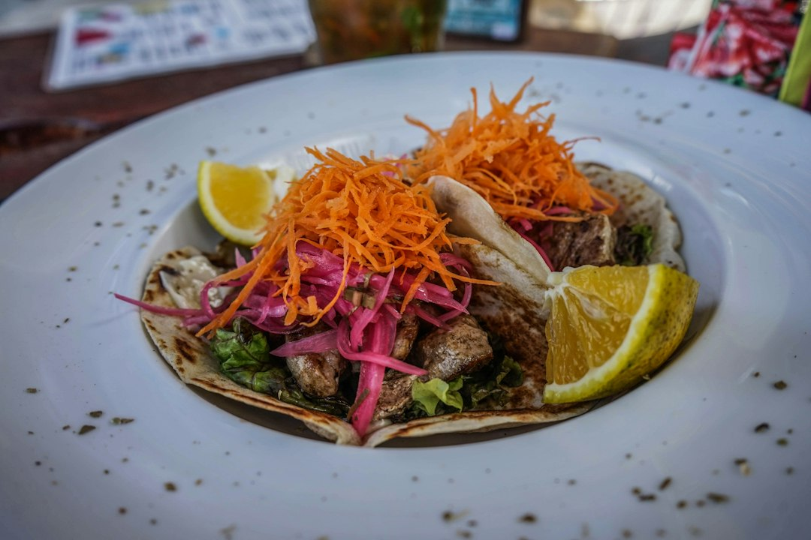
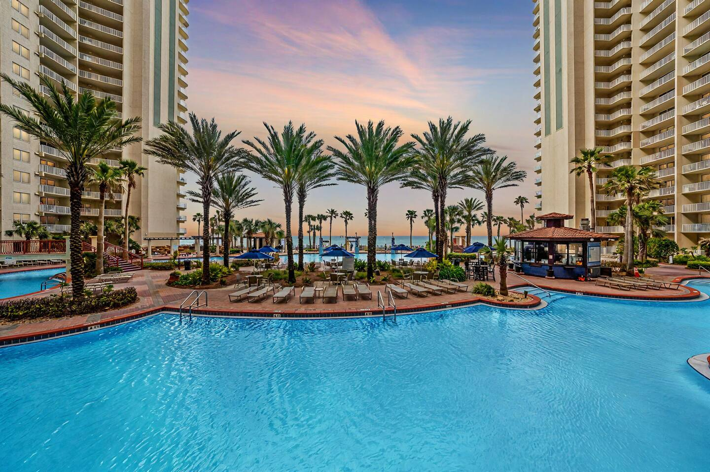
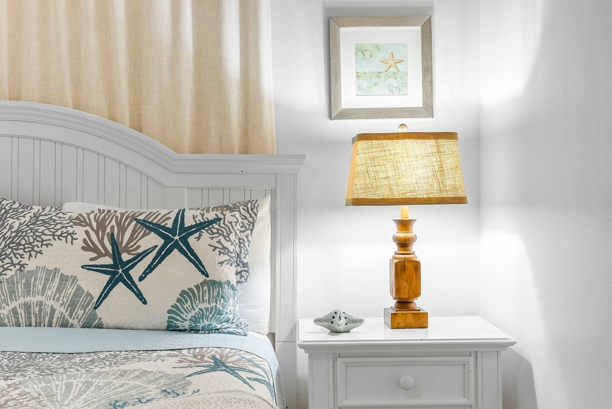
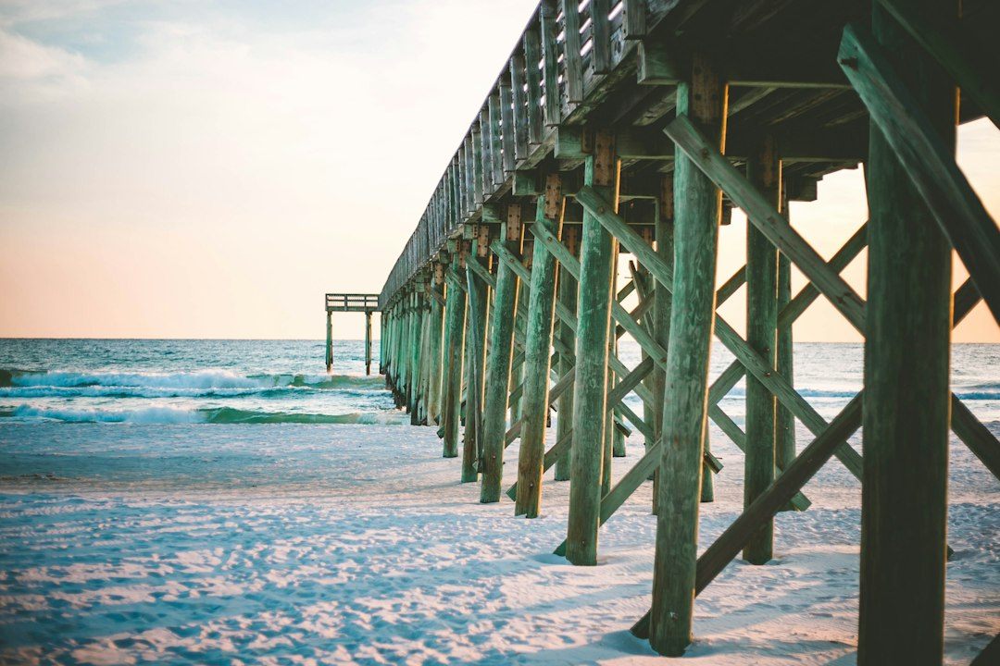
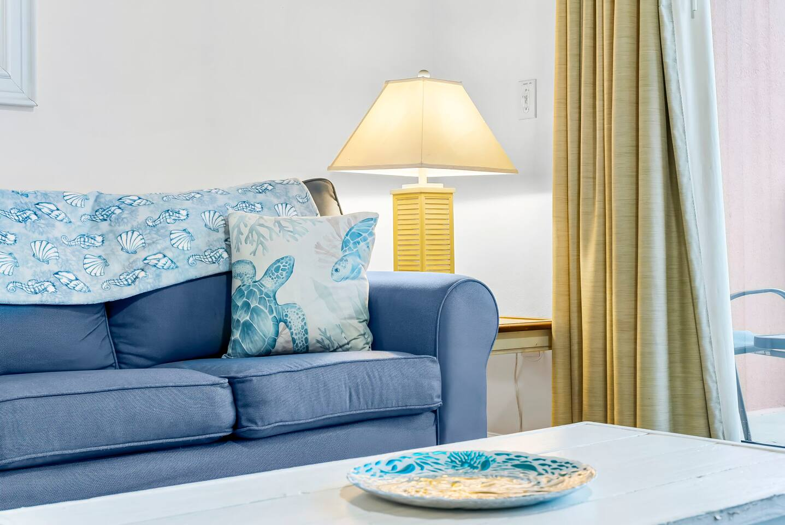

Let’s be honest: when you picture Panama City Beach, you might imagine bustling crowds, packed beaches, and a line for everything. And sure, during peak season, it can get lively. But what if I told you there’s a completely different side to PCB? A quieter, more serene version where you can hear the waves without the noise, find a stretch of sand all to yourself, and truly unwind.

Getting away from the crowds isn't about avoiding the best parts of Panama City Beach; it's about experiencing them in a smarter, more relaxed way. It’s knowing when to go, where to look, and how to find those hidden pockets of paradise that most tourists drive right past.

This is your guide to doing just that.

### Table of Contents
*   [Timing is Everything: When to Visit for Fewer Crowds](#timing-is-everything-when-to-visit-for-fewer-crowds)
*   [Rethinking the Beach: Swapping Crowded Spots for Quiet Shores](#rethinking-the-beach-swapping-crowded-spots-for-quiet-shores)
*   [Beyond the Sand: Nature & Activities Away from the Main Strip](#beyond-the-sand-nature--activities-away-from-the-main-strip)
*   [Smart Dining: How to Eat Well Without the Wait](#smart-dining-how-to-eat-well-without-the-wait)
*   [Your Private Oasis: Choosing the Right Place to Stay](#your-private-oasis-choosing-the-right-place-to-stay)
*   [Panama City Beach Crowd-Avoidance FAQs](#panama-city-beach-crowd-avoidance-faqs)

## Timing is Everything: When to Visit for Fewer Crowds

The single biggest factor in having a peaceful vacation is *when* you visit. If you can swing it, avoiding the peak weeks of Spring Break (mid-March to early April) and the height of summer (June and July) will change your entire experience.

### The Magic of the Shoulder Seasons

Ask anyone who lives here, and they'll tell you the absolute best time of year in Panama City Beach is the fall. From September through November, the summer crowds have vanished, but the Gulf water is still incredibly warm and inviting. The humidity drops, the sunsets are somehow even more spectacular, and you can actually find a front-row parking spot at the grocery store.

The same goes for late spring. The last two weeks of April and the entire month of May are a sweet spot after the spring breakers have gone home but before the summer rush begins. The weather is perfect, and the energy is laid-back.

### Be an Early Bird (or a Night Owl)

Even if you have to visit during a busier time, you can still find solitude by adjusting your schedule.

*   **Morning:** The beach is practically empty between sunrise and 9:00 AM. It’s the perfect time for a quiet walk, a dolphin-spotting session, or just enjoying your coffee with the sound of the waves. You’ll have the shore to yourself, save for a few fishermen and fellow early risers.
*   **Evening:** While many people head out for sunset dinners, the hour *after* sunset is another magical time. The day-trippers have left, and a calm settles over the beach. It’s ideal for a moonlit stroll along the water's edge.

## Rethinking the Beach: Swapping Crowded Spots for Quiet Shores

Not all 27 miles of Panama City Beach’s sand are created equal. The stretches of beach in front of the major high-rise condos and public access points near Pier Park will naturally be the most congested. The secret is to head to the parks and the far west end.

### The St. Andrews State Park Secret

This is, without a doubt, one of the crown jewels of the Florida Panhandle. While it’s a popular park, it’s so vast that it’s easy to find your own space. Most people congregate near the main parking lots. Here’s the pro move:

1.  **Go to the Jetties:** Park and walk out onto the jetties early in the morning. It's a fantastic spot for fishing, watching boats pass through the channel, and seeing pods of dolphins that frequently play in the currents.
2.  **Explore the "Kiddie Pool":** This sheltered, shallow lagoon behind the dunes is perfect for families with small children. It's calm, clear, and far less intimidating than the open Gulf.
3.  **Hike the Dunes:** The park has several nature trails that wind through the dunes and coastal scrub. You’ll feel a world away from the beach crowds just a few hundred yards away.

You can find the entrance at [4607 State Park Ln, Panama City, FL 32408](https://www.google.com/maps/search/?api=1&query=4607+State+Park+Ln,+Panama+City,+FL+32408). Remember to arrive early on weekends, as it can reach capacity.

### The Uncrowded West End

Drive west on Front Beach Road, past Pier Park and all the major developments. As you get closer to the Phillips Inlet bridge, the vibe changes dramatically. This is the "quiet end" of the beach, characterized by smaller homes, fewer high-rises, and a much more local feel.

There are numerous small public beach access points all along this stretch. Park along the side of the road (just be mindful of the signs) and pick one. You're likely to find a wide-open expanse of that same famous white sand with only a handful of other people around. It’s the perfect setting for a low-key beach day.

## Beyond the Sand: Nature & Activities Away from the Main Strip

There's so much more to PCB than just the Gulf. When the main strip feels too hectic, escape into the area's stunning natural landscapes. This is where you can find some of the best things to do in Panama City Beach, period.

### Find Your Zen at the Conservation Park

A true local treasure, the Panama City Beach Conservation Park offers over 24 miles of trails and boardwalks through pristine cypress domes and pine flatwoods. It’s a haven for birdwatchers, hikers, and anyone looking for a dose of tranquility.

*   **Trail Lengths:** Choose from a variety of loops ranging from a short 0.6-mile stroll to a challenging 11-mile trek.
*   **Wildlife:** Keep your eyes peeled for alligators, deer, and dozens of bird species.
*   **Tip:** The boardwalk sections are the most scenic, especially the "Cypress Pond Loop." Bring bug spray, especially in the warmer months, and plenty of water.

The park is located at [100 Conservation Drive, Panama City Beach, FL 32413](https://www.google.com/maps/search/?api=1&query=100+Conservation+Drive,+Panama+City+Beach,+FL+32413) and is a fantastic, free activity.

### Kayaking and Paddleboarding Lake Powell

Lake Powell, one of the world's largest coastal dune lakes, sits on the border of Bay and Walton counties at Camp Helen State Park. These rare ecosystems are found in only a handful of places on Earth. Rent a kayak or a stand-up paddleboard and explore the calm, brackish waters. You can paddle through the "outfall" where the lake opens into the Gulf, experiencing two completely different aquatic worlds in one trip. It’s a peaceful adventure that feels miles away from the buzz of Front Beach Road.

### Explore Camp Helen State Park

Even if you don't go out on the water, Camp Helen State Park is worth a visit. It’s bordered by water on three sides—the Gulf, Lake Powell, and Phillips Inlet. The park has beautiful hiking trails, historic buildings, and some of the most remote and pristine beachfront in the area. It rarely feels crowded, offering a perfect escape. The entrance is at [23937 Panama City Beach Pkwy, Panama City Beach, FL 32413](https://www.google.com/maps/search/?api=1&query=23937+Panama+City+Beach+Pkwy,+Panama+City+Beach,+FL+32413).

## Smart Dining: How to Eat Well Without the Wait

Waiting an hour and a half for a table is nobody’s idea of a vacation. You can still enjoy the fantastic local food scene without the long lines if you plan strategically.

### Timing is (Still) Everything

The golden rule of vacation dining: eat at off-peak hours. The dinner rush in PCB is typically from 6:00 PM to 8:00 PM. If you can have an early dinner around 5:00 PM or a later one after 8:30 PM, you’ll often walk right in. The same principle applies to lunch; beat the noon rush by going at 11:30 AM or after 1:30 PM.

### Underrated Gems the Locals Love

While the big-name seafood places get all the attention, some of the best food is found in smaller, off-the-beaten-path spots.

*   **Finns Island Style Grub:** Forget fancy restaurants. This place, often operating out of a food truck or a small walk-up counter, serves some of the best tacos and burritos you'll ever have. Grab your food to-go and eat it on the beach. Check their locations at Little Village ([2808 W 12th St, Panama City, FL 32401](https://www.google.com/maps/search/?api=1&query=2808+W+12th+St,+Panama+City,+FL+32401)) or near St. Andrews.
*   **Christo's Sports Bar & Grill:** It might look like a simple sports bar, but they serve fantastic marinated Greek chicken, fresh salads, and one of the best burgers in town. It's a casual, no-fuss spot where you can get a great meal without the tourist markup. Find it at [2903 Thomas Dr, Panama City, FL 32408](https://www.google.com/maps/search/?api=1&query=2903+Thomas+Dr,+Panama+City,+FL+32408).
*   **Liza's Kitchen:** For breakfast or lunch, this is the spot. They make everything from scratch, from their amazing sandwiches on homemade focaccia to their legendary soups. It's small and can get busy, but it's worth it. Go early or call ahead for takeout.

### The Unbeatable Joy of a Cook-In Night

Honestly, one of the best ways to avoid the restaurant chaos is to not go at all. Head to a local seafood market like Buddy's Seafood Market ([111 S Hwy 79, Panama City Beach, FL 32413](https://www.google.com/maps/search/?api=1&query=111+S+Hwy+79,+Panama+City+Beach,+FL+32413)) for some fresh-off-the-boat shrimp or grouper. They’ll even steam it for you with their own seasoning.

Bring it back to your rental, pour a cold drink, and enjoy a five-star meal on your private balcony with the best view in town—no reservations required. This is one of the biggest advantages of choosing a vacation rental over a hotel.

Having a full kitchen and a comfortable space to relax transforms your trip. A place like the **[On the Beach | Ocean Views | Sleeps 6](https://book.springlinestays.com/property/beachfront-hot-tub-ocean-views-sleeps-6)** is perfect for a small group or family. You get the million-dollar ocean view without having to fight for a table at a crowded beachfront restaurant.

## Your Private Oasis: Choosing the Right Place to Stay

Where you stay sets the tone for your entire vacation. If your goal is to relax and avoid crowds, your choice of lodging is critical.

### The Power of a Private Balcony

Never underestimate the value of your own private outdoor space. A beachfront balcony is your personal, crowd-free zone. It’s where you can watch the sunrise with your coffee, enjoy a happy hour cocktail as the sun sets, and watch for dolphins playing in the surf. It gives you a guaranteed front-row seat to the best show in town, available 24/7.

### Why a Panama City Beach Vacation Rental Beats a Crowded Hotel

Hotels often mean crowded pools, packed elevators, and noisy hallways. A private Panama City Beach vacation rental offers a true escape. You get more space, more privacy, and the amenities of home.

Having a home base like the **[On the Beach | Ocean Views | Sleeps 6 Springline Stays](https://book.springlinestays.com/property/beachfront-hot-tub-ocean-views-sleeps-6)** property means you can create your own schedule. Sleep in, have a leisurely breakfast, and head to the beach when you’re ready—all without the hustle and bustle of a large resort. It’s your sanctuary away from the crowds.

## Panama City Beach Crowd-Avoidance FAQs

**What is the least crowded time to visit Panama City Beach?**
The least crowded and most pleasant times to visit are the "shoulder seasons": September through November and late April through May. The weather is fantastic, the water is warm, and the summer and spring break crowds are gone.

**Are there quiet beaches in Panama City Beach?**
Absolutely. For quieter stretches of sand, head to the far West End of Front Beach Road, past Pier Park. The beaches within St. Andrews State Park and Camp Helen State Park are also vast and offer plenty of space to spread out.

**How can I avoid traffic in Panama City Beach?**
The main roads, Front Beach Road and Panama City Beach Parkway (Back Beach Road/Hwy 98), can get congested. Try to run errands and travel during off-peak times (mid-morning or mid-afternoon). The State Road 79 bridge and the Hathaway Bridge are major bottlenecks; avoid them during rush hour if possible.

**What is there to do in PCB besides the beach?**
Panama City Beach has incredible nature preserves perfect for escaping the crowds. Explore the hiking and biking trails at the PCB Conservation Park, go kayaking on the coastal dune lakes at Camp Helen State Park, or visit Gayle's Trails for a paved walk or bike ride.

---

A trip to Panama City Beach can be as loud or as quiet as you want it to be. By visiting during the shoulder season, exploring the state parks, and choosing a private rental as your home base, you can craft a truly restful and rejuvenating getaway.

Ready to find your own slice of paradise? The best vacations start with the perfect place to stay. Browse our properties and **[book your Panama City Beach vacation rental directly with Springline Stays](https://www.springlinestays.com)** for the best rates and a seamless experience.

*Conservation Park — a must-visit near our Panama City Beach properties.*

*[On the Beach | Ocean Views | Sleeps 6 — Book your stay →](https://book.springlinestays.com/property/beachfront-hot-tub-ocean-views-sleeps-6)*
