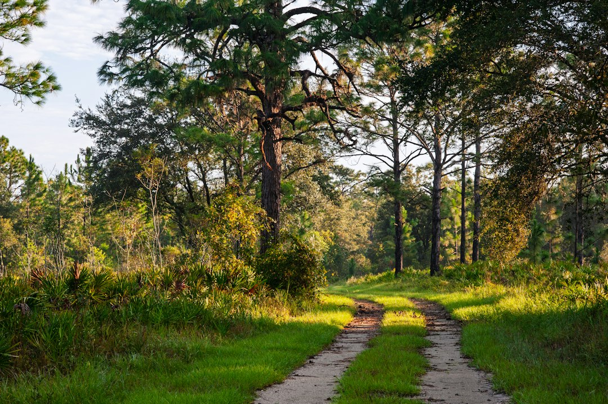
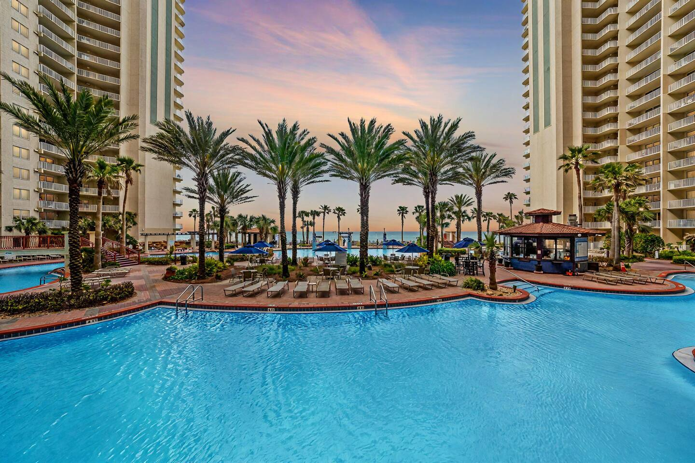
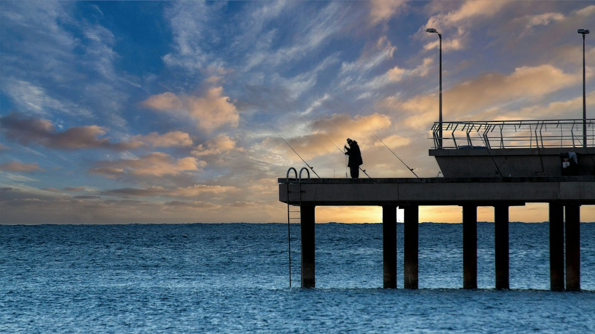
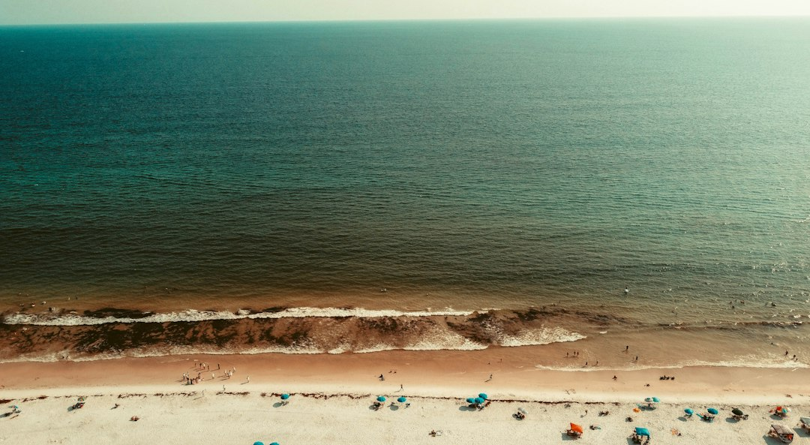
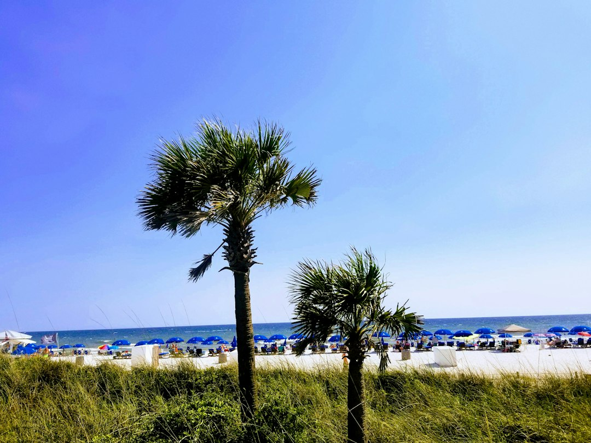
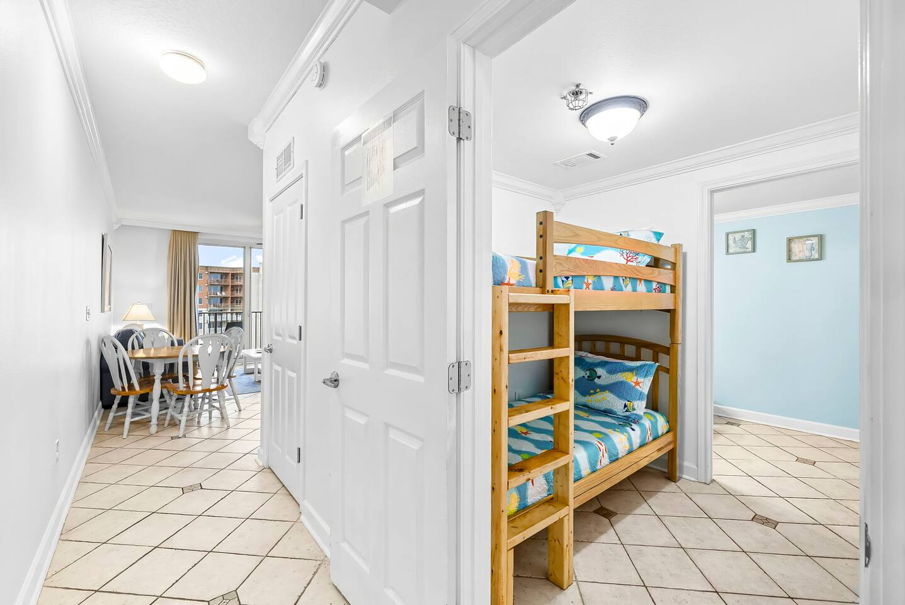

Everyone knows Panama City Beach for its 27 miles of sugar-white sand and emerald water. But what if I told you that some of the area's most breathtaking experiences have nothing to do with sprawling out on a beach towel?

Just beyond the main strip lies a world of pristine nature preserves, rare coastal dune lakes, and thriving wildlife habitats. This is the PCB that many visitors miss—a quiet, wild, and utterly stunning side of the Emerald Coast. If you're looking to trade the crowds for the call of an osprey or the splash of a dolphin, this is your guide. Forget what you think you know; let's explore the *other* side of Panama City Beach.

### Table of Contents
*   [St. Andrews State Park: A Coastal Paradise](#st-andrews-state-park-a-coastal-paradise)
*   [Conservation Park: Your Gateway to Old Florida](#conservation-park-your-gateway-to-old-florida)
*   [Paddling Adventures: Kayaks, SUPs, and Coastal Dune Lakes](#paddling-adventures-kayaks-sups-and-coastal-dune-lakes)
*   [More Wild Encounters in PCB](#more-wild-encounters-in-pcb)
*   [Where to Refuel After Your Adventure](#where-to-refuel-after-your-adventure)
*   [Frequently Asked Questions](#frequently-asked-questions)

---

## St. Andrews State Park: A Coastal Paradise

If you only have time for one nature outing, make it St. Andrews State Park. This former military reservation at the eastern tip of PCB is a 1,200-acre wonderland that perfectly showcases Florida’s coastal ecosystems. It’s consistently ranked one of the best parks in the country, and for good reason. The key is knowing where to go once you're inside.

**Address**: [4607 State Park Ln, Panama City, FL 32408](https://www.google.com/maps/search/?api=1&query=4607+State+Park+Ln+Panama+City+FL+32408)

### The Jetties: Snorkeling, Fishing, and Dolphin Spotting

The rock jetties that form the St. Andrew Bay pass are the park's main attraction. They create a calm, protected swimming area that’s perfect for families. But the real magic is just below the surface. This is one of the best and most accessible snorkeling spots in the region.

*   **Local Tip**: For the clearest water, go at high tide when fresh Gulf water has pushed into the cove. You'll see everything from sheepshead and snapper to blue crabs and the occasional octopus. The jetties are also a prime spot to watch the fishing charters and shrimp boats head out, often followed by pods of playful dolphins.

### Gator Lake and Button Bush Marsh Overlook

Yes, there are alligators in Panama City Beach, and this is your best (and safest) place to see them. Take a short walk from the main parking area to the Gator Lake overlook—a raised wooden platform offering panoramic views of the small freshwater lake. You’ll often see gators sunning themselves on the banks. The nearby Button Bush Marsh trail is another fantastic spot for birdwatching, where you can spot herons, egrets, and ibis.

### Hiking and Biking Trails

While most people stick to the water, the park’s two inland trails are worth exploring.
*   **Heron Pond Trail**: A short, easy loop that takes you through a coastal pine forest to a peaceful freshwater pond.
*   **Sandy Point Trail**: A slightly longer trail that winds through scrub habitat and offers glimpses of the Grand Lagoon.

The paved park roads are also perfect for a leisurely bike ride, offering stunning views at every turn.

---

## Conservation Park: Your Gateway to Old Florida

Just a few miles from the bustling Pier Park is a 2,900-acre wilderness tract that feels a world away: Conservation Park. This protected wetland and pine forest is a haven for hikers, bikers, and birdwatchers, with over 24 miles of trails and a mile of boardwalks.

**Address**: [100 Conservation Dr, Panama City Beach, FL 32413](https://www.google.com/maps/search/?api=1&query=100+Conservation+Dr+Panama+City+Beach+FL+32413)

### What to Expect

The park is a massive cypress dome wetland, which means the boardwalk sections take you right over the swampy ground, offering an incredible, up-close look at this unique ecosystem. The rest of the trails are unpaved, wide, and well-marked, cutting through towering pine flatwoods. It’s mostly flat, making it accessible for all fitness levels.

### Trail Guide: Which Loop is Right for You?

The trails are organized into a series of interconnected loops, ranging from 0.6 miles to 11 miles.
*   **For a Quick Look**: The Cypress Pond Trail (Green Trail, 0.6 miles) is almost entirely boardwalk and gives you the quintessential Conservation Park experience in under 30 minutes.
*   **For a Good Walk**: The 4.5-mile Yellow Trail is a local favorite. It’s a perfect loop that offers a great mix of pine forest and wetland views without being an all-day commitment.
*   **For the Serious Hiker/Biker**: The 11-mile Red Trail is the longest and will take you to the most remote corners of the park.

**Pro Tip**: Go early in the morning or about an hour before sunset. The wildlife is most active then, and you'll avoid the brutal midday Florida sun. And whatever you do, *bring bug spray*. The mosquitos are no joke, especially in the warmer months.

---

## Paddling Adventures: Kayaks, SUPs, and Coastal Dune Lakes

Getting out on the water is one of the best ways to experience PCB’s natural beauty, and I’m not just talking about the Gulf. The calm backwaters of the bay and the area’s rare dune lakes offer incredible opportunities for exploration.

### Exploring Grand Lagoon

Nestled between St. Andrews State Park and the mainland, the Grand Lagoon provides miles of protected water perfect for kayaking and stand-up paddleboarding (SUP). You can launch from several points, including the state park itself. Paddle along the shores and you’re likely to see wading birds, schools of fish, and even dolphins who come into the lagoon to feed. Several local outfitters offer rentals if you don't have your own.

After a long day paddling the calm waters of Grand Lagoon, there's nothing better than coming back to a place with an unbeatable view. The perfect basecamp for balancing beach time with your nature excursions is a spot where you can easily access both. Our **[On the Beach | Ocean Views | Sleeps 6](https://book.springlinestays.com/property/beachfront-hot-tub-ocean-views-sleeps-6)** condo is just a short drive from the park, offering the perfect spot to relax on the balcony and watch the sunset over the Gulf.

### Lake Powell: A Rare Gem

Just on the western edge of PCB, bordering the 30A area, you'll find Lake Powell. This isn't just any lake—it's one of the world's rare coastal dune lakes. These unique bodies of water are found in only a handful of places on Earth, and they periodically exchange water with the Gulf of Mexico, creating a brackish ecosystem teeming with life. Rent a kayak or SUP from Camp Helen State Park and explore this incredible natural phenomenon. The water is often calm and crystal-clear, making it a peaceful escape.

---

## More Wild Encounters in PCB

Beyond the major parks, there are plenty of other ways to connect with nature during your Panama City Beach vacation.

### Eco-Friendly Dolphin Tours

There are dozens of dolphin tours to choose from, but it pays to pick the right one. Look for operators who are part of the "Dolphin SMART" program, which ensures they follow responsible viewing practices that don't disturb the animals. A sunset cruise where you can watch dolphins play in the boat's wake is a truly magical experience and a must-do for any things to do in Panama City Beach list.

### Gulf World Marine Park

While not a "wild" encounter, Gulf World Marine Park is a fantastic place to learn about the local marine life you might see in the Gulf. It's an especially great stop for families. The daily shows with dolphins and sea lions are entertaining, but the real value is in the educational exhibits on sea turtles, sharks, and penguins.

**Address**: [15412 Front Beach Rd, Panama City Beach, FL 32413](https://www.google.com/maps/search/?api=1&query=15412+Front+Beach+Rd+Panama+City+Beach+FL+32413)

### Fishing from Russell-Fields Pier

Commonly known as the Pier Park pier, this 1,500-foot concrete structure juts deep into the Gulf of Mexico, giving you access to incredible fishing without needing a boat. You can rent gear and buy bait right at the pier entrance. Depending on the season, you can catch everything from Spanish mackerel and king mackerel to redfish and flounder. Even if you don't fish, it's worth paying the small "walker's fee" to stroll to the end for an unparalleled view of the coastline.

---

## Where to Refuel After Your Adventure

After a day of hiking or paddling, you’ll need a good meal. While PCB has no shortage of fine dining, sometimes you just want a casual spot with a great vibe where you can show up in your hiking shorts.

### Finn's Island Style Grub

This place is a local institution. Operating out of a small shack and a food truck, Finn's serves up some of the best tacos, burritos, and acai bowls in town. Everything is fresh and made to order. My go-to is the Ahi Tuna Tacos. Grab your food and find a spot at one of the picnic tables.

**Address**: [7220 Thomas Dr, Panama City Beach, FL 32408](https://www.google.com/maps/search/?api=1&query=7220+Thomas+Dr+Panama+City+Beach+FL+32408)

### Patches Pub & Grill

Slightly off the beaten path on the east end of the beach, Patches is a true local's hangout known for its fantastic pizza and laid-back atmosphere. It's the perfect no-frills spot to grab a cold beer and a hot pie after a long day in St. Andrews State Park. Their "Garbage" pizza is legendary.

**Address**: [4723 Thomas Dr, Panama City, FL 32408](https://www.google.com/maps/search/?api=1&query=4723+Thomas+Dr+Panama+City+FL+32408)

---

## Frequently Asked Questions

### What is the best time of year to explore nature in Panama City Beach?
While PCB is a year-round destination, the best times for hiking and exploring the parks are fall (October-November) and spring (March-May). The weather is milder, humidity is lower, and the bugs are less intense.

### Can you see alligators in Panama City Beach?
Yes, absolutely. The freshwater lakes and marshes in St. Andrews State Park and the wetlands of Conservation Park are prime habitats for American alligators. Always view them from a safe distance on designated trails and overlooks, and never feed them.

### Are the parks in PCB family-friendly?
Yes, very. St. Andrews State Park has calm swimming areas, picnic pavilions, and easy walking trails. Conservation Park offers short, flat boardwalk trails that are perfect for little legs. It's a great way to introduce kids to Florida's natural environment.

### What should I pack for hiking in Panama City Beach?
Even for a short hike, essentials include plenty of water, sunscreen, a hat, and insect repellent. Closed-toe shoes are highly recommended to protect against roots, rocks, and critters. Binoculars are also great for birdwatching and wildlife spotting.

---

Panama City Beach truly offers the best of both worlds. You can spend your morning on one of the world's most beautiful beaches and your afternoon exploring a pristine wilderness that feels untouched by time. So next time you're planning your trip, leave a little room in your itinerary to discover the other side of PCB.

Ready to explore the wild side of the Emerald Coast? The perfect adventure starts with the perfect home base. **[Book your Panama City Beach vacation rental directly with Springline Stays](https://www.springlinestays.com)** for the best rates, local service, and a stay you won't forget.

*Panama City Beach — a must-visit near our Panama City Beach properties.*

*St. Andrews State Park — a must-visit near our Panama City Beach properties.*

*[On the Beach | Ocean Views | Sleeps 6 — Book your stay →](https://book.springlinestays.com/property/beachfront-hot-tub-ocean-views-sleeps-6)*
