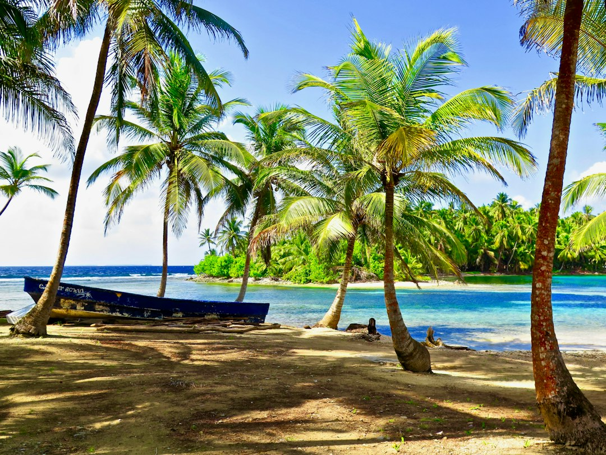
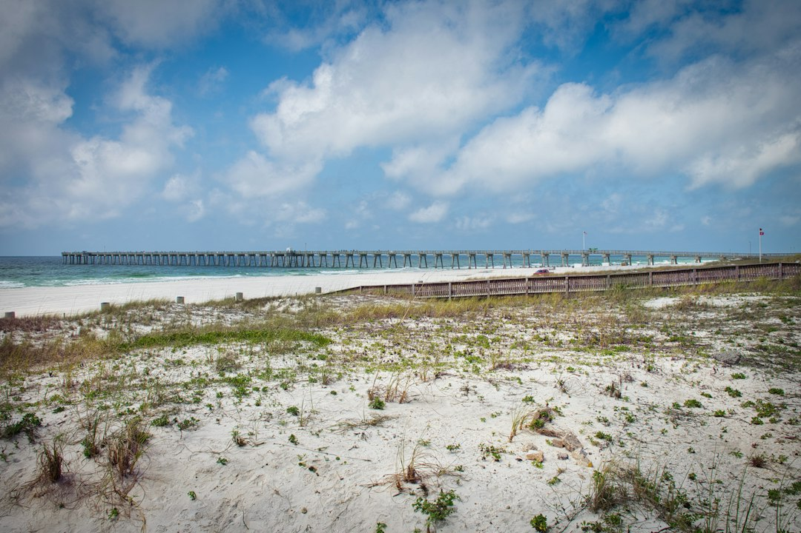
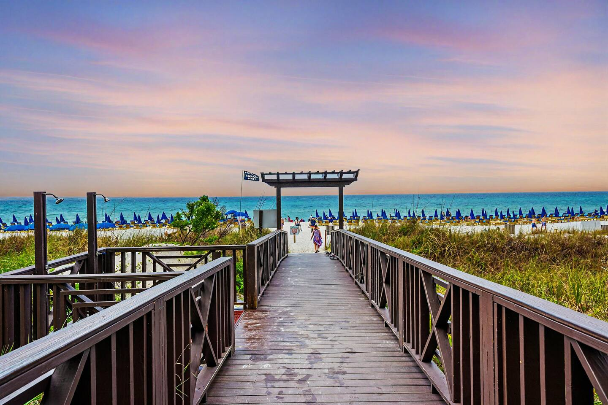

So you've got a weekend trip to Panama City Beach on the calendar. Forget the endless lists of "101 things to do" that leave you more stressed than excited. You don't need a thousand options; you need the *right* options. This is the plan—a curated, tried-and-true 72-hour guide to experiencing the best of PCB, from the can't-miss icons to the spots only locals know about.

We're skipping the tourist traps and focusing on a weekend that balances pure beach relaxation with genuine local flavor and a touch of adventure. Ready? Let's dive in.

### Table of Contents
- [Day 1: Arrival, Pier Park, and West End Sunsets](#day-1-arrival-pier-park-and-west-end-sunsets)
- [Day 2: Coastal Parks and Marine Wonders](#day-2-coastal-parks-and-marine-wonders)
- [Day 3: Nature Trails and a Sweet Farewell](#day-3-nature-trails-and-a-sweet-farewell)
- [Panama City Beach Weekend Itinerary FAQ](#panama-city-beach-weekend-itinerary-faq)

## Day 1: Arrival, Pier Park, and West End Sunsets

### Afternoon: Settle In and Hit the Sand

The second you arrive in PCB, the goal is to get your toes in that sugar-white sand as quickly as possible. Don't waste time unpacking every last thing. Drop your bags, change into your swimsuit, and head straight for the shore.

This is where choosing the right place to stay makes all the difference. If you're staying somewhere with direct beach access, you can go from car to coast in under five minutes. For a small group or family, a beachfront spot like our **[On the Beach | Ocean Views | Sleeps 6](https://book.springlinestays.com/property/beachfront-hot-tub-ocean-views-sleeps-6)** condo means your backyard is literally the Gulf of Mexico. No packing up the car, no hunting for parking—just pure, instant beach bliss.

Spend a couple of hours soaking in the sun, listening to the waves, and letting the travel stress melt away. You've officially arrived.

### Late Afternoon: Explore Pier Park

Once you’ve had your initial beach fix, it’s time to explore PCB’s vibrant hub: Pier Park. This isn't your average strip mall; it’s a massive outdoor complex with shops, restaurants, and entertainment venues stretching from Highway 98 all the way to the beach.

- **The Pier:** The main attraction is the Russell-Fields Pier itself. It costs about $4 per person to walk out on it, and it's worth every penny. Stroll to the end for an incredible panoramic view of the coastline. You’ll see fishermen reeling in their catch, pelicans dive-bombing for snacks, and often dolphins or sea turtles cruising by.

- **Shopping:** While you'll find big names, look for the local surf shops and boutiques. Ron Jon Surf Shop is a classic for a reason, but also check out smaller spots for unique souvenirs that aren't mass-produced.

- **Pre-Dinner Treat:** Skip the chain coffee shops and grab a sweet treat at The Yard Milkshake Bar. Their over-the-top milkshakes are a meal in themselves and incredibly photogenic.

### Dinner: Casual Eats on the West End

After walking around Pier Park, you'll be ready for a laid-back dinner. Avoid the long waits at the big tourist-centric restaurants. Instead, head just a few minutes west to a local favorite, **Salty Sue's** ([17501 Panama City Beach Pkwy](https://www.google.com/maps/search/?api=1&query=17501+Panama+City+Beach+Pkwy+Panama+City+Beach+FL)).

It might look unassuming from the outside, but it’s a powerhouse of delicious, unpretentious food. While they're known for their fantastic BBQ, their fried shrimp and grouper are just as good. It’s the perfect blend of surf and turf. My go-to order is the pulled pork sandwich with a side of their tangy coleslaw.

### Evening: Sunset Show

The perfect way to end your first day is by watching a world-class Gulf Coast sunset. You have two fantastic options:

1.  **From the Pier:** Head back to the Russell-Fields Pier. The view as the sun dips below the horizon, painting the sky in fiery colors, is breathtaking.
2.  **From Your Balcony:** If you booked a beachfront rental, there's nothing better than watching the sunset from the privacy of your own balcony with a cold drink in hand. It’s the ultimate way to unwind and soak in the beauty of Panama City Beach.

## Day 2: Coastal Parks and Marine Wonders

### Morning: Fuel Up Like a Local

Start your day with a trip to a place that’s a PCB institution: **Thomas Donut & Snack Shop** ([19208 Front Beach Rd](https://www.google.com/maps/search/?api=1&query=19208+Front+Beach+Rd+Panama+City+Beach+FL)). Located on the quieter west end of the beach, this family-owned spot has been serving up fresh, hot donuts for over 50 years.

**Local Tip:** The line can get long, especially on weekend mornings. The secret is to either go super early (before 8 AM) or send one person from your group to do a "donut run" while everyone else gets ready. Don't just get the glazed; their "Ugly" apple fritters and cake donuts are legendary. They also serve great breakfast sandwiches if you need something more substantial.

### Late Morning & Afternoon: St. Andrews State Park

Today is all about exploring one of Florida's most beautiful and popular state parks. Located on the far east end of the beach, St. Andrews State Park is a must-visit. It’s about a 15-20 minute drive from the central part of PCB. Plan to spend at least half your day here. The entrance fee is $8 per vehicle.

Here’s how to make the most of it:

- **The Jetties:** This is the park's star attraction. A massive rock jetty separates the calm waters of St. George Sound from the open Gulf. It's an amazing spot for snorkeling (the water is usually crystal clear here), fishing, or just watching the boats navigate the pass. It's also one of the best places in PCB to spot dolphins.

- **The "Kiddie Pool":** Tucked behind the jetty is a shallow, protected lagoon with calm, clear water. It's the perfect spot for families with young children to swim and splash without worrying about waves.

- **Beach Time:** The Gulf-side beaches within the park are stunning and often feel a bit more natural and less crowded than the main stretches of PCB.

- **Shell Island Shuttle:** The park is the primary departure point for the official Shell Island Shuttle. If you want to explore that pristine, undeveloped barrier island, this is the easiest way to do it. (We have a whole guide on that adventure if you want to learn more!)

For lunch, pack a cooler with sandwiches and drinks. There are plenty of picnic tables scattered throughout the park, offering a scenic and affordable lunch break.

### Late Afternoon: Gulf World Marine Park

After cleaning up from your state park adventure, head to **Gulf World Marine Park** ([15412 Front Beach Rd](https://www.google.com/maps/search/?api=1&query=15412+Front+Beach+Rd+Panama+City+Beach+FL)). This is a fantastic activity for families or anyone who loves marine life.

You can see daily shows featuring dolphins, sea lions, and tropical birds. They also have fascinating indoor and outdoor exhibits with sharks, sea turtles, and penguins. The park is compact enough that you can see most of it in just a couple of hours, making it a perfect late-afternoon activity before dinner.

### Dinner: A Taste of Old Florida

For dinner, experience a different side of PCB dining at **Captain Anderson's Restaurant & Waterfront Market** ([5551 N Lagoon Dr](https://www.google.com/maps/search/?api=1&query=5551+N+Lagoon+Dr+Panama+City+Beach+FL)). This isn't a trendy new spot; it's a classic that has been serving incredible seafood since 1967. Situated on the Grand Lagoon, you can watch the fishing fleet return with their daily catch while you dine.

The atmosphere is a bit more traditional, but the food is impeccable. They're famous for their "Grilled Bay Shrimp" and the "Classic Baked Scallops." It’s a great choice for a slightly more upscale, yet still relaxed, dining experience. Make reservations if you can, especially on a Saturday night.

## Day 3: Nature Trails and a Sweet Farewell

### Morning: A Walk on the Wild Side

Most people come to PCB for the beach, but they miss out on another incredible natural wonder: the **Panama City Beach Conservation Park** ([100 Conservation Dr](https://www.google.com/maps/search/?api=1&query=100+Conservation+Dr+Panama+City+Beach+FL)). This massive 2,900-acre park offers a complete change of scenery.

Here you’ll find miles of flat, easy-to-navigate trails and boardwalks that wind through cypress domes and pine flatwoods. It’s a paradise for bird watchers, and you might even spot an alligator sunning itself near the water. There are trails ranging from half a mile to over 11 miles, so you can choose a walk that fits your schedule.

**Pro-Tip:** Go early in the morning to beat the Florida heat and see the most active wildlife. And don't forget bug spray and a bottle of water! It’s a fantastic way to experience the quiet, natural beauty of the Panhandle before heading home.

### Lunch: One Last Iconic Meal

For your final meal, you have to grab a legendary grouper sandwich. Head to **Finn's Island Style Grub** ([7220 Thomas Dr](https://www.google.com/maps/search/?api=1&query=7220+Thomas+Dr+Panama+City+Beach+FL)). This place is all about fresh ingredients and chill vibes. They operate out of a food truck and a small storefront, with plenty of outdoor seating.

Their fish tacos are incredible, but the Ahi Tuna Poke Bowl is my personal favorite—it's light, fresh, and full of flavor. It's the perfect final taste of the coast.

### Afternoon: Last Call for the Beach

Before you hit the road, take one last walk on the beach. Collect a few shells, take a final picture, and breathe in that salty air. It's always tough to say goodbye to the view, especially when you've been waking up to the sound of the waves right outside your window at a place like the **[On the Beach condo](https://book.springlinestays.com/property/beachfront-hot-tub-ocean-views-sleeps-6)**.

Grab a coffee for the road from a local spot like The Pour. It's a small gesture that makes the drive home a little more bearable and supports a great local business.

This itinerary is just a starting point, a framework for a perfect weekend. The real magic of a Panama City Beach vacation rental is having the freedom to mix and match, to sleep in one day and get up for the sunrise the next.

## Panama City Beach Weekend Itinerary FAQ

### What is the best month to visit Panama City Beach?
While summer is the most popular time, the sweet spots are late spring (April-May) and early fall (September-October). During these months, the weather is fantastic, the water is warm, and the crowds are much smaller than in June and July. You'll find better deals on accommodations and more room to spread out on the sand.

### Is 3 days enough for Panama City Beach?
Absolutely! While you could easily spend a week or more here, a 3-day weekend is the perfect amount of time to experience the highlights. This itinerary shows you can enjoy the beach, explore a state park, eat at fantastic local restaurants, and even squeeze in a nature hike without feeling rushed. It's an ideal getaway for a long weekend.

### What is the least crowded part of Panama City Beach?
The West End of PCB, located west of Pier Park, is known for being much quieter and more residential. The beaches here are just as beautiful but attract more families and locals than the central areas near the big resorts and condos. If you're looking for a more relaxed and peaceful beach experience, this is where to find it.

### Can you walk around Pier Park?
Yes, Pier Park is designed to be a completely walkable outdoor complex. You can park your car once and easily spend hours walking between the shops, restaurants, the movie theater, and the pier itself. The entire area is pedestrian-friendly with wide sidewalks and crosswalks.

---

Ready to build your own perfect PCB weekend? This guide gives you the building blocks for an unforgettable trip. By planning ahead and choosing a great home base, you can spend less time searching and more time enjoying.

When you're ready to book, consider booking your Panama City Beach vacation rental directly with us at **[Springline Stays](https://www.springlinestays.com)**. You'll avoid the extra fees charged by third-party sites and get personalized service from people who know and love the area. We can't wait to host you!

*Shell Island — a must-visit near our Panama City Beach properties.*

*Conservation Park — a must-visit near our Panama City Beach properties.*

*[On the Beach | Ocean Views | Sleeps 6 — Book your stay →](https://book.springlinestays.com/property/beachfront-hot-tub-ocean-views-sleeps-6)*
