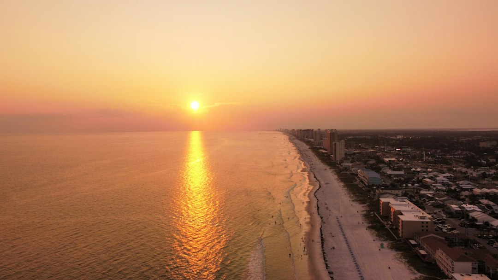
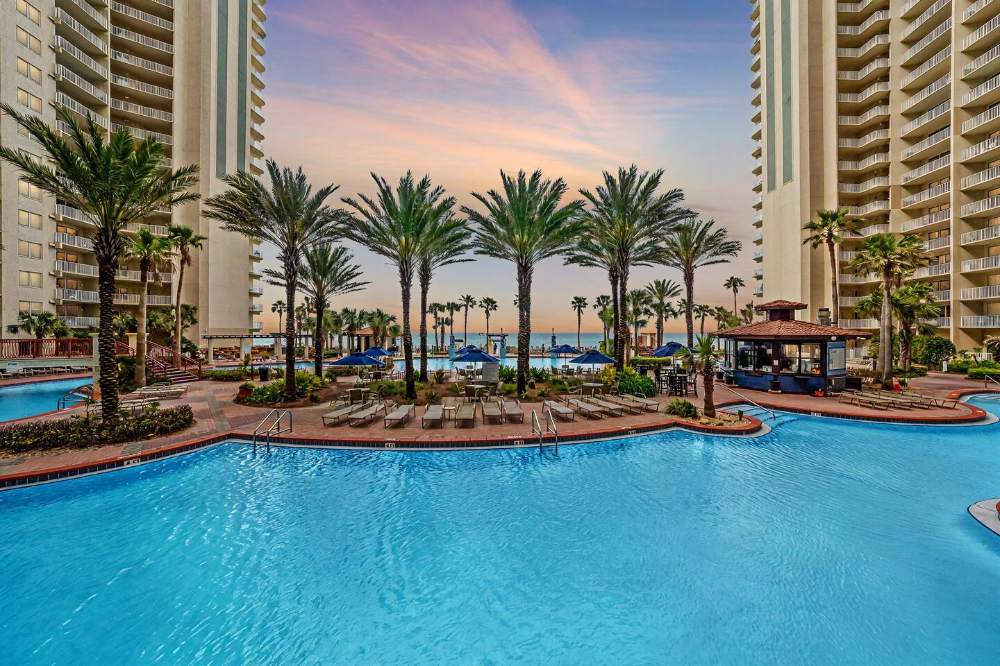
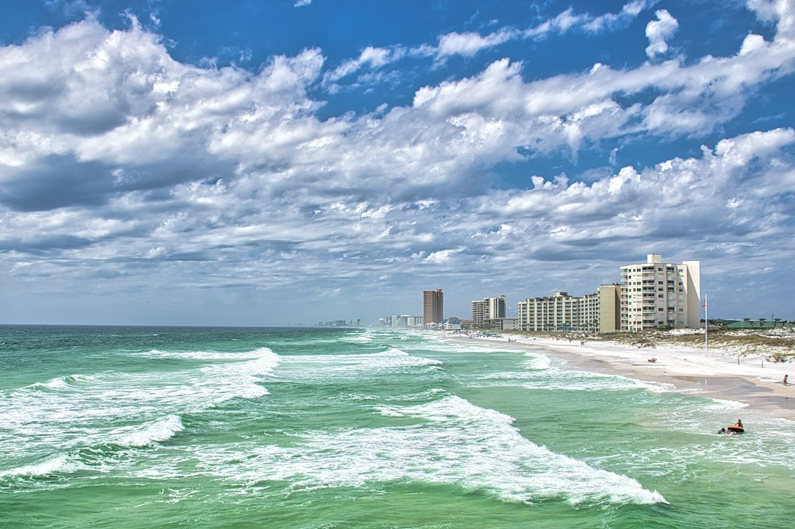
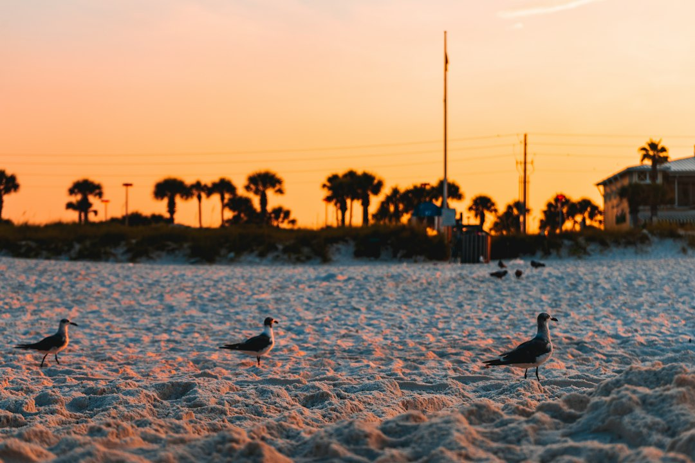

Everyone knows Panama City Beach boasts 27 miles of sugar-white sand, but here’s a secret: not all of those miles are created equal. The entire vibe of your vacation—from your morning coffee run to your sunset view—hinges on which part of that 27-mile stretch you choose as your home base.

Are you looking for a quiet, residential escape where the loudest sound is the surf? Or do you want to be in the heart of the action, with shops, restaurants, and attractions just steps from your door?

Choosing the right neighborhood can feel overwhelming, but it doesn't have to be. Let's break down the three main areas of Panama City Beach: the laid-back West End, the action-packed Central strip, and the nature-focused East End. By the end, you’ll know exactly where to plant your beach chair.

## Table of Contents
- [A Quick Guide to PCB's Layout](#a-quick-guide-to-pcbs-layout)
- [The West End: Quiet, Residential, and Close to 30A](#the-west-end-quiet-residential-and-close-to-30a)
- [Central Panama City Beach: The Heart of the Action](#central-panama-city-beach-the-heart-of-the-action)
- [The East End: For Nature Lovers and Local Vibes](#the-east-end-for-nature-lovers-and-local-vibes)
- [Which PCB Neighborhood Is Right for You? A Quick Summary](#which-pcb-neighborhood-is-right-for-you-a-quick-summary)
- [Frequently Asked Questions About Where to Stay in PCB](#frequently-asked-questions-about-where-to-stay-in-pcb)

## A Quick Guide to PCB's Layout
Before we dive in, let's get oriented. Panama City Beach is a long, narrow city that stretches east to west along the Gulf of Mexico. The two main arteries are Front Beach Road (which runs right along the coast) and Panama City Beach Parkway (also known as US-98 or Back Beach Road), which runs parallel but slightly inland.

For the most part, everything you want to see and do is located between these two roads or just off them. We'll use the iconic Pier Park as our central reference point. Anything west of it is the West End, anything east is the East End, and the area surrounding it is Central PCB. Simple.

## The West End: Quiet, Residential, and Close to 30A

### The Vibe
Drive west from Pier Park on Front Beach Road, and you'll notice an immediate shift. The towering high-rises give way to a charming mix of single-family beach houses, low-rise condos, and a more "Old Florida" feel. This is the West End. It's quieter, more residential, and the beaches are noticeably less crowded, even during peak season.

### Who It's For
The West End is perfect for families with younger children who need space to run without a huge crowd, or for couples seeking a more romantic and peaceful getaway. If your vacation goal is maximum relaxation and beach time without the hustle and bustle, this is your spot.

### Pros and Cons
**Pros:**
-   **Less Crowded Beaches:** This is the main draw. You can easily find a spot to spread out.
-   **Relaxed Atmosphere:** The pace is slower here.
-   **Proximity to 30A:** You're just a 10-15 minute drive from the start of the scenic 30A highway, with its famous communities like Rosemary Beach and Alys Beach—perfect for a day trip.

**Cons:**
-   **Fewer Walkable Options:** You'll likely need to drive to most restaurants, grocery stores, and major attractions.
-   **Limited Nightlife:** If you're looking for late-night bars and clubs, you'll find more options centrally.

### Hyper-Local West End Tips & Things to Do

-   **Morning Donuts at Thomas Donut & Snack Shop:** This place is a PCB institution, and it’s right on the West End. Get there early. I'm not kidding. The line can wrap around the building, but the glazed donuts and breakfast biscuits are worth every second of the wait. My personal favorite is the red velvet donut. Their address is [19208 Front Beach Rd, Panama City Beach, FL 32413](https://www.google.com/maps/search/?api=1&query=19208+Front+Beach+Rd+Panama+City+Beach+FL+32413).

-   **Explore Conservation Park:** Looking for things to do in Panama City Beach that don't involve sand? Head just north of Front Beach Road to the Panama City Beach Conservation Park. With over 24 miles of trails, it's a fantastic spot for a morning hike or bike ride. The trails are flat and well-marked, making it great for all fitness levels.

-   **Dinner with a View at The Back Porch Seafood & Oyster House:** While there are many Back Porch locations, the one on the West End ([16220 Front Beach Rd](https://www.google.com/maps/search/?api=1&query=16220+Front+Beach+Rd+Panama+City+Beach+FL+32413)) has some of the best sunset views, right on the sand. It's more relaxed than its central counterparts.

## Central Panama City Beach: The Heart of the Action

### The Vibe
This is the Panama City Beach you've likely seen on postcards. It's a vibrant hub of activity, defined by gleaming condominium towers, bustling beach bars, and an endless list of attractions. The energy here is palpable, with something always happening day or night. The undisputed center of this area is Pier Park.

### Who It's For
Central PCB is ideal for first-time visitors, families with teenagers, and groups of friends who want to be in the middle of it all. If your idea of a perfect vacation involves walking to dinner, shopping until you drop, and having tons of entertainment options at your fingertips, you'll love it here.

### Pros and Cons
**Pros:**
-   **Walkability:** Many condos are within walking distance of Pier Park's shops, restaurants, and the SkyWheel.
-   **Endless Entertainment:** From Gulf World Marine Park to arcades and movie theaters, you'll never be bored.
-   **Variety of Dining:** You'll find everything from quick-service eats to upscale dining.

**Cons:**
-   **Crowds:** This is the busiest part of PCB, especially during spring break and summer.
-   **Traffic:** Front Beach Road can get congested during peak times.

### Hyper-Local Central PCB Tips & Things to Do

-   **Mastering Pier Park:** Pier Park is a massive outdoor shopping and entertainment complex. Don't just stick to the main drag. Explore Pier Park North across the parkway for bigger stores like Target and Dick's Sporting Goods. The secret to parking is to try the lots behind the main storefronts first; they often have more space. The main address to navigate to is [600 Pier Park Dr, Panama City Beach, FL 32413](https://www.google.com/maps/search/?api=1&query=600+Pier+Park+Dr+Panama+City+Beach+FL+32413).

-   **Walk the Russell-Fields Pier:** It costs a few dollars to walk out onto the pier (and more to fish), but the perspective is incredible. You can see far down the coastline, spot dolphins and sea turtles, and watch fishermen reel in their catch. It’s one of the best spots for a sunset photo.

-   **Find Your Perfect Home Base:** Being central means your Panama City Beach vacation rental becomes a crucial retreat from the buzz. You want a place with a great view where you can relax and recharge. If being in the heart of the action with a stunning ocean view is your goal, you can't beat a spot like the **[On the Beach | Ocean Views | Sleeps 6](https://book.springlinestays.com/property/beachfront-hot-tub-ocean-views-sleeps-6)**. Imagine waking up, grabbing your coffee, and stepping right out onto a balcony overlooking the Gulf, knowing Pier Park is just a short drive away. It's the perfect home base for a family or group of friends who want to be close to everything without sacrificing comfort and killer views.

## The East End: For Nature Lovers and Local Vibes

### The Vibe
The East End offers a fantastic balance. It's not as sleepy as the West End, but it's noticeably more laid-back than the central strip. This area is anchored by the magnificent St. Andrews State Park and is popular with boaters, fishermen, and anyone who loves to mix their beach time with a bit of nature. You'll find a mix of classic condos, local neighborhoods, and some of the best-loved restaurants in town.

### Who It's For
This area is perfect for nature enthusiasts, boaters, and families who want access to amenities but prefer a slightly more relaxed environment. If your dream Panama City Beach travel guide includes kayaking, exploring undeveloped islands, and watching boats pass through the channel, the East End is calling your name.

### Pros and Cons
**Pros:**
-   **St. Andrews State Park:** This is a world-class park with pristine beaches, jetties for fishing, and calm "kiddie pool" areas.
-   **Access to Shell Island:** Most shuttle boats and tours to the famous Shell Island depart from marinas on the East End.
-   **Strong Local Flavor:** This area is home to many beloved local restaurants and less-touristy spots.

**Cons:**
-   **Further from Pier Park:** It's about a 15-20 minute drive to the central shopping and entertainment hub.
-   **Can Feel Older:** Some parts of the East End feature older, more classic Florida architecture, which can be a pro or a con depending on your taste.

### Hyper-Local East End Tips & Things to Do

-   **Don't Miss St. Andrews State Park:** This isn't just a park; it's a destination. Pack a cooler and spend the entire day. The jetties are great for fishing and snorkeling (on a calm day), and the sheltered cove on the bay side is perfect for little kids. The address for your GPS is [4607 State Park Ln, Panama City, FL 32408](https://www.google.com/maps/search/?api=1&query=4607+State+Park+Ln+Panama+City+FL+32408). Pro tip: arrive early on summer weekends as the park can reach capacity.

-   **Catch the Shell Island Shuttle:** The official park shuttle leaves from inside St. Andrews and is the easiest way to get to this pristine, undeveloped barrier island. It's a must-do.

-   **Eat Like a Local at Andy's Flour Power:** For breakfast or brunch, this place is legendary. It feels like a bustling city cafe dropped onto a beach town. The omelets are fantastic, and the French toast is a work of art. It's located at [2629 Thomas Dr, Panama City, FL 32408](https://www.google.com/maps/search/?api=1&query=2629+Thomas+Dr+Panama+City+FL+32408). Expect a wait, but it moves quickly and is well worth it.

## Which PCB Neighborhood Is Right for You? A Quick Summary

Still on the fence? Here’s a quick cheat sheet:

-   **Choose the West End if:** You crave peace and quiet, want uncrowded beaches, and are traveling with small children or as a couple seeking relaxation.
-   **Choose Central PCB if:** It's your first visit, you want to be in the middle of the action, you love shopping and entertainment, and you prefer walking to driving.
-   **Choose the East End if:** You love state parks, boating, and fishing, you want to visit Shell Island, and you appreciate a more local, laid-back vibe with great food.

## Frequently Asked Questions About Where to Stay in PCB

### What is the best area to stay in Panama City Beach for families?
It depends on the age of your kids. For families with toddlers and young children, the quieter **West End** is often preferred for its less crowded beaches and more residential feel. For families with teenagers, **Central PCB** is a great choice because it puts them within walking distance of Pier Park, the movie theater, and other attractions.

### Is it better to stay in Panama City or Panama City Beach?
For a vacation, you almost certainly want to stay in **Panama City Beach (PCB)**. This is where you'll find the 27 miles of white-sand beaches, Gulf-front condos, and tourist attractions. Panama City (PC) is a separate, more traditional city across the bay with a historic downtown and residential neighborhoods.

### What is the least crowded part of Panama City Beach?
The **West End** is definitively the least crowded part of Panama City Beach. As you travel west on Front Beach Road past Pier Park, the density of high-rises decreases, leading to more open space on the sand. The beaches here feel much more private and serene.

### Can you walk around Panama City Beach?
Certain areas are very walkable, while the city as a whole is not. The area around **Pier Park in Central PCB** is designed for walking, with shops, restaurants, and the pier all accessible on foot. However, to get from one end of the city to the other (e.g., from the West End to St. Andrews State Park), you will absolutely need a car.

---

No matter which neighborhood you choose, Panama City Beach offers a slice of paradise for every type of traveler. The key is matching the area's personality to your own vacation style. Once you’ve picked your perfect spot, the only thing left to do is find the perfect place to call home.

Ready to plan your trip? Browse our curated selection of properties and **[book direct with Springline Stays](https://www.springlinestays.com)** to get the best rates and local service for your next Panama City Beach getaway.

*Conservation Park — a must-visit near our Panama City Beach properties.*

*[On the Beach | Ocean Views | Sleeps 6 — Book your stay →](https://book.springlinestays.com/property/beachfront-hot-tub-ocean-views-sleeps-6)*
